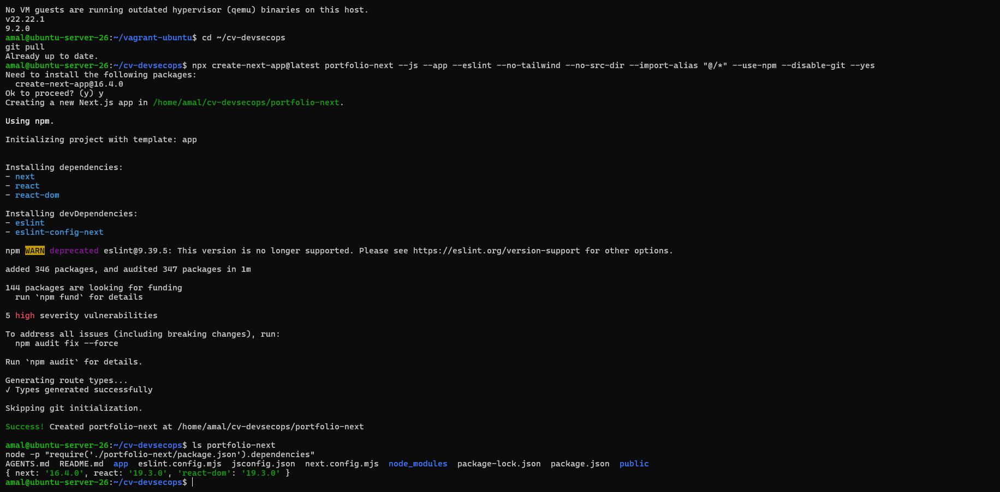
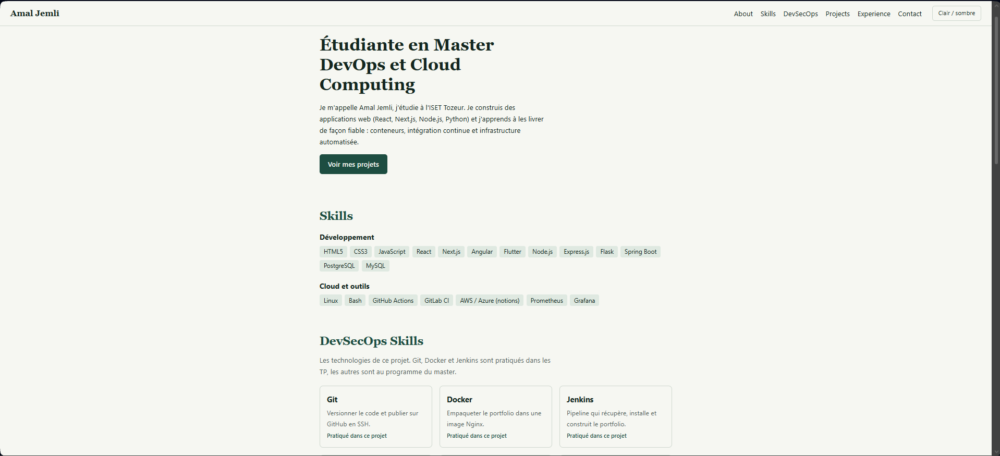
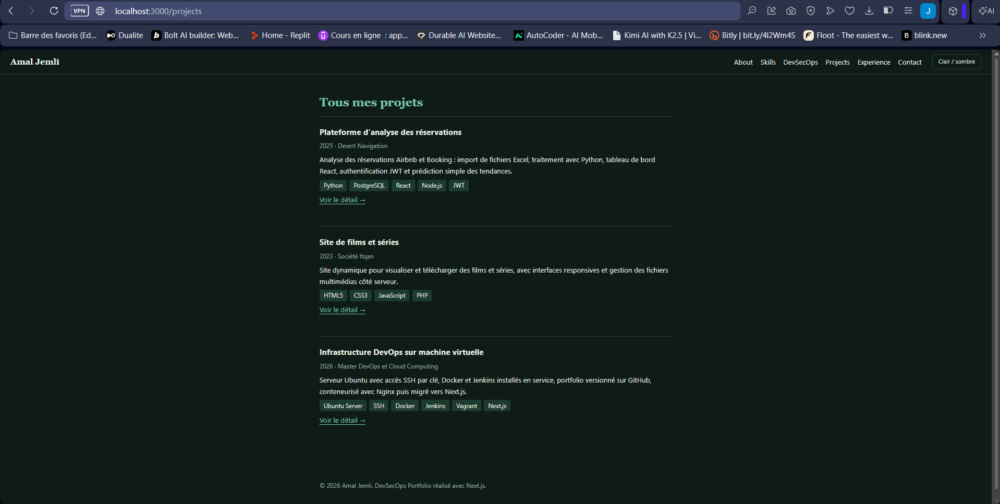
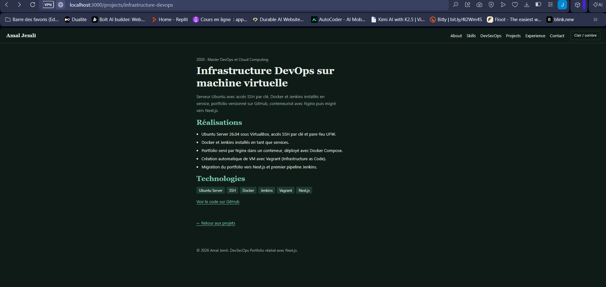

# Partie V – Migration du Portfolio vers Next.js

Le DevSecOps Portfolio (HTML/CSS/JavaScript) est recréé avec **Next.js 16** (App Router, JavaScript) dans le dossier [`portfolio-next/`](../portfolio-next) du dépôt.

## Prérequis : Node.js sur la VM

Next.js 16 demande Node.js 20.9 ou plus récent. Installation depuis les dépôts Ubuntu :

```bash
sudo apt update
sudo apt install -y nodejs npm
node -v   # v22.22.1
npm -v    # 9.2.0
```

## Étape 18 – Création du projet Next.js

Commande de création, lancée à la racine du dépôt `~/cv-devsecops` :

```bash
npx create-next-app@latest portfolio-next --js --app --eslint --no-tailwind --no-src-dir --import-alias "@/*" --use-npm --disable-git --yes
```

| Option | Rôle |
|---|---|
| `--js` | projet en JavaScript, comme la première version |
| `--app` | App Router : chaque dossier de `app/` devient une route |
| `--eslint` | analyse du code avec ESLint (`npm run lint`) |
| `--no-tailwind` | on garde la feuille de style du portfolio d'origine |
| `--import-alias "@/*"` | imports courts : `@/components/Header` au lieu de `../../components/Header` |
| `--disable-git` | pas de second dépôt Git : le projet est déjà dans `cv-devsecops` |
| `--yes` | aucune question interactive |



Compilation puis lancement de l'application, accessible depuis la machine physique sur `http://localhost:3000` (port 3000 ouvert dans UFW et redirigé dans VirtualBox) :

```bash
cd ~/cv-devsecops/portfolio-next
npm run build
npm run start -- -H 0.0.0.0 -p 3000
```

Toutes les sections de la version HTML sont conservées : **About, Skills, DevSecOps Skills, Projects, Experience, Contact**, ainsi que le thème clair / sombre.



## Étape 19 – Composants réutilisables

Chaque partie de la page est un composant React dans `components/`. La page d'accueil se contente de les assembler.

```
portfolio-next/
├── app/
│   ├── layout.js               # structure commune : <Header />, contenu, <Footer />
│   ├── page.js                 # accueil : assemble les sections
│   ├── globals.css             # styles du portfolio
│   └── projects/
│       ├── page.js             # route /projects
│       └── [slug]/page.js      # route /projects/<nom-du-projet>
├── components/
│   ├── Header.js               # navigation + bouton thème (composant client)
│   ├── About.js
│   ├── Skills.js
│   ├── DevSecOpsSkills.js
│   ├── Projects.js             # liste de projets
│   ├── ProjectCard.js          # carte d'un projet (réutilisée par Projects)
│   ├── Experience.js
│   ├── Contact.js
│   └── Footer.js
└── data/
    ├── projects.js
    ├── skills.js
    └── experience.js
```

Assemblage dans `app/page.js` :

```javascript
import About from "@/components/About";
import Skills from "@/components/Skills";
import DevSecOpsSkills from "@/components/DevSecOpsSkills";
import Projects from "@/components/Projects";
import Experience from "@/components/Experience";
import Contact from "@/components/Contact";

export default function Home() {
  return (
    <>
      <About />
      <Skills />
      <DevSecOpsSkills />
      <Projects />
      <Experience />
      <Contact />
    </>
  );
}
```

`Header` et `Footer` sont placés une seule fois dans `app/layout.js` et apparaissent donc sur toutes les pages. Le composant `Projects` est réutilisé sur l'accueil et sur `/projects`, avec un titre différent passé en paramètre (`<Projects titre="Tous mes projets" />`).

## Étape 20 – Données séparées

Le contenu (projets, compétences, expériences) est dans des fichiers JavaScript du dossier `data/`, séparés de l'affichage. Ajouter un projet revient à ajouter un objet au tableau, sans toucher aux composants.

Extrait de `data/projects.js` :

```javascript
export const projects = [
  {
    slug: "infrastructure-devops",
    titre: "Infrastructure DevOps sur machine virtuelle",
    periode: "2026 · Master DevOps et Cloud Computing",
    description: "Serveur Ubuntu avec accès SSH par clé, Docker et Jenkins installés en service, ...",
    details: [
      "Ubuntu Server 26.04 sous VirtualBox, accès SSH par clé et pare-feu UFW.",
      "Docker et Jenkins installés en tant que services.",
      // ...
    ],
    technologies: ["Ubuntu Server", "SSH", "Docker", "Jenkins", "Vagrant", "Next.js"],
    lien: "https://github.com/Amal356/cv-devsecops",
  },
  // ...
];

export function getProject(slug) {
  return projects.find((p) => p.slug === slug);
}
```

Extrait de `data/skills.js` :

```javascript
export const devsecopsSkills = [
  { nom: "Git", role: "Versionner le code et publier sur GitHub en SSH.", pratique: true },
  { nom: "Docker", role: "Empaqueter le portfolio dans une image Nginx.", pratique: true },
  { nom: "Jenkins", role: "Pipeline qui récupère, installe et construit le portfolio.", pratique: true },
  { nom: "Kubernetes", role: "Orchestrer des conteneurs.", pratique: false },
  // ...
];
```

Les composants importent ces données et les affichent avec `map()`, par exemple dans `components/Projects.js` :

```javascript
import { projects } from "@/data/projects";
import ProjectCard from "./ProjectCard";

export default function Projects({ titre = "Projects" }) {
  return (
    <section id="projects">
      <h2>{titre}</h2>
      {projects.map((p) => <ProjectCard key={p.slug} projet={p} />)}
    </section>
  );
}
```

## Étape 21 – Pages des projets

Avec l'App Router, les routes correspondent aux dossiers de `app/` :

| Route | Fichier | Contenu |
|---|---|---|
| `/projects` | `app/projects/page.js` | liste de tous les projets |
| `/projects/<slug>` | `app/projects/[slug]/page.js` | page dédiée à un projet |

`[slug]` est un segment dynamique. `generateStaticParams()` génère une page par projet au moment du build, et un slug inconnu renvoie une erreur 404 :

```javascript
export const dynamicParams = false;

export function generateStaticParams() {
  return projects.map((p) => ({ slug: p.slug }));
}

export default async function ProjectPage({ params }) {
  const { slug } = await params;
  const projet = getProject(slug);
  if (!projet) notFound();
  // ... affichage du titre, des réalisations et des technologies
}
```

Résultat de `npm run build` : les trois pages de projets sont générées à l'avance (●).

```
Route (app)
┌ ○ /
├ ○ /_not-found
├ ○ /projects
└   /projects/[slug]
  ├ ● /projects/analyse-reservations
  ├ ● /projects/site-films-series
  └ ● /projects/infrastructure-devops
```

Page `/projects` :



Page `/projects/infrastructure-devops` :


