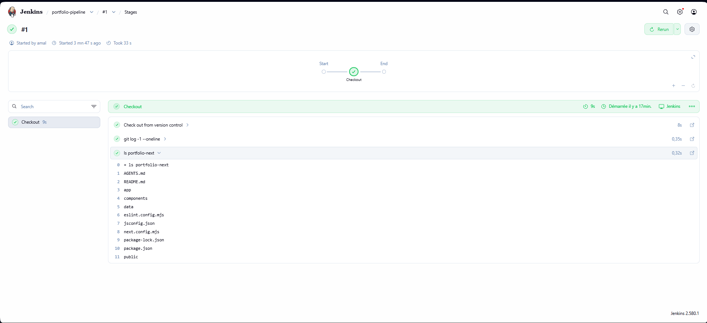
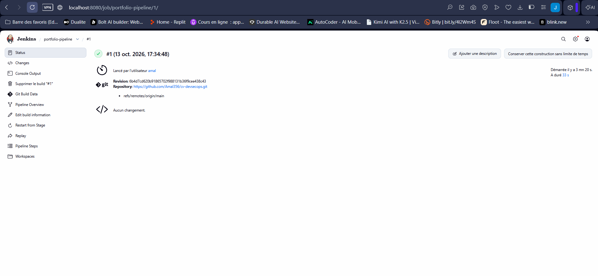
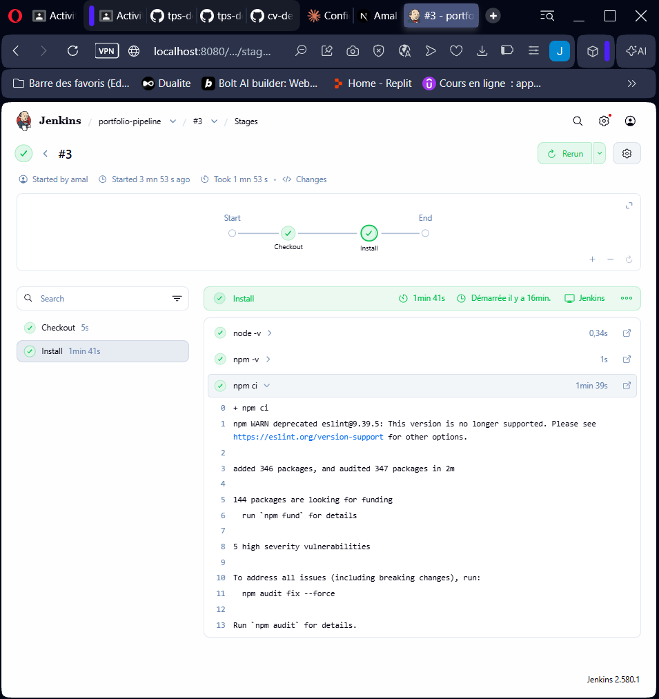
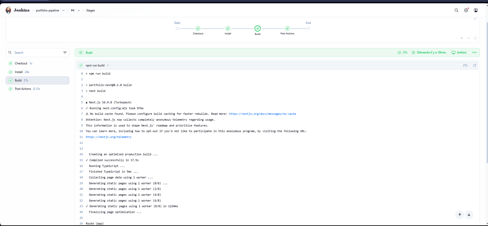
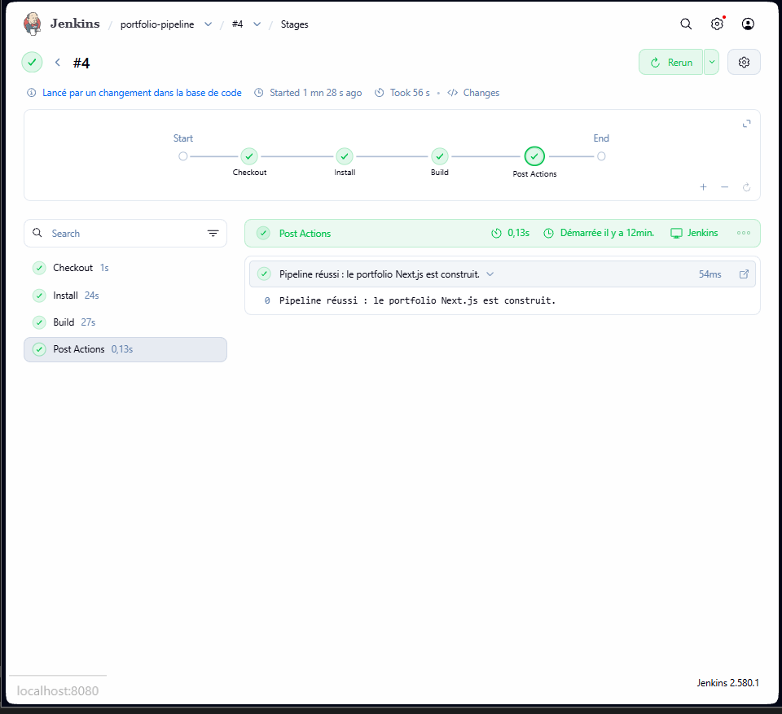

# Partie VI – Premier pipeline Jenkins

Le pipeline `portfolio-pipeline` récupère le dépôt GitHub, installe les dépendances du projet Next.js puis construit l'application. Il est décrit dans le fichier [`Jenkinsfile`](../Jenkinsfile) à la racine du dépôt (*Pipeline as Code*) : Jenkins le lit directement depuis GitHub.

Prérequis sur la VM : Jenkins installé en service (étape 4), Git, et Node.js 22 / npm installés pour la partie V (`sudo apt install -y nodejs npm`). Node.js étant installé pour tout le système, l'utilisateur `jenkins` peut lancer `node` et `npm` sans configuration supplémentaire.

## Création du job dans Jenkins

Depuis `http://localhost:8080` sur la machine physique :

1. **Nouveau Item** → nom `portfolio-pipeline` → type **Pipeline** → **OK**
2. Section **Pipeline** :

| Champ | Valeur |
|---|---|
| Definition | Pipeline script from SCM |
| SCM | Git |
| Repository URL | `https://github.com/Amal356/cv-devsecops.git` |
| Credentials | aucun (dépôt public) |
| Branch Specifier | `*/main` |
| Script Path | `Jenkinsfile` |

3. **Save**, puis **Lancer un build** pour le premier lancement.

Le Jenkinsfile a été construit en trois versions, une par question : chaque version ajoute un stage, est publiée avec `git push` et exécutée par Jenkins.

## Étape 22 – Récupération automatique du dépôt GitHub

Première version du Jenkinsfile, avec un seul stage `Checkout` :

```groovy
pipeline {
    agent any

    options {
        skipDefaultCheckout()
    }

    triggers {
        pollSCM('H/5 * * * *')
    }

    stages {
        stage('Checkout') {
            steps {
                checkout scm
                sh 'git log -1 --oneline'
                sh 'ls portfolio-next'
            }
        }
    }
}
```

- `agent any` : le pipeline s'exécute sur le serveur Jenkins de la VM.
- `checkout scm` : clone le dépôt et la branche configurés dans le job (`*/main`).
- `skipDefaultCheckout()` : désactive le checkout automatique de Jenkins, pour que la récupération du code apparaisse dans un stage dédié.
- `pollSCM('H/5 * * * *')` : toutes les 5 minutes, Jenkins vérifie s'il y a un nouveau commit sur GitHub et relance le pipeline si c'est le cas. Une VM en NAT n'est pas joignable depuis Internet : un *webhook* GitHub ne pourrait pas l'atteindre, d'où le choix du *polling*.

Build #1 : le stage Checkout récupère le dépôt et liste le projet Next.js.



Le build indique le dépôt, la branche `origin/main` et la révision récupérés :



## Étape 23 – Installation des dépendances

Stage ajouté au Jenkinsfile :

```groovy
stage('Install') {
    steps {
        dir('portfolio-next') {
            sh 'node -v'
            sh 'npm -v'
            sh 'npm ci'
        }
    }
}
```

- `dir('portfolio-next')` : les commandes s'exécutent dans le dossier du projet Next.js.
- `npm ci` plutôt que `npm install` : installation propre et reproductible, avec exactement les versions de `package-lock.json`. Le dossier `node_modules` n'est pas dans Git : le pipeline le recrée à chaque build.

Résultat : `added 346 packages`.



## Étape 24 – Build de l'application Next.js

Stage ajouté au Jenkinsfile :

```groovy
stage('Build') {
    steps {
        dir('portfolio-next') {
            sh 'npm run build'
        }
    }
}
```

`npm run build` lance `next build`, qui compile l'application et génère les pages statiques (`/`, `/projects` et une page par projet). Si le code contient une erreur, le stage passe au rouge et le pipeline échoue.



Ce build #4 a été **lancé automatiquement** après le `git push` du Jenkinsfile (« Lancé par un changement dans la base de code »), sans clic sur « Lancer un build » : c'est le `pollSCM` qui a détecté le nouveau commit. Les trois stages et les actions de fin sont au vert.



## Jenkinsfile final

```groovy
pipeline {
    agent any

    options {
        // On fait le checkout nous-mêmes dans le stage "Checkout"
        skipDefaultCheckout()
        // Un seul build à la fois
        disableConcurrentBuilds()
    }

    triggers {
        // Jenkins vérifie GitHub toutes les 5 minutes et relance le pipeline s'il y a un nouveau commit
        pollSCM('H/5 * * * *')
    }

    stages {
        stage('Checkout') {
            steps {
                checkout scm
                sh 'git log -1 --oneline'
                sh 'ls portfolio-next'
            }
        }

        stage('Install') {
            steps {
                dir('portfolio-next') {
                    sh 'node -v'
                    sh 'npm -v'
                    // npm ci installe exactement les versions de package-lock.json
                    sh 'npm ci'
                }
            }
        }

        stage('Build') {
            steps {
                dir('portfolio-next') {
                    // Compilation de l'application Next.js (dossier .next)
                    sh 'npm run build'
                }
            }
        }
    }

    post {
        success {
            echo 'Pipeline réussi : le portfolio Next.js est construit.'
        }
        failure {
            echo 'Pipeline en échec : voir le stage en rouge.'
        }
    }
}
```

- `disableConcurrentBuilds()` : empêche deux builds de tourner en même temps sur la VM (deux `npm ci` simultanés consomment beaucoup de mémoire).
- `post` : message affiché à la fin du pipeline selon le résultat.

Commandes Git utilisées pour publier chaque version :

```bash
git add Jenkinsfile
git commit -m "Jenkinsfile : stage Checkout du dépôt GitHub"   # puis "stage Install (npm ci)", puis "stage Build (npm run build)"
git push
```
