# Partie VII – Automatisation avec Ansible

Ansible configure des machines **à distance, par SSH, sans agent** à installer sur elles. On décrit l'état voulu dans un fichier YAML (*playbook*), et Ansible ne modifie que ce qui n'est pas déjà dans cet état.

Les fichiers sont dans le dossier [`ansible/`](../ansible) du dépôt.

## Architecture

| VM | Rôle | IP (réseau privé hôte) | Utilisateur | Création |
|---|---|---|---|---|
| `ansible-admin` | VM d'administration : Ansible y est installé | 192.168.56.20 | `vagrant` | Vagrant |
| `docker-vm` | nouvelle VM, Docker y est installé par Ansible | 192.168.56.30 | `vagrant` | Vagrant |
| `ubuntu-server-26` | serveur du TP (Docker, Jenkins, portfolio) | 192.168.56.40 | `amal` | installée à l'étape 1 |

Toutes les VM sont sur le **réseau privé hôte** VirtualBox `192.168.56.0/24`, qui leur permet de communiquer entre elles. Leur carte NAT (accès à Internet, redirections de ports vers Windows) ne change pas.

```
              ansible-admin (192.168.56.20)
              ansible all -m ping / ansible-playbook
                 │ SSH                 │ SSH
                 ▼                     ▼
  ubuntu-server-26 (.40)        docker-vm (.30)
```

### Création des deux nouvelles VM avec Vagrant

Vagrant est installé sous Windows avec VirtualBox (utilisé au TP précédent). Le fichier [`ansible/vagrant/Vagrantfile`](../ansible/vagrant/Vagrantfile) décrit les deux VM, avec une box **Ubuntu 24.04** :

```ruby
Vagrant.configure("2") do |config|
  config.vm.box = "bento/ubuntu-24.04"
  config.vm.boot_timeout = 600

  config.vm.define "ansible-admin" do |admin|
    admin.vm.hostname = "ansible-admin"
    admin.vm.network "private_network", ip: "192.168.56.20"
    # Port SSH fixe sur Windows (2222 est déjà utilisé par ubuntu-server-26)
    admin.vm.network "forwarded_port", guest: 22, host: 2201, id: "ssh"
    admin.vm.provider "virtualbox" do |vb|
      vb.name = "ansible-admin"
      vb.memory = 1024
      vb.cpus = 1
    end
    admin.vm.provision "shell", path: "scripts/cle-ssh-admin.sh"
  end

  config.vm.define "docker-vm" do |dvm|
    dvm.vm.hostname = "docker-vm"
    dvm.vm.network "private_network", ip: "192.168.56.30"
    dvm.vm.network "forwarded_port", guest: 22, host: 2202, id: "ssh"
    dvm.vm.provider "virtualbox" do |vb|
      vb.name = "docker-vm"
      vb.memory = 2048
      vb.cpus = 1
    end
    dvm.vm.provision "shell", path: "scripts/autoriser-admin.sh"
  end
end
```

Le provisionnement prépare la connexion SSH d'Ansible : sur `ansible-admin`, [`cle-ssh-admin.sh`](../ansible/vagrant/scripts/cle-ssh-admin.sh) génère une clé SSH et dépose la clé publique dans le dossier partagé `/vagrant` ; sur `docker-vm`, [`autoriser-admin.sh`](../ansible/vagrant/scripts/autoriser-admin.sh) l'ajoute à `~/.ssh/authorized_keys`. Ansible n'est **pas** installé par Vagrant : c'est l'étape 25.

Par défaut, Vagrant redirige le SSH de la première VM sur le port **2222** de Windows. Ce port est déjà celui d'`ubuntu-server-26` : les deux VM ont donc des ports SSH fixes, 2201 et 2202.

Lancement depuis PowerShell, dans le dossier du Vagrantfile :

```powershell
vagrant up
vagrant status
```

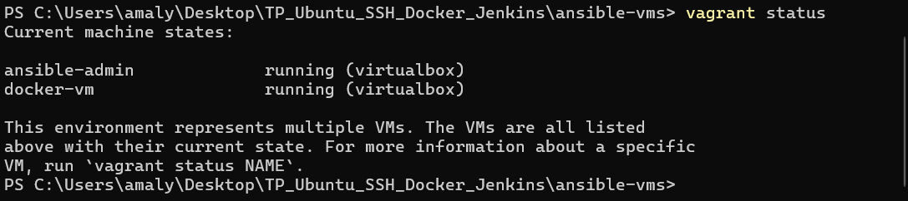

### Le serveur Ubuntu sur le réseau privé hôte

`ubuntu-server-26` reçoit une 2ᵉ carte réseau, sur la même interface VirtualBox que les VM Vagrant. Depuis PowerShell, VM éteinte :

```powershell
# nom de l'interface utilisée par Vagrant
VBoxManage showvminfo ansible-admin --machinereadable | findstr hostonlyadapter2
# hostonlyadapter2="VirtualBox Host-Only Ethernet Adapter #3"
VBoxManage modifyvm "ubuntu-server-26" --nic2 hostonly --hostonlyadapter2 "VirtualBox Host-Only Ethernet Adapter #3"
```

Dans la VM, la nouvelle carte s'appelle `enp0s8`. Elle reçoit une adresse fixe, dans `/etc/netplan/60-hostonly.yaml` :

```yaml
network:
  version: 2
  ethernets:
    enp0s8:
      dhcp4: false
      addresses: [192.168.56.40/24]
```

```bash
sudo chmod 600 /etc/netplan/60-hostonly.yaml
sudo netplan apply
ip -4 addr show enp0s8
sudo ufw allow from 192.168.56.20 to any port 22 proto tcp   # SSH depuis ansible-admin uniquement
```

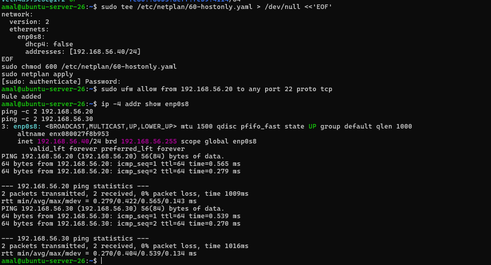

## Étape 25 – Installation d'Ansible sur la VM d'administration

Connexion à la VM d'administration, puis installation :

```bash
vagrant ssh ansible-admin
sudo apt update
sudo apt install -y ansible
ansible --version
```

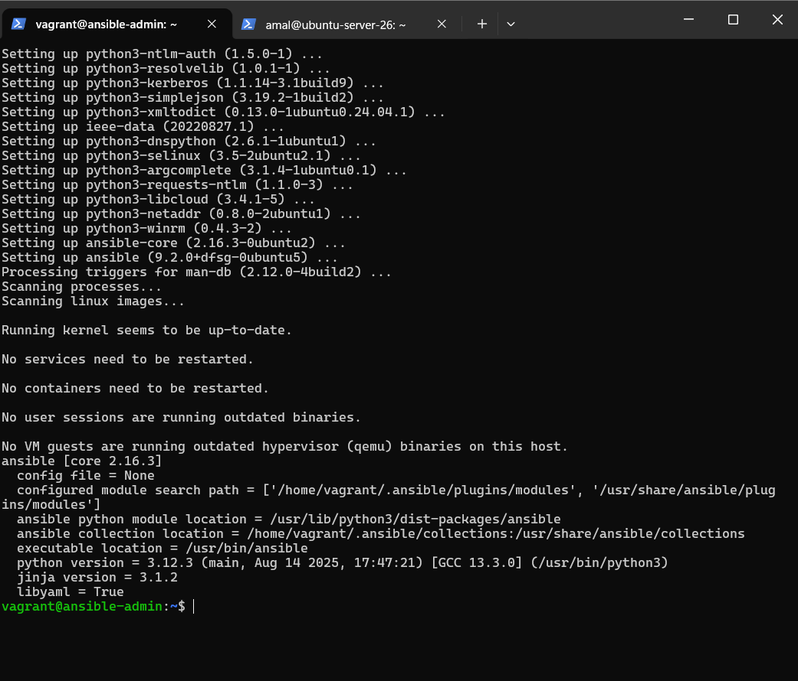

### Accès SSH aux machines gérées

Ansible se connecte par SSH avec la clé d'`ansible-admin`. Elle est déjà autorisée sur `docker-vm` (provisionnement Vagrant).

Sur `ubuntu-server-26`, l'authentification par mot de passe est désactivée depuis l'[étape 1](../01-ubuntu-ssh/README.md) : `ssh-copy-id` serait refusé. La clé **publique** d'`ansible-admin` (déposée par Vagrant dans `admin_id_ed25519.pub`, à côté du Vagrantfile) est donc ajoutée directement sur le serveur :

```bash
# sur ubuntu-server-26
echo "ssh-ed25519 AAAA...TrnUp ansible-admin" >> ~/.ssh/authorized_keys
```

Test depuis `ansible-admin` (à la première connexion, l'empreinte de chaque machine est acceptée avec `yes`) :

```bash
ssh amal@192.168.56.40 hostname
ssh vagrant@192.168.56.30 hostname
```

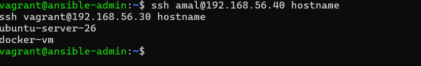

## Étape 26 – Inventaire et test de communication

Le dépôt est cloné sur `ansible-admin`, et les commandes sont lancées depuis son dossier `ansible/` :

```bash
git clone https://github.com/Amal356/cv-devsecops.git
cd cv-devsecops/ansible
```

`inventory.ini` – la liste des machines gérées, par groupe :

```ini
# Serveur Ubuntu du TP (Docker, Jenkins, portfolio)
[serveurs]
ubuntu-server ansible_host=192.168.56.40 ansible_user=amal ansible_become_exe=sudo.ws

# Nouvelle VM (créée par Vagrant) sur laquelle Ansible installe Docker
[docker_hosts]
docker-vm ansible_host=192.168.56.30 ansible_user=vagrant

[all:vars]
ansible_python_interpreter=/usr/bin/python3
```

- `ansible_user` : compte utilisé pour la connexion SSH, différent sur chaque machine ;
- `ansible_become_exe=sudo.ws` : sur Ubuntu 26.04, voir le problème rencontré à l'étape 27.

`ansible.cfg` – Ansible lit ce fichier dans le dossier courant, ce qui évite d'ajouter `-i inventory.ini` à chaque commande :

```ini
[defaults]
inventory = inventory.ini
callback_result_format = yaml
```

Test de communication :

```bash
ansible all -m ping
```

Le module `ping` d'Ansible se connecte en SSH à chaque machine et vérifie que Python y fonctionne. Chaque hôte répond `"ping": "pong"`.

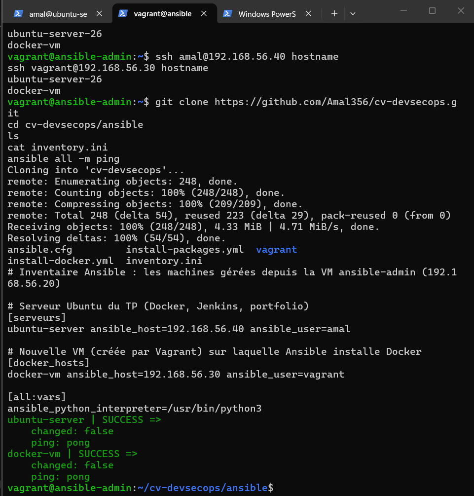

## Étape 27 – Premier playbook : installer des paquets

[`ansible/install-packages.yml`](../ansible/install-packages.yml) :

```yaml
- name: Installer des paquets de base
  hosts: all
  become: true          # les tâches s'exécutent avec sudo

  vars:
    paquets:
      - curl
      - git
      - tree

  tasks:
    - name: Mettre à jour la liste des paquets (apt update)
      ansible.builtin.apt:
        update_cache: true
        cache_valid_time: 3600

    - name: Installer curl, git et tree
      ansible.builtin.apt:
        name: "{{ paquets }}"
        state: present

    - name: Lire la version de git
      ansible.builtin.command: git --version
      register: version_git
      changed_when: false

    - name: Afficher la version de git
      ansible.builtin.debug:
        msg: "{{ inventory_hostname }} : {{ version_git.stdout }}"
```

- `hosts: all` : le playbook s'applique à toutes les machines de l'inventaire ;
- `become: true` : élévation des droits avec `sudo` ;
- `state: present` : le paquet doit être installé. S'il l'est déjà, Ansible ne fait rien (**idempotence**).

```bash
ansible-playbook install-packages.yml -K
```

`-K` (`--ask-become-pass`) demande le mot de passe `sudo` d'`amal` au lancement : il n'est écrit dans aucun fichier. (L'utilisateur `vagrant` de `docker-vm` a un `sudo` sans mot de passe.)

### Problème rencontré : `sudo-rs` sur Ubuntu 26.04

À la première exécution, `docker-vm` (Ubuntu 24.04) passe, mais `ubuntu-server` échoue dès la collecte des *facts* :

```
fatal: [ubuntu-server]: FAILED! =>
    msg: 'Timeout (12s) waiting for privilege escalation prompt: '
```

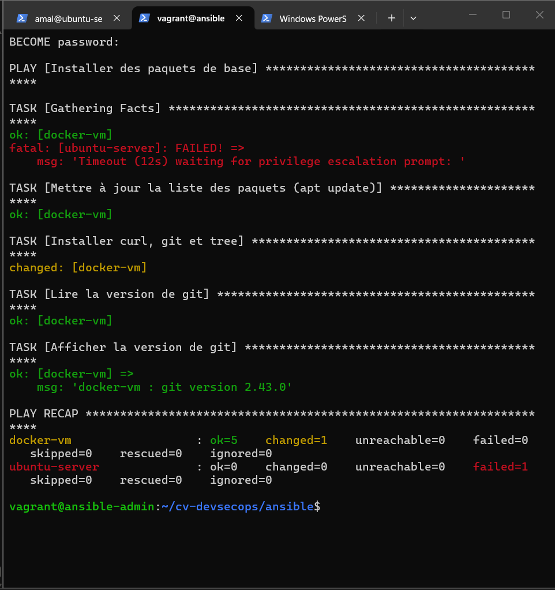

Ubuntu 26.04 utilise par défaut **`sudo-rs`**, une réécriture de `sudo` en Rust (`sudo --version` affiche `sudo-rs 0.2.13`). Ansible lance `sudo` avec un prompt de mot de passe personnalisé (option `-p`) et attend ce texte précis pour envoyer le mot de passe. `sudo-rs` affiche son propre prompt, `[sudo: authenticate] Password:`, qu'Ansible ne reconnaît pas : il attend jusqu'au délai maximal.

Le `sudo` classique reste installé sous le nom `sudo.ws`. La variable `ansible_become_exe=sudo.ws`, ajoutée à `ubuntu-server` dans l'inventaire, indique à Ansible de l'utiliser sur ce serveur uniquement.

```bash
sudo --version | head -1    # sudo-rs 0.2.13-0ubuntu1.2
which sudo.ws               # /usr/bin/sudo.ws
```

Après correction, le playbook passe sur les deux machines. `tree` est installé sur `ubuntu-server` (`changed`) ; sur `docker-vm`, il l'avait déjà été à la première tentative (`ok`) :

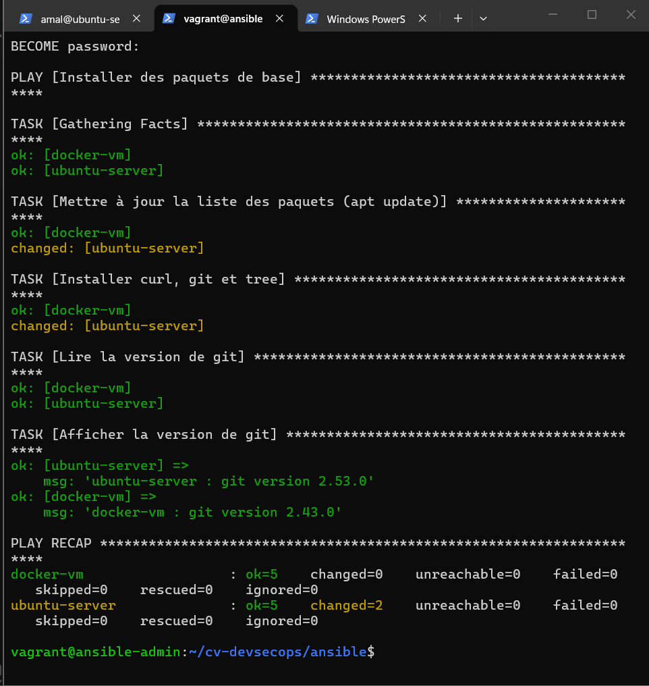

Deuxième exécution : toutes les tâches sont `ok` et `changed=0`. Les paquets sont déjà là, Ansible ne refait rien.

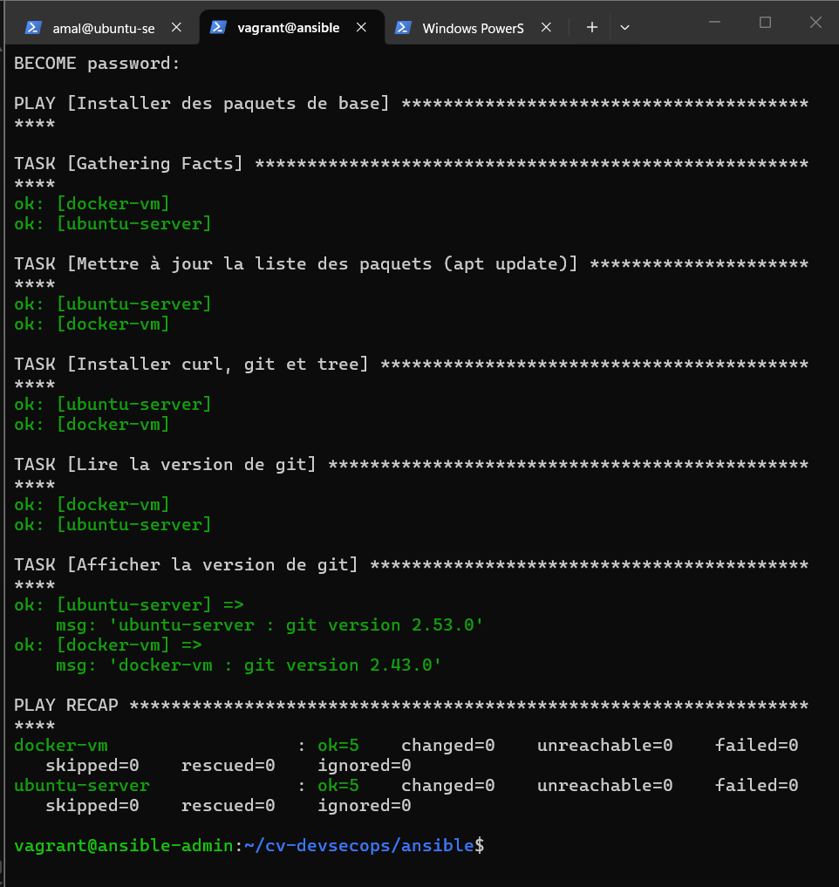

## Étape 28 – Playbook : installer Docker sur une nouvelle VM

`docker-vm` est une VM neuve, sans Docker (`docker: command not found`) :

```
vagrant@ansible-admin:~$ ssh vagrant@192.168.56.30 "hostname; docker --version"
docker-vm
bash: line 1: docker: command not found
```

[`ansible/install-docker.yml`](../ansible/install-docker.yml) reprend en tâches Ansible les commandes de l'[étape 3](../03-docker/README.md), faites à la main sur le premier serveur :

```yaml
- name: Installer Docker
  hosts: docker_hosts
  become: true

  vars:
    utilisateur_docker: "{{ ansible_user }}"   # vagrant sur docker-vm
    architecture:
      x86_64: amd64
      aarch64: arm64

  tasks:
    - name: Installer les prérequis
      ansible.builtin.apt:
        name:
          - ca-certificates
          - curl
          - python3-debian   # requis par le module deb822_repository
        state: present
        update_cache: true

    - name: Créer le dossier des clés APT
      ansible.builtin.file:
        path: /etc/apt/keyrings
        state: directory
        mode: "0755"

    - name: Télécharger la clé GPG officielle de Docker
      ansible.builtin.get_url:
        url: https://download.docker.com/linux/ubuntu/gpg
        dest: /etc/apt/keyrings/docker.asc
        mode: "0644"

    - name: Ajouter le dépôt officiel Docker
      ansible.builtin.deb822_repository:
        name: docker
        types: deb
        uris: https://download.docker.com/linux/ubuntu
        suites: "{{ ansible_facts['distribution_release'] }}"
        components: stable
        architectures: "{{ architecture[ansible_facts['architecture']] }}"
        signed_by: /etc/apt/keyrings/docker.asc

    - name: Installer Docker Engine et le plugin Compose
      ansible.builtin.apt:
        name:
          - docker-ce
          - docker-ce-cli
          - containerd.io
          - docker-buildx-plugin
          - docker-compose-plugin
        state: present
        update_cache: true

    - name: Démarrer Docker et l'activer au démarrage
      ansible.builtin.service:
        name: docker
        state: started
        enabled: true

    - name: Autoriser l'utilisateur à lancer docker sans sudo
      ansible.builtin.user:
        name: "{{ utilisateur_docker }}"
        groups: docker
        append: true

    - name: Lire la version de Docker
      ansible.builtin.command: docker --version
      register: version_docker
      changed_when: false

    - name: Afficher le résultat de docker --version
      ansible.builtin.debug:
        msg: "{{ version_docker.stdout }}"
```

- `ansible_facts['distribution_release']` : nom de code de la version d'Ubuntu, détecté par Ansible (comme `$VERSION_CODENAME` dans la commande manuelle) ;
- `deb822_repository` : ajoute le dépôt au format `.sources` utilisé par les versions récentes d'Ubuntu. Ce module a besoin de la bibliothèque Python `python3-debian` sur la machine gérée : sans elle, la première exécution s'arrêtait sur `No module named 'debian'`. Le paquet est donc installé avec les prérequis ;
- `append: true` : ajoute le groupe `docker` sans retirer les autres groupes de l'utilisateur.

```bash
ansible-playbook install-docker.yml -K
```

Première exécution, avant l'ajout de `python3-debian` aux prérequis : l'ajout du dépôt échoue.

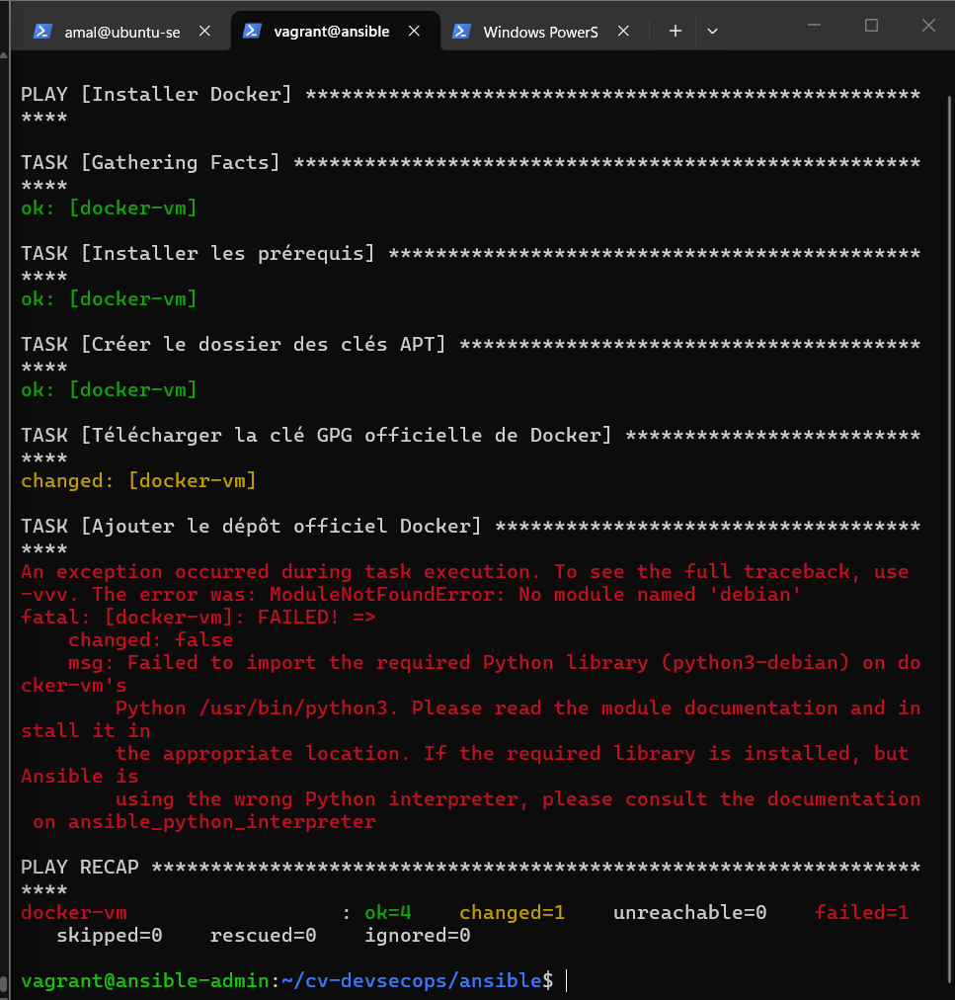

Après correction, Docker est installé : la dernière tâche affiche `Docker version 29.9.1`.

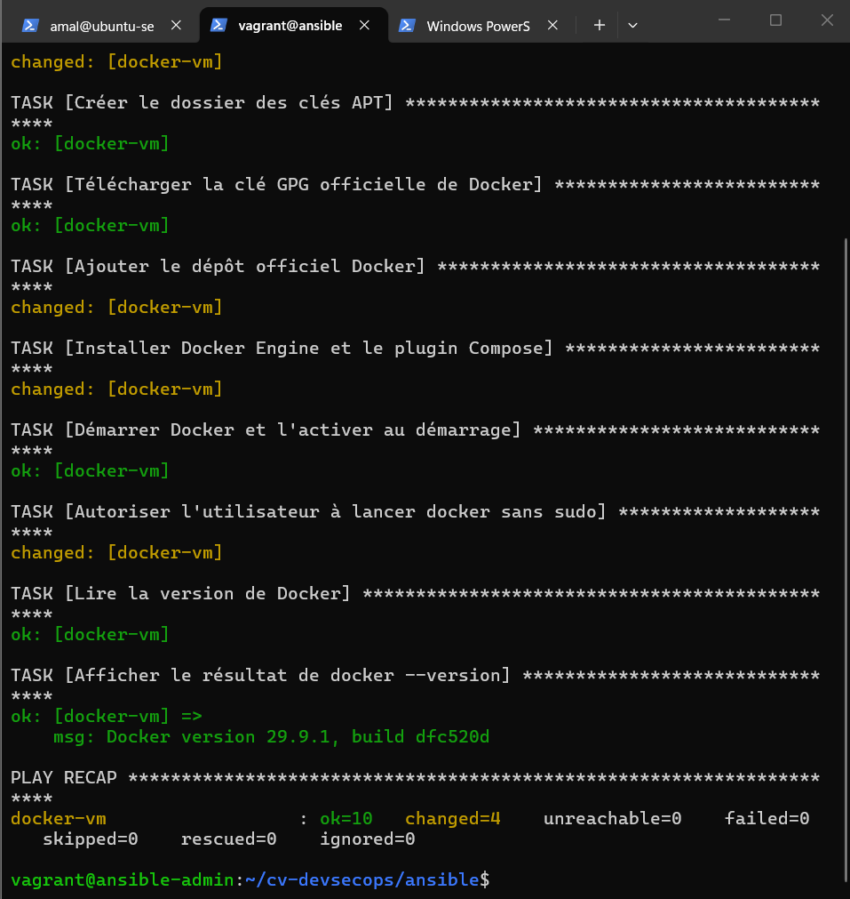

Vérification sur la VM, et à distance depuis `ansible-admin` :

```bash
docker --version
ansible docker_hosts -a "docker --version"
```

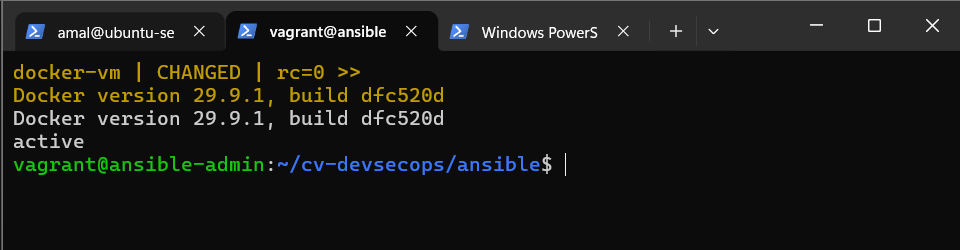
