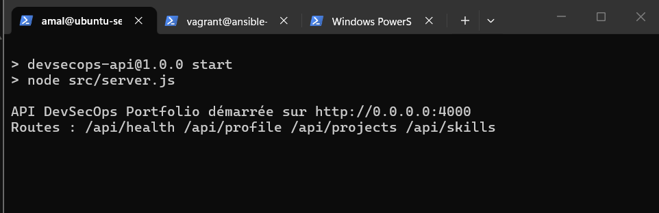
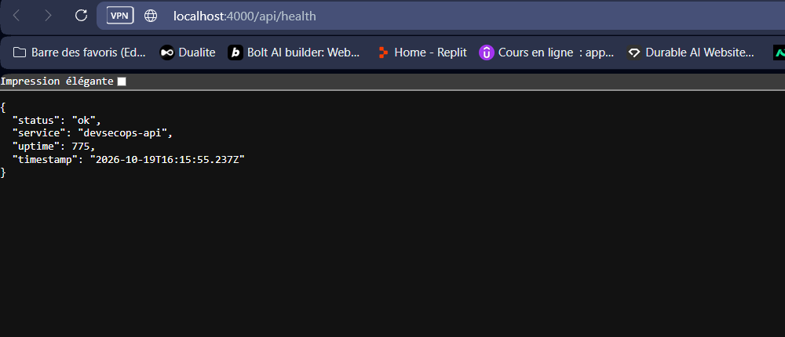
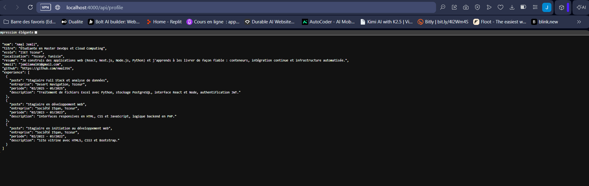
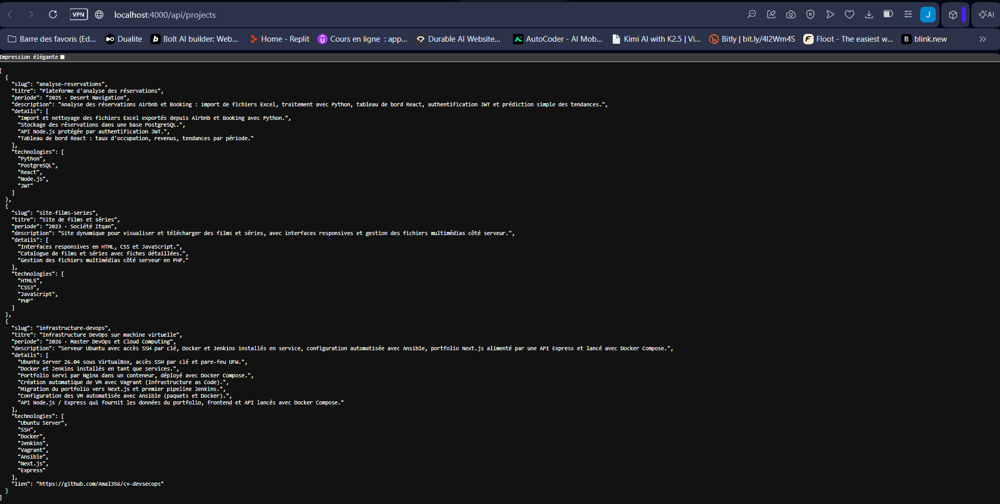
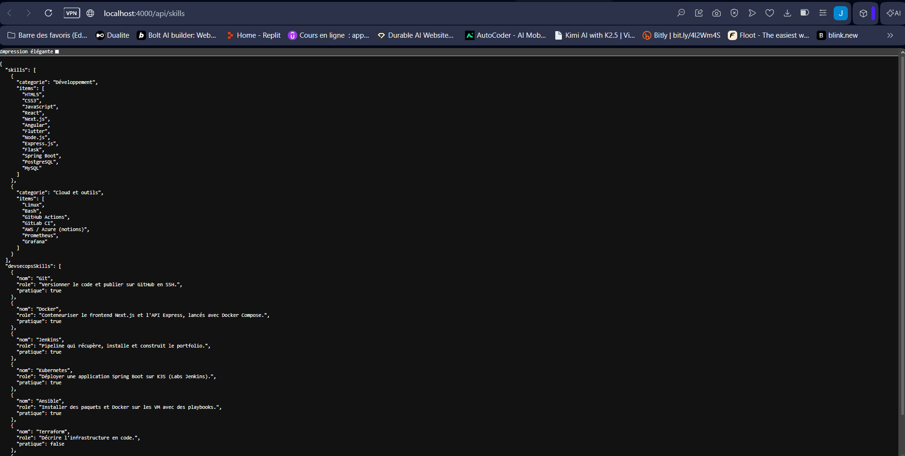
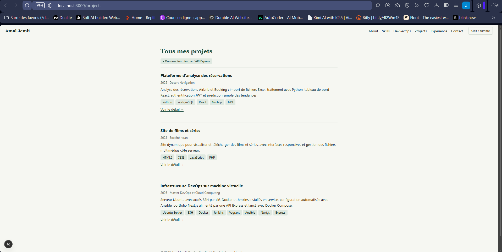
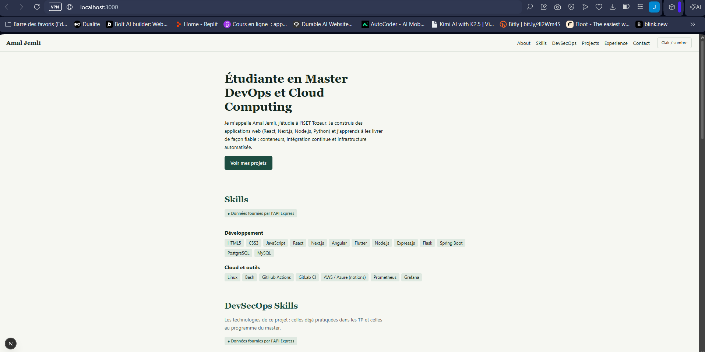
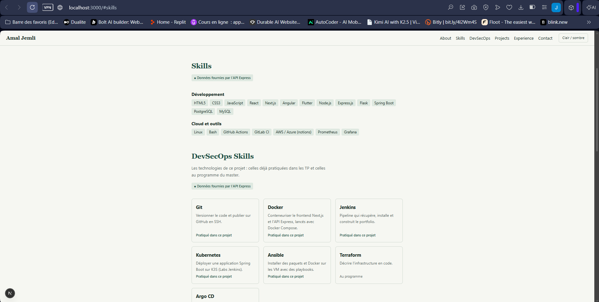
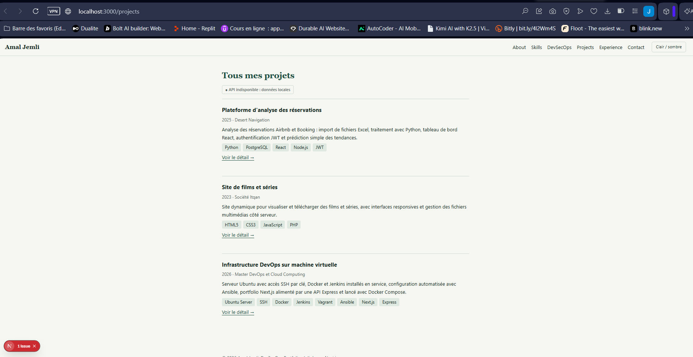

# Partie VIII – API Node.js / Express

Jusqu'ici, les données du portfolio (projets, compétences) étaient écrites dans le frontend Next.js (`portfolio-next/data/`). Elles sont maintenant servies par une **API Express** indépendante, dans le dossier [`api/`](../api). Le frontend les lit par HTTP.

## Étape 29 – Le projet `api`

```
api/
├── package.json          # dépendance : express ; scripts start et dev
├── package-lock.json
├── .env.example          # variables d'environnement (exemple, partie IX)
├── .gitignore            # node_modules/ et .env ne vont pas sur GitHub
├── .dockerignore
├── Dockerfile            # image Docker de l'API (partie X)
├── data/                 # données du portfolio
│   ├── profile.js
│   ├── projects.js
│   ├── skills.js
│   └── experience.js
└── src/
    ├── server.js         # démarrage du serveur (port, arrêt propre)
    ├── app.js            # application Express : journal, routes, 404
    └── routes/
        ├── health.js     # GET /api/health
        ├── profile.js    # GET /api/profile
        ├── projects.js   # GET /api/projects et /api/projects/:slug
        └── skills.js     # GET /api/skills
```

- **`app.js` / `server.js`** : `app.js` décrit l'application (routes), `server.js` la lance sur un port. Chaque route est dans son propre fichier (`express.Router`).
- **Indépendante du frontend** : l'API a son propre `package.json` et se lance seule, sur le port **4000**. Le frontend reste sur le port 3000.
- Le projet utilise les modules ES (`"type": "module"` dans `package.json`), comme le frontend : `import` / `export`.

Création du projet et installation d'Express (version 5) :

```bash
cd ~/cv-devsecops
mkdir api && cd api
npm init -y
npm install express
```

`package.json` :

```json
{
  "name": "devsecops-api",
  "version": "1.0.0",
  "private": true,
  "type": "module",
  "main": "src/server.js",
  "scripts": {
    "start": "node src/server.js",
    "dev": "node --watch src/server.js"
  },
  "dependencies": {
    "express": "^5.3.0"
  }
}
```

`src/app.js` :

```javascript
import express from "express";
import healthRouter from "./routes/health.js";
import profileRouter from "./routes/profile.js";
import projectsRouter from "./routes/projects.js";
import skillsRouter from "./routes/skills.js";

const app = express();

// Ne pas annoncer "X-Powered-By: Express" dans les réponses
app.disable("x-powered-by");

// JSON indenté : plus lisible dans le navigateur et avec curl
app.set("json spaces", 2);

// Journal minimal : méthode, URL, code de réponse et durée
app.use((req, res, next) => {
  const debut = Date.now();
  res.on("finish", () => {
    console.log(`${req.method} ${req.originalUrl} ${res.statusCode} ${Date.now() - debut} ms`);
  });
  next();
});

// Routes de l'API
app.use("/api/health", healthRouter);
app.use("/api/profile", profileRouter);
app.use("/api/projects", projectsRouter);
app.use("/api/skills", skillsRouter);

// Route inconnue : réponse JSON 404
app.use((req, res) => {
  res.status(404).json({ erreur: "Route introuvable", route: req.originalUrl });
});

export default app;
```

`src/server.js` :

```javascript
import app from "./app.js";

// Port et adresse d'écoute lus dans les variables d'environnement
const PORT = Number(process.env.PORT) || 4000;
const HOST = process.env.HOST || "0.0.0.0";

const server = app.listen(PORT, HOST, () => {
  console.log(`API DevSecOps Portfolio démarrée sur http://${HOST}:${PORT}`);
  console.log("Routes : /api/health /api/profile /api/projects /api/skills");
});

// Arrêt propre quand Docker envoie SIGTERM (docker stop, docker compose down)
function arreter(signal) {
  console.log(`${signal} reçu, arrêt de l'API`);
  server.close(() => process.exit(0));
}
process.on("SIGTERM", arreter);
process.on("SIGINT", arreter);
```

Lancement, depuis le dossier `api` :

```bash
npm install
npm start
```

Pour ouvrir l'API depuis le navigateur de Windows : `sudo ufw allow 4000/tcp` sur la VM et une redirection VirtualBox **4000 → 4000**.



## Étape 30 – GET /api/health

`src/routes/health.js` :

```javascript
import { Router } from "express";

const router = Router();

// GET /api/health : indique que l'API fonctionne
router.get("/", (req, res) => {
  res.json({
    status: "ok",
    service: "devsecops-api",
    uptime: Math.round(process.uptime()),
    timestamp: new Date().toISOString(),
  });
});

export default router;
```

`uptime` : nombre de secondes depuis le démarrage de l'API. Cette route sert aussi au *healthcheck* Docker (partie X).

```bash
curl http://localhost:4000/api/health
```



## Étape 31 – GET /api/profile

Les informations principales du portfolio sont dans `data/profile.js` ; la route y ajoute les expériences (`data/experience.js`) :

```javascript
import { Router } from "express";
import { profile } from "../../data/profile.js";
import { experience } from "../../data/experience.js";

const router = Router();

// GET /api/profile : informations principales du portfolio
router.get("/", (req, res) => {
  res.json({ ...profile, experience });
});

export default router;
```

```bash
curl http://localhost:4000/api/profile
```



## Étape 32 – GET /api/projects

`src/routes/projects.js` :

```javascript
import { Router } from "express";
import { projects, getProject } from "../../data/projects.js";

const router = Router();

// GET /api/projects : liste des projets
router.get("/", (req, res) => {
  res.json(projects);
});

// GET /api/projects/:slug : un projet (utilisé par la page /projects/<slug>)
router.get("/:slug", (req, res) => {
  const projet = getProject(req.params.slug);
  if (!projet) {
    return res.status(404).json({ erreur: "Projet introuvable", slug: req.params.slug });
  }
  res.json(projet);
});

export default router;
```

La route `/api/projects/:slug` en plus permet à la page de détail d'un projet de lire, elle aussi, ses données dans l'API.



## Étape 33 – GET /api/skills

`src/routes/skills.js` renvoie les compétences générales et les compétences DevSecOps :

```javascript
import { Router } from "express";
import { skills, devsecopsSkills } from "../../data/skills.js";

const router = Router();

// GET /api/skills : compétences générales et compétences DevSecOps
router.get("/", (req, res) => {
  res.json({ skills, devsecopsSkills });
});

export default router;
```



## Étapes 34 et 35 – Le frontend Next.js lit les projets et les compétences dans l'API

Un module [`portfolio-next/lib/api.js`](../portfolio-next/lib/api.js) regroupe les appels à l'API :

```javascript
import { cache } from "react";
import { connection } from "next/server";
import { projects as projetsLocaux } from "@/data/projects";
import { skills as skillsLocaux, devsecopsSkills as devsecopsLocaux } from "@/data/skills";

async function appelApi(chemin) {
  const base = process.env.API_URL;
  if (!base) throw new Error("variable API_URL non définie");

  const reponse = await fetch(`${base}${chemin}`, {
    cache: "no-store", // toujours les données à jour
    signal: AbortSignal.timeout(3000), // pas d'attente infinie si l'API ne répond pas
  });
  if (reponse.status === 404) return null;
  if (!reponse.ok) throw new Error(`réponse ${reponse.status} pour ${chemin}`);
  return reponse.json();
}

// Si l'API est injoignable, la page reste affichée avec les données locales (data/)
async function avecRepli(chemin, donneesLocales) {
  await connection(); // rendu à chaque requête, pas au build
  try {
    return { data: await appelApi(chemin), source: "api" };
  } catch (erreur) {
    console.error(`API indisponible (${chemin}) : ${erreur.message}, données locales utilisées`);
    return { data: donneesLocales, source: "local" };
  }
}

export const getProjects = cache(() => avecRepli("/api/projects", projetsLocaux));
export const getProject = cache((slug) => avecRepli(`/api/projects/${encodeURIComponent(slug)}`, /* ... */));
export const getSkills = cache(() =>
  avecRepli("/api/skills", { skills: skillsLocaux, devsecopsSkills: devsecopsLocaux })
);
```

Les composants deviennent des **composants serveur asynchrones** : ils attendent la réponse de l'API avant d'afficher la liste. Exemple, `components/Projects.js` :

```javascript
import { getProjects } from "@/lib/api";
import ProjectCard from "./ProjectCard";
import DataSource from "./DataSource";

export default async function Projects({ titre = "Projects" }) {
  const { data: projects, source } = await getProjects();

  return (
    <section id="projects">
      <h2>{titre}</h2>
      <DataSource source={source} />
      {projects.map((p) => <ProjectCard key={p.slug} projet={p} />)}
    </section>
  );
}
```

`Skills.js` et `DevSecOpsSkills.js` utilisent de la même façon `getSkills()` (étape 35). La page de détail `/projects/[slug]` appelle `getProject(slug)`.

Choix réalisés :

- **Appels côté serveur** : c'est le serveur Next.js qui interroge l'API, pas le navigateur. L'adresse de l'API n'a donc pas besoin d'être accessible depuis Windows, et il n'y a pas de configuration CORS à prévoir.
- **Rendu à chaque requête** (`connection()`) : une modification dans l'API apparaît au rechargement de la page, sans reconstruire le frontend. La sortie de `npm run build` le montre : les routes `/`, `/projects` et `/projects/[slug]` sont marquées `ƒ (Dynamic)`.
- **Repli sur les données locales** : si l'API ne répond pas, le portfolio reste affiché avec les fichiers `data/` du frontend, conservés comme copie de secours. L'énoncé demande de ne plus utiliser *uniquement* des données locales : l'API est la source principale.
- **Badge `DataSource`** : chaque liste indique d'où viennent ses données, « Données fournies par l'API Express » ou « API indisponible : données locales ».
- `cache()` (React) : `Skills` et `DevSecOpsSkills` demandent les mêmes données, mais un seul appel à `/api/skills` est fait par requête.

Test sur la VM, avec deux terminaux SSH :

```bash
# Terminal 1 : l'API
cd ~/cv-devsecops/api && npm start

# Terminal 2 : le frontend, qui lit l'adresse de l'API dans API_URL
cd ~/cv-devsecops/portfolio-next
API_URL=http://localhost:4000 npm run dev -- -H 0.0.0.0 -p 3000
```

Projets lus depuis l'API :



La page d'accueil assemble les sections : chacune indique la source de ses données.



Compétences lues depuis l'API (étape 35) :



Si l'API est arrêtée (Ctrl+C dans le terminal 1), la page reste disponible avec les données locales :


