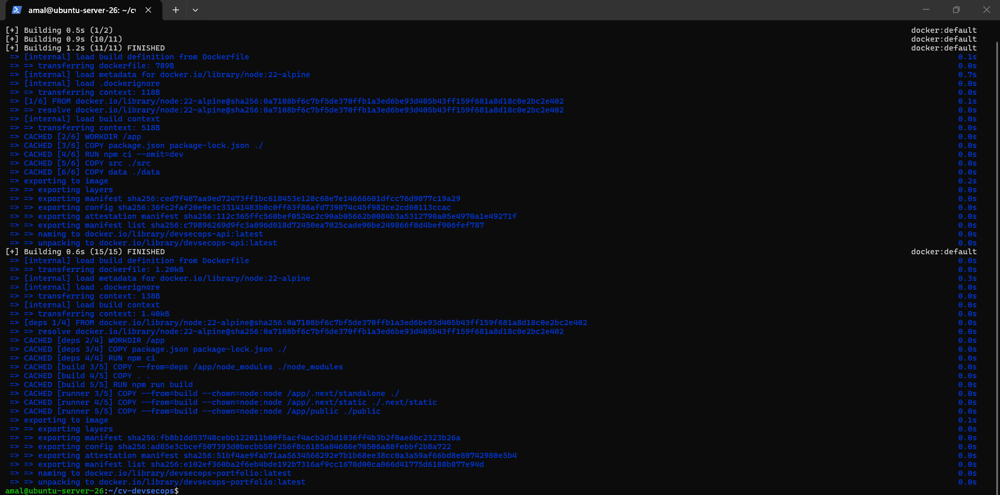
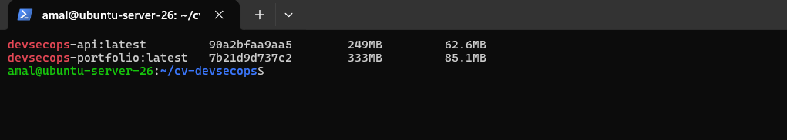
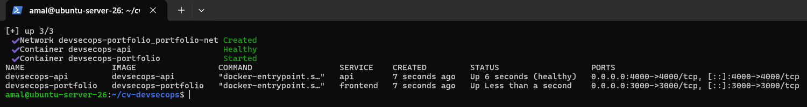
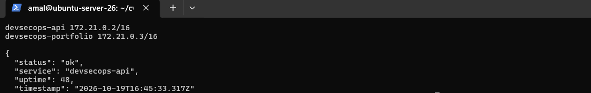
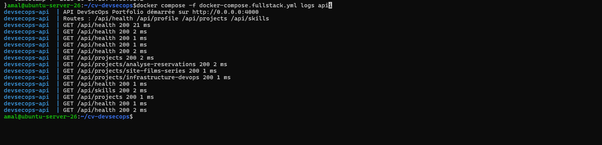
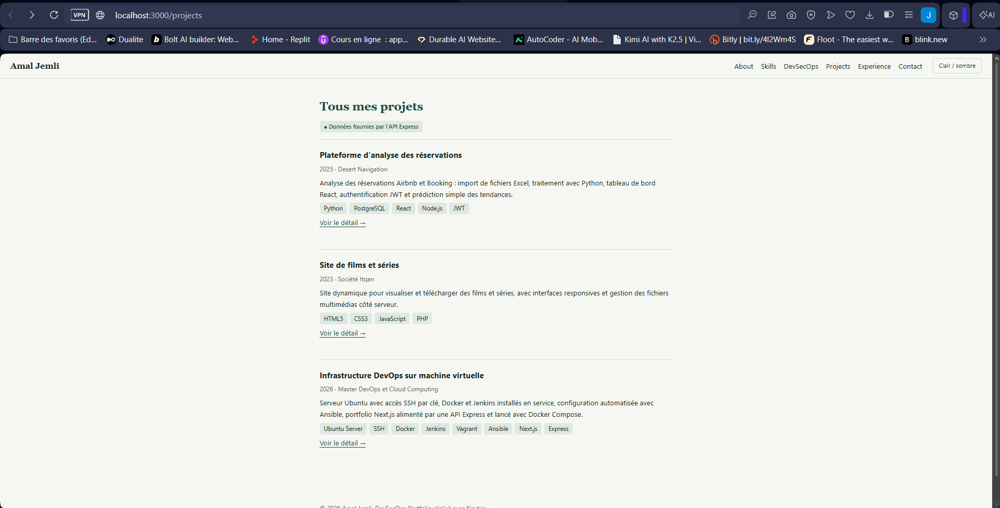

# Partie X – Dockerisation du frontend et de l'API

Le frontend Next.js et l'API Express ont chacun leur Dockerfile. Docker Compose les lance ensemble, dans un réseau où le frontend joint l'API par son nom de service.

## Étape 38 – Dockerfile du frontend Next.js

Dans [`next.config.mjs`](../portfolio-next/next.config.mjs), l'option `output: "standalone"` fait produire à `next build` un dossier `.next/standalone` : un petit serveur `server.js` avec uniquement les dépendances utilisées.

```javascript
const nextConfig = {
  output: "standalone",
};
```

[`portfolio-next/Dockerfile`](../portfolio-next/Dockerfile) :

```dockerfile
# ---------- Étape 1 : dépendances ----------
FROM node:22-alpine AS deps
WORKDIR /app
COPY package.json package-lock.json ./
RUN npm ci

# ---------- Étape 2 : build Next.js ----------
FROM node:22-alpine AS build
WORKDIR /app
ENV NEXT_TELEMETRY_DISABLED=1
COPY --from=deps /app/node_modules ./node_modules
COPY . .
# Produit .next/standalone (voir output: "standalone" dans next.config.mjs)
RUN npm run build

# ---------- Étape 3 : image finale d'exécution ----------
FROM node:22-alpine AS runner
WORKDIR /app
ENV NODE_ENV=production \
    NEXT_TELEMETRY_DISABLED=1 \
    PORT=3000 \
    HOSTNAME=0.0.0.0

# Seuls le serveur minimal, les fichiers statiques et public/ sont copiés :
# ni le code source, ni les dépendances de développement
COPY --from=build --chown=node:node /app/.next/standalone ./
COPY --from=build --chown=node:node /app/.next/static ./.next/static
COPY --from=build --chown=node:node /app/public ./public

# Exécution avec l'utilisateur non root "node"
USER node

EXPOSE 3000

# API_URL n'est pas fixée ici : elle est fournie au lancement du conteneur
CMD ["node", "server.js"]
```

- **Build multi-étapes** : les deux premières étapes installent les dépendances et construisent l'application ; l'image finale ne garde que le résultat. Elle ne contient ni le code source, ni `node_modules` complet, ni les outils de build : elle est plus légère et expose moins de choses.
- `npm ci` : installation exacte selon `package-lock.json`, comme dans le pipeline Jenkins.
- `HOSTNAME=0.0.0.0` : le serveur écoute sur toutes les interfaces du conteneur, sinon il serait injoignable depuis l'extérieur.
- `USER node` : le processus ne tourne pas en root dans le conteneur.
- `API_URL` n'est pas dans l'image : elle est donnée au lancement (partie IX).

Le fichier `.dockerignore` évite de copier `node_modules`, `.next` et les fichiers `.env` dans le contexte de build.

## Étape 39 – Dockerfile de l'API Express

[`api/Dockerfile`](../api/Dockerfile) :

```dockerfile
# Image officielle Node.js 22 (Alpine : image légère)
FROM node:22-alpine

# Mode production : Express désactive les messages de débogage
ENV NODE_ENV=production

WORKDIR /app

# Dépendances d'abord : cette couche reste en cache tant que package*.json ne change pas
COPY package.json package-lock.json ./
RUN npm ci --omit=dev

# Code de l'API
COPY src ./src
COPY data ./data

# L'API écoute sur le port 4000
ENV PORT=4000
EXPOSE 4000

# Exécution avec l'utilisateur non root "node" fourni par l'image
USER node

# Docker vérifie régulièrement que l'API répond sur /api/health
HEALTHCHECK --interval=15s --timeout=3s --start-period=5s --retries=3 \
  CMD wget -qO- http://127.0.0.1:4000/api/health || exit 1

CMD ["node", "src/server.js"]
```

- L'API n'a pas d'étape de build : une seule étape suffit.
- `npm ci --omit=dev` : seules les dépendances de production sont installées.
- **Ordre des `COPY`** : `package.json` est copié avant le code. Si seul le code change, Docker réutilise la couche `npm ci` déjà en cache et le build est beaucoup plus rapide.
- **`HEALTHCHECK`** : Docker appelle `/api/health` toutes les 15 secondes. `docker ps` affiche l'état `healthy` ou `unhealthy`. Docker Compose s'en sert pour démarrer le frontend seulement quand l'API est prête.

## Étape 40 – Construction des deux images

K3S, inutile ici, est arrêté pour libérer de la mémoire pendant le build (`sudo systemctl stop k3s`).

```bash
cd ~/cv-devsecops
docker build -t devsecops-api ./api
docker build -t devsecops-portfolio ./portfolio-next
docker images | grep devsecops
```

Deuxième construction : toutes les étapes sont `CACHED`, le build ne prend qu'une seconde. On voit les trois étapes du Dockerfile du frontend : `deps`, `build` et `runner`.





## Étape 41 – Docker Compose : frontend + API

[`docker-compose.fullstack.yml`](../docker-compose.fullstack.yml), à la racine du dépôt. Le fichier `docker-compose.yml` de l'étape 13 (portfolio HTML servi par Nginx) est conservé : celui-ci a un nom différent, et on le désigne avec l'option `-f`.

```yaml
name: devsecops-portfolio

services:
  api:
    build: ./api
    image: devsecops-api
    container_name: devsecops-api
    environment:
      PORT: 4000
    ports:
      - "4000:4000"          # accès direct à l'API depuis la VM (tests avec curl)
    restart: unless-stopped
    networks:
      - portfolio-net

  frontend:
    build: ./portfolio-next
    image: devsecops-portfolio
    container_name: devsecops-portfolio
    environment:
      # "api" = nom du service ci-dessus, résolu par le DNS du réseau Docker Compose
      API_URL: http://api:4000
    ports:
      - "3000:3000"
    depends_on:
      api:
        condition: service_healthy   # attend que /api/health réponde
    restart: unless-stopped
    networks:
      - portfolio-net

networks:
  portfolio-net:
    driver: bridge
```

- **`API_URL: http://api:4000`** : dans le réseau `portfolio-net`, Docker fournit un DNS interne. Le nom `api` désigne le conteneur de l'API. On n'utilise pas `localhost` : dans le conteneur du frontend, `localhost` est le conteneur du frontend lui-même.
- **`depends_on` + `service_healthy`** : le frontend ne démarre qu'une fois l'API déclarée `healthy` par son `HEALTHCHECK`.
- `build` et `image` ensemble : Compose construit les images avec les noms `devsecops-api` et `devsecops-portfolio`.

Le serveur Next.js lancé à la main (partie VIII) doit être arrêté avant, pour libérer le port 3000.

```bash
docker compose -f docker-compose.fullstack.yml up -d
docker compose -f docker-compose.fullstack.yml ps
```

Les deux services sont `Up`, l'API est `(healthy)` :



## Étape 42 – Communication frontend ↔ API dans le réseau Compose

Le réseau créé par Compose et ses deux conteneurs :

```bash
docker network inspect devsecops-portfolio_portfolio-net \
  --format '{{range .Containers}}{{.Name}} {{.IPv4Address}}{{"\n"}}{{end}}'
```

Le frontend joint l'API par son nom de service :

```bash
docker compose -f docker-compose.fullstack.yml exec frontend wget -qO- http://api:4000/api/health
```

Résultat : les deux conteneurs sont sur le réseau `portfolio-net` (172.21.0.2 et 172.21.0.3), et le frontend joint l'API par son nom de service `api` :



Les journaux de l'API montrent les appels faits par le frontend à chaque chargement de page :

```bash
docker compose -f docker-compose.fullstack.yml logs api
```

On y voit le *healthcheck* (`GET /api/health` toutes les 15 secondes), puis les appels `GET /api/projects`, `GET /api/skills` et `GET /api/projects/<slug>` (Next.js précharge les pages de détail des projets).



Le portfolio sur `http://localhost:3000` affiche les projets et les compétences avec le badge « Données fournies par l'API Express » :



Arrêt :

```bash
docker compose -f docker-compose.fullstack.yml down
```
