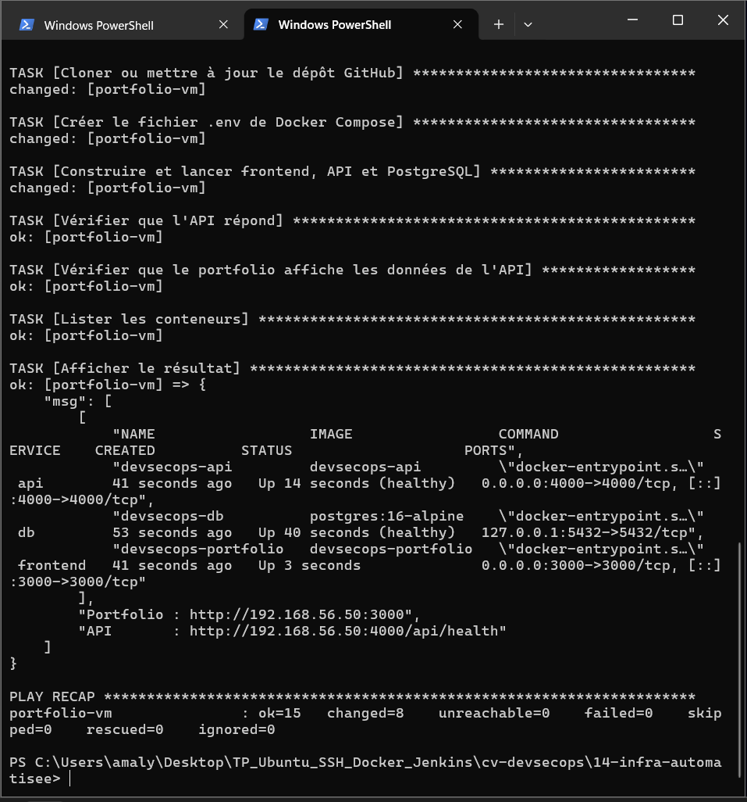
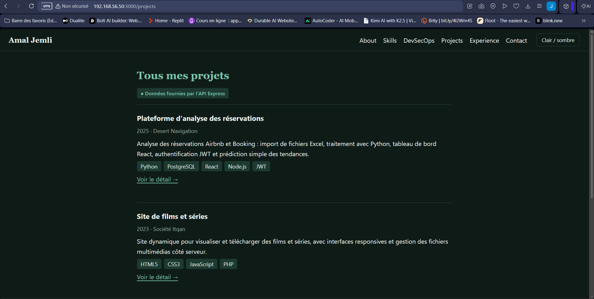
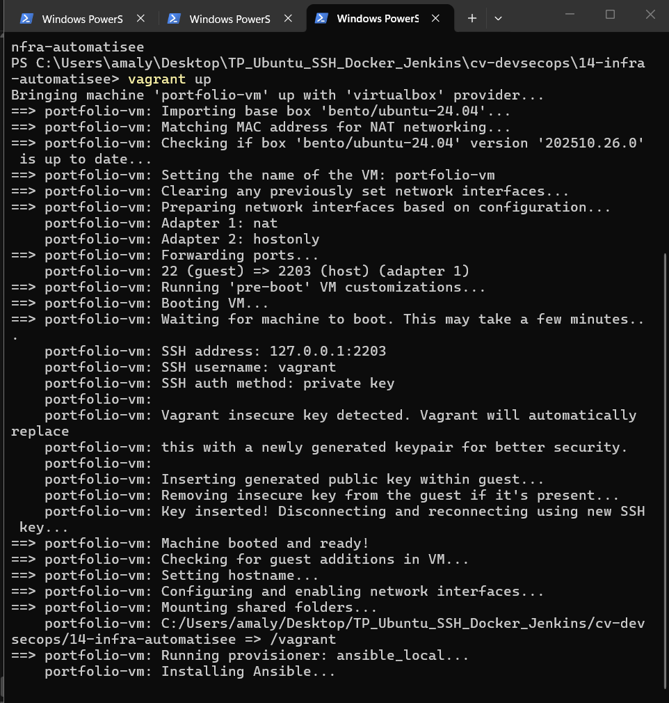
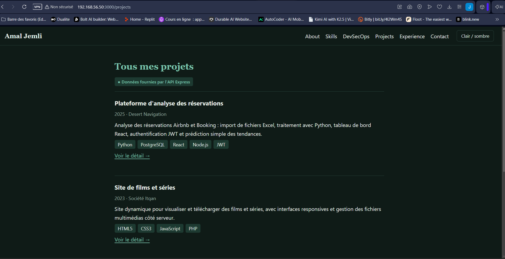

# Activité 4 – Partie XI : Infrastructure automatisée (étapes 43 à 45)

Objectif : une seule commande crée une VM, l'installe et y déploie le DevSecOps Portfolio complet (frontend Next.js, API Express, PostgreSQL).

```
vagrant up ──► création de la VM ──► Ansible ──► Docker ──► git clone ──► docker compose up
```

Fichiers de ce dossier :

| Fichier | Rôle |
| :--- | :--- |
| [`deploy-fullstack.yml`](deploy-fullstack.yml) | Playbook Ansible de déploiement (étape 43) |
| [`inventory.ini`](inventory.ini) | Inventaire pour lancer le playbook depuis la VM `ansible-admin` |
| [`Vagrantfile`](Vagrantfile) | VM `portfolio-vm` provisionnée automatiquement par Ansible (étape 44) |

## Étape 43 – Playbook de déploiement

Le playbook [`deploy-fullstack.yml`](deploy-fullstack.yml) enchaîne :

1. installation de Docker Engine et du plugin Compose (même méthode qu'à l'étape 28 : dépôt officiel, `deb822_repository`) ;
2. clonage du dépôt GitHub dans `/opt/cv-devsecops` ;
3. création du fichier `.env` avec un **mot de passe PostgreSQL aléatoire**, généré à la première exécution puis conservé (`force: false`) : aucun secret dans Git ni dans le playbook ;
4. `docker compose -f docker-compose.fullstack.yml up -d --build --wait` ;
5. vérifications : `/api/health` répond 200 et la page `/projects` affiche le badge « Données fournies par l'API Express ».

Lancement depuis la VM d'administration de l'Activité 3 :

```bash
cd ~/cv-devsecops/14-infra-automatisee
ansible-playbook -i inventory.ini deploy-fullstack.yml
```





Relancer le playbook ne change rien si rien n'a changé (idempotence) : `changed=0` dans le PLAY RECAP.

## Étape 44 – Vagrant lance Ansible automatiquement

Extrait du [`Vagrantfile`](Vagrantfile) :

```ruby
config.vm.define "portfolio-vm" do |vm|
  vm.vm.hostname = "portfolio-vm"
  vm.vm.network "private_network", ip: "192.168.56.50"
  vm.vm.provider "virtualbox" do |vb|
    vb.memory = 3072   # le build Next.js a besoin d'environ 2 Go
    vb.cpus = 2
  end
  vm.vm.provision "ansible_local" do |ansible|
    ansible.playbook = "deploy-fullstack.yml"
  end
end
```

Pourquoi `ansible_local` et pas `ansible` : le provisionneur `ansible` exécute Ansible **sur la machine hôte**, ce qui n'est pas possible sous Windows. Avec `ansible_local`, Vagrant installe Ansible **dans la VM** et lance le playbook depuis le dossier partagé `/vagrant`.

```powershell
cd 14-infra-automatisee
vagrant up
```



Le portfolio est ensuite accessible depuis Windows sur `http://192.168.56.50:3000`.

## Étape 45 – Test de reconstruction complète

```powershell
vagrant destroy -f
vagrant up
```

La VM est supprimée puis recréée de zéro. Sans aucune action manuelle, le portfolio est de nouveau en ligne, avec les données de l'API :



Intérêt : l'infrastructure est décrite par du code (*Infrastructure as Code*). Elle est reproductible, versionnée dans Git, et une VM cassée se remplace en une commande au lieu d'être réparée à la main.
