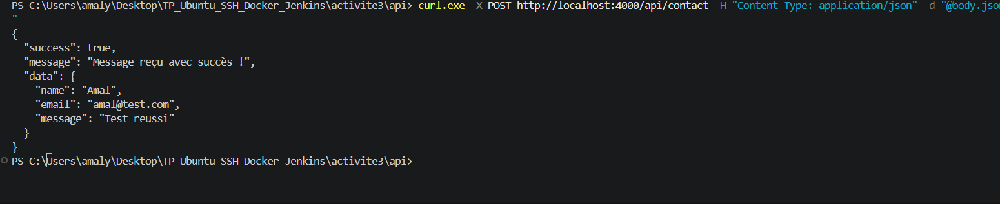
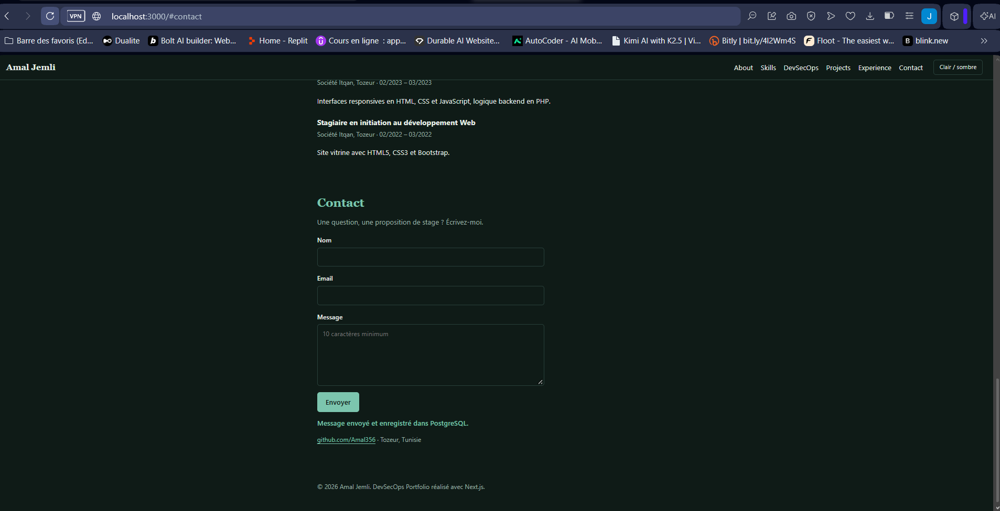
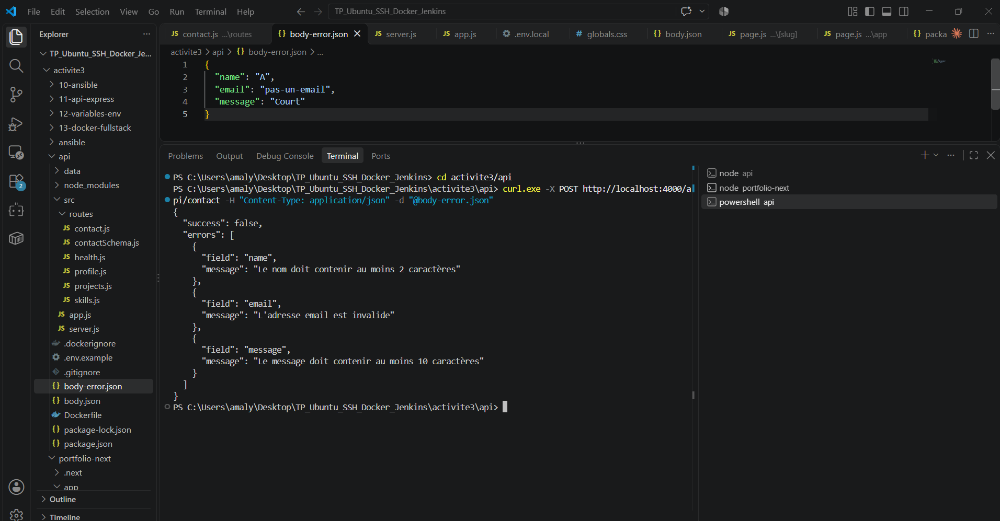
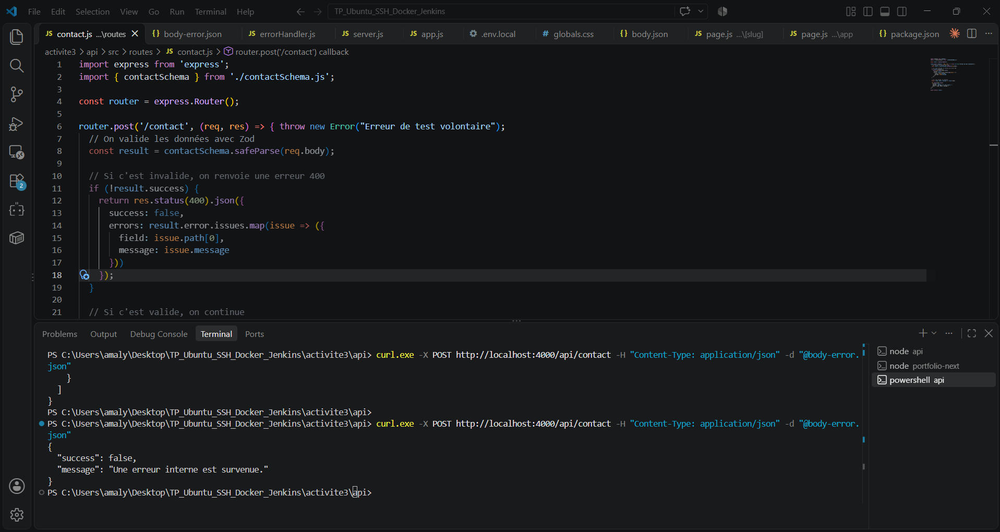
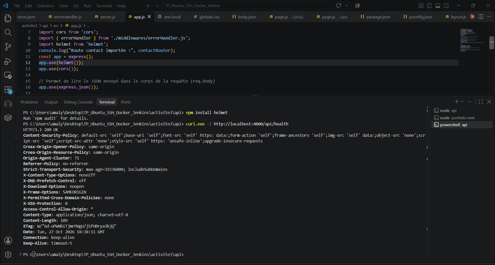
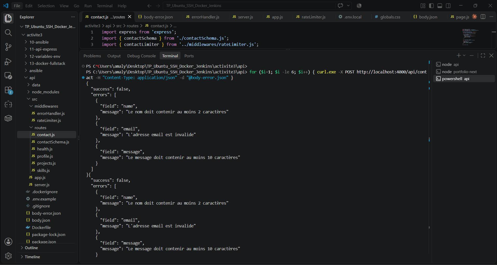

# Activité 4 – Partie XII : Évolution et sécurisation de l'API (étapes 46 à 52)

## Étape 46 – Route POST /api/contact

Fichier [`api/src/routes/contact.js`](../api/src/routes/contact.js), monté dans `app.js` :

```javascript
app.use("/api/contact", contactRouter);
```

Test avec curl :

```bash
curl -X POST http://localhost:4000/api/contact \
  -H "Content-Type: application/json" \
  -d '{"name":"Amal","email":"amal@example.com","message":"Message de test"}'
```

Réponse `201 Created` :

```json
{
  "success": true,
  "message": "Message enregistré !",
  "data": { "id": 1, "createdAt": "2026-10-29T12:46:45.436Z" }
}
```

L'API ne renvoie que l'identifiant et la date : inutile de renvoyer au client les données qu'il vient d'envoyer.



## Étape 47 – Formulaire Next.js relié à l'API

Le composant [`Contact.js`](../portfolio-next/components/Contact.js) (composant client) envoie le formulaire en JSON avec `fetch`, puis affiche le résultat : confirmation, erreurs de validation (400), limite atteinte (429) ou API injoignable.

L'adresse de l'API vue par le navigateur n'est pas codée en dur : elle vient de `NEXT_PUBLIC_API_URL`, intégrée au build (argument de build dans `docker-compose.fullstack.yml`).



## Étape 48 – Validation stricte avec Zod

[`contactSchema.js`](../api/src/routes/contactSchema.js) :

```javascript
export const contactSchema = z.strictObject({
  name: z.string().trim().min(2, "Le nom doit contenir au moins 2 caractères").max(50),
  email: z.string().trim().max(200).email("L'adresse email est invalide"),
  message: z.string().trim().min(10, "Le message doit contenir au moins 10 caractères").max(1000),
});
```

- `strictObject` : un champ non prévu (par exemple `"isAdmin": true`) est **refusé**, pas seulement ignoré.
- `trim()` : un nom composé uniquement d'espaces est refusé.
- `max()` : longueurs limitées, la base ne reçoit pas de textes géants.

Réponse `400 Bad Request` pour des données invalides :

```json
{
  "success": false,
  "errors": [
    { "field": "name", "message": "Le nom doit contenir au moins 2 caractères" },
    { "field": "email", "message": "L'adresse email est invalide" },
    { "field": "message", "message": "Le message doit contenir au moins 10 caractères" }
  ]
}
```



## Étape 49 – Gestion centralisée des erreurs

Le middleware [`errorHandler.js`](../api/src/middlewares/errorHandler.js) est déclaré **en dernier** dans `app.js`. Toutes les erreurs passées à `next(error)` y arrivent :

| Cas | Code | Réponse |
| :--- | :--- | :--- |
| JSON malformé | 400 | `Corps de requête JSON invalide.` |
| Corps de plus de 10 ko | 413 | `Requête trop volumineuse.` |
| Erreur inattendue (base indisponible…) | 500 | `Une erreur interne est survenue.` |

Le détail de l'erreur (message, pile d'appels, adresse de la base) est écrit dans les logs du serveur, **jamais envoyé au client**.

Test avec une erreur volontaire dans la route :



## Étape 50 – En-têtes de sécurité avec Helmet

```javascript
app.use(helmet());
app.disable("x-powered-by");
```

```bash
curl -I http://localhost:4000/api/health
```

```text
Content-Security-Policy: default-src 'self';base-uri 'self';...
Strict-Transport-Security: max-age=31536000; includeSubDomains
X-Content-Type-Options: nosniff
X-Frame-Options: SAMEORIGIN
Cross-Origin-Resource-Policy: same-origin
```

`X-Powered-By: Express` n'apparaît plus : un attaquant ne sait pas directement quel framework est utilisé.



CORS est aussi restreint : seule l'origine du portfolio (`CORS_ORIGIN`, par défaut `http://localhost:3000`) peut appeler l'API depuis un navigateur.

## Étape 51 – Rate limiting

[`rateLimiter.js`](../api/src/middlewares/rateLimiter.js) : 5 requêtes par adresse IP toutes les 15 minutes sur `POST /api/contact`.

```bash
for i in 1 2 3 4 5 6; do
  curl -s -o /dev/null -w "%{http_code}\n" -X POST http://localhost:4000/api/contact \
    -H "Content-Type: application/json" \
    -d '{"name":"Amal","email":"amal@example.com","message":"Test du rate limit"}'
done
```

Résultat : `201` cinq fois, puis `429 Too Many Requests`. Les en-têtes `RateLimit` et `RateLimit-Policy` indiquent au client la limite et le temps restant.



## Étape 52 – Analyse OWASP API Security Top 10 (2023)

| Réf. | Risque | Concerne l'API ? | Mesure |
| :--- | :--- | :--- | :--- |
| API1 | Broken Object Level Authorization | Non | Aucune ressource propre à un utilisateur n'est exposée. `GET /api/projects/:slug` ne sert que des données publiques. |
| API2 | Broken Authentication | Non (aujourd'hui) | Pas de comptes. Une future route d'administration (lecture des messages) devra être authentifiée. |
| API3 | Broken Object Property Level Authorization | **Oui** | `z.strictObject` refuse les champs non prévus. La réponse ne renvoie que `id` et `createdAt`. |
| API4 | Unrestricted Resource Consumption | **Oui** | Rate limiting (5 / 15 min), corps JSON limité à 10 ko, longueurs maximales dans Zod. |
| API5 | Broken Function Level Authorization | Non | Pas de rôles ni de fonctions d'administration. |
| API6 | Unrestricted Access to Sensitive Business Flows | **Oui** | Le formulaire de contact est le flux sensible (spam) : rate limiting par IP. |
| API7 | Server Side Request Forgery | Non | L'API ne fait aucune requête vers une URL fournie par l'utilisateur. |
| API8 | Security Misconfiguration | **Oui** | Helmet, `x-powered-by` désactivé, CORS restreint, erreurs sans détail interne, conteneur non root, mot de passe de la base hors de Git. |
| API9 | Improper Inventory Management | **Oui** | Routes centralisées dans `app.js` et documentées. Toute autre route renvoie un 404 JSON. |
| API10 | Unsafe Consumption of APIs | Non | L'API ne consomme pas d'API tierces. |

Injection SQL (OWASP Top 10 général, A03) : Prisma envoie les valeurs en **paramètres** de requête, jamais concaténées au SQL. Un test automatisé le vérifie (étape 59).
