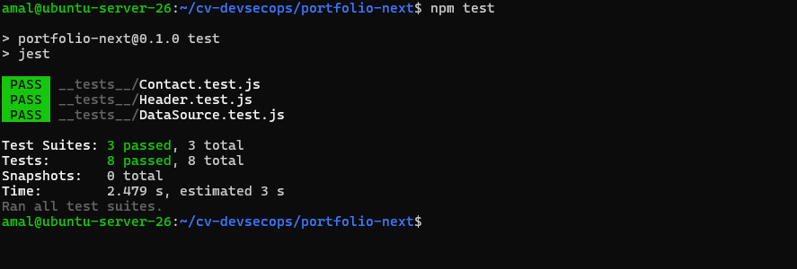
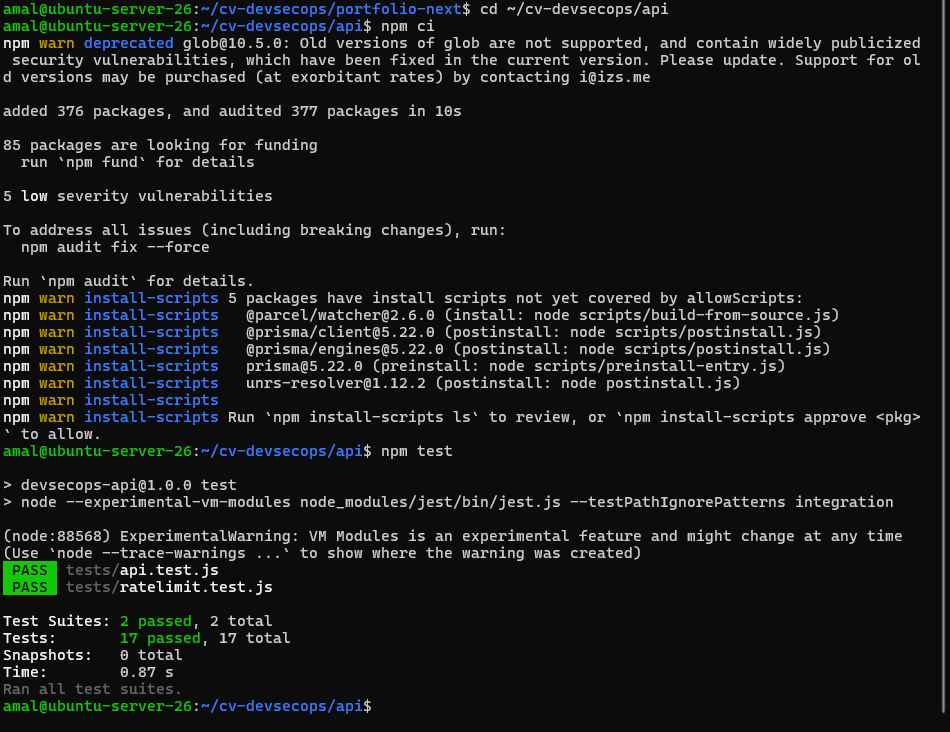
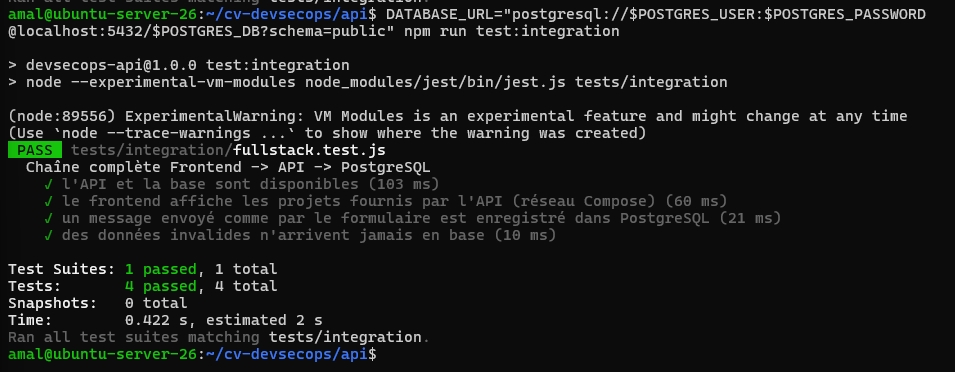

# Activité 4 – Partie XIV : Tests applicatifs (étapes 57 à 60)

| Niveau | Outils | Emplacement | Commande |
| :--- | :--- | :--- | :--- |
| Composants frontend | Jest, Testing Library | [`portfolio-next/__tests__/`](../portfolio-next/__tests__) | `cd portfolio-next && npm test` |
| API (unitaires) | Jest, Supertest | [`api/tests/`](../api/tests) | `cd api && npm test` |
| Intégration | Jest, fetch, Prisma | [`api/tests/integration/`](../api/tests/integration) | `cd api && npm run test:integration` |

## Étape 57 – Tests du frontend Next.js

Configuration : [`jest.config.mjs`](../portfolio-next/jest.config.mjs) utilise `next/jest`, qui reprend la configuration de Next.js (compilation SWC, alias `@/`).

Tests écrits :

- **Header** : le nom et les liens vers chaque section sont affichés.
- **DataSource** : le bon badge s'affiche selon l'origine des données (API ou fichiers locaux).
- **Contact** : l'appel à l'API est simulé (`global.fetch = jest.fn()`) pour vérifier :
  - l'envoi en JSON à `POST /api/contact` et le message de confirmation ;
  - l'affichage des erreurs Zod (400) et du message de limite (429) ;
  - le message « Impossible de contacter l'API » si le réseau échoue ;
  - le blocage par le navigateur d'un formulaire incomplet, sans appel à l'API.

```bash
cd portfolio-next
npm test
```



## Étape 58 – Tests de l'API Express

Prisma est remplacé par une fonction simulée (`jest.unstable_mockModule`, car le projet utilise les modules ES) : les tests n'ont besoin ni de PostgreSQL ni de Docker et durent environ une seconde.

```javascript
const create = jest.fn();
jest.unstable_mockModule("../src/lib/prisma.js", () => ({
  default: { contact: { create } },
}));
const { default: app } = await import("../src/app.js");

test("accepte un message valide et l'enregistre (201)", async () => {
  const res = await request(app).post("/api/contact").send(messageValide);
  expect(res.status).toBe(201);
  expect(create).toHaveBeenCalledWith({ data: messageValide });
});
```

Couverture : toutes les routes GET, le 404, les en-têtes Helmet, CORS, et `POST /api/contact`. Le rate limiting a son propre fichier ([`ratelimit.test.js`](../api/tests/ratelimit.test.js)) pour ne pas gêner les autres tests.

```bash
cd api
npm test
```



## Étape 59 – Le backend refuse les entrées invalides ou malveillantes

Tests dans [`api/tests/api.test.js`](../api/tests/api.test.js) :

| Entrée envoyée | Résultat attendu |
| :--- | :--- |
| Nom trop court, email invalide, message trop court | 400, une erreur par champ, rien en base |
| Corps vide `{}` | 400 |
| Champ en plus : `"isAdmin": true` | 400 (OWASP API3) |
| Objet au lieu d'une chaîne : `"name": {"$gt": ""}` | 400 (tentative d'injection NoSQL) |
| JSON malformé | 400 en JSON propre |
| Corps de 20 ko | 413 |
| `'; DROP TABLE "Contact"; --` | 201 : stocké comme simple texte, jamais exécuté |
| Erreur de base de données | 500 sans aucun détail interne |
| 6e requête en 15 minutes | 429 |

Dans chaque cas de refus, le test vérifie aussi que Prisma n'a **pas** été appelé : une donnée invalide n'atteint jamais la base.

## Étape 60 – Test d'intégration Frontend → API → PostgreSQL

[`api/tests/integration/fullstack.test.js`](../api/tests/integration/fullstack.test.js) s'exécute contre la stack réelle :

1. l'API répond et PostgreSQL accepte une requête ;
2. la page `/projects` du **frontend** contient le badge `source-api` et les projets renvoyés par l'API, ce qui prouve que Next.js a joint l'API par le réseau Docker Compose (`http://api:4000`) ;
3. un message envoyé comme par le formulaire (même en-tête `Origin`) est accepté, autorisé par CORS, et **relu dans PostgreSQL** ;
4. un message invalide est refusé et le nombre de lignes en base ne change pas.

```bash
docker compose -f docker-compose.fullstack.yml up -d --build
cd api
DATABASE_URL="postgresql://amal:<mot de passe du .env>@localhost:5432/portfolio_db?schema=public" \
  npm run test:integration
```


