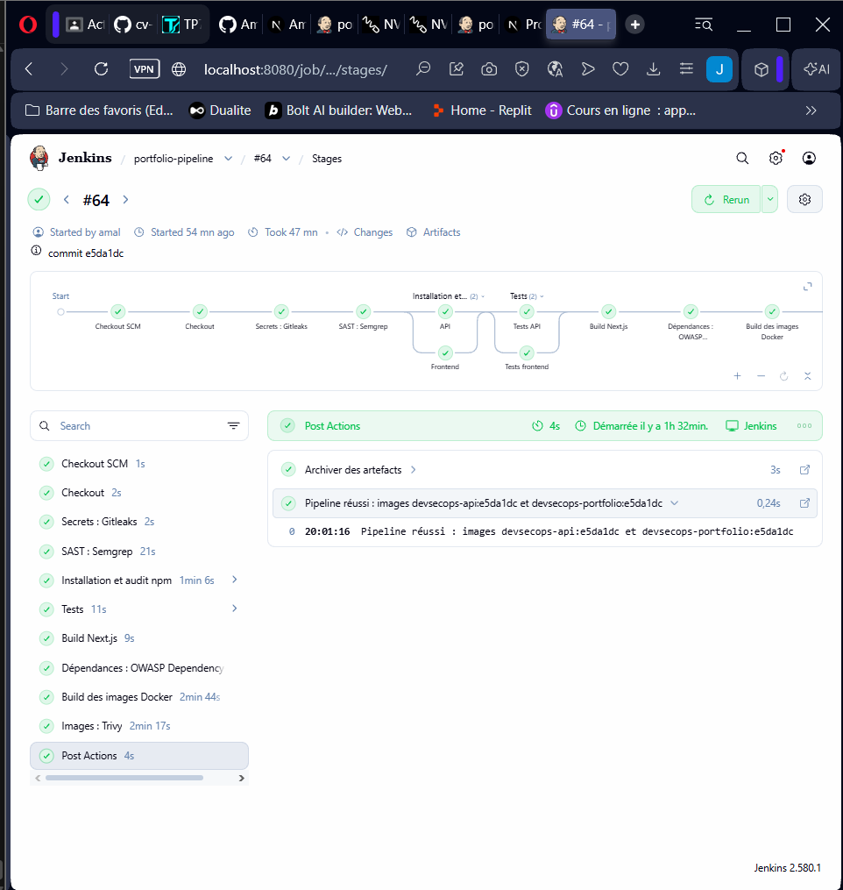
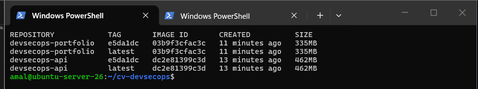
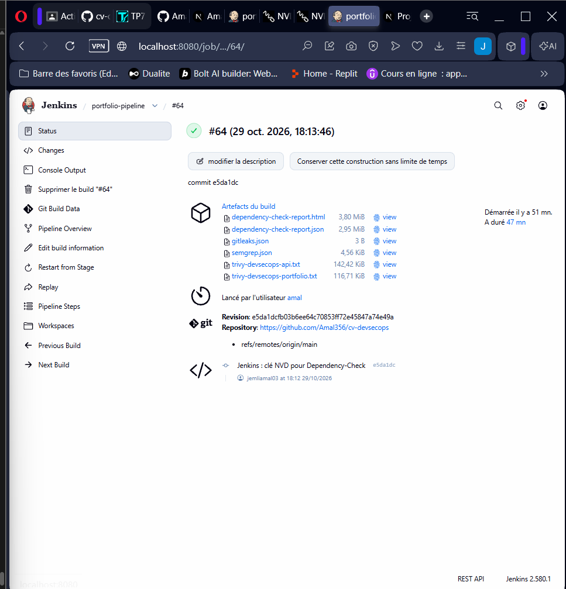
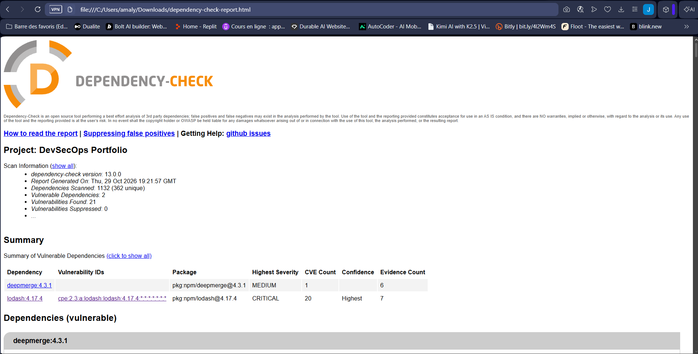
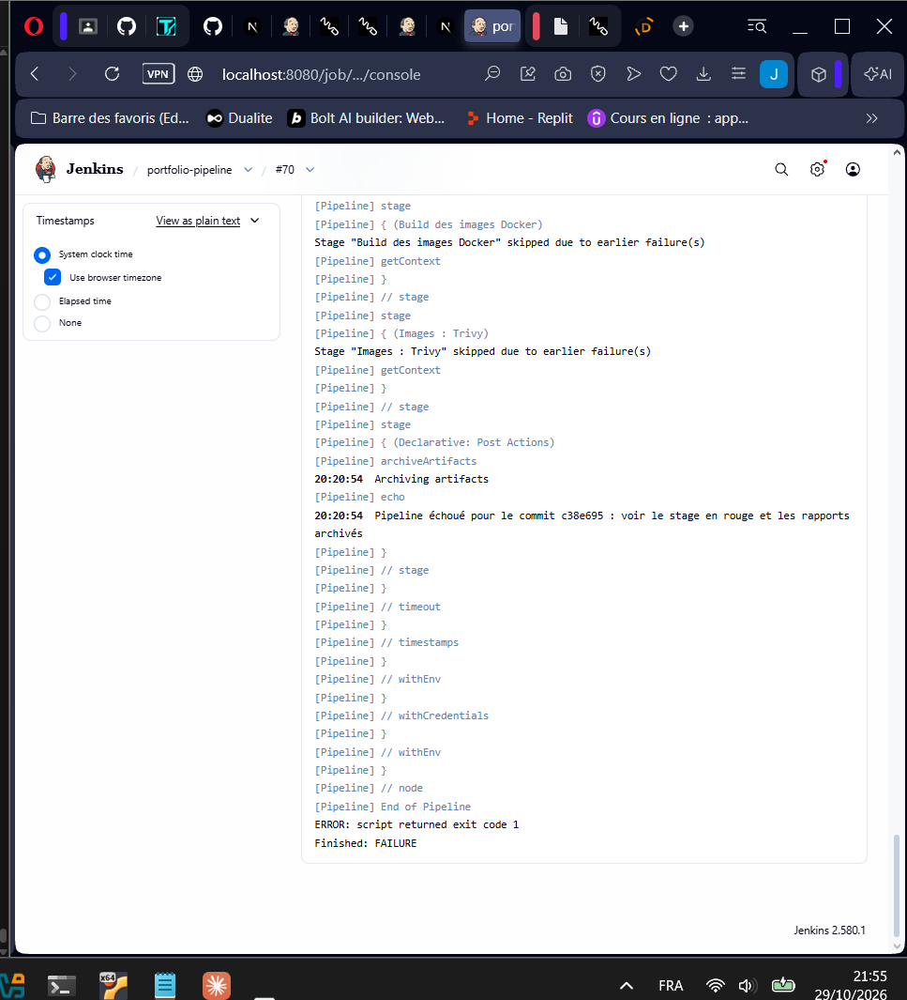

# Activité 4 – Parties XV et XVI : Pipeline DevSecOps Jenkins (étapes 61 à 69)

Le [`Jenkinsfile`](../Jenkinsfile) du premier pipeline (étapes 22 à 24) devient un pipeline DevSecOps : chaque commit est testé, analysé, construit en images Docker puis scanné.

```
Checkout ─► Gitleaks ─► Semgrep ─► npm ci + npm audit ─► Tests ─► Build Next.js
         ─► Dependency-Check ─► Build des images (tag = SHA) ─► Trivy
```

## Prérequis sur la VM Jenkins

Les outils de sécurité tournent dans des conteneurs Docker : il n'y a rien à installer à part Docker, déjà présent depuis l'étape 3. L'utilisateur `jenkins` doit pouvoir lancer `docker` :

```bash
sudo usermod -aG docker jenkins
sudo systemctl restart jenkins
sudo -u jenkins docker ps      # doit fonctionner sans erreur
```

## Étape 61 – Tests automatisés dans le pipeline

```groovy
stage('Tests') {
    parallel {
        stage('Tests API')      { steps { dir('api')            { sh 'npm test' } } }
        stage('Tests frontend') { steps { dir('portfolio-next') { sh 'npm test -- --ci' } } }
    }
}
```

Les deux suites tournent en parallèle. Si un test échoue, le pipeline s'arrête : aucune image n'est construite.



## Étapes 62 et 63 – Images Docker taguées avec le SHA Git

```groovy
env.GIT_SHA = sh(script: 'git rev-parse --short HEAD', returnStdout: true).trim()
```

```bash
docker build -t devsecops-api:$GIT_SHA -t devsecops-api:latest api
docker build -t devsecops-portfolio:$GIT_SHA -t devsecops-portfolio:latest portfolio-next
```

Chaque image porte le hash du commit dont elle est issue : on sait exactement quel code tourne, et on peut revenir à une version précise. `latest` reste un simple raccourci.

```bash
docker images --filter "reference=devsecops-*"
```



## Étapes 64 à 68 – Analyses de sécurité

| Étape | Outil | Ce qu'il analyse | Le pipeline échoue si… |
| :--- | :--- | :--- | :--- |
| 64 | **Gitleaks** | secrets dans le code (mots de passe, clés API, jetons) | un secret est trouvé |
| 65 | **Semgrep** (SAST) | failles dans le code JavaScript et les Dockerfiles | une règle de sévérité ERROR est déclenchée |
| 66 | **npm audit** | dépendances npm de production | une vulnérabilité est critique |
| 67 | **OWASP Dependency-Check** | bibliothèques comparées à la base des CVE (NVD) | un score CVSS ≥ 9 est trouvé |
| 68 | **Trivy** | images Docker finales (Alpine + node_modules) | une vulnérabilité CRITICAL corrigeable est trouvée |

Gitleaks ignore les dossiers générés (`node_modules`, `.next`) grâce à [`.gitleaks.toml`](../.gitleaks.toml). Les rapports (`gitleaks.json`, `semgrep.json`, `dependency-check-report.html`, `trivy-*.txt`) sont archivés dans Jenkins : *Build → Artifacts*.



### Étape 67 – Exemple de dépendance vulnérable détectée

Pour la démonstration, une ancienne version de `lodash` (4.17.4, vulnérable entre autres à la pollution de prototype CVE-2019-10744, CVSS 9.1) est ajoutée à l'API. Le job Jenkins surveille `main`, la démonstration s'y fait donc, puis elle est annulée :

```bash
cd ~/cv-devsecops/api
npm install lodash@4.17.4
git commit -am "Démo étape 69 : dépendance vulnérable"
git push          # Jenkins lance le pipeline (polling de 5 min, ou "Lancer un build")
```

Dans le pipeline, `npm audit` arrête tout avant Dependency-Check. Le rapport Dependency-Check de cette version vulnérable est donc produit avec la même commande que le stage, lancée à la main sur la VM :

```bash
cd ~/cv-devsecops && mkdir -p reports && chmod 777 reports
docker run --rm -v "$PWD:/src" -v dependency-check-data:/usr/share/dependency-check/data \
  owasp/dependency-check:latest --project "DevSecOps Portfolio" \
  --scan /src/api/package-lock.json --format HTML --out /src/reports
# ouvrir reports/dependency-check-report.html
```



## Étape 69 – Le pipeline échoue sur une vulnérabilité critique

Pipeline réussi sur `main` : tous les stages sont verts.


Pipeline sur le commit de démonstration : `npm audit --audit-level=critical` détecte `lodash` et arrête le pipeline. Les stages suivants ne s'exécutent pas, donc aucune image vulnérable n'est construite.



Ensuite, on annule la démonstration. Le pipeline suivant redevient vert :

```bash
git revert --no-edit HEAD
git push
```

Une sécurité qui ne fait qu'afficher un avertissement est vite ignorée. En faisant échouer le pipeline, une faille critique bloque la livraison tant qu'elle n'est pas corrigée (*security gate*).
