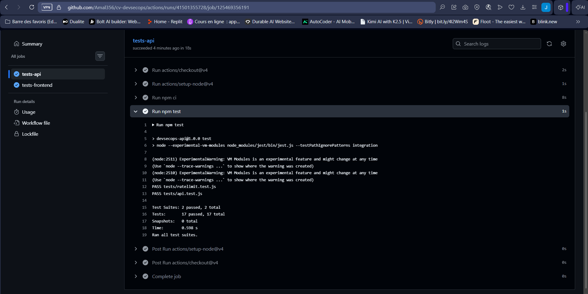
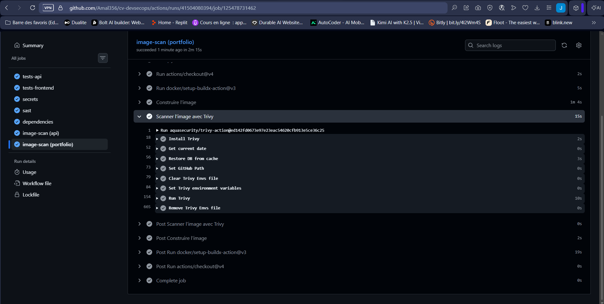
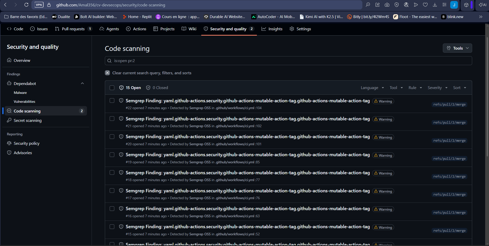
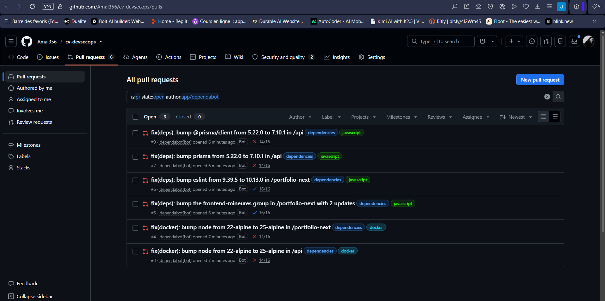

# Activité 5 – Partie 17 : GitHub Actions et sécurité GitHub (étapes 70 à 78)

Trois workflows, dans [`.github/workflows`](../.github/workflows) :

| Fichier | Déclencheurs | Rôle |
| :--- | :--- | :--- |
| [`ci.yml`](../.github/workflows/ci.yml) | push sur `main`, Pull Request vers `main` | Tests, secrets, SAST, dépendances, images + Trivy ; sur `main` : release, publication signée, vérification |
| [`codeql.yml`](../.github/workflows/codeql.yml) | push, PR, chaque lundi | CodeQL (GitHub Advanced Security) sur le JavaScript et sur les workflows |
| [`verify-deploy.yml`](../.github/workflows/verify-deploy.yml) | manuel | Barrière de déploiement : refuse une image non signée (partie 21) |

```
Pull Request ─┬─ tests-api ─────────┐
              ├─ tests-frontend ────┤
              ├─ secrets (Gitleaks) ┤
              ├─ sast (Semgrep) ────┼─► merge autorisé (contrôles obligatoires, partie 18)
              ├─ dependencies ──────┤
              ├─ image-scan (api) ──┤
              ├─ image-scan (portfolio)
              └─ commits (commitlint)
push main ──► mêmes contrôles ─► release ─► publish (api, portfolio) ─► verify-before-deploy
```

## Étape 70 – Tests sur push et Pull Request

Jobs `tests-api` (`npm test`, 17 tests Jest/Supertest) et `tests-frontend` (`npm test`, 8 tests, puis `npm run build`). Node.js 22, cache npm de `actions/setup-node`.



## Étape 71 – Secrets, SAST et dépendances

| Job | Outil | Échoue si |
| :--- | :--- | :--- |
| `secrets` | Gitleaks (tout l'historique Git, `fetch-depth: 0`) | un secret est trouvé dans n'importe quel commit |
| `sast` | Semgrep 1.182.1 (`p/javascript`, `p/dockerfile`, `p/owasp-top-ten`) | une règle de sévérité ERROR est déclenchée |
| `dependencies` | `npm audit` (API + frontend) et `dependency-review-action` sur les PR | une dépendance critique est présente ou ajoutée |

Les résultats Semgrep sont aussi publiés en SARIF dans *Security → Code scanning*, à côté de CodeQL et Trivy.

## Étapes 72-73 – Construction des images et scan Trivy

Job `image-scan`, une matrice `api` / `portfolio` : construction BuildKit avec cache GitHub Actions (`type=gha`), scan Trivy (HIGH et CRITICAL publiés en SARIF), puis barrière : échec sur une vulnérabilité **CRITICAL corrigeable**.



## Étape 74 – CodeQL comparé à Semgrep

CodeQL est activé par le workflow [`codeql.yml`](../.github/workflows/codeql.yml) (configuration avancée, requêtes `security-extended`). Il analyse deux « langages » : `javascript-typescript` (API + frontend) et `actions` (les workflows eux-mêmes).



| Critère | CodeQL | Semgrep |
| :--- | :--- | :--- |
| Alertes sur ce dépôt | *à compléter* | *à compléter* |
| Dont HIGH / CRITICAL | *à compléter* | *à compléter* |
| Principe | Base de données du code, requêtes de flux de données (source → sink) | Recherche de motifs dans l'arbre syntaxique |
| Analyse des workflows GitHub Actions | Oui (langage `actions`) | Non (règles YAML génériques seulement) |
| Dockerfiles | Non | Oui (`p/dockerfile`) |
| Durée | *à compléter* | *à compléter* |
| Faux positifs constatés | *à compléter* | *à compléter* |

*Analyse :* à compléter après le premier passage des deux outils.

## Étape 75 – Dependabot

[`.github/dependabot.yml`](../.github/dependabot.yml) surveille chaque semaine :

- npm : `api/`, `portfolio-next/` et l'outillage de release à la racine ;
- les images de base des deux Dockerfiles (`node:22-alpine`) ;
- les Actions GitHub, en conservant l'épinglage par SHA et en mettant à jour le commentaire de version.

Les mises à jour mineures et de correctif sont regroupées en une seule PR par projet. Les **Dependabot security updates** ouvrent une PR dès qu'une alerte de sécurité apparaît. Les messages de commit suivent Conventional Commits (`fix(deps): ...`), ce qui déclenche une release de correctif après le merge.



## Étape 76 – Permissions minimales du GITHUB_TOKEN

Chaque workflow commence par `permissions: {}` : le jeton n'a **aucun** droit par défaut. Chaque job demande ensuite uniquement ce dont il a besoin.

| Job | Permissions |
| :--- | :--- |
| tests, secrets, dependencies, commits | `contents: read` |
| sast, image-scan, codeql | `contents: read`, `security-events: write` (envoi SARIF) |
| release | `contents: write` (tag + release) |
| publish | `contents: write`, `packages: write`, `id-token: write`, `attestations: write` |
| verify-before-deploy | `contents: read`, `packages: read`, `attestations: read` |

Autres mesures : `persist-credentials: false` sur chaque `checkout` (le jeton n'est pas laissé dans `.git/config`), et les entrées utilisateur (`inputs.image`) passées par variables d'environnement, jamais interpolées dans un script (injection de commandes).

## Étape 77 – Actions épinglées par SHA

Toutes les Actions tierces sont référencées par le SHA complet de leur commit, la version restant en commentaire :

```yaml
- uses: aquasecurity/trivy-action@ed142fd0673e97e23eac54620cfb913e5ce36c25 # v0.36.0
```

**Pourquoi la chaîne CI/CD est elle-même une surface d'attaque.** Le pipeline a accès à tout ce qui compte : le code source, les secrets (jetons de registre, clés de signature), les droits d'écriture sur le dépôt et le droit de publier les images que les serveurs vont exécuter. Compromettre une seule étape suffit à injecter du code dans tout ce qui est livré, sans toucher au code de l'application.

Un tag Git comme `v0.36.0` est modifiable : son propriétaire, ou un attaquant qui a volé ses identifiants, peut le déplacer vers un autre commit. Le SHA, lui, désigne un contenu unique et immuable.

Cas réel, mars 2026 (CVE-2026-33634) : 76 des 77 tags de `aquasecurity/trivy-action` et tous les tags de `setup-trivy` ont été réécrits vers du code qui volait les secrets des pipelines. Un workflow écrit `trivy-action@0.34.0` a exécuté ce code sans aucun changement de son côté ; un workflow épinglé par SHA n'a pas été affecté. La version utilisée ici (v0.36.0) épingle elle-même `setup-trivy` par SHA, sur la version 0.2.6 recréée après l'incident.

Dependabot (étape 75) garde ces SHA à jour : la sécurité de l'épinglage sans le risque de rester sur des versions obsolètes.

## Étape 78 – GitHub Actions comparé à Jenkins

| Critère | GitHub Actions | Jenkins (VM) |
| :--- | :--- | :--- |
| Hébergement | Runners gérés par GitHub, détruits après chaque job | Serveur à installer, mettre à jour et sauvegarder soi-même |
| Déclenchement | Événements GitHub natifs (push, PR, release) | *Polling* toutes les 5 min (VM non joignable par webhook) |
| Intégration aux PR | Statuts de checks bloquants, annotations, onglet Security | Plugin nécessaire |
| Secrets | Secrets GitHub, OIDC sans secret stocké (Cosign keyless, attestations) | Credentials Jenkins, clés stockées sur le serveur |
| Sécurité de la chaîne | Permissions du jeton par job, Actions épinglées par SHA | Plugins et images d'outils à maintenir |
| Accès au réseau privé | Non (ne peut pas atteindre Harbor sur la VM) | Oui (Harbor, déploiement local) |
| Coût / limites | Gratuit pour un dépôt public | Ressources de la VM (RAM, disque) |

Les deux pipelines exécutent les mêmes contrôles. GitHub Actions publie dans GHCR avec une signature keyless ; Jenkins publie dans Harbor, sur le réseau privé, avec une clé Cosign.
