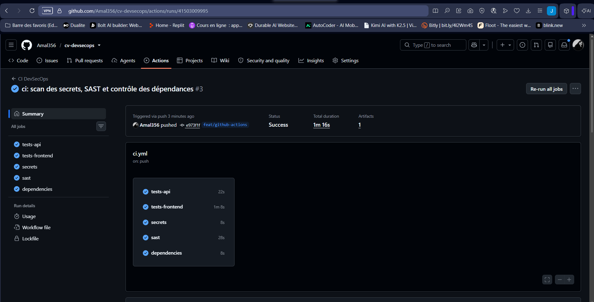
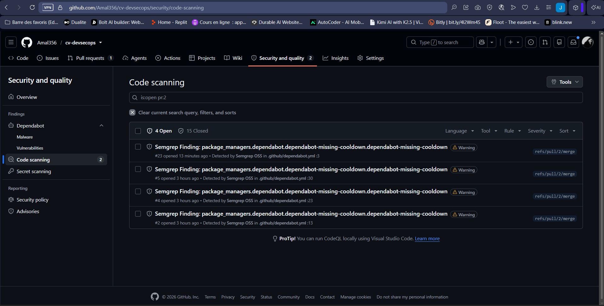

# Activité 5 – Partie 17 : GitHub Actions et sécurité GitHub (étapes 70 à 78)

Workflow : [`.github/workflows/ci.yml`](../.github/workflows/ci.yml). Il se déclenche à chaque `push` et à chaque Pull Request.

| Job | Rôle | Étape |
| :--- | :--- | :--- |
| `tests-api`, `tests-frontend` | `npm ci` puis `npm test` (17 tests API, 8 tests frontend) | 70 |
| `secrets` | Gitleaks sur tout l'historique Git (`fetch-depth: 0`) | 71 |
| `sast` | Semgrep (`p/javascript`, `p/dockerfile`, `p/owasp-top-ten`), alertes envoyées dans Code scanning | 71, 74 |
| `dependencies` | `npm audit` (API + frontend) et Dependency Review sur les PR | 71 |
| `image-scan (api)`, `image-scan (portfolio)` | construction de l'image (BuildKit) puis scan Trivy | 72, 73 |

## Étape 70 – Tests à chaque push et Pull Request

Deux jobs en parallèle, chacun sur une machine Ubuntu neuve : récupération du code, Node.js 22, `npm ci`, `npm test`.


## Étape 71 – Secrets, SAST et dépendances

Ce sont les mêmes contrôles que le pipeline Jenkins de l'activité 4. Chaque job échoue (et bloque) si :

- Gitleaks trouve un secret dans n'importe quel commit ;
- Semgrep trouve une alerte de sévérité ERROR ;
- `npm audit` trouve une dépendance critique, ou Dependency Review détecte qu'une PR ajoute une dépendance critique.



## Étapes 72-73 – Images Docker et scan Trivy

Une **matrice** lance le même job pour les deux images. L'image est construite avec BuildKit (`docker/build-push-action`, `load: true`), taguée avec le SHA du commit, puis scannée par Trivy. Le job échoue s'il trouve une vulnérabilité **CRITICAL** pour laquelle un correctif existe.


## Étape 74 – CodeQL comparé à Semgrep

CodeQL est activé en *Default setup* (Settings → Advanced Security), avec la suite de requêtes *Extended*. Semgrep envoie ses résultats au format SARIF dans le même onglet *Security → Code scanning*.


| Critère | CodeQL | Semgrep |
| :--- | :--- | :--- |
| Alertes trouvées | 2 | 15 (+ 4 après l'ajout de Dependabot) |
| Règle | `js/log-injection` (Log injection) | `github-actions-mutable-action-tag`, puis `dependabot-missing-cooldown` |
| Sévérité | Medium | Warning |
| Fichiers concernés | `api/src/app.js:38`, `api/src/middlewares/errorHandler.js:16` | `.github/workflows/ci.yml`, `.github/dependabot.yml` |
| Méthode | Analyse du **flux de données** : suit une valeur venue de l'utilisateur (`req.originalUrl`) jusqu'à un `console.log` | Recherche de **motifs** dans le code (ici, un `uses:` sans SHA) |
| Ce qu'il voit et l'autre non | L'injection de logs (Semgrep ne la détecte pas) | La configuration de la chaîne CI/CD : tags d'Actions modifiables, absence de délai Dependabot |
| Mise en place | Un clic dans les réglages, géré par GitHub | Une étape dans le workflow, règles au choix |

**Conclusion :** les deux outils sont complémentaires. CodeQL est plus fort sur les failles du code applicatif (flux de données) ; Semgrep, avec ses règles communautaires, couvre ici la configuration du pipeline. Les 15 alertes Semgrep ont été corrigées à l'étape 77 et les 4 alertes Dependabot par l'ajout d'un `cooldown`. Les 2 alertes CodeQL restent à traiter : il faudrait nettoyer les retours à la ligne des valeurs écrites dans les logs.

## Étape 75 – Dependabot

[`.github/dependabot.yml`](../.github/dependabot.yml) surveille chaque semaine :

- les dépendances npm de `api/` et de `portfolio-next/` (mises à jour mineures regroupées en une seule PR) ;
- l'image de base des Dockerfiles (`node:22-alpine`) ;
- les versions des Actions GitHub (Dependabot met à jour le SHA **et** le commentaire de version).

Un `cooldown` de 7 jours évite d'installer une version publiée depuis moins d'une semaine : une version piégée est en général découverte et retirée en quelques jours. Les *Dependabot security updates* (Settings) ouvrent en plus une PR dès qu'une faille est publiée.


## Étape 76 – Permissions minimales du GITHUB_TOKEN

```yaml
permissions: {}          # en haut du workflow : aucun droit par défaut

jobs:
  sast:
    permissions:
      contents: read          # lire le code
      security-events: write  # envoyer les alertes dans Code scanning
```

Chaque job ne reçoit que ce dont il a besoin : `contents: read` pour tous, et `security-events: write` seulement pour `sast`. Chaque `checkout` utilise aussi `persist-credentials: false`, pour que le jeton ne reste pas écrit dans `.git/config` pendant le reste du job.

## Étape 77 – Actions épinglées par SHA

```yaml
- uses: actions/checkout@3d3c42e5aac5ba805825da76410c181273ba90b1 # v7.0.1
```

Un tag (`@v4`) est un simple pointeur que le propriétaire de l'Action, ou un attaquant qui a volé ses accès, peut déplacer vers un autre code. Un SHA de commit désigne un contenu unique, impossible à modifier. Après ce changement, les 15 alertes Semgrep `mutable-action-tag` se sont fermées automatiquement.



**Pourquoi la chaîne CI/CD est elle-même une surface d'attaque.** Le pipeline a accès à tout ce qui compte : le code source, les secrets (jetons, clés de signature), le droit d'écrire dans le dépôt et celui de publier les images qui tourneront en production. Un attaquant n'a donc pas besoin de toucher au code de l'application : il lui suffit de compromettre **une seule étape** du pipeline, par exemple une Action tierce, pour voler les secrets ou glisser du code dans tout ce qui est livré.

Cas réel, mars 2026 (CVE-2026-33634) : 76 des 77 tags de `aquasecurity/trivy-action` ont été réécrits vers un code qui volait les secrets des pipelines. Les workflows qui utilisaient un tag ont exécuté ce code sans rien changer de leur côté ; ceux épinglés par SHA n'ont pas été touchés.

## Étape 78 – GitHub Actions comparé à Jenkins

| Critère | GitHub Actions | Jenkins (VM) |
| :--- | :--- | :--- |
| Installation | Rien à installer : machines fournies par GitHub, neuves à chaque job | Serveur à installer, mettre à jour et sauvegarder soi-même |
| Déclenchement | Événements GitHub natifs (push, Pull Request) | *Polling* toutes les 5 minutes (VM non joignable depuis Internet) |
| Intégration aux PR | Statut de chaque contrôle visible et bloquant dans la PR, alertes dans l'onglet Security | Nécessite des plugins |
| Configuration | YAML dans `.github/workflows/`, versionné avec le code | `Jenkinsfile` versionné, mais plugins et credentials configurés dans l'interface |
| Sécurité du pipeline | Permissions du jeton par job, Actions épinglées par SHA | Plugins et images d'outils à maintenir à jour |
| Accès au réseau privé | Non (ne voit pas la VM) | Oui (peut déployer et publier en local) |
| Coût | Gratuit pour un dépôt public | Ressources de la VM (RAM, disque, temps d'administration) |

Les deux exécutent les mêmes contrôles. GitHub Actions est plus simple à maintenir et mieux intégré aux Pull Requests ; Jenkins reste utile pour agir sur le réseau privé (registre Harbor, déploiement sur la VM).
