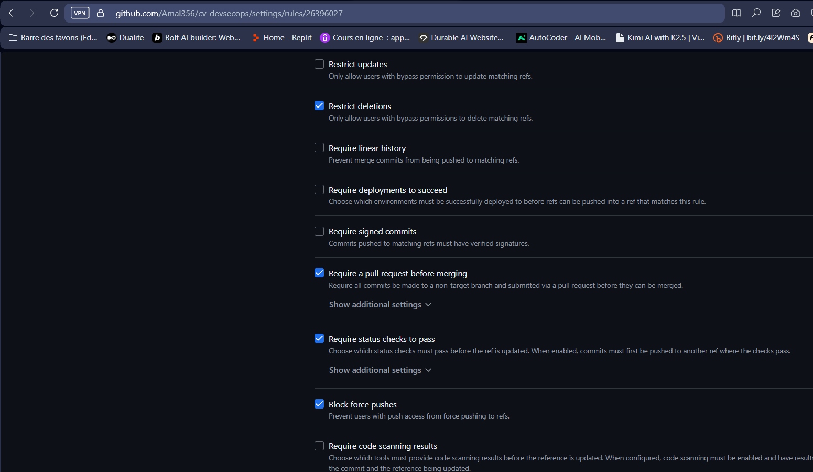
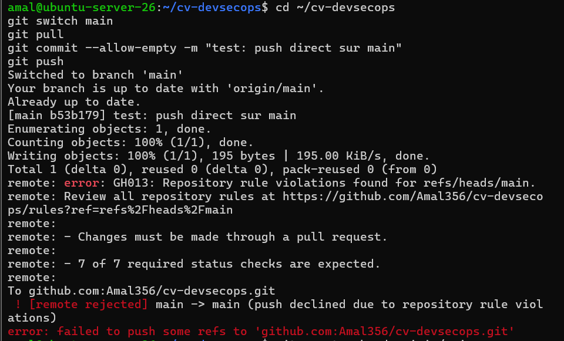
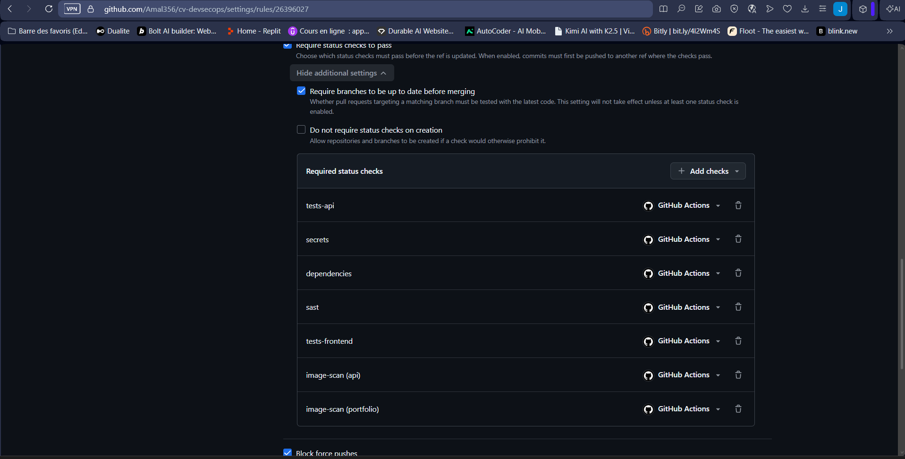
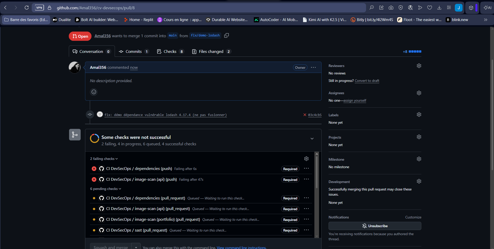
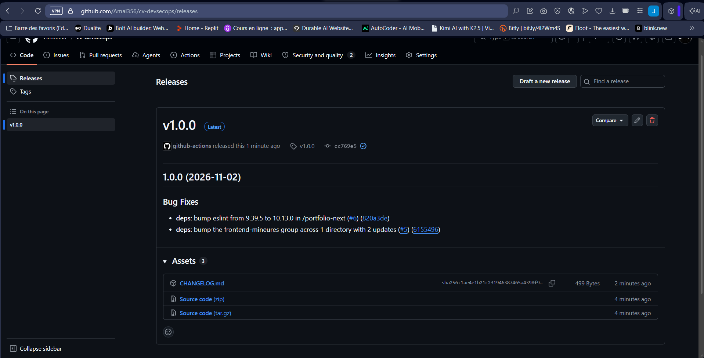

# Activité 5 – Partie 18 : Git Workflow (étapes 79 à 84)

## Étape 79 – branch → Pull Request → review → merge

Plus aucun changement n'est fait directement sur `main` : chaque modification passe par une branche, puis une Pull Request.

```bash
git switch main && git pull
git switch -c ci/semantic-release            # 1. branche
# ... modifications, commits Conventional Commits ...
git push -u origin ci/semantic-release       # 2. Pull Request ouverte sur GitHub
# 3. review : relecture du diff (Files changed), alertes Code scanning, contrôles CI au vert
# 4. Squash and merge depuis GitHub, puis suppression de la branche
```

**Convention de nommage des branches** : `<type>/<description-en-kebab-case>`, avec les mêmes types que les commits.

| Préfixe | Usage | Exemple réel du dépôt |
| :--- | :--- | :--- |
| `feat/` | nouvelle fonctionnalité | `feat/github-actions` |
| `fix/` | correction | `fix/demo-lodash` |
| `ci/` | pipelines, workflows, outillage de release | `ci/semantic-release`, `ci/fix-preset-release` |
| `docs/` | documentation uniquement | `docs/readme-git-workflow` |
| `dependabot/...` | créées automatiquement par Dependabot | `dependabot/npm_and_yarn/portfolio-next/...` |

Seule développeuse du projet, je ne peux pas approuver ma propre PR : la review consiste à relire le diff, les commentaires de `github-advanced-security` (Semgrep, CodeQL) et le résultat des contrôles avant le merge. Exemple : sur la PR #10, Semgrep a signalé l'absence de `min-release-age` dans `.npmrc` ; l'alerte a été corrigée dans la PR avant la fusion.

## Étape 80 – Protection de la branche principale

*Settings → Rules → Rulesets* : ruleset `protection-main`, cible `main`.

| Règle | Effet |
| :--- | :--- |
| Restrict deletions | `main` ne peut pas être supprimée |
| Block force pushes | l'historique de `main` ne peut pas être réécrit |
| Require a pull request before merging | aucun push direct, merge par *squash* |
| Require status checks to pass | les 7 contrôles de l'étape 81 doivent être verts |



Un push direct sur `main` est refusé :

```text
remote: error: GH013: Repository rule violations found for refs/heads/main.
remote: - Changes must be made through a pull request.
```



## Étape 81 – Contrôles obligatoires avant le merge

| Contrôle demandé | Check GitHub requis |
| :--- | :--- |
| tests | `tests-api`, `tests-frontend` |
| SAST | `sast` (Semgrep) |
| secrets | `secrets` (Gitleaks) |
| dependencies | `dependencies` (npm audit + Dependency Review) |
| image scan | `image-scan (api)`, `image-scan (portfolio)` (Trivy) |



**Démonstration :** la PR #8 ajoute `lodash@4.17.4` (vulnérabilité critique de prototype pollution) à l'API. Deux contrôles échouent : `dependencies` (npm audit) et `image-scan (api)` (Trivy trouve la même faille dans l'image). Le bouton *Squash and merge* reste désactivé ; la PR a été fermée sans merge.



La même protection s'applique aux PR de Dependabot : les montées de version majeures `node 25` et `prisma 7` cassaient la CI ; elles ont été refusées avec `@dependabot ignore this major version`.

## Étape 82 – Conventional Commits

Format : `<type>(<portée facultative>): <description>`.

| Type | Usage | Exemple du dépôt |
| :--- | :--- | :--- |
| `feat` | nouvelle fonctionnalité | `feat: ajout du formulaire de contact` |
| `fix` | correction | `fix(deps): resynchronisation du package-lock du frontend` |
| `ci` | pipeline, workflows | `ci: releases automatiques avec semantic-release` |
| `docs` | documentation | `docs: README de la partie 18 (Git workflow)` |
| `feat!` / `BREAKING CHANGE:` | changement incompatible | `feat(api)!: suppression de la route /api/v1` |

Dependabot suit la même convention grâce aux préfixes de `.github/dependabot.yml` (`fix(deps)`, `fix(docker)`, `ci`). Avec le *squash merge*, le titre de la PR devient le message du commit sur `main` : c'est lui qu'analyse semantic-release.

## Étape 83 – Semantic Versioning

Version `MAJOR.MINOR.PATCH`, calculée à partir des commits fusionnés depuis la dernière release :

| Commits depuis la dernière release | Incrément | Exemple |
| :--- | :--- | :--- |
| `fix:`, `perf:` | PATCH | 1.0.0 → 1.0.1 |
| `feat:` | MINOR | 1.0.1 → 1.1.0 |
| `feat!:` ou `BREAKING CHANGE:` | MAJOR | 1.1.0 → 2.0.0 |
| `ci:`, `docs:`, `chore:`, `test:` | aucune release | — |

Les anciens commits des activités 1 à 4 (`Activité 4 : captures...`) ne respectent pas la convention : semantic-release les ignore (*The commit should not trigger a release*).

## Étape 84 – Changelog et releases avec semantic-release

Fichiers :

- [`package.json`](../package.json) racine : versions figées de `semantic-release` 25.0.9, `@semantic-release/changelog`, `@semantic-release/exec` et du preset `conventional-changelog-conventionalcommits` 9.3.1 ;
- [`.releaserc.json`](../.releaserc.json) : branche `main`, tags `vX.Y.Z`, notes de version, `CHANGELOG.md` joint à la release ;
- [`.npmrc`](../.npmrc) : `min-release-age=7`, aucune version npm publiée depuis moins de 7 jours n'est installée (même logique que le `cooldown` de Dependabot).

Le job `release` de [`ci.yml`](../.github/workflows/ci.yml) ne tourne que sur un push vers `main`, **après** les 7 contrôles de sécurité (`needs`). Seul ce job a `contents: write` ; tous les autres sont en lecture seule.

1. analyse des commits et calcul de la version ;
2. génération des notes de version (preset `conventionalcommits`) ;
3. création du tag `v1.0.0` et de la release GitHub, avec `CHANGELOG.md` en pièce jointe ;
4. la version est exposée en sortie du job (`version`) pour les jobs suivants (images taguées `X.Y.Z`, SBOM joints à la release).

Le changelog n'est pas recommité dans `main` : la branche est protégée, la release GitHub joue ce rôle.

**Incident rencontré :** la première exécution a échoué à l'étape `generateNotes` (`Missing helper: conventional-changelog-conventionalcommits requires conventional-changelog-writer@9`). Le preset 10.x n'est pas compatible avec le *writer* 8 embarqué par semantic-release 25 ; le preset a été fixé en 9.3.1 (PR `ci/fix-preset-release`). Le job a ensuite publié **v1.0.0** à partir des commits `fix(deps)` des PR #5 et #6.


