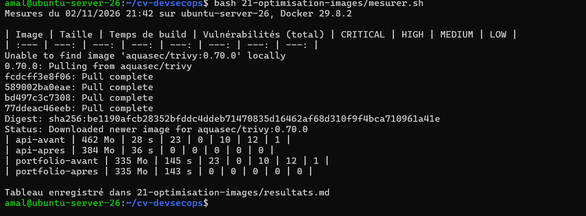
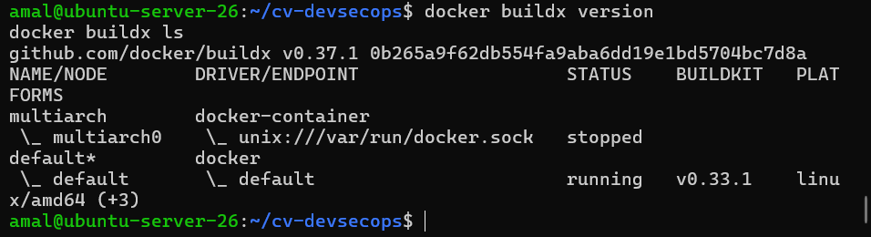

# Activité 5 – Partie 19 : Optimisation des images (étapes 85 à 89)

## Étape 85 – Mesures des images actuelles

Les Dockerfiles de l'activité 4 sont conservés dans [`avant/`](avant). Le script [`mesurer.sh`](mesurer.sh) construit chaque image **sans cache**, puis relève :

- la taille (`docker image inspect`) ;
- le temps de build ;
- le nombre de vulnérabilités, par sévérité (Trivy 0.70.0).

```bash
cd ~/cv-devsecops
bash 21-optimisation-images/mesurer.sh
```

## Étape 86 – Builds multi-stage

**API Express** ([`api/Dockerfile`](../api/Dockerfile)) : la version de l'activité 4 tenait en une seule étape.

| Étape | Contenu |
| :--- | :--- |
| `deps` | `npm ci --omit=dev`, `prisma generate`, copie du code, droits de lecture |
| `runtime` | Node.js + `/app` copié depuis `deps` ; npm, npx, yarn et corepack supprimés ; `apk upgrade` |

**Frontend Next.js** ([`portfolio-next/Dockerfile`](../portfolio-next/Dockerfile)) : il était déjà multi-stage (`deps` → `build` → `runner`, sortie `standalone`). L'image finale gagne les mêmes optimisations, un `HEALTHCHECK` et le cache npm BuildKit.

Ce qui réduit la taille et les vulnérabilités :

1. **Pas de caches dans l'image.** Avant, `npx prisma generate` laissait le cache des moteurs Prisma (`/root/.cache/prisma`) dans une couche. Avec `RUN --mount=type=cache`, les caches servent pendant le build mais ne sont jamais écrits dans l'image.
2. **Pas d'outils de build à l'exécution.** npm embarque ses propres dépendances (`glob`, `cross-spawn`, `tar`...), régulièrement signalées par Trivy. L'application n'en a pas besoin pour tourner : la migration Prisma est lancée directement avec `node node_modules/prisma/build/index.js`.
3. **Correctifs du système.** `apk upgrade` applique les correctifs Alpine publiés depuis la création de l'image `node:22-alpine`.
4. **Code en lecture seule.** Les fichiers de l'API appartiennent à `root` ; l'utilisateur `node` peut les lire et les exécuter, mais pas les modifier.

## Étape 87 – Comparaison avant / après

Résultat de `mesurer.sh` ([`resultats.md`](resultats.md)), le 02/11/2026 sur `ubuntu-server-26`, Docker 29.8.2 :

| Image | Taille | Temps de build (sans cache) | Vulnérabilités (total) | CRITICAL | HIGH | MEDIUM | LOW |
| :--- | ---: | ---: | ---: | ---: | ---: | ---: | ---: |
| api (avant) | 462 Mo | 28 s | 23 | 0 | 10 | 12 | 1 |
| api (après) | **384 Mo** | 36 s | **0** | 0 | 0 | 0 | 0 |
| portfolio (avant) | 335 Mo | 145 s | 23 | 0 | 10 | 12 | 1 |
| portfolio (après) | 335 Mo | 143 s | **0** | 0 | 0 | 0 | 0 |

**Analyse :**

- **Vulnérabilités : 23 → 0 pour les deux images.** Les 23 vulnérabilités identiques dans les deux images « avant » montrent qu'elles ne venaient pas de notre code, mais de l'image de base : npm et ses dépendances, et des paquets Alpine non mis à jour. Les supprimer et appliquer `apk upgrade` les élimine toutes.
- **Taille de l'API : −78 Mo (−17 %).** Le cache Prisma et npm ne sont plus dans l'image.
- **Taille du portfolio : inchangée.** L'image était déjà multi-stage avec la sortie `standalone` ; les quelques Mo gagnés en supprimant npm sont compensés par les paquets Alpine mis à jour.
- **Temps de build sans cache : légèrement plus long pour l'API** (une étape de plus et `apk upgrade`). En usage normal, les *cache mounts* BuildKit et le cache de couches (`type=gha` dans GitHub Actions) rendent les builds suivants beaucoup plus rapides.



## Étape 88 – BuildKit / Buildx

```bash
docker buildx version
docker buildx ls
```



- Les Dockerfiles commencent par `# syntax=docker/dockerfile:1` et utilisent `RUN --mount=type=cache` : ces fonctions n'existent qu'avec BuildKit.
- `mesurer.sh` construit avec `docker buildx build --load`.
- **GitHub Actions** : `docker/setup-buildx-action` puis `docker/build-push-action`, dans les jobs `image-scan` et `publish` ; le job `publish` partage un cache de couches entre les exécutions (`cache-from` / `cache-to: type=gha`).

## Étape 89 – Image multi-architecture (amd64 et arm64)

Le job `publish` de [`ci.yml`](../.github/workflows/ci.yml) tourne après chaque release créée par semantic-release. Il construit chaque image pour `linux/amd64` et `linux/arm64` (émulation QEMU via `docker/setup-qemu-action`) et publie un **index d'images** dans GHCR : le même tag sert aux deux architectures, et chaque machine récupère la sienne.

| Image | Tags |
| :--- | :--- |
| `ghcr.io/amal356/devsecops-api` | `X.Y.Z`, `latest` |
| `ghcr.io/amal356/devsecops-portfolio` | `X.Y.Z`, `latest` |

```bash
docker buildx imagetools inspect ghcr.io/amal356/devsecops-api:1.0.1
```

Résultat (copié du job `publish (api)`) :

```text
à compléter
```
