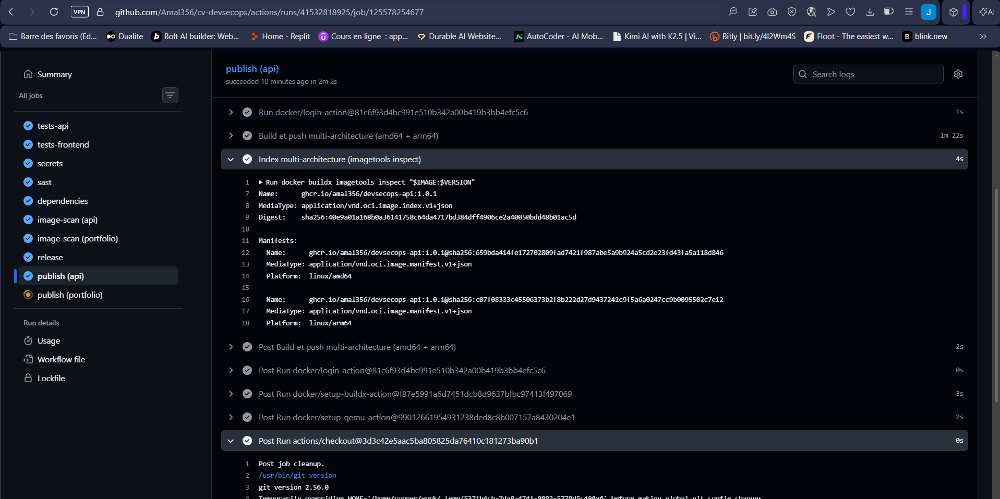

# Activité 5 – Partie 19 : Optimisation des images (étapes 85 à 89)

## Étape 85 – Mesures des images actuelles

Les Dockerfiles de l'activité 4 sont conservés dans [`avant/`](avant). Le script [`mesurer.sh`](mesurer.sh) construit chaque image **sans cache**, puis relève :

- la taille (`docker image inspect`) ;
- le temps de build ;
- le nombre de vulnérabilités, par sévérité (Trivy 0.70.0, la même version que les pipelines).

```bash
cd ~/cv-devsecops
bash 21-optimisation-images/mesurer.sh
```

## Étape 86 – Builds multi-stage

**API Express** ([`api/Dockerfile`](../api/Dockerfile)) : la version de l'activité 4 tenait en une seule étape.

| Étape | Contenu |
| :--- | :--- |
| `deps` | `npm ci --omit=dev`, `prisma generate`, copie du code, droits de lecture |
| `runtime` | Node.js + `/app` copié depuis `deps` ; npm, npx, yarn et corepack supprimés ; `apk upgrade` |

**Frontend Next.js** ([`portfolio-next/Dockerfile`](../portfolio-next/Dockerfile)) : il était déjà multi-stage (`deps` → `build` → `runner`, sortie `standalone`). Il gagne les mêmes optimisations dans `runner`, un `HEALTHCHECK` et le cache npm BuildKit.

Ce qui réduit la taille et les vulnérabilités :

1. **Pas de caches dans l'image.** Avant, `npm cache clean` et `npx prisma generate` laissaient le cache des moteurs Prisma (`/root/.cache/prisma`) dans une couche. Avec `RUN --mount=type=cache`, les caches servent pendant le build mais ne sont jamais écrits dans l'image.
2. **Pas d'outils de build à l'exécution.** npm embarque ses propres dépendances (`glob`, `cross-spawn`, `tar`...), régulièrement signalées par Trivy. L'application n'en a pas besoin pour tourner : la migration Prisma est lancée directement avec `node node_modules/prisma/build/index.js`.
3. **Correctifs du système.** `apk upgrade` applique les correctifs Alpine publiés depuis la création de l'image `node:22-alpine`.
4. **Code en lecture seule.** Les fichiers de l'API appartiennent à `root` ; l'utilisateur `node` peut les lire et les exécuter, mais pas les modifier.

## Étape 87 – Comparaison avant / après

*Tableau généré par `mesurer.sh` (copie de `resultats.md`), à compléter :*

| Image | Taille | Temps de build | Vulnérabilités (total) | CRITICAL | HIGH | MEDIUM | LOW |
| :--- | ---: | ---: | ---: | ---: | ---: | ---: | ---: |
| api (avant) | | | | | | | |
| api (après) | | | | | | | |
| portfolio (avant) | | | | | | | |
| portfolio (après) | | | | | | | |

*Analyse :* à compléter.


## Étape 88 – BuildKit / Buildx

- **Jenkins** : `docker buildx build --load` (stage *Build des images Docker*), qui affiche le temps de build de chaque image.
- **GitHub Actions** : `docker/setup-buildx-action`, puis `docker/build-push-action`, avec un cache de couches partagé entre les exécutions (`cache-from` / `cache-to: type=gha`).
- Les Dockerfiles commencent par `# syntax=docker/dockerfile:1` et utilisent `RUN --mount=type=cache` : ces fonctions n'existent qu'avec BuildKit.

```bash
docker buildx version
docker buildx ls
```

## Étape 89 – Image multi-architecture (amd64 et arm64)

Le job `publish` de GitHub Actions construit chaque image pour `linux/amd64` et `linux/arm64` (émulation QEMU via `docker/setup-qemu-action`). Il publie un **index d'images** dans GHCR : le même tag sert aux deux architectures, et chaque machine récupère la sienne.

```bash
docker buildx imagetools inspect ghcr.io/amal356/devsecops-api:1.0.0
```

Résultat (copié du job `publish (api)`) :

```text
à compléter
```


