# Activité 5 – Partie 20 : Registre privé Harbor (étapes 90 à 95)

## Étape 90 – Installation

Harbor v2.15.4 est installé sur `ubuntu-server-26`, la VM qui fait tourner Jenkins, avec le script [`install-harbor.sh`](install-harbor.sh) :

- installeur *online* (les images Harbor viennent de Docker Hub), avec **Trivy intégré** (`--with-trivy`) ;
- HTTP sur le port **8090**, nom d'hôte `localhost` : Docker accepte un registre HTTP sur `localhost` sans configuration, donc Jenkins pousse sur `localhost:8090` ;
- le mot de passe admin est demandé à l'installation, celui de la base est généré aléatoirement (`openssl rand`) : **aucun secret dans Git**, `harbor.yml` est en `chmod 600` hors du dépôt (`/opt/harbor`).

```bash
sudo bash 22-harbor/install-harbor.sh
sudo docker compose -f /opt/harbor/docker-compose.yml ps     # 10 conteneurs (healthy)
curl -s http://localhost:8090/api/v2.0/health                 # "status": "healthy"
```

Depuis Windows, une redirection de port VirtualBox `harbor` (8090 → 8090) donne accès à l'interface sur `http://localhost:8090`.

Ressources : la VM n'a que 3,3 Go de RAM. Avant l'installation, les caches de build Docker ont été purgés (`docker builder prune`, +9 Go de disque libre) et le conteneur du mini CV de l'activité 1 a été arrêté.

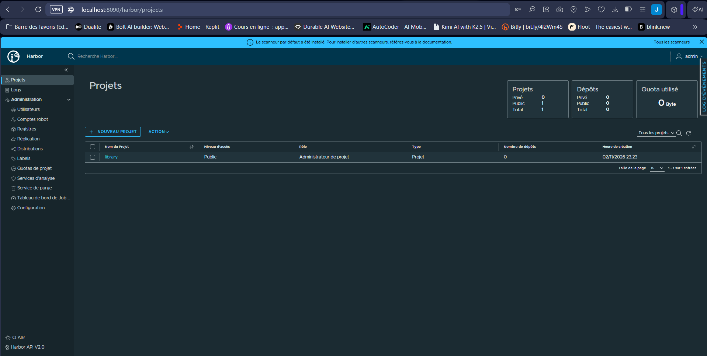

## Étape 91 – Publication depuis le pipeline

Le stage Jenkins *Publication Harbor* (voir [`Jenkinsfile`](../Jenkinsfile)) pousse les deux images **après** les contrôles de sécurité : une image refusée par Trivy n'arrive jamais dans le registre.

| Image | Tags |
| :--- | :--- |
| `localhost:8090/devsecops/devsecops-api` | `<sha court du commit>`, `latest` |
| `localhost:8090/devsecops/devsecops-portfolio` | `<sha court du commit>`, `latest` |

Les identifiants du robot sont injectés par `withCredentials` (credential `harbor-robot`), utilisés avec `docker login --password-stdin` dans un `DOCKER_CONFIG` propre au build, puis supprimés dans le bloc `post` : ils ne restent ni dans le workspace ni dans `~/.docker` de l'utilisateur `jenkins`.

Build Jenkins **#79** (commit `41003d0`) — fichier `reports/images-harbor.txt` archivé :

```text
localhost:8090/devsecops/devsecops-api@sha256:d197c4034ebf50f6857de90916e3367804f24a35ea1847317c659455d2be7612
localhost:8090/devsecops/devsecops-portfolio@sha256:d035da90a6f6ebde86a8676679d68ab064085ab5abee8fb9a1ddde3dbada1121
```

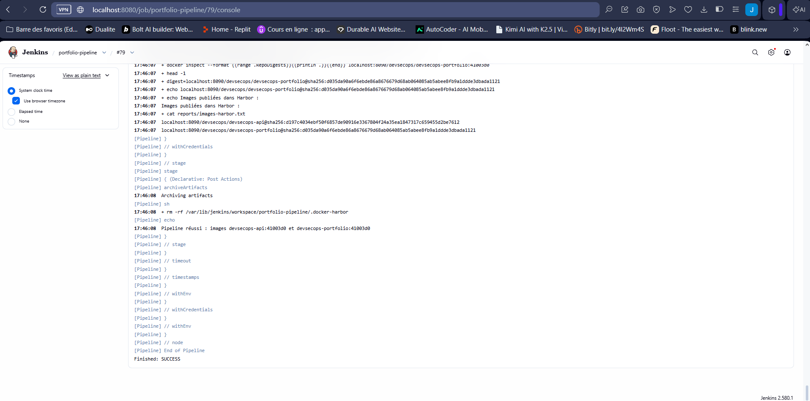
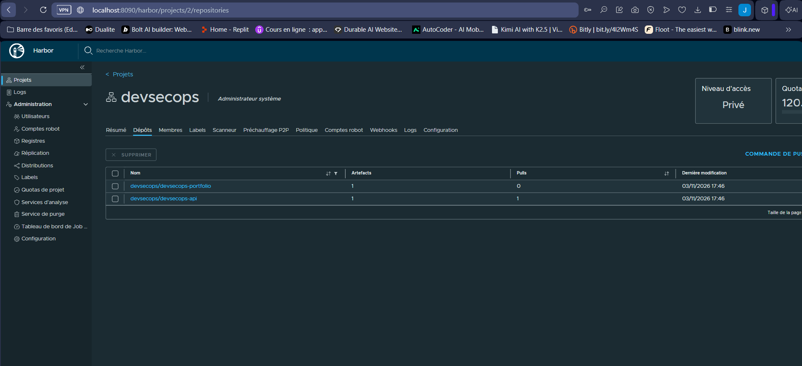

## Étape 92 – RBAC : projet, utilisateurs, robot account

| Élément | Configuration | Droits |
| :--- | :--- | :--- |
| Projet `devsecops` | **Privé** (pas d'accès anonyme) | — |
| Utilisateur `amal` | Membre, rôle **Développeur** | push et pull, pas d'administration du projet |
| Utilisateur `lecteur` | Membre, rôle **Invité** | pull uniquement |
| Robot `robot$devsecops+jenkins` | Robot du projet, expiration **90 jours** | *Dépôt* : Push et Pull, rien d'autre |

Le compte `admin` ne sert qu'à l'administration. Le pipeline utilise uniquement le robot : il ne peut pas se connecter à l'interface, n'a accès qu'à un seul projet, expire automatiquement et peut être révoqué sans toucher aux comptes humains. Son secret n'est affiché qu'une fois par Harbor ; il est stocké uniquement dans Jenkins (credential `harbor-robot`, type *Username with password*).

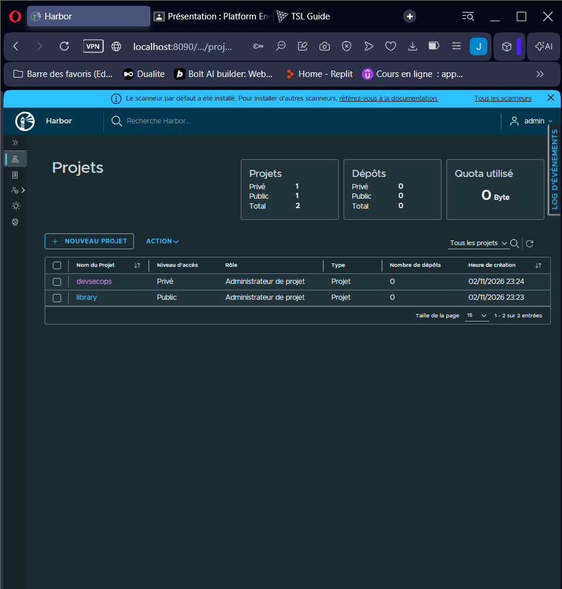
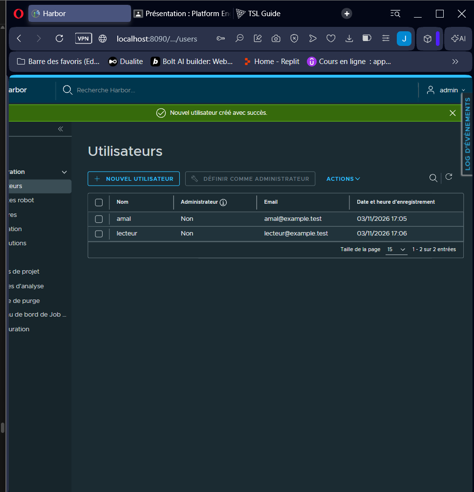
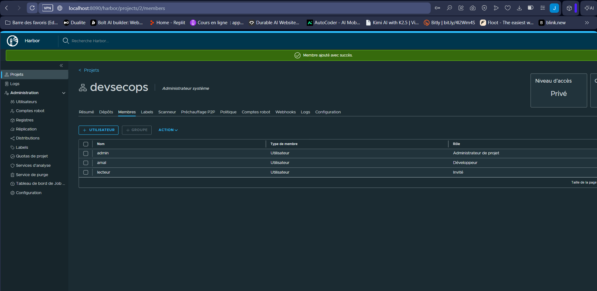
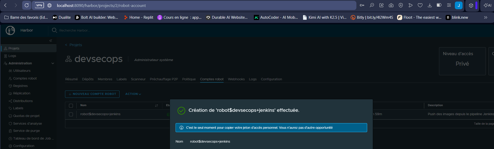
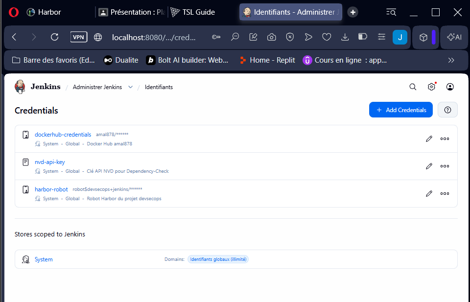

## Étape 93 – Scan automatique Harbor comparé au scan Trivy du pipeline

Projet `devsecops` → *Configuration* → **Analyse automatique des images lors de l'envoi** activée.

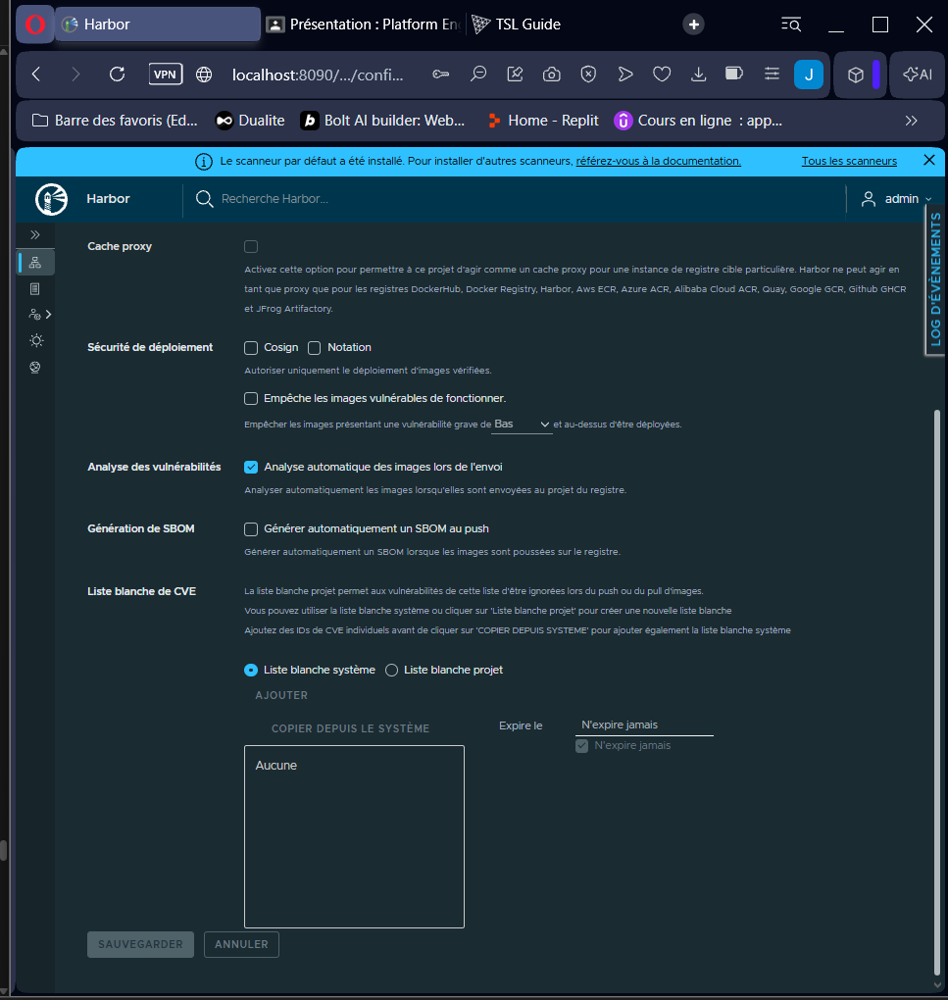

| Image | Trivy du pipeline Jenkins (0.70.0, HIGH + CRITICAL) | Scan Harbor (Trivy adapter v0.75.0, toutes sévérités) |
| :--- | :--- | :--- |
| devsecops-api | 0 | Pas de vulnérabilité |
| devsecops-portfolio | 0 | Pas de vulnérabilité |

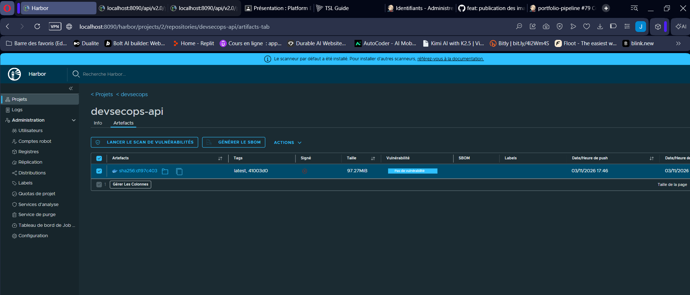
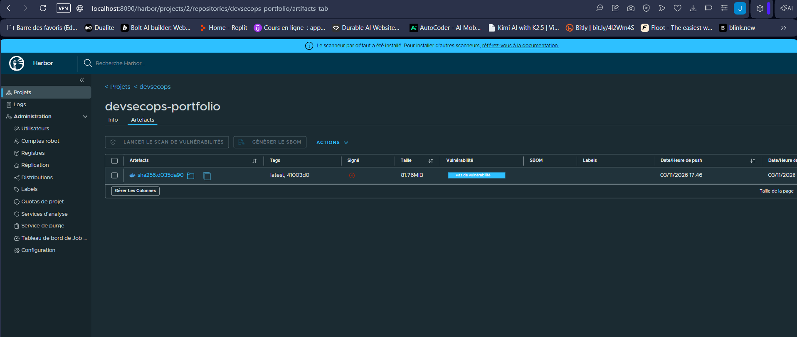

**Analyse :** les deux scans utilisent Trivy et donnent le même résultat, grâce aux images optimisées de la partie 19 (npm supprimé, `apk upgrade`). Ils n'ont pourtant pas le même rôle :

- le scan du **pipeline bloque** une image vulnérable **avant** sa publication ;
- le scan **Harbor surveille** les images **déjà stockées** : il peut être relancé quand de nouvelles CVE sont publiées, et l'option *Empêche les images vulnérables de fonctionner* bloque le pull d'une image devenue trop vulnérable.

**Incident :** le premier scan Harbor a échoué (`failed to download vulnerability DB ... context deadline exceeded`) : le scanner n'a pas pu télécharger la base Trivy (~80 Mo depuis `ghcr.io`) dans le délai de 5 minutes. La base déjà téléchargée par le pipeline (volume Docker `trivy-cache`) a été copiée dans le cache du scanner (`/data/trivy-adapter/trivy/db`), puis le scan a été relancé avec succès.

## Étape 94 – Politique de rétention

Projet `devsecops` → *Politique* → *Rétention de tags* :

| Règle | Dépôts | Conserver | Tags |
| :--- | :--- | :--- | :--- |
| 1 | `**` | les **5** images poussées le plus récemment | `**` (et artefacts non tagués) |
| 2 | `**` | **toujours** | `latest` |

Planification **journalière** (01:00). Un *Tester l'exécution* (dry run) montre ce qui serait supprimé sans rien supprimer ; le *Service de purge* (garbage collection, Administration) libère ensuite l'espace disque des artefacts supprimés. Chaque build Jenkins pousse un nouveau tag : sans rétention, le disque de la VM se remplirait.

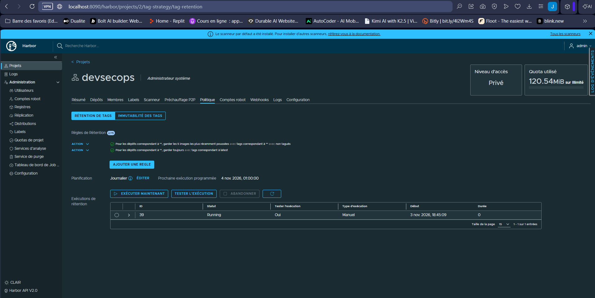

## Étape 95 – GitHub Container Registry comparé à Harbor

| Critère | GHCR (`ghcr.io/amal356/...`) | Harbor (`localhost:8090/devsecops/...`) |
| :--- | :--- | :--- |
| Hébergement | Service GitHub, rien à installer | Auto-hébergé : VM, disque, sauvegardes, mises à jour à notre charge |
| Accès | Internet ; public ou privé | Réseau privé, pas d'exposition publique |
| Authentification CI | `GITHUB_TOKEN` du workflow (`packages: write`), aucun secret à gérer | Robot account (secret stocké dans Jenkins) |
| RBAC | Droits hérités du dépôt ou de l'organisation | Projets, rôles (Invité → Administrateur de projet), robots à périmètre limité |
| Scan de vulnérabilités | Non intégré (Trivy et Dependabot dans le pipeline) | Trivy intégré, scan à l'envoi, blocage du pull |
| Rétention | Manuelle ou via une Action | Politiques par projet + garbage collection |
| Multi-architecture | Oui (index amd64 + arm64, partie 19) | Oui (index OCI supportés) |
| Signatures / SBOM | Artefacts OCI, vérifiés par `cosign` / `gh attestation` | Affichés comme *accessoires* ; politique « Cosign obligatoire » possible |
| Coût | Gratuit pour un dépôt public | Gratuit (open source), mais coût en ressources (≈ 2 Go de RAM ici) |

**Conclusion :** GHCR convient aux images publiques construites par GitHub Actions : zéro maintenance, authentification sans secret. Harbor convient à un registre interne, quand on veut garder le contrôle des images, des droits et des politiques de sécurité (scan, rétention, signature obligatoire), au prix de l'exploitation d'un service de plus.
