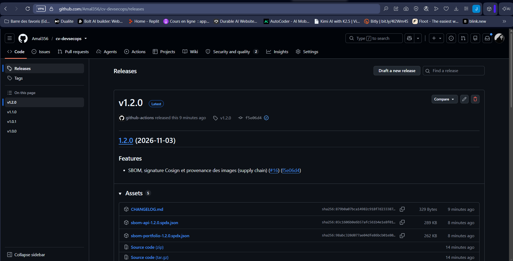
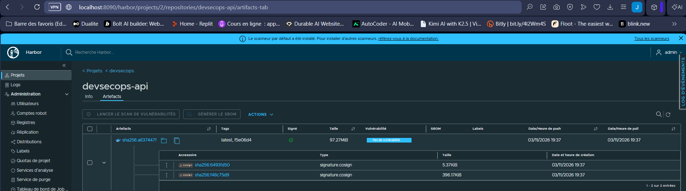
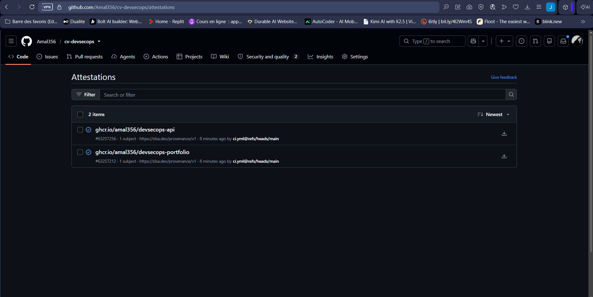
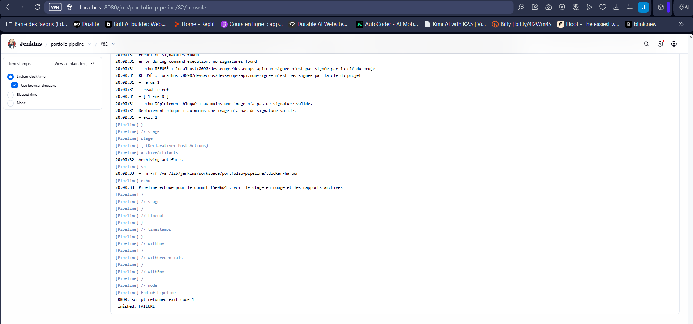
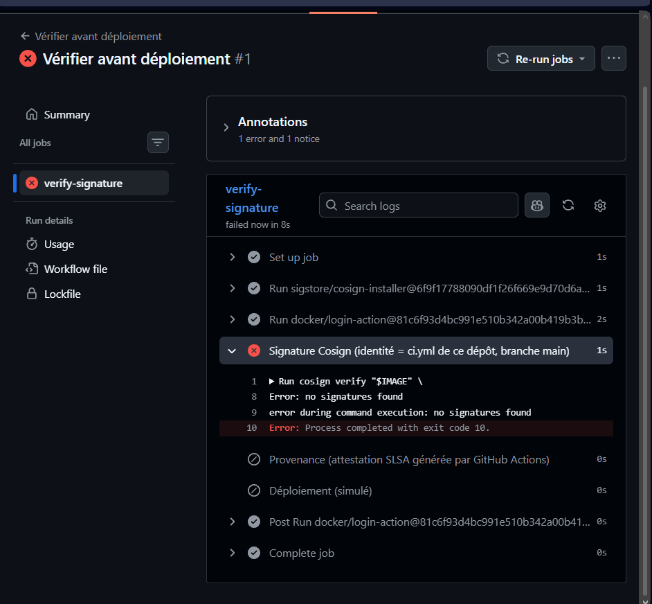

# Activité 5 – Partie 21 : Software Supply Chain Security (étapes 96 à 105)

Deux chaînes, une même logique : **inventorier** (SBOM), **signer**, **attester l'origine**, puis **refuser** à la livraison tout ce qui n'est pas vérifiable.

| | GitHub Actions → GHCR | Jenkins → Harbor |
| :--- | :--- | :--- |
| SBOM | `anchore/sbom-action` (Syft) | conteneur `anchore/syft:v1.55.0` |
| Signature | Cosign **keyless** : certificat éphémère lié à l'identité OIDC du workflow | Cosign avec **paire de clés** (`cosign.key` dans Jenkins, [`cosign.pub`](cosign.pub) dans Git) |
| Provenance | `actions/attest-build-provenance` (SLSA v1) | SBOM attaché en attestation signée (`cosign attest`) |
| Barrière de déploiement | job `verify-before-deploy` + workflow [`verify-deploy.yml`](../.github/workflows/verify-deploy.yml) | stage *Déploiement : vérification de signature* |

## Étapes 96-97 – SBOM avec Syft, conservé comme artefact

Un SBOM (*Software Bill of Materials*) liste tous les composants d'une image : paquets Alpine, modules npm, versions, licences. Quand une nouvelle CVE est publiée, il suffit de chercher le composant concerné dans les SBOM, sans reconstruire ni rescanner les images.

- **GitHub Actions** : `sbom-<image>.spdx.json`, artefact du job `publish`.
- **Jenkins** : `reports/sbom-devsecops-api.spdx.json` et `sbom-devsecops-portfolio.spdx.json`, dans les *Artifacts* du build.


## Étape 98 – SBOM attaché à chaque release GitHub

Le job `publish` ajoute `sbom-api-X.Y.Z.spdx.json` et `sbom-portfolio-X.Y.Z.spdx.json` à la release créée par semantic-release (`gh release upload`).



## Étape 99 – Signature des images avec Cosign

**GitHub Actions (keyless)** :

```bash
cosign sign --yes --recursive ghcr.io/amal356/devsecops-api@sha256:...
```

Aucune clé n'est stockée. Le job obtient un jeton OIDC de GitHub (`id-token: write`), Fulcio délivre un certificat valable 10 minutes qui contient l'identité du workflow, et la signature est inscrite dans le journal public Rekor. `--recursive` signe l'index multi-architecture **et** chaque image (amd64, arm64).

**Jenkins (paire de clés)** : la clé a été générée une fois sur la VM.

```bash
docker run --rm -it -u "$(id -u):$(id -g)" -v "$PWD:/keys" -w /keys \
  ghcr.io/sigstore/cosign/cosign:v3.1.4 generate-key-pair
```

`cosign.key` (chiffrée par un mot de passe) va dans les credentials Jenkins, jamais dans Git. Seule `cosign.pub` est commitée.



## Étape 100 – Vérification avec `cosign verify`

```bash
cosign verify ghcr.io/amal356/devsecops-api:1.0.0 \
  --certificate-identity "https://github.com/Amal356/cv-devsecops/.github/workflows/ci.yml@refs/heads/main" \
  --certificate-oidc-issuer https://token.actions.githubusercontent.com
```

Résultat :

```text
à compléter
```

La vérification contrôle trois choses : la signature correspond bien au digest de l'image ; le certificat a été émis pour **ce** workflow, sur **cette** branche, de **ce** dépôt ; la signature figure dans Rekor. Une image signée par quelqu'un d'autre, ou depuis une autre branche, est refusée.

## Étape 101 – Attestations de build dans GitHub Actions

`actions/attest-build-provenance` produit une attestation **SLSA Provenance v1**, signée par Sigstore et poussée dans GHCR à côté de l'image. Elle indique le dépôt, le commit, le workflow, le runner et le déclencheur qui ont produit ce digest. Elle est visible dans l'onglet *Actions → Attestations* du dépôt.



## Étape 102 – Provenance des artefacts

La **provenance** répond à la question : *d'où vient cet artefact, et comment a-t-il été fabriqué ?* Une signature prouve qu'une identité a approuvé une image. La provenance décrit en plus le processus de fabrication : sources, commit exact, système de build, paramètres. Elle est elle-même signée, donc infalsifiable après coup.

```bash
gh attestation verify oci://ghcr.io/amal356/devsecops-api:1.0.0 --repo Amal356/cv-devsecops
```

Résultat :

```text
à compléter
```

## Étape 103 – SLSA et in-toto : où se situe le pipeline ?

**in-toto** est un format d'attestation : un *statement* qui associe un sujet (le digest d'un artefact) à un *prédicat* typé (provenance SLSA, SBOM SPDX, résultat de scan...), le tout signé. Cosign et GitHub produisent tous deux des attestations in-toto.

**SLSA** (*Supply-chain Levels for Software Artifacts*) définit des niveaux de garantie sur le build :

| Niveau (Build track v1) | Exigence | Pipeline GitHub Actions | Pipeline Jenkins |
| :--- | :--- | :--- | :--- |
| L1 | La provenance existe et décrit le build | ✅ attestation SLSA générée automatiquement | ⚠️ SBOM attesté, pas de provenance SLSA complète |
| L2 | Provenance **signée**, générée par une plateforme de build hébergée | ✅ signée par Sigstore, générée par les runners GitHub | ❌ serveur Jenkins auto-hébergé |
| L3 | Build isolé et durci : la provenance ne peut pas être falsifiée par le projet lui-même | ⚠️ runners éphémères isolés, mais l'attestation est générée dans le même job que le build (un *reusable workflow* isolé serait nécessaire) | ❌ |

**Synthèse :** le pipeline GitHub Actions atteint **SLSA Build L2**. Il s'approche de L3 : passer la génération de provenance dans un *reusable workflow* séparé, que les étapes du build ne peuvent pas influencer. Le pipeline Jenkins reste au niveau **L1** : ses signatures et ses SBOM sont réels, mais rien ne garantit qu'un administrateur du serveur n'a pas modifié le build.

## Étape 104 – Refuser une image non signée

- **GitHub Actions** : le job `verify-before-deploy` (après `publish`) et le workflow manuel *Vérifier avant déploiement* exécutent `cosign verify` et `gh attestation verify`. Si l'une des deux commandes échoue, l'étape de déploiement ne s'exécute pas.
- **Jenkins** : le stage *Déploiement : vérification de signature* vérifie chaque image publiée dans Harbor avec `cosign.pub`, et fait échouer le build si une seule image n'est pas signée par la clé du projet.
- **Harbor** (défense en profondeur) : *Projet → Configuration → Cosign : prevent unsigned images from being pulled*. Le registre refuse lui-même de distribuer une image non signée.

## Étape 105 – Simulation d'une attaque de supply chain

**Scénario :** un attaquant obtient le droit de pousser dans le registre (identifiants volés, ou un développeur trompé) et remplace l'image de l'API par la sienne, sans passer par le pipeline. Il ne possède pas la clé de signature.

1. Image piégée poussée directement dans Harbor, sans signature :
   ```bash
   docker pull nginx:alpine
   docker tag nginx:alpine localhost:8090/devsecops/devsecops-api:non-signee
   docker push localhost:8090/devsecops/devsecops-api:non-signee
   ```
2. Tentative de déploiement : *Build with Parameters*, `IMAGE_A_DEPLOYER = localhost:8090/devsecops/devsecops-api:non-signee`.
3. **Résultat : déploiement bloqué.**
   ```text
   à compléter (sortie du stage « Déploiement : vérification de signature »)
   ```
4. Côté GitHub : *Actions → Vérifier avant déploiement → Run workflow* avec une image non signée (par ex. `docker.io/library/nginx:alpine`). Le job échoue sur `cosign verify` : `no signatures found`.

Le scénario « dépendance compromise » est couvert à l'étape 81 : la PR qui ajoute `lodash@4.17.4` est bloquée avant le merge, donc aucune image n'est construite.



