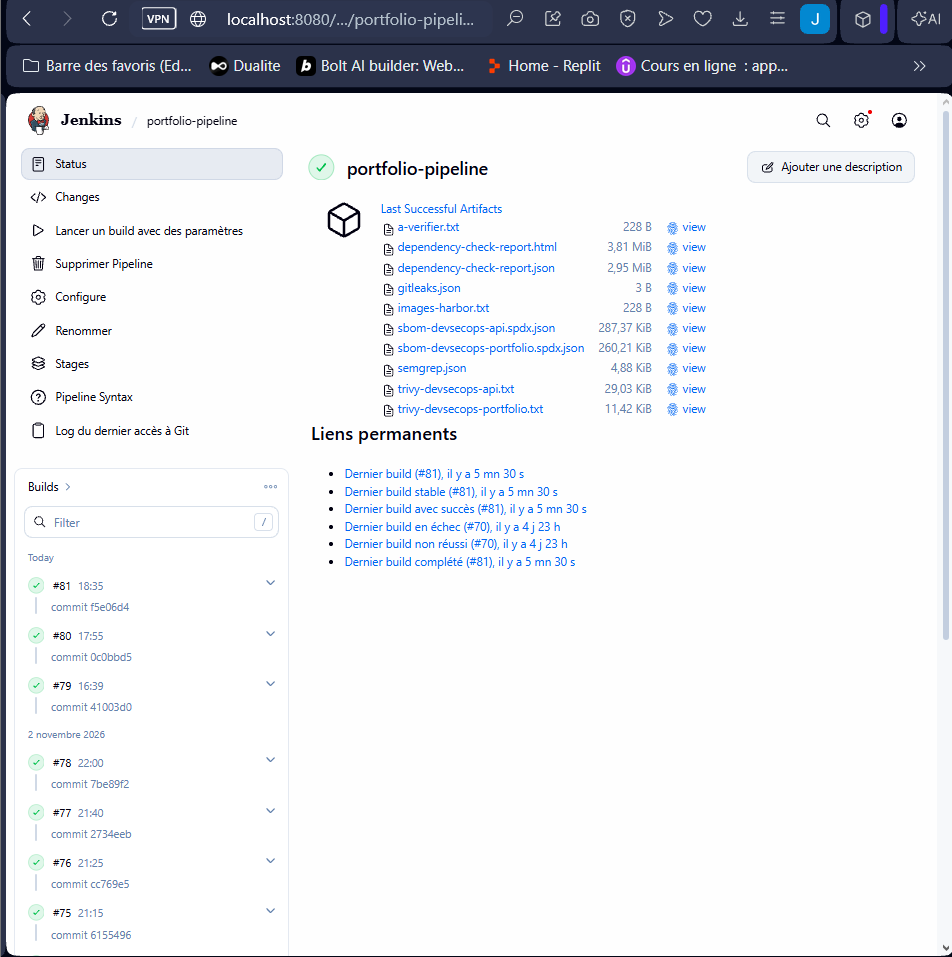
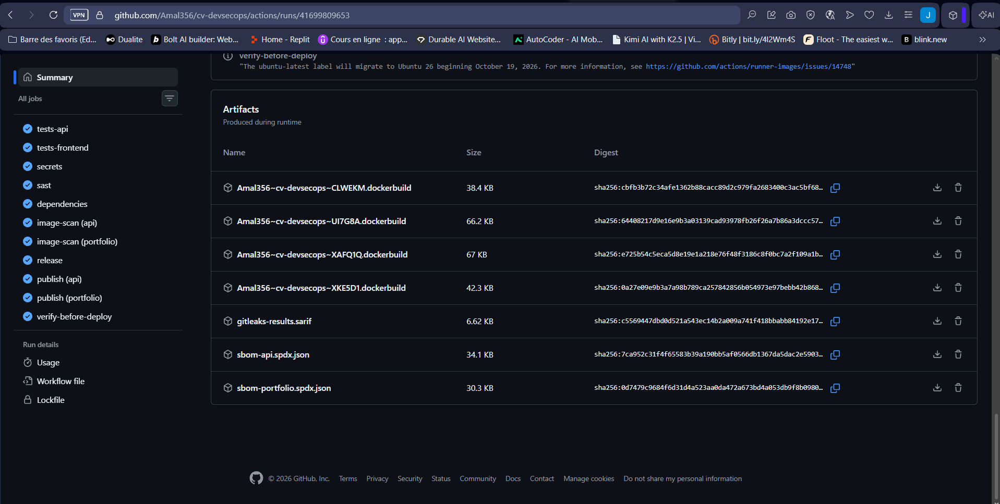
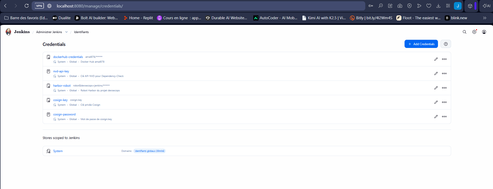
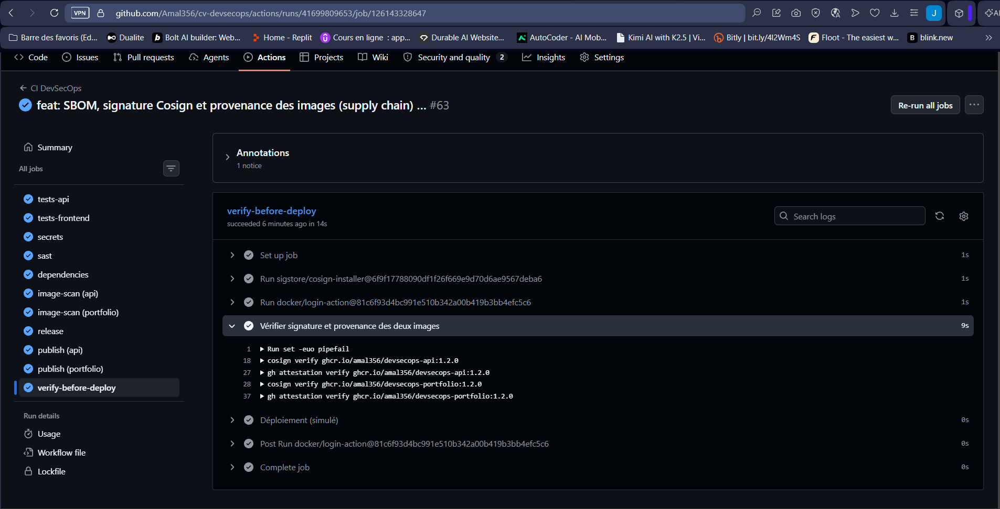
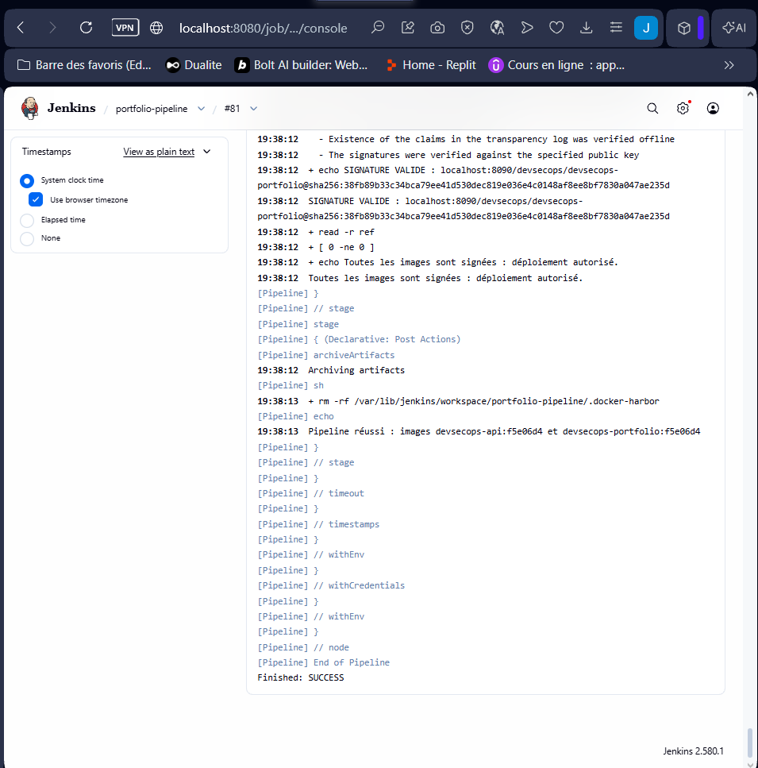

# Activité 5 – Partie 21 : Software Supply Chain Security (étapes 96 à 105)

Deux chaînes, une même logique : **inventorier** (SBOM), **signer**, **attester l'origine**, puis **refuser** à la livraison tout ce qui n'est pas vérifiable.

| | GitHub Actions → GHCR | Jenkins → Harbor |
| :--- | :--- | :--- |
| SBOM | `anchore/sbom-action` (Syft), artefact du run + pièce jointe de la release | conteneur `anchore/syft:v1.55.0`, artefact du build |
| Signature | Cosign **keyless** : certificat éphémère lié à l'identité OIDC du workflow | Cosign avec **paire de clés** (`cosign.key` dans Jenkins, [`cosign.pub`](cosign.pub) dans Git) |
| Provenance | `actions/attest-build-provenance` (SLSA Provenance v1) | SBOM attaché en attestation signée (`cosign attest`) |
| Barrière de déploiement | job `verify-before-deploy` + workflow manuel [`verify-deploy.yml`](../.github/workflows/verify-deploy.yml) | stage *Déploiement : vérification de signature* |

## Étapes 96-97 – SBOM avec Syft, conservé comme artefact

Un SBOM (*Software Bill of Materials*) liste tous les composants d'une image : paquets Alpine, modules npm, versions, licences. Quand une nouvelle CVE est publiée, il suffit de chercher le composant dans les SBOM archivés pour savoir quelles images sont touchées, sans reconstruire ni rescanner.

- **Jenkins** (build #81) : stage *SBOM : Syft*, fichiers `sbom-devsecops-api.spdx.json` (287 Kio) et `sbom-devsecops-portfolio.spdx.json` (260 Kio) dans les artefacts du build.
- **GitHub Actions** (run #63) : artefacts `sbom-api.spdx.json` et `sbom-portfolio.spdx.json` du job `publish`.




## Étape 98 – SBOM attaché à chaque release GitHub

Le job `publish` ajoute le SBOM de chaque image à la release créée par semantic-release (`gh release upload`). Release **v1.2.0** : `sbom-api-1.2.0.spdx.json`, `sbom-portfolio-1.2.0.spdx.json` et `CHANGELOG.md`.


## Étape 99 – Signature des images avec Cosign

**GitHub Actions (keyless)** :

```bash
cosign sign --yes --recursive ghcr.io/amal356/devsecops-api@sha256:...
```

Aucune clé n'est stockée. Le job obtient un jeton OIDC de GitHub (`id-token: write`), Fulcio délivre un certificat valable 10 minutes qui contient l'identité du workflow (`ci.yml@refs/heads/main`), et la signature est inscrite dans le journal public de transparence Rekor. `--recursive` signe l'index multi-architecture **et** chaque image (amd64, arm64). On signe toujours un **digest**, jamais un tag : un tag peut être déplacé, un digest non.

**Jenkins (paire de clés)** : la paire a été générée une seule fois sur la VM, **hors du dépôt** :

```bash
mkdir -p ~/cosign-keys && chmod 700 ~/cosign-keys && cd ~/cosign-keys
docker run --rm -it -u "$(id -u):$(id -g)" -v "$PWD:/keys" -w /keys \
  ghcr.io/sigstore/cosign/cosign:v3.1.4 generate-key-pair
```

- `cosign.key` (chiffrée par un mot de passe) : credential Jenkins `cosign-key` (*Secret file*), mot de passe dans `cosign-password` (*Secret text*). La copie temporaire sous Windows a été supprimée, et `cosign.key` est dans `.gitignore`.
- `cosign.pub` : commitée dans ce dossier, elle sert à vérifier.

Le stage *Signature : Cosign* signe chaque image publiée dans Harbor, puis attache son SBOM en **attestation signée** (`cosign attest --type spdxjson`). Harbor affiche ces deux objets comme *accessoires* de l'image, et la colonne **Signé** passe au vert.




## Étape 100 – Vérification avec `cosign verify`

**GitHub Actions** (job `verify-before-deploy`, v1.2.0) :

```bash
cosign verify ghcr.io/amal356/devsecops-api:1.2.0 \
  --certificate-identity "https://github.com/Amal356/cv-devsecops/.github/workflows/ci.yml@refs/heads/main" \
  --certificate-oidc-issuer https://token.actions.githubusercontent.com
```

La vérification contrôle trois choses : la signature correspond au digest de l'image ; le certificat a été émis pour **ce** workflow, sur **cette** branche, de **ce** dépôt ; la signature figure dans Rekor. Une image signée par quelqu'un d'autre, ou depuis une autre branche, est refusée.

**Jenkins** (build #81) : `cosign verify --key cosign.pub` sur chaque image de Harbor.

```text
- Existence of the claims in the transparency log was verified offline
- The signatures were verified against the specified public key
SIGNATURE VALIDE : localhost:8090/devsecops/devsecops-portfolio@sha256:38fb89b33c34bca79ee41d530dec819e036e4c0148af8ee8bf7830a047ae235d
Toutes les images sont signées : déploiement autorisé.
Finished: SUCCESS
```




## Étape 101 – Attestations de build dans GitHub Actions

`actions/attest-build-provenance` produit une attestation **SLSA Provenance v1** (`https://slsa.dev/provenance/v1`), signée par Sigstore et poussée dans GHCR à côté de l'image. Elle indique le dépôt, le commit, le workflow, le runner et le déclencheur qui ont produit ce digest. Les deux attestations (API et portfolio) sont visibles dans l'onglet *Attestations* du dépôt, signées par `ci.yml@refs/heads/main`.


## Étape 102 – Provenance des artefacts

La **provenance** répond à la question : *d'où vient cet artefact, et comment a-t-il été fabriqué ?*

- une **signature** prouve qu'une identité a approuvé une image ;
- la **provenance** décrit en plus le processus de fabrication : sources, commit exact, système de build, paramètres. Elle est elle-même signée, donc infalsifiable après coup.

```bash
gh attestation verify oci://ghcr.io/amal356/devsecops-api:1.2.0 --repo Amal356/cv-devsecops
```

Cette commande est exécutée par `verify-before-deploy` à chaque release (voir la capture de l'étape 100) : une image sans provenance émise par **ce** dépôt n'est pas déployée.

## Étape 103 – SLSA et in-toto : où se situe le pipeline ?

**in-toto** est un format d'attestation : un *statement* qui associe un **sujet** (le digest d'un artefact) à un **prédicat** typé (provenance SLSA, SBOM SPDX, résultat de scan...), le tout signé. Cosign (`cosign attest`) et GitHub (`attest-build-provenance`) produisent tous deux des attestations in-toto.

**SLSA** (*Supply-chain Levels for Software Artifacts*) définit des niveaux de garantie sur le build :

| Niveau (Build track v1) | Exigence | Pipeline GitHub Actions | Pipeline Jenkins |
| :--- | :--- | :--- | :--- |
| L1 | La provenance existe et décrit le build | ✅ attestation SLSA générée automatiquement | ⚠️ SBOM attesté et signé, pas de provenance SLSA complète |
| L2 | Provenance **signée**, générée par une plateforme de build hébergée | ✅ signée par Sigstore, générée par les runners GitHub | ❌ serveur Jenkins auto-hébergé |
| L3 | Build isolé et durci : la provenance ne peut pas être falsifiée par le projet lui-même | ⚠️ runners éphémères isolés, mais l'attestation est générée dans le même job que le build | ❌ |

**Synthèse :** le pipeline GitHub Actions atteint **SLSA Build L2**. Pour viser L3, il faudrait générer la provenance dans un *reusable workflow* séparé, que les étapes du build ne peuvent pas influencer (par exemple `slsa-framework/slsa-github-generator`). Le pipeline Jenkins reste au niveau **L1** : ses signatures et ses SBOM sont réels, mais rien ne garantit qu'un administrateur du serveur n'a pas modifié le build.

## Étape 104 – Refuser une image non signée

- **GitHub Actions** : le job `verify-before-deploy` (après `publish`) et le workflow manuel *Vérifier avant déploiement* exécutent `cosign verify` puis `gh attestation verify`. Si l'une échoue, l'étape *Déploiement (simulé)* n'est pas exécutée.
- **Jenkins** : le stage *Déploiement : vérification de signature* vérifie chaque image publiée dans Harbor avec `cosign.pub`, et fait échouer le build si une seule image n'est pas signée par la clé du projet.
- **Harbor** (défense en profondeur, possible en plus) : *Projet → Configuration → Sécurité de déploiement → Cosign* : le registre refuse lui-même de distribuer une image non signée.

## Étape 105 – Simulation d'une attaque de supply chain

**Scénario :** un attaquant a volé le mot de passe d'un compte développeur Harbor. Il remplace l'image de l'API par la sienne, **sans passer par le pipeline**. Il ne possède pas la clé de signature.

1. Image piégée poussée directement dans Harbor, avec le compte `amal` (rôle Développeur) : **le push réussit**, le registre seul ne protège pas contre un identifiant volé.
   ```bash
   docker tag nginx:alpine localhost:8090/devsecops/devsecops-api:non-signee
   docker login localhost:8090 -u amal
   docker push localhost:8090/devsecops/devsecops-api:non-signee
   # non-signee: digest: sha256:2db7d28517d1fba17c2da3210395f7be11a11b419246ad0da2edf782af72f367
   ```
2. Tentative de déploiement : Jenkins, *Lancer un build avec des paramètres*, `IMAGE_A_DEPLOYER = localhost:8090/devsecops/devsecops-api:non-signee` (build #82).
3. **Résultat : déploiement bloqué.**
   ```text
   Error: no signatures found
   REFUSÉ : localhost:8090/devsecops/devsecops-api:non-signee n'est pas signée par la clé du projet
   Déploiement bloqué : au moins une image n'a pas de signature valide.
   Finished: FAILURE
   ```
4. Même attaque côté GitHub : *Actions → Vérifier avant déploiement → Run workflow* avec `docker.io/library/nginx:alpine`. Le job échoue sur `cosign verify` (`no signatures found`) ; les étapes *Provenance* et *Déploiement (simulé)* ne sont pas exécutées.

Le scénario « dépendance compromise » est couvert à l'étape 81 : la PR qui ajoute `lodash@4.17.4` est bloquée avant le merge, donc aucune image n'est construite.


**Conclusion :** chaque maillon de la chaîne est contrôlé. Le code passe par une PR et des contrôles obligatoires, les dépendances par npm audit, Dependency Review et Dependabot, les images par Trivy, puis elles sont inventoriées (SBOM), signées, attestées, et **vérifiées avant déploiement**. Un attaquant qui contourne le pipeline peut pousser une image, mais il ne peut pas la faire déployer.
