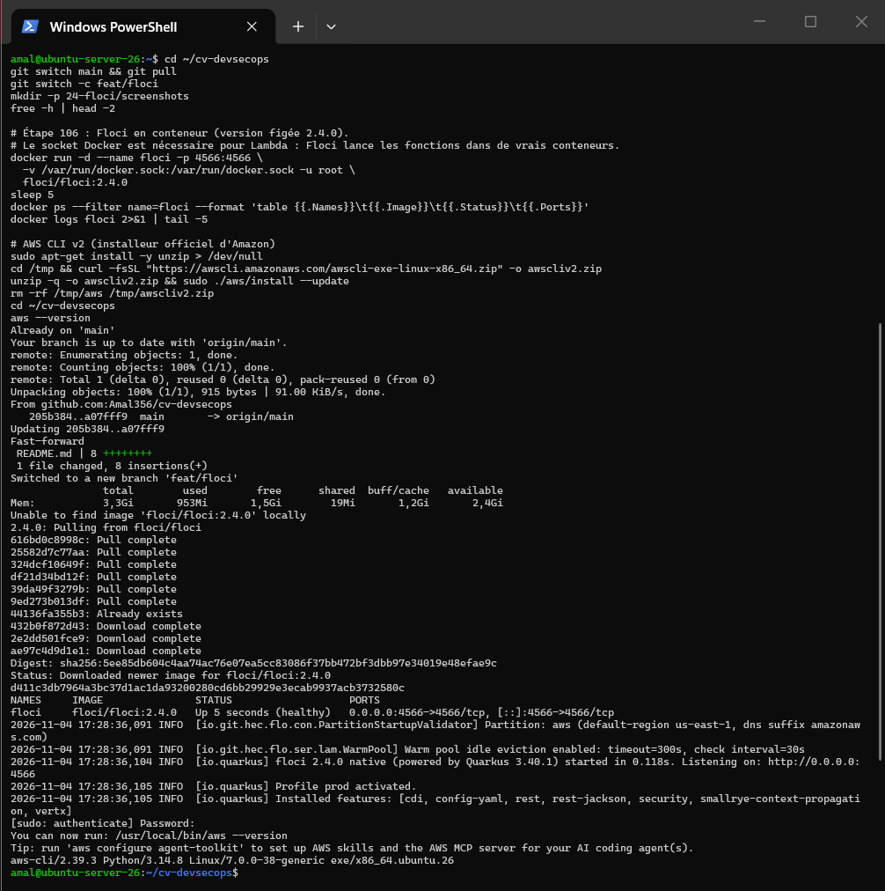
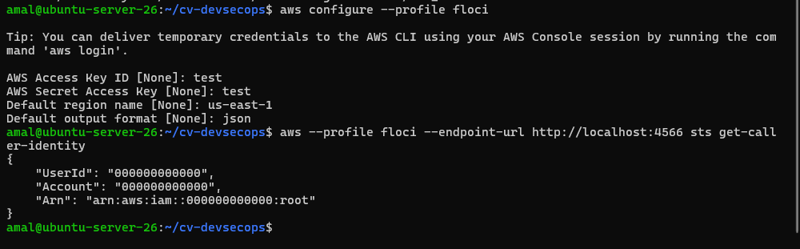
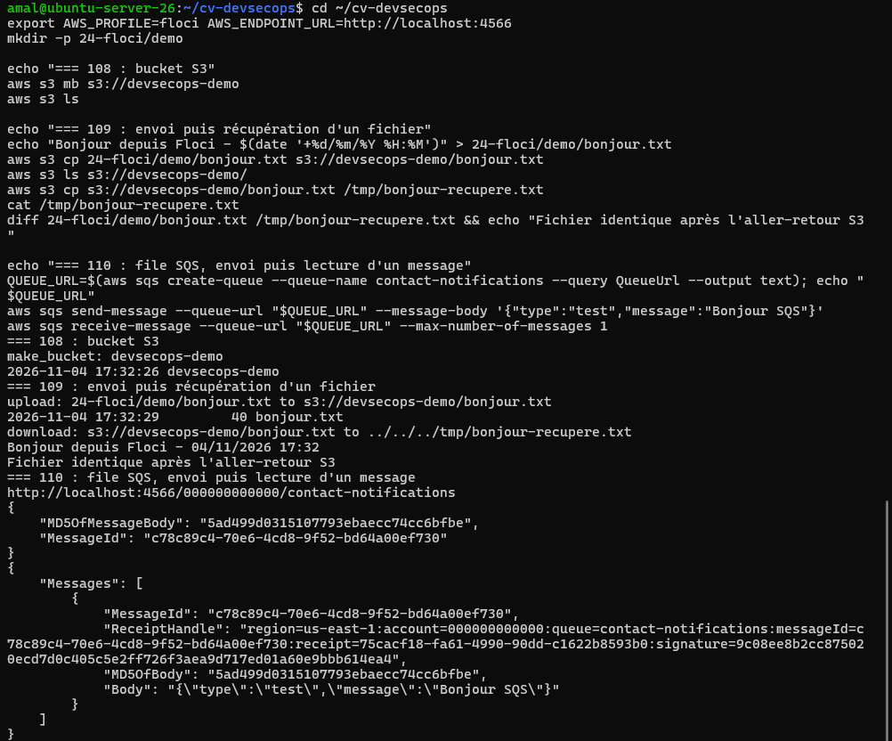
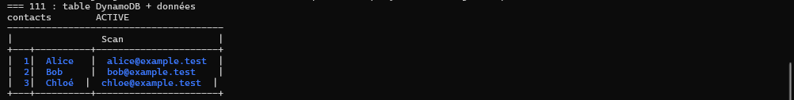
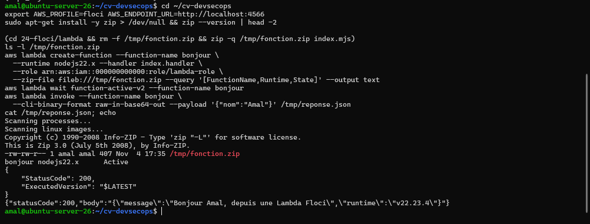
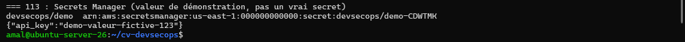
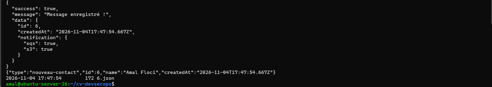
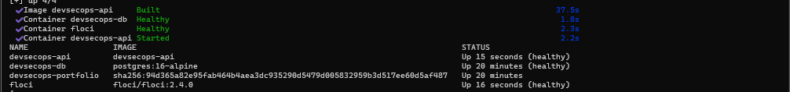
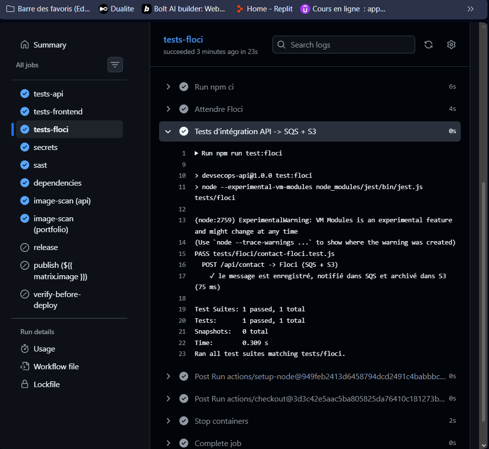

# Activité 6 – Partie 22 : Cloud local avec Floci (étapes 106 à 117)

[Floci](https://github.com/floci-io/floci) est un émulateur AWS **open source (licence MIT)** : S3, SQS, DynamoDB, Lambda, Secrets Manager, STS… répondent sur un seul port, `4566`, sans compte AWS et sans frais. Il remplace le cloud pendant le développement et les tests.

## Étape 106 – Installation de Floci

```bash
docker run -d --name floci -p 4566:4566 \
  -v /var/run/docker.sock:/var/run/docker.sock -u root \
  floci/floci:2.4.0
docker ps --filter name=floci
```

- version **figée** (`2.4.0`) plutôt que `latest`, comme pour toutes les images du projet ;
- le socket Docker est monté parce que Floci exécute les fonctions Lambda dans de vrais conteneurs (`public.ecr.aws/lambda/nodejs:22`). C'est un accès puissant à la machine : acceptable sur une VM de laboratoire, à éviter sur un serveur partagé.

```text
NAMES   IMAGE               STATUS                  PORTS
floci   floci/floci:2.4.0   Up 5 seconds (healthy)  0.0.0.0:4566->4566/tcp, [::]:4566->4566/tcp
... floci 2.4.0 native (powered by Quarkus 3.40.1) started in 0.118s. Listening on: http://0.0.0.0:4566
```



## Étape 107 – AWS CLI configurée vers Floci

AWS CLI v2 (2.39.3), profil `floci` avec des identifiants **fictifs** (`test` / `test`, région `us-east-1`) :

```bash
aws configure --profile floci
aws --profile floci --endpoint-url http://localhost:4566 sts get-caller-identity
```

```json
{
    "UserId": "000000000000",
    "Account": "000000000000",
    "Arn": "arn:aws:iam::000000000000:root"
}
```

Pour la suite, deux variables d'environnement évitent de répéter les options (l'AWS CLI v2 les lit directement) :

```bash
export AWS_PROFILE=floci AWS_ENDPOINT_URL=http://localhost:4566
```



## Étapes 108 à 110 – S3 et SQS

```bash
# 108 : bucket
aws s3 mb s3://devsecops-demo                     # make_bucket: devsecops-demo
aws s3 ls

# 109 : envoi puis récupération d'un fichier
aws s3 cp 24-floci/demo/bonjour.txt s3://devsecops-demo/bonjour.txt
aws s3 cp s3://devsecops-demo/bonjour.txt /tmp/bonjour-recupere.txt
diff 24-floci/demo/bonjour.txt /tmp/bonjour-recupere.txt && echo "Fichier identique après l'aller-retour S3"

# 110 : file SQS, envoi puis lecture
QUEUE_URL=$(aws sqs create-queue --queue-name contact-notifications --query QueueUrl --output text)
aws sqs send-message --queue-url "$QUEUE_URL" --message-body '{"type":"test","message":"Bonjour SQS"}'
aws sqs receive-message --queue-url "$QUEUE_URL" --max-number-of-messages 1
```



## Étape 111 – Table DynamoDB

```bash
aws dynamodb create-table --table-name contacts \
  --attribute-definitions AttributeName=id,AttributeType=S \
  --key-schema AttributeName=id,KeyType=HASH --billing-mode PAY_PER_REQUEST
aws dynamodb put-item --table-name contacts --item '{"id":{"S":"1"},"nom":{"S":"Alice"},"email":{"S":"alice@example.test"}}'
# ... Bob, Chloé
aws dynamodb scan --table-name contacts --query 'Items[].[id.S,nom.S,email.S]' --output table
```



## Étape 112 – Fonction Lambda Node.js

Code : [`lambda/index.mjs`](lambda/index.mjs).

```bash
(cd 24-floci/lambda && zip -q /tmp/fonction.zip index.mjs)
aws lambda create-function --function-name bonjour --runtime nodejs22.x --handler index.handler \
  --role arn:aws:iam::000000000000:role/lambda-role --zip-file fileb:///tmp/fonction.zip
aws lambda invoke --function-name bonjour --cli-binary-format raw-in-base64-out \
  --payload '{"nom":"Amal"}' /tmp/reponse.json
```

```text
bonjour  nodejs22.x  Active
{ "StatusCode": 200, "ExecutedVersion": "$LATEST" }
{"statusCode":200,"body":"{\"message\":\"Bonjour Amal, depuis une Lambda Floci\",\"runtime\":\"v22.23.4\"}"}
```



## Étape 113 – Secrets Manager

```bash
aws secretsmanager create-secret --name devsecops/demo --secret-string '{"api_key":"demo-valeur-fictive-123"}'
aws secretsmanager get-secret-value --secret-id devsecops/demo --query SecretString --output text
```

Valeur **de démonstration** uniquement : un vrai secret ne doit jamais apparaître dans une commande (historique du shell) ni dans un README.



## Étape 114 – L'API Express communique avec Floci

```text
Navigateur ── POST /api/contact ──► API Express ──► PostgreSQL   (enregistrement du message)
                                         │
                                         ├──► SQS  contact-notifications           notification : id + nom, sans l'email
                                         └──► S3   devsecops-contacts/contacts/<id>.json   archive complète du message
```

- [`api/src/lib/aws.js`](../api/src/lib/aws.js) : clients SQS et S3 du SDK AWS v3. Ils visent Floci grâce à `AWS_ENDPOINT_URL` ; sur le vrai AWS, il suffit de retirer cette variable. S3 utilise le style « chemin » (`forcePathStyle`), nécessaire avec un endpoint local.
- [`api/src/routes/contact.js`](../api/src/routes/contact.js) : après l'enregistrement dans PostgreSQL, `publierContact()` envoie la notification et l'archive. La réponse indique ce qui a réussi.
- **Activation par configuration** : sans `CONTACT_QUEUE_NAME` ni `CONTACT_BUCKET`, l'API fonctionne exactement comme avant.
- **Panne tolérée** : si Floci (ou AWS) ne répond pas, le message reste enregistré dans PostgreSQL ; l'erreur est journalisée, la requête n'échoue pas.
- **Minimisation des données** : la notification SQS ne contient pas l'adresse email ; seule l'archive S3 contient le message complet.

```bash
curl -s -X POST http://localhost:4000/api/contact -H 'Content-Type: application/json' \
  -d '{"name":"Amal Floci","email":"amal@example.test","message":"Test du formulaire vers SQS et S3 via Floci"}'
aws sqs receive-message --queue-url http://localhost:4566/000000000000/contact-notifications --query 'Messages[0].Body' --output text
aws s3 ls s3://devsecops-contacts/contacts/
```

```text
{ "success": true, "message": "Message enregistré !",
  "data": { "id": 6, "createdAt": "2026-11-04T17:47:54.667Z", "notification": { "sqs": true, "s3": true } } }
{"type":"nouveau-contact","id":6,"name":"Amal Floci","createdAt":"2026-11-04T17:47:54.667Z"}
2026-11-04 17:47:54        172 6.json
```



Tests unitaires ajoutés ([`api/tests/aws.test.js`](../api/tests/aws.test.js), SDK simulé) : aucune action sans configuration, notification sans email, panne AWS sans échec de la requête. Résultat : **20 tests passés**.

## Étape 115 – Floci dans Docker Compose

Service `floci` ajouté à [`docker-compose.fullstack.yml`](../docker-compose.fullstack.yml) :

- image `floci/floci:2.4.0`, port publié sur `127.0.0.1:4566` uniquement (AWS CLI et Terraform depuis la VM) ;
- l'API le joint par le DNS du réseau Compose : `AWS_ENDPOINT_URL=http://floci:4566` ;
- `depends_on: floci: condition: service_healthy` : l'API ne démarre qu'une fois Floci prêt (l'image Floci fournit son propre `HEALTHCHECK`) ;
- identifiants `test` / `test` : fictifs, acceptés par Floci, aucun secret.

```bash
docker compose -f docker-compose.fullstack.yml up -d --build floci api
docker compose -f docker-compose.fullstack.yml ps
```



## Étape 116 – Floci comme service container dans GitHub Actions

Job `tests-floci` de [`ci.yml`](../.github/workflows/ci.yml) :

```yaml
services:
  floci:
    image: floci/floci:2.4.0
    ports:
      - 4566:4566
env:
  AWS_ENDPOINT_URL: http://localhost:4566
  AWS_ACCESS_KEY_ID: test
  AWS_SECRET_ACCESS_KEY: test
```

GitHub démarre Floci **avant** le job et attend son healthcheck. Le test [`api/tests/floci/contact-floci.test.js`](../api/tests/floci/contact-floci.test.js) envoie un message à l'API, puis vérifie avec le SDK que la notification est bien arrivée dans SQS (sans l'email) et que l'archive est bien dans S3. Aucun compte AWS, aucun secret, aucun coût : le test peut tourner sur chaque Pull Request.



## Étape 117 – Floci, LocalStack et AWS réel

| Critère | Floci | LocalStack | AWS réel |
| :--- | :--- | :--- | :--- |
| Licence | MIT, open source | Édition Community arrêtée le 23 mars 2026 ; image unique avec compte et jeton d'authentification ; gratuit seulement pour un usage non commercial | Service propriétaire |
| Services | Plus de 100 services émulés (S3, SQS, DynamoDB, Lambda, Secrets Manager, STS…) | Très large catalogue, les plus avancés dans les offres payantes | Tous les services, toutes les régions |
| Fidélité | Bonne pour les API courantes ; pas d'IAM réellement appliqué, pas de quotas ni de latence réseau réelle | Bonne, plus mature (projet plus ancien) | Référence : le comportement réel |
| Coût | Gratuit, très léger (image d'environ 90 Mo, démarrage en 0,1 s ici) | Gratuit en non commercial, payant en entreprise ; image plus lourde | Payant à l'usage, risque de facture en cas d'erreur |
| Usage en CI | Service container sans jeton ni secret, démarrage instantané | Nécessite un jeton d'authentification stocké en secret CI | Nécessite des identifiants AWS (idéalement OIDC), un compte de test isolé et un nettoyage des ressources |
| Usage conseillé | Développement local, tests d'intégration rapides, formation | Équipes qui ont besoin de services avancés émulés | Tests de recette, performance, sécurité IAM, production |

**Conclusion :** Floci couvre le développement et les tests d'intégration du projet sans compte ni coût. Les tests ne remplacent pas une validation finale sur un vrai compte AWS : les permissions IAM, les quotas et les performances n'y sont pas reproduits fidèlement.
