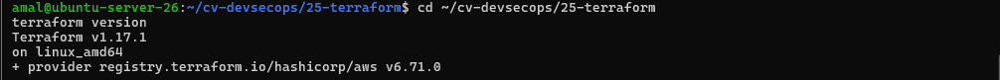
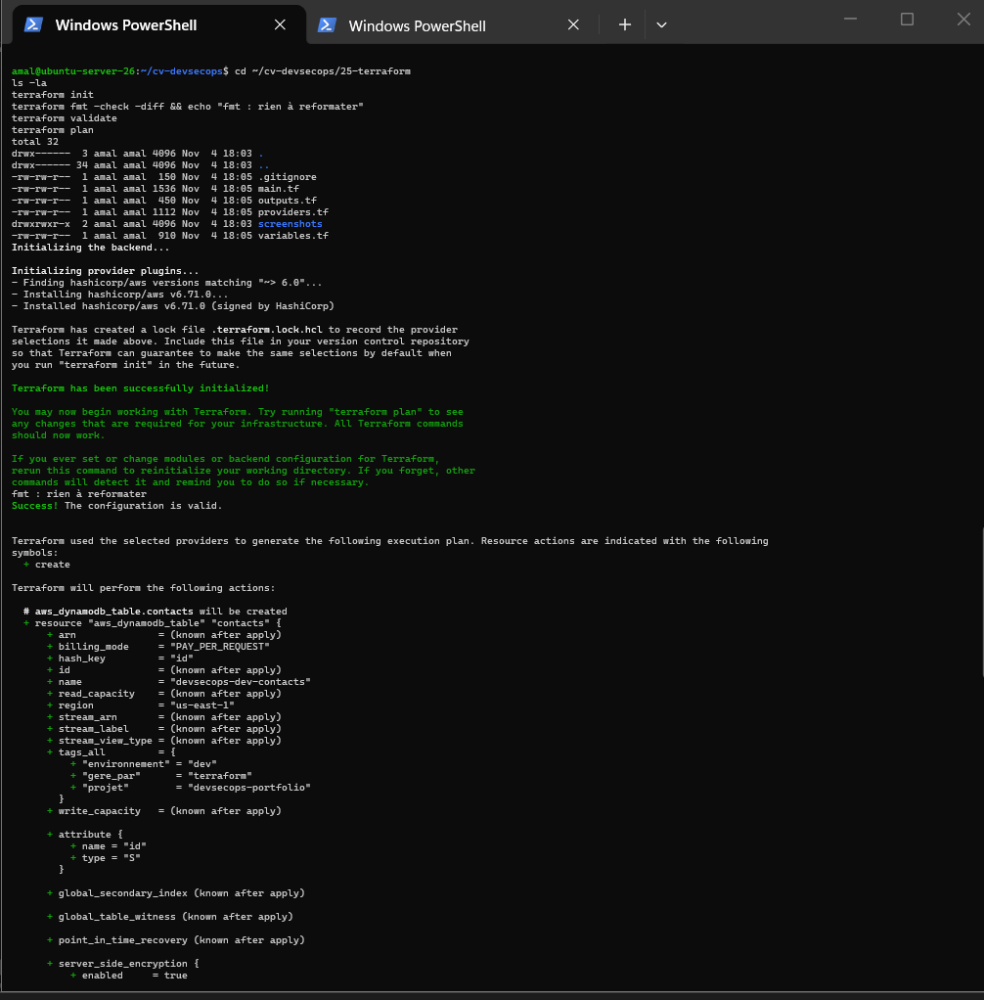
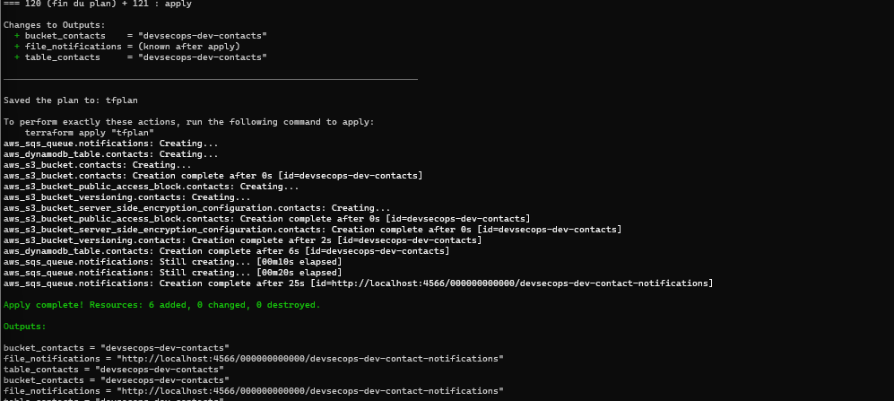
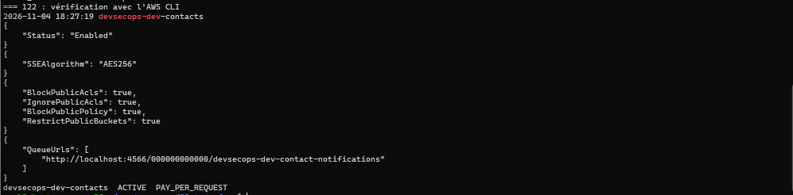
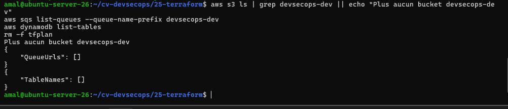
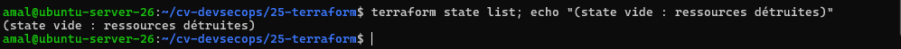

# Activité 6 – Partie 23 : Introduction à Terraform (étapes 118 à 123)

Terraform décrit l'infrastructure dans des fichiers (*Infrastructure as Code*) : on écrit **l'état voulu**, Terraform calcule les différences avec l'existant (`plan`) puis les applique (`apply`). Ici, le « cloud » est [Floci](../24-floci/README.md), l'émulateur AWS local.

## Étape 118 – Installation

Binaire officiel HashiCorp, empreinte SHA-256 vérifiée avant installation :

```bash
TF=$(curl -fsS https://checkpoint-api.hashicorp.com/v1/check/terraform | python3 -c 'import json,sys;print(json.load(sys.stdin)["current_version"])')
curl -fsSLO "https://releases.hashicorp.com/terraform/${TF}/terraform_${TF}_linux_amd64.zip"
curl -fsSLO "https://releases.hashicorp.com/terraform/${TF}/terraform_${TF}_SHA256SUMS"
grep "linux_amd64.zip" "terraform_${TF}_SHA256SUMS" | sha256sum -c -     # terraform_1.17.1_linux_amd64.zip: OK
unzip terraform_${TF}_linux_amd64.zip terraform && sudo install -m 755 terraform /usr/local/bin/terraform
terraform version
```

```text
Terraform v1.17.1
on linux_amd64
+ provider registry.terraform.io/hashicorp/aws v6.71.0
```



## Étape 119 – Premier projet Terraform

| Fichier | Rôle |
| :--- | :--- |
| [`providers.tf`](providers.tf) | version de Terraform et du provider AWS (`~> 6.0`) ; provider configuré pour Floci : `endpoints` S3, SQS, DynamoDB et STS vers `http://localhost:4566`, `s3_use_path_style`, pas de vérification de compte ; tags par défaut sur toutes les ressources |
| [`variables.tf`](variables.tf) | région, profil AWS CLI, adresse de Floci, environnement (validé : `dev`, `staging` ou `prod`), préfixe |
| [`main.tf`](main.tf) | les ressources (étape 121) |
| [`outputs.tf`](outputs.tf) | nom du bucket, URL de la file, nom de la table |
| [`.gitignore`](.gitignore) | `.terraform/` et `*.tfstate` ne sont jamais commités |
| `.terraform.lock.hcl` | versions et empreintes exactes des providers : commité, comme un `package-lock.json` |

**Aucun identifiant dans le code** : le provider lit le profil AWS CLI `floci` (`profile = var.aws_profile`), qui contient les identifiants fictifs `test` / `test`.

## Étape 120 – init, fmt, validate, plan

```bash
terraform init                         # télécharge hashicorp/aws v6.71.0 (signé par HashiCorp), crée le lock file
terraform fmt -check -diff             # aucun fichier à reformater
terraform validate                     # Success! The configuration is valid.
terraform plan                         # Plan: 6 to add, 0 to change, 0 to destroy.
```



## Étape 121 – Création des ressources dans Floci

[`main.tf`](main.tf) crée 6 ressources, sécurisées par défaut :

| Ressource | Nom | Sécurité |
| :--- | :--- | :--- |
| `aws_s3_bucket` + 3 ressources de configuration | `devsecops-dev-contacts` | versioning activé, chiffrement AES256, accès public entièrement bloqué |
| `aws_sqs_queue` | `devsecops-dev-contact-notifications` | chiffrement SSE géré par SQS, rétention 4 jours |
| `aws_dynamodb_table` | `devsecops-dev-contacts` | chiffrement activé, facturation à la demande |

```bash
terraform plan -out=tfplan      # le plan enregistré est exactement celui qui sera appliqué
terraform apply tfplan
```

```text
Apply complete! Resources: 6 added, 0 changed, 0 destroyed.

Outputs:
bucket_contacts = "devsecops-dev-contacts"
file_notifications = "http://localhost:4566/000000000000/devsecops-dev-contact-notifications"
table_contacts = "devsecops-dev-contacts"
```

La file SQS met environ 25 secondes à être créée : le provider attend que ses attributs soient bien appliqués, comme sur le vrai AWS.



## Étape 122 – Vérification avec l'AWS CLI

```bash
export AWS_PROFILE=floci AWS_ENDPOINT_URL=http://localhost:4566
aws s3 ls | grep devsecops-dev
aws s3api get-bucket-versioning     --bucket devsecops-dev-contacts      # "Status": "Enabled"
aws s3api get-bucket-encryption     --bucket devsecops-dev-contacts      # "SSEAlgorithm": "AES256"
aws s3api get-public-access-block   --bucket devsecops-dev-contacts      # 4 x true
aws sqs list-queues --queue-name-prefix devsecops-dev
aws dynamodb describe-table --table-name devsecops-dev-contacts          # ACTIVE  PAY_PER_REQUEST
```

L'AWS CLI, outil indépendant de Terraform, confirme que chaque ressource existe avec la configuration demandée.



## Étape 123 – terraform destroy

```bash
terraform destroy          # Plan: 0 to add, 0 to change, 6 to destroy. -> yes
```

Terraform supprime les ressources dans l'ordre inverse des dépendances (configuration du bucket, puis bucket). La suppression de la file SQS prend quelques dizaines de secondes : le provider attend qu'elle ait réellement disparu.

Vérification : plus aucun bucket `devsecops-dev`, `"QueueUrls": []`, `"TableNames": []`, et le state ne contient plus aucune ressource.



