# Activité 6 – Partie 24 : Terraform avancé (étapes 124 à 133)

```text
26-terraform-avance/
├── modules/contact-stack/   étape 124 : module réutilisable (S3 + SQS + DynamoDB)
├── envs/dev|staging|prod/   étape 125 : un dossier par environnement, chacun avec son state
├── bootstrap/               étape 127 : bucket S3 qui stocke les states (dans Floci)
├── terragrunt/              étape 132 : les mêmes environnements, sans duplication
└── pulumi/                  étape 133 : une ressource équivalente écrite en TypeScript
```

## Étape 124 – Module réutilisable

Le code de la partie 23 devient le module [`modules/contact-stack`](modules/contact-stack) : les mêmes ressources sécurisées (bucket chiffré, versionné, accès public bloqué ; file SQS chiffrée ; table DynamoDB chiffrée), mais **paramétrées** :

| Variable | Rôle | Contrôle |
| :--- | :--- | :--- |
| `nom` | préfixe des ressources (`devsecops-dev`…) | — |
| `retention_messages_jours` | rétention des messages SQS | validation : 1 à 14 jours |
| `suppression_forcee` | `force_destroy` du bucket | `false` en production |
| `protection_suppression` | `deletion_protection_enabled` de la table | `true` en production |

Le module ne contient ni provider ni backend : il peut être appelé par n'importe quel environnement, par Terragrunt (étape 132) ou par le projet de la partie 25.

## Étape 125 – Configurations dev, staging et prod

Chaque dossier [`envs/<env>`](envs) appelle le même module avec ses propres valeurs et possède son propre state :

| | dev | staging | prod |
| :--- | :---: | :---: | :---: |
| Rétention SQS | 1 jour (86 400 s) | 4 jours (345 600 s) | 14 jours (1 209 600 s) |
| `force_destroy` du bucket | `true` | `true` | **`false`** |
| Protection de la table | `false` | `false` | **`true`** |
| Fichier de state | `dev/terraform.tfstate` | `staging/terraform.tfstate` | `prod/terraform.tfstate` |

Séparer les dossiers (et donc les states) isole les environnements : un `terraform destroy` en dev ne peut pas toucher la production.

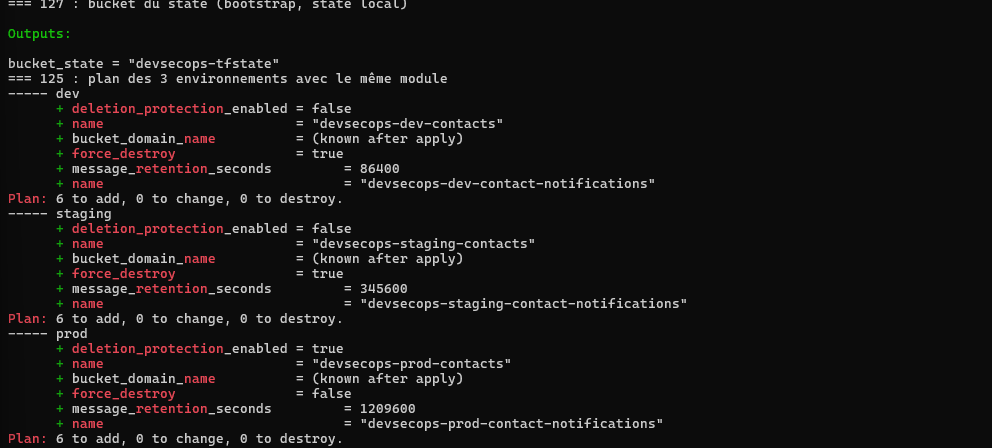

## Étape 126 – Le rôle du fichier Terraform State

Le **state** (`terraform.tfstate`) est la mémoire de Terraform : il associe chaque bloc du code (`aws_s3_bucket.contacts`) à l'objet réel créé (l'identifiant `devsecops-dev-contacts`, ses attributs, ses dépendances). À chaque `plan`, Terraform compare **le code**, **le state** et **l'infrastructure réelle** pour calculer les changements.

- Sans state, Terraform ne sait plus ce qu'il a créé : il tenterait de tout recréer (erreur « BucketAlreadyExists », exactement ce qui s'est produit à l'étape 131 quand OpenTofu, avec un state vide, a voulu créer des ressources qui existaient déjà).
- Le state peut contenir des **valeurs sensibles** (mots de passe, clés générées) : il n'est jamais commité (`.gitignore`), il est stocké **chiffré** et avec un accès restreint.
- En équipe, un state local ne suffit pas : il faut un **state distant partagé** (étape 127) et un **verrou** pour empêcher deux modifications simultanées (étape 128).

## Étape 127 – Backend distant S3 dans Floci

Le projet [`bootstrap`](bootstrap) crée le bucket `devsecops-tfstate` (versionné, chiffré, accès public bloqué). Il ne peut pas stocker son propre state dans un bucket qui n'existe pas encore : il garde un state local, non commité (« problème de l'œuf et de la poule »).

Chaque environnement déclare ensuite le backend dans [`backend.tf`](envs/dev/backend.tf) :

```hcl
terraform {
  backend "s3" {
    bucket       = "devsecops-tfstate"
    key          = "dev/terraform.tfstate"
    region       = "us-east-1"
    use_lockfile = true   # verrou natif S3 (Terraform >= 1.10)
    encrypt      = true
    endpoints    = { s3 = "http://localhost:4566", sts = "http://localhost:4566" }
    # + options Floci : profile, use_path_style, skip_* ...
  }
}
```

Après `terraform apply` de dev, le state est dans S3 et non plus sur le disque :

```text
2026-11-04 18:38:06      11808 dev/terraform.tfstate
```

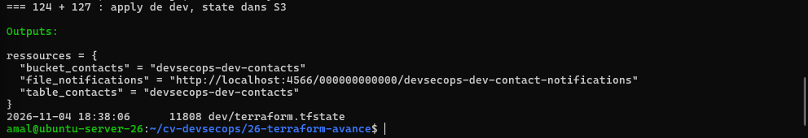

## Étape 128 – Verrouillage du state

`use_lockfile = true` : pendant une opération, Terraform crée `<key>.tflock` dans le bucket par une **écriture conditionnelle** (`If-None-Match`). Si le fichier existe déjà, S3 répond `412 PreconditionFailed` : le verrou est pris.

Démonstration : un `apply` de staging en arrière-plan (la file SQS met environ 25 s à être créée), puis un deuxième `plan` pendant qu'il tourne :

```bash
terraform apply -auto-approve > /tmp/apply-staging.log 2>&1 &
sleep 6
aws s3 ls s3://devsecops-tfstate/ --recursive    # staging/terraform.tfstate.tflock apparaît
terraform plan -lock-timeout=0s                  # deuxième exécution : bloquée
```

```text
staging/terraform.tfstate.tflock
Error: Error acquiring the state lock
Error message: ... StatusCode: 412 ... PreconditionFailed
Lock Info:
  Path:      devsecops-tfstate/staging/terraform.tfstate
  Operation: OperationTypeApply
  Who:       amal@ubuntu-server-26
  Version:   1.17.1
```

Le premier `apply` se termine normalement, puis le verrou est libéré. Sans verrou, deux exécutions simultanées pourraient écrire chacune leur version du state et le corrompre.

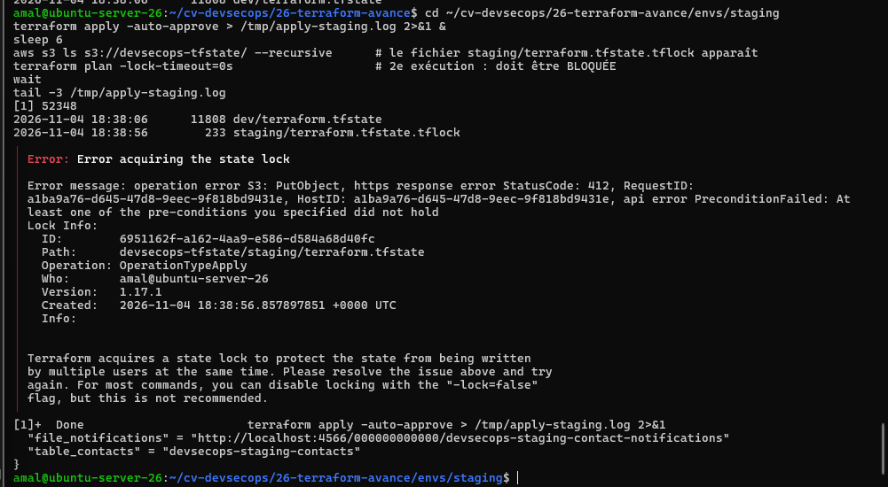

## Étape 129 – Analyse du code Terraform dans le pipeline

Job `iac-scan` de [`ci.yml`](../.github/workflows/ci.yml) : **Trivy** en mode `config`, limité au code Terraform (`TRIVY_MISCONFIG_SCANNERS=terraform`), bloquant sur les erreurs **HIGH** et **CRITICAL**. Le job fait partie des contrôles obligatoires du ruleset `protection-main`, comme `tests-floci`.

Une seule règle remontait sur le code sain : `AWS-0132`, qui demande une clé KMS gérée par le client au lieu du chiffrement AES256. Elle est mise en **exception documentée** dans [`.trivyignore`](../.trivyignore), avec sa justification (laboratoire Floci, à revoir sur un vrai compte AWS). Semgrep, déjà présent dans le pipeline, signale la même recommandation pour DynamoDB (*Warning*) : l'alerte a été fermée avec la même justification.

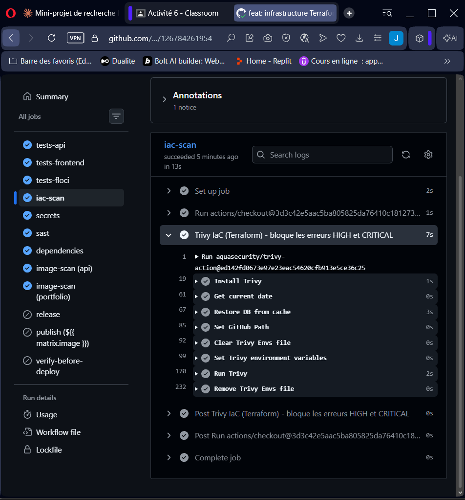
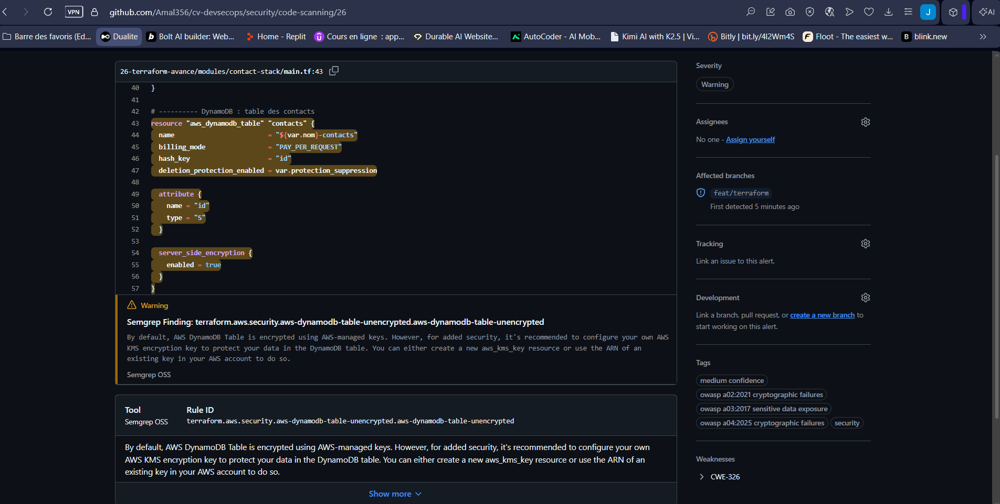

## Étape 130 – Mauvaise configuration détectée

PR #21 : les 4 blocages d'accès public du bucket passent à `false` et le chiffrement DynamoDB est désactivé, dans le module. Résultat :

```text
26-terraform-avance/modules/contact-stack/main.tf   terraform   15
Failures: 15 (HIGH: 15, CRITICAL: 0)
AWS-0086 (HIGH): Public access block does not block public ACLs
AWS-0087 (HIGH): Public access block does not block public policies
AWS-0091 (HIGH): Public access block does not ignore public ACLs
AWS-0093 (HIGH): Public access block does not restrict public buckets
```

Une seule erreur dans le module touche les **trois environnements** qui l'utilisent. `iac-scan` est rouge et **obligatoire** : le bouton *Squash and merge* reste désactivé. La PR a été fermée sans fusion.

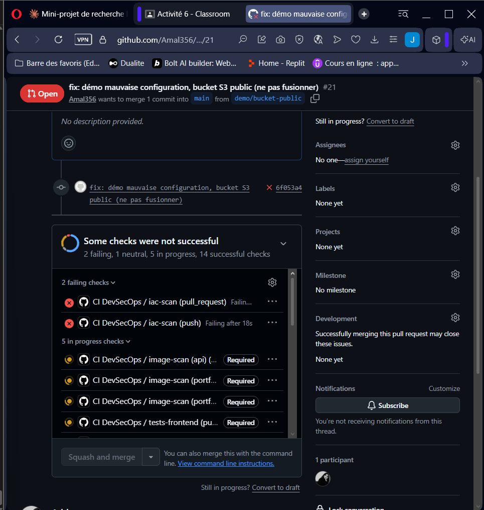
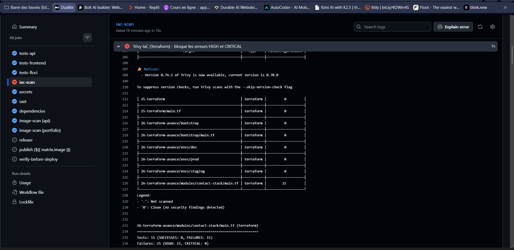
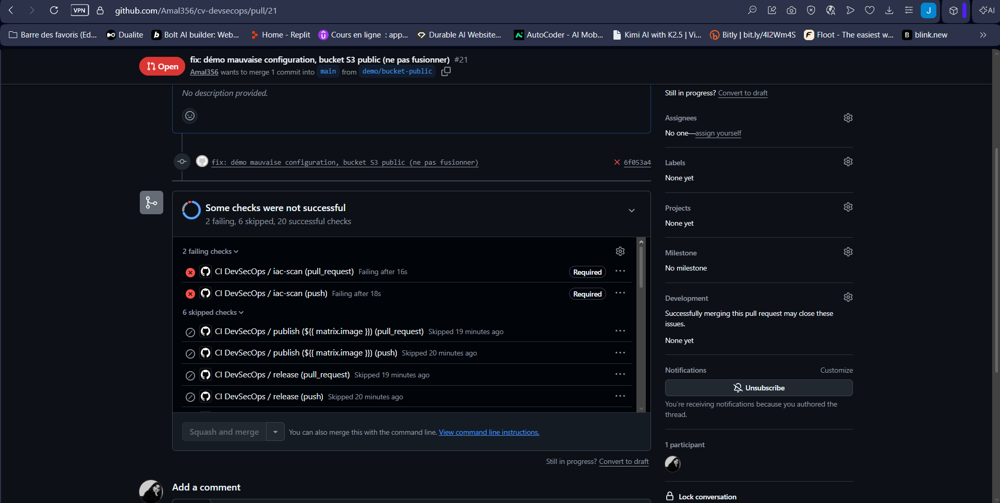

## Étape 131 – OpenTofu comparé à Terraform

OpenTofu 1.13.2 (binaire officiel, empreinte SHA-256 vérifiée) exécute **le code de la partie 23 sans aucune modification** : `tofu init`, `validate`, `apply` (6 ressources), `destroy`.

```text
- Installed hashicorp/aws v6.71.0 (signed, key ID 0C0AF313E5FD9F80)
OpenTofu has been successfully initialized!
Apply complete! Resources: 6 added, 0 changed, 0 destroyed.     (36 s)
Destroy complete! Resources: 6 destroyed.
```

| | Terraform | OpenTofu |
| :--- | :--- | :--- |
| Licence | BUSL 1.1 (source disponible, usage concurrent restreint) | MPL 2.0, open source, gouvernance Linux Foundation |
| Compatibilité | — | même langage HCL, mêmes providers, commandes identiques (`tofu` au lieu de `terraform`) |
| Registre des providers | `registry.terraform.io` | `registry.opentofu.org` (même provider `hashicorp/aws` v6.71.0, signé) |
| Fonctions propres | HCP Terraform, Terraform Stacks | chiffrement natif du state, évaluation anticipée de variables |

Le premier `tofu init` a pris 12 min 31 s : uniquement le téléchargement du provider (environ 150 Mo) depuis un autre registre sur la connexion lente de la VM, le cache de Terraform n'étant pas partagé. Un essai a d'abord échoué (`BucketAlreadyExists`) : les noms `devsecops-dev-*` étaient déjà utilisés par `envs/dev`. Le préfixe a été changé avec `-var prefixe=devsecops-tofu`.

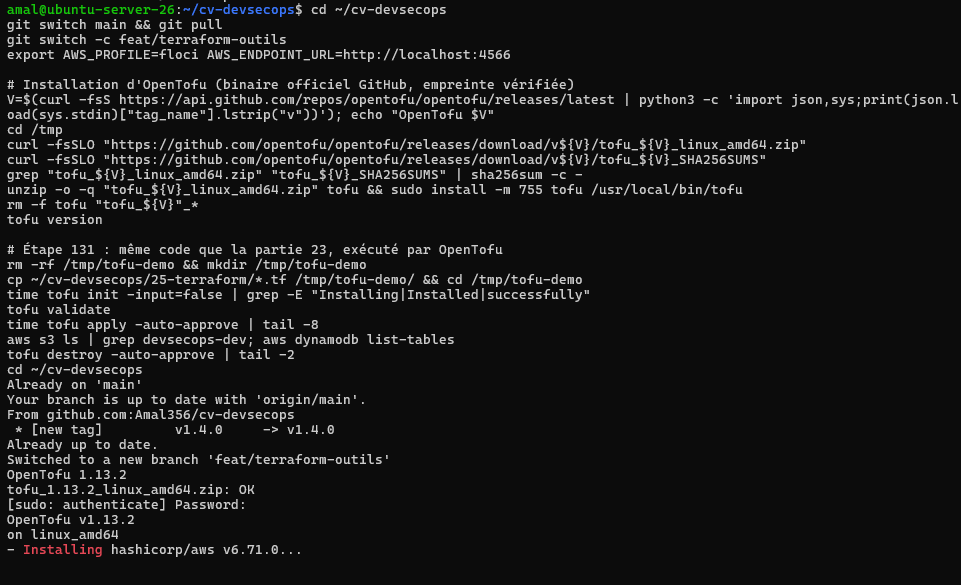
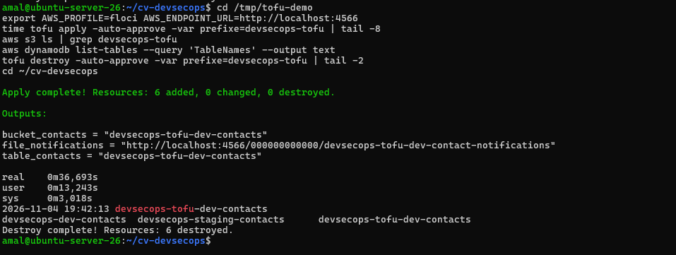

## Étape 132 – Terragrunt : factoriser dev, staging et prod

Dans `envs/`, chaque environnement répète `providers.tf` et `backend.tf`. Avec [Terragrunt](terragrunt), ils sont écrits **une seule fois** dans [`root.hcl`](terragrunt/root.hcl) (blocs `generate`), et chaque environnement ne garde que ses valeurs :

```hcl
# terragrunt/prod/terragrunt.hcl
include "root" { path = find_in_parent_folders("root.hcl") }
terraform { source = "../../modules/contact-stack" }
inputs = {
  nom                      = "devsecops-tg-prod"
  retention_messages_jours = 14
  suppression_forcee       = false
  protection_suppression   = true
}
```

- clé de state calculée automatiquement : `terragrunt/${path_relative_to_include()}/terraform.tfstate` ;
- **110 lignes** de configuration au lieu de **219** pour les trois environnements ;
- `terragrunt run --all plan` planifie les trois environnements en une commande.

```text
[staging] Plan: 6 to add   message_retention_seconds = 345600   deletion_protection_enabled = false
[prod]    Plan: 6 to add   message_retention_seconds = 1209600  deletion_protection_enabled = true
Apply complete! Resources: 6 added       ->  terragrunt/dev/terraform.tfstate dans le bucket
Destroy complete! Resources: 6 destroyed.
```

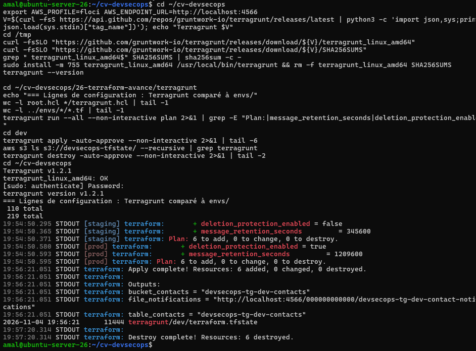

## Étape 133 – Pulumi (TypeScript)

[`pulumi/index.ts`](pulumi/index.ts) décrit l'infrastructure avec un vrai langage : une **boucle** crée un bucket par usage (`archives`, `pieces-jointes`), chacun avec son blocage d'accès public. State local (`pulumi login --local`), aucun compte Pulumi Cloud.

```text
+ pulumi:providers:aws             floci
+ aws:s3:Bucket                    archives / pieces-jointes
+ aws:s3:BucketPublicAccessBlock   archives-public / pieces-jointes-public
Resources: + 6 created   Duration: 4s
nomsDesBuckets: ["devsecops-pulumi-dev-archives", "devsecops-pulumi-dev-pieces-jointes"]
Resources: - 6 deleted
```

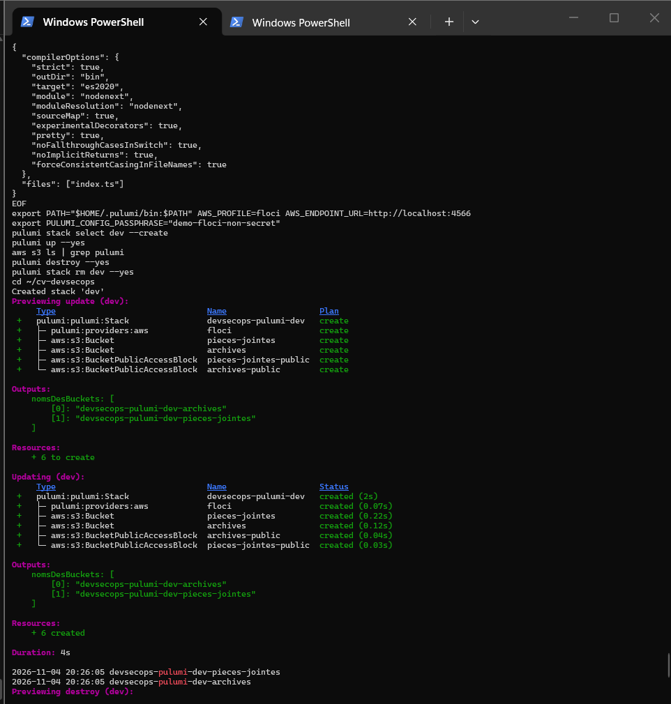

### Terraform, OpenTofu et Pulumi en quelques lignes

- **Terraform** : langage déclaratif HCL, l'écosystème de providers le plus large et la référence du marché ; licence BUSL depuis 2023.
- **OpenTofu** : fork open source de Terraform (MPL 2.0), compatible à l'identique ; le choix naturel quand la licence ou l'indépendance vis-à-vis d'un éditeur compte.
- **Pulumi** : l'infrastructure dans un langage généraliste (TypeScript, Python, Go…) : boucles, fonctions, tests unitaires et outils du développeur ; plus puissant pour les logiques complexes, mais le code peut devenir moins lisible qu'une description déclarative, et l'état est géré par le service Pulumi ou un backend choisi.
