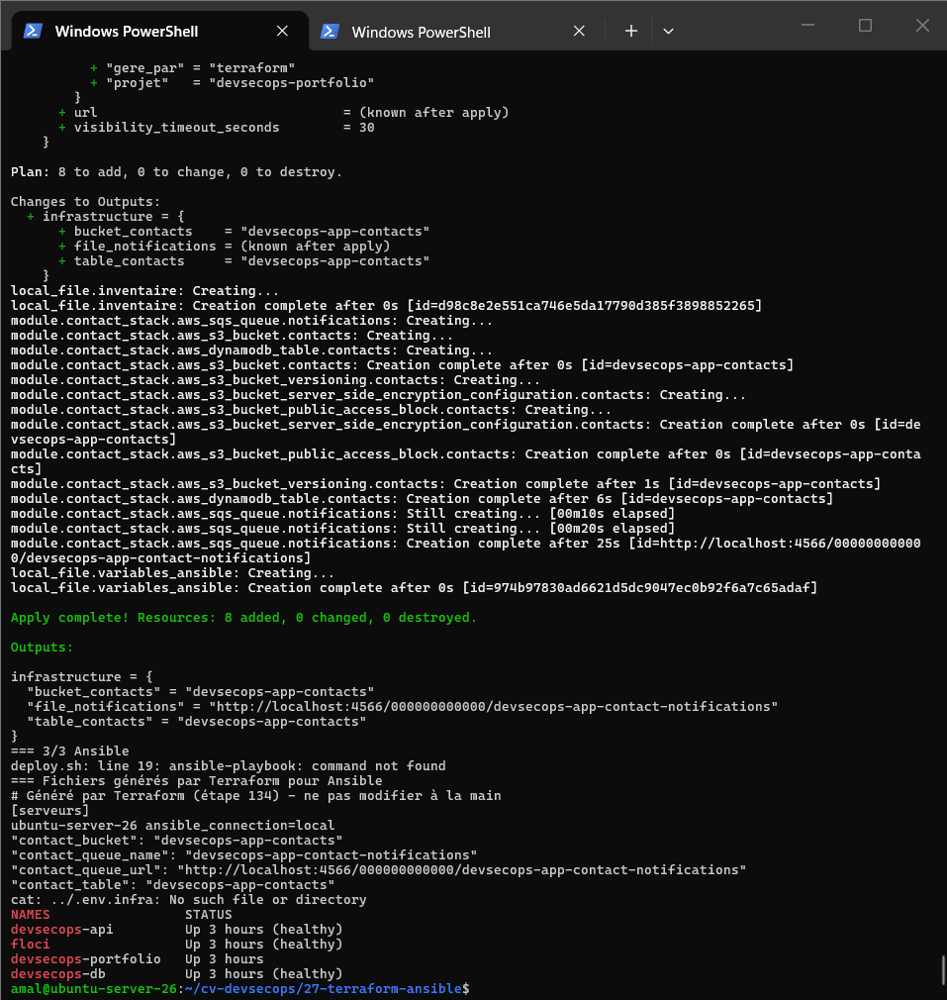
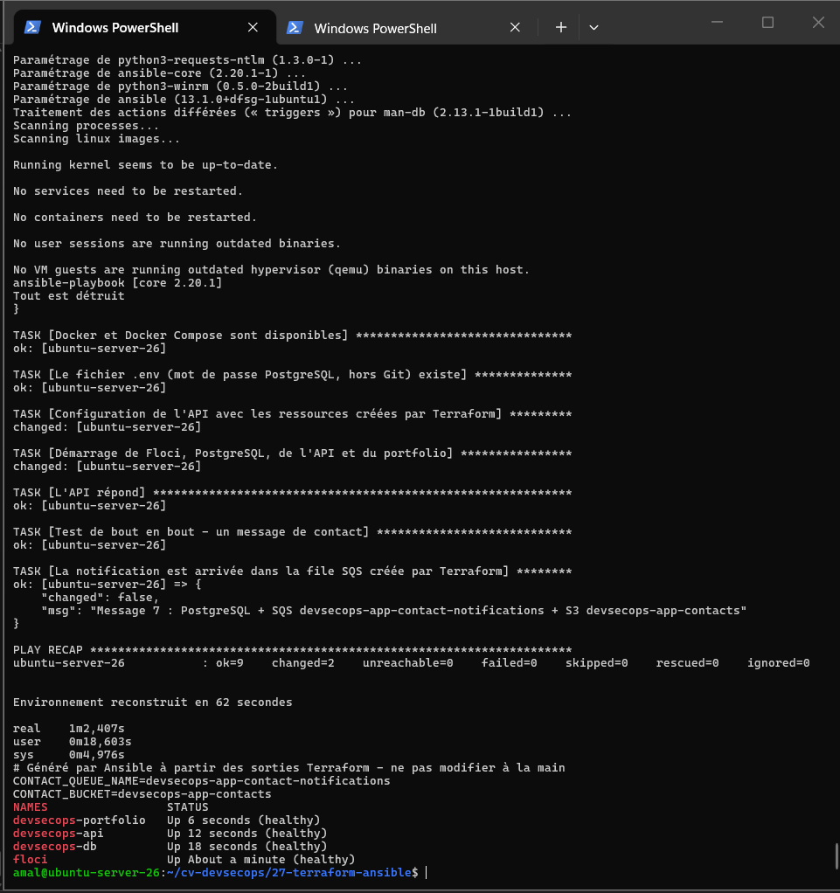
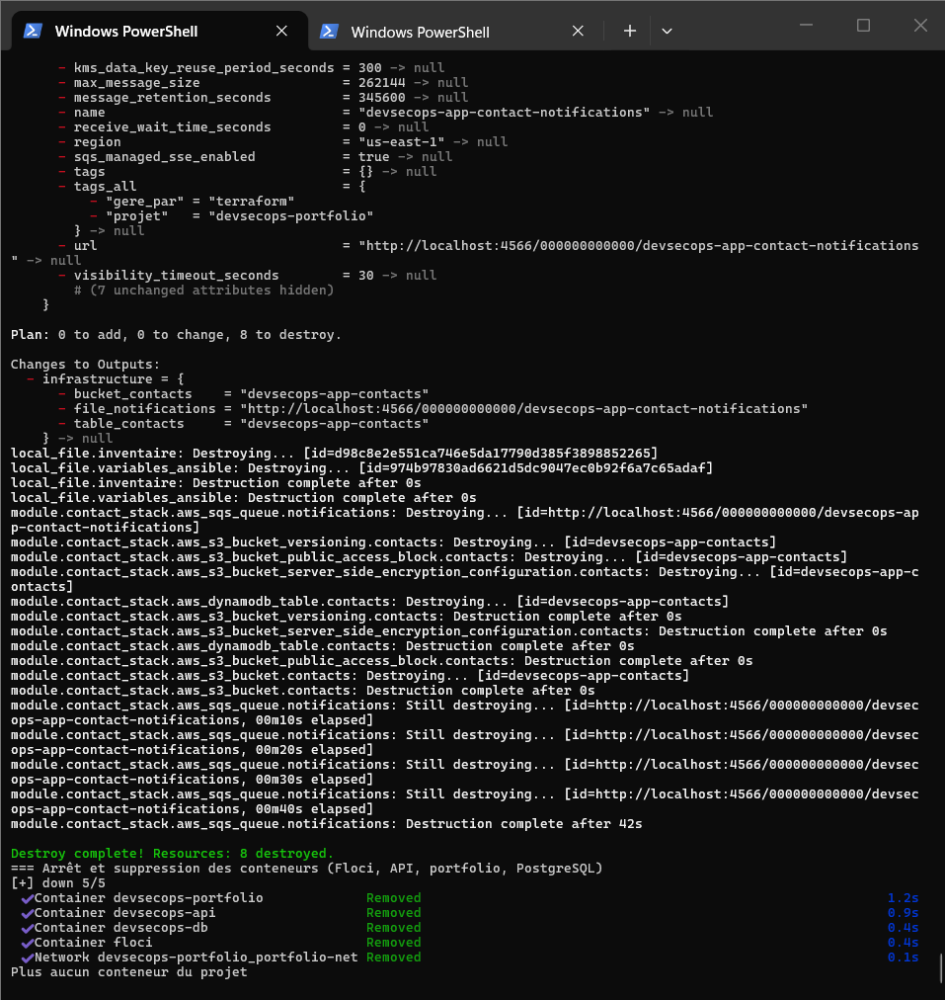

# Activité 6 – Partie 25 : Automatisation Terraform + Ansible (étapes 134 et 135)

## Étape 134 – Terraform crée l'infrastructure, Ansible configure le serveur

```text
deploy.sh
 │
 ├─ 1. Floci ──────────── docker compose up floci              le « cloud » local
 │
 ├─ 2. Terraform ──────── module contact-stack (partie 24)
 │        ├─► S3 devsecops-app-contacts, SQS devsecops-app-contact-notifications, DynamoDB devsecops-app-contacts
 │        └─► écrit ansible/inventory.ini + ansible/terraform_vars.yml   (noms réels des ressources)
 │
 └─ 3. Ansible ────────── playbook.yml sur ubuntu-server-26
          ├─ vérifie le serveur : Ubuntu, Docker Compose, fichier .env (mot de passe PostgreSQL, hors Git)
          ├─ écrit .env.infra : CONTACT_QUEUE_NAME / CONTACT_BUCKET = sorties Terraform
          ├─ docker compose up --wait : Floci, PostgreSQL, API, portfolio (Docker)
          └─ test de bout en bout : POST /api/contact -> PostgreSQL + SQS + S3 créés par Terraform
```

| Fichier | Rôle |
| :--- | :--- |
| [`terraform/main.tf`](terraform/main.tf) | appelle le module réutilisable de la partie 24, puis génère l'inventaire et les variables d'Ansible (`local_file`) |
| [`ansible/playbook.yml`](ansible/playbook.yml) | configuration du serveur et déploiement Docker, avec vérifications |
| [`ansible/templates/env.infra.j2`](ansible/templates/env.infra.j2) | configuration de l'API à partir des sorties Terraform |
| [`deploy.sh`](deploy.sh) | Floci → Terraform → Ansible, chronométré |
| [`destroy.sh`](destroy.sh) | `terraform destroy` puis arrêt de tous les conteneurs |

Le passage de relais se fait par fichiers : Terraform connaît les noms réels des ressources, il les écrit pour Ansible ; Ansible ne contient aucun nom en dur. Dans [`docker-compose.fullstack.yml`](../docker-compose.fullstack.yml), l'API lit `CONTACT_QUEUE_NAME` et `CONTACT_BUCKET` avec des valeurs par défaut (`${CONTACT_QUEUE_NAME:-contact-notifications}`) : la stack fonctionne aussi sans ce projet.

Le serveur cible est la VM elle-même (`ansible_connection=local`) : Floci n'émule pas de vraies machines virtuelles. Avec un vrai cloud, Terraform créerait une instance EC2 et écrirait son adresse IP dans l'inventaire ; le playbook resterait identique, avec une connexion SSH.

**Terraform** (`Plan: 8 to add` : 6 ressources du module + 2 fichiers pour Ansible) :

```text
Apply complete! Resources: 8 added, 0 changed, 0 destroyed.
infrastructure = {
  "bucket_contacts"    = "devsecops-app-contacts"
  "file_notifications" = "http://localhost:4566/000000000000/devsecops-app-contact-notifications"
  "table_contacts"     = "devsecops-app-contacts"
}
```



**Ansible** :

```text
TASK [Configuration de l'API avec les ressources créées par Terraform]  changed
TASK [Démarrage de Floci, PostgreSQL, de l'API et du portfolio]          changed
TASK [L'API répond]                                                      ok
TASK [Test de bout en bout - un message de contact]                      ok
TASK [La notification est arrivée dans la file SQS créée par Terraform]
  "msg": "Message 7 : PostgreSQL + SQS devsecops-app-contact-notifications + S3 devsecops-app-contacts"
PLAY RECAP
ubuntu-server-26 : ok=9  changed=2  unreachable=0  failed=0
```

Fichier généré `.env.infra` (non commité) :

```text
CONTACT_QUEUE_NAME=devsecops-app-contact-notifications
CONTACT_BUCKET=devsecops-app-contacts
```



## Étape 135 – Tout supprimer, puis tout reconstruire avec les scripts

```bash
cd 27-terraform-ansible
bash destroy.sh          # terraform destroy (8 ressources) + docker compose down
time bash deploy.sh      # Floci -> Terraform -> Ansible
```

**Suppression :**

```text
Destroy complete! Resources: 8 destroyed.
 ✔ Container devsecops-portfolio  Removed
 ✔ Container devsecops-api        Removed
 ✔ Container devsecops-db         Removed
 ✔ Container floci                Removed
 ✔ Network devsecops-portfolio_portfolio-net Removed
Plus aucun conteneur du projet
```



**Reconstruction, sans aucune action manuelle :**

```text
PLAY RECAP  ubuntu-server-26 : ok=9  changed=2  failed=0
Environnement reconstruit en 62 secondes
real    1m2,407s
devsecops-portfolio   Up (healthy)
devsecops-api         Up (healthy)
devsecops-db          Up (healthy)
floci                 Up (healthy)
```

| Étape | Durée approximative |
| :--- | :--- |
| Démarrage de Floci | ~1 s |
| Terraform (dont la file SQS, ~25 s d'attente du provider) | ~35 s |
| Ansible (démarrage des conteneurs jusqu'à `healthy`, test de bout en bout) | ~25 s |
| **Total** | **62 secondes** |

Conditions : images Docker déjà construites, provider AWS dans le cache de Terraform (`TF_PLUGIN_CACHE_DIR`). Les données PostgreSQL sont conservées par `destroy.sh` (volume `db-data`) : on reconstruit l'infrastructure, pas les données. Sans cache et sans images, il faut ajouter le téléchargement du provider et le build des images.

**Bilan :** l'environnement complet (cloud local, ressources, configuration du serveur, application, test) se reconstruit en une commande et environ une minute. Aucune étape n'est faite à la main : c'est ce qui rend l'infrastructure reproductible, testable et documentée par son propre code.
