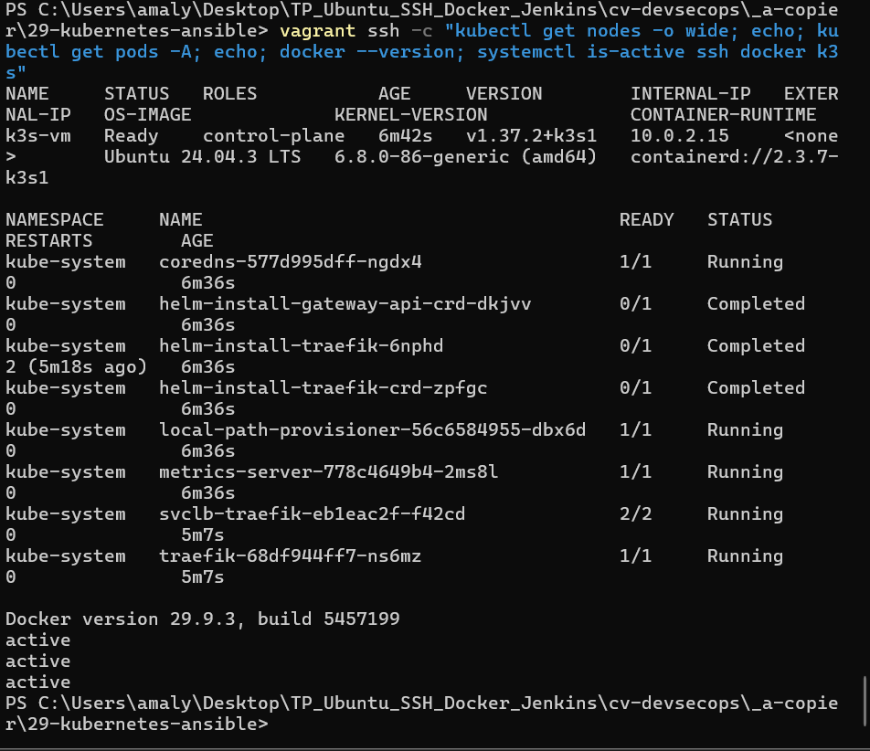
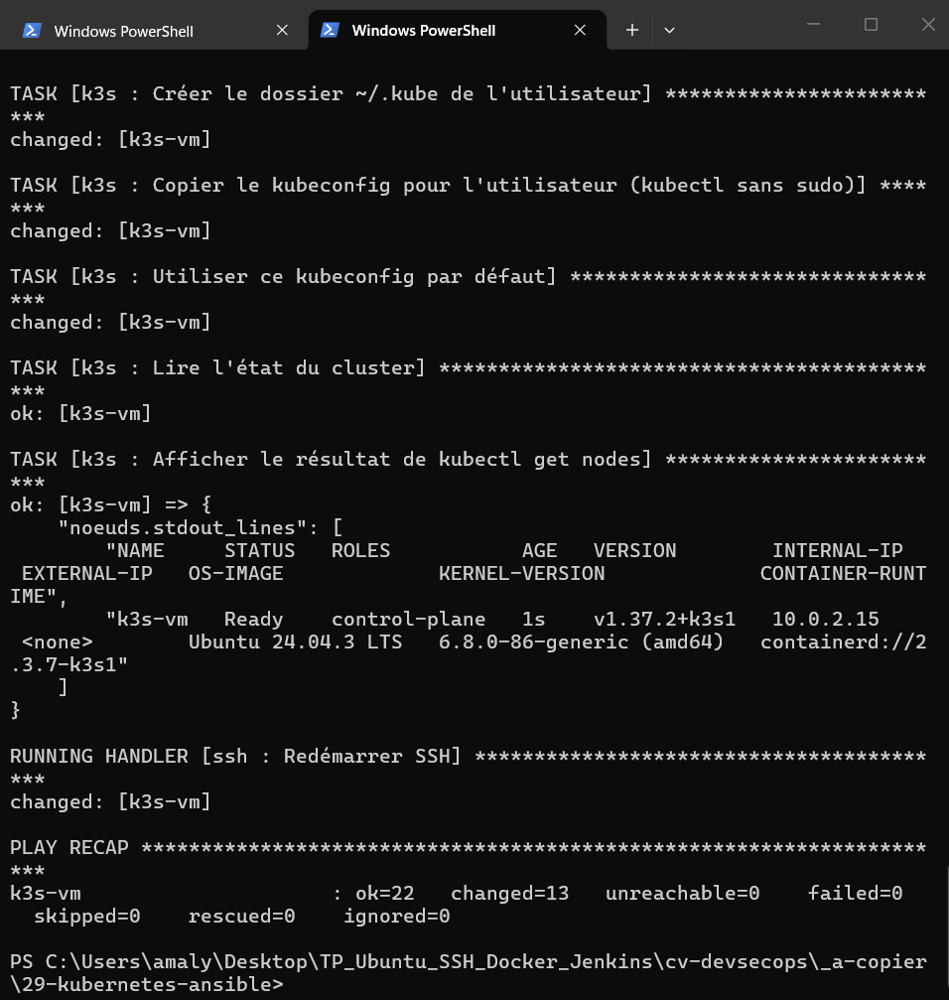
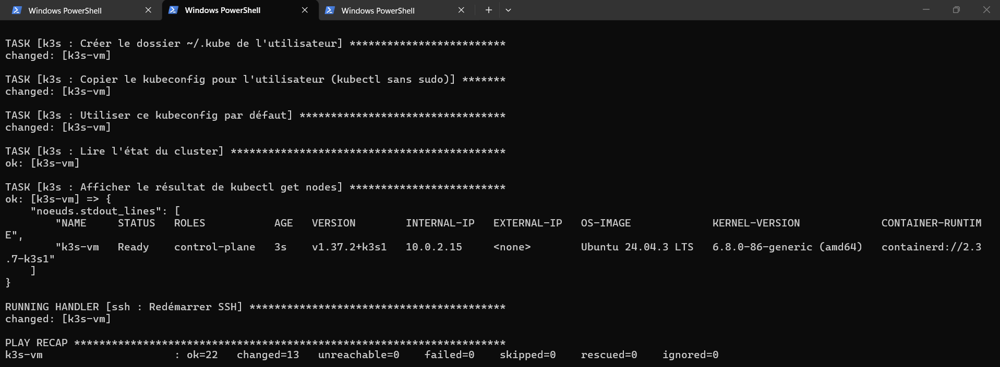

# Activité 7 – Partie 27 : Kubernetes avec Ansible (étapes 144 à 146)

Une VM de test est créée puis configurée **uniquement par l'automatisation** : Vagrant crée la VM (VirtualBox, sous Windows), Ansible installe SSH, Docker et K3s.

## Schéma de l'automatisation (étape 145)

```text
PowerShell (Windows) : vagrant up
 │
 ├─ Vagrant + VirtualBox ─── VM k3s-vm : Ubuntu 24.04 (box bento), 2 Go, 2 CPU
 │                           IP 192.168.56.40, SSH sur le port 2203 de Windows
 │
 ├─ provisioner shell ────── apt install ansible-core      (Windows ne peut pas être contrôleur Ansible)
 │
 └─ provisioner ansible_local ── playbook.yml (exécuté dans la VM)
        ├─ rôle ssh ──── OpenSSH installé, durci (pas de root, pas de mot de passe), actif
        ├─ rôle docker ─ Docker Engine (dépôt officiel), utilisateur vagrant dans le groupe docker
        └─ rôle k3s ──── K3s v1.37.2+k3s1, attente du nœud Ready, kubectl sans sudo
```

| Fichier | Rôle |
| :--- | :--- |
| [`Vagrantfile`](Vagrantfile) | création de la VM et lancement d'Ansible |
| [`ansible/playbook.yml`](ansible/playbook.yml) | applique les 3 rôles dans l'ordre |
| [`ansible/roles/ssh/`](ansible/roles/ssh/) | OpenSSH + fichier `sshd_config.d/00-durcissement.conf` (vérifié par `sshd -t`) |
| [`ansible/roles/docker/`](ansible/roles/docker/) | repris du playbook `ansible/install-docker.yml` (partie VII) |
| [`ansible/roles/k3s/`](ansible/roles/k3s/) | rôle K3s (étape 144), réutilisé pour le cluster Cilium (étape 170) |

## Étape 144 – Rôle Ansible K3s

[`ansible/roles/k3s/tasks/main.yml`](ansible/roles/k3s/tasks/main.yml) :

1. écrit `/etc/rancher/k3s/config.yaml` (lu par K3s au démarrage) ;
2. télécharge le script officiel et installe la **version fixée** `k3s_version` (`creates: /usr/local/bin/k3s` : rien n'est refait si K3s est déjà là) ;
3. démarre le service, applique un éventuel redémarrage (handler), attend que le nœud soit `Ready` ;
4. vérifie `kubectl get nodes` **avec l'utilisateur vagrant**, pas root.

Variables ([`defaults/main.yml`](ansible/roles/k3s/defaults/main.yml)) : `k3s_version`, `k3s_utilisateur`, `k3s_config_supplementaire` (options K3s en plus, ex. désactiver flannel pour Cilium), `k3s_attendre_noeud`.

```yaml
- name: Écrire la configuration de K3s
  ansible.builtin.copy:
    dest: /etc/rancher/k3s/config.yaml
    content: |
      write-kubeconfig-mode: "0640"
      write-kubeconfig-group: "{{ k3s_utilisateur }}"
      {{ k3s_config_supplementaire }}
  notify: Redémarrer K3s
```

**Problème rencontré :** au premier essai, `vagrant ssh -c "kubectl get nodes"` répondait `permission denied` sur `/etc/rancher/k3s/k3s.yaml` (fichier lisible par root seulement). La variable `KUBECONFIG` dans `~/.bashrc` ne suffit pas : ce fichier n'est pas lu par les commandes non interactives. Solution recommandée par K3s : `write-kubeconfig-group` + `write-kubeconfig-mode: "0640"`. Le fichier reste à root, le groupe `vagrant` peut le lire. Le rôle vérifie maintenant `kubectl` avec l'utilisateur vagrant, l'erreur ne peut plus passer inaperçue.

```text
vagrant ssh -c "kubectl get nodes -o wide; kubectl get pods -A; docker --version; systemctl is-active ssh docker k3s"
NAME     STATUS   ROLES           VERSION        OS-IMAGE             CONTAINER-RUNTIME
k3s-vm   Ready    control-plane   v1.37.2+k3s1   Ubuntu 24.04.3 LTS   containerd://2.3.7-k3s1
Docker version 29.9.3, build 5457199
active
active
active
```



## Étape 145 – Vagrant + Ansible

```powershell
cd 29-kubernetes-ansible
vagrant up
```

```text
TASK [k3s : Afficher le résultat de kubectl get nodes]
    "k3s-vm   Ready    control-plane   1s    v1.37.2+k3s1   10.0.2.15 ..."
PLAY RECAP
k3s-vm : ok=22   changed=13   unreachable=0    failed=0
```



## Étape 146 – Destruction et recréation uniquement par l'automatisation

```powershell
vagrant destroy -f
vagrant up
vagrant ssh -c "kubectl get nodes -o wide"
```

```text
==> k3s-vm: Destroying VM and associated drives...
...
PLAY RECAP
k3s-vm : ok=22   changed=13   unreachable=0    failed=0
```



Aucune commande n'est tapée dans la VM : la VM détruite est reconstruite à l'identique (même version de K3s, même configuration) en quelques minutes. Relancer `vagrant provision` sur une VM existante ne refait que ce qui a changé (rôles **idempotents**).

Le dossier `.vagrant/` (clé SSH privée générée par Vagrant) est exclu de Git (`.gitignore`).
