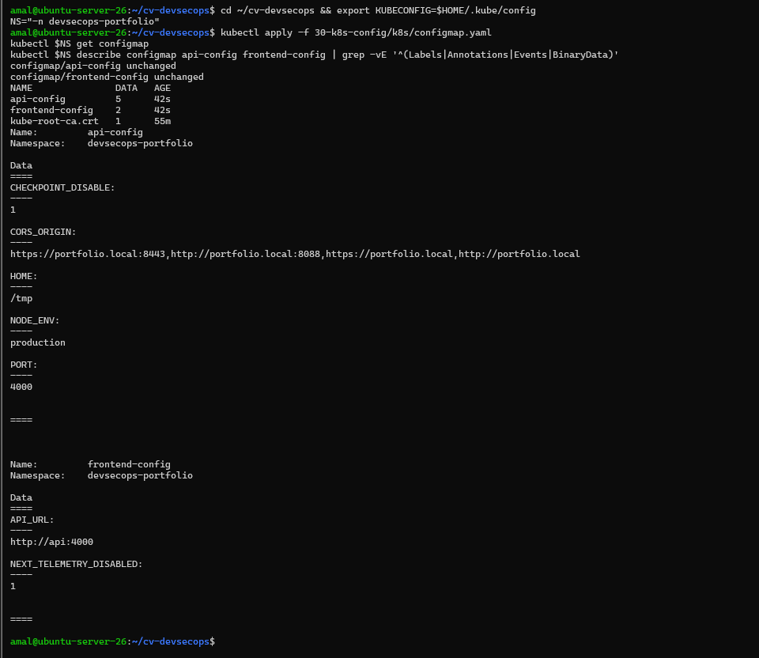
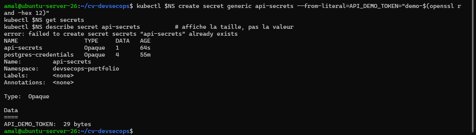
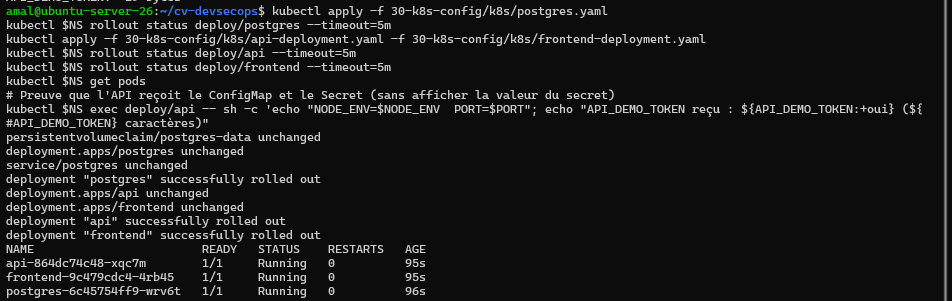
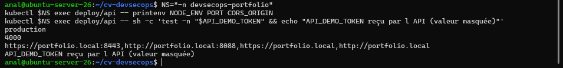
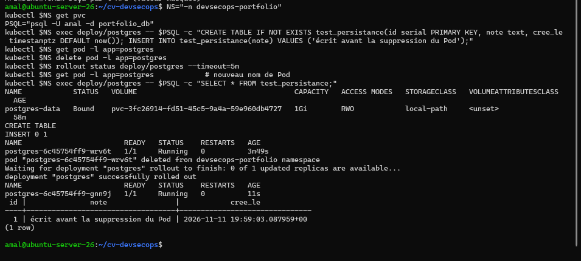
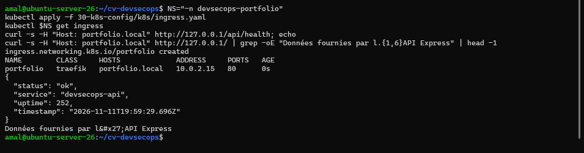
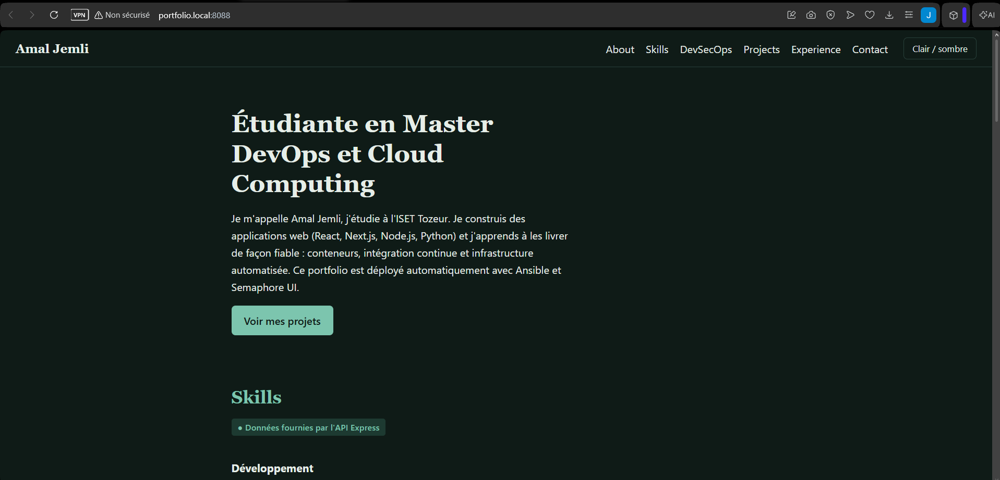
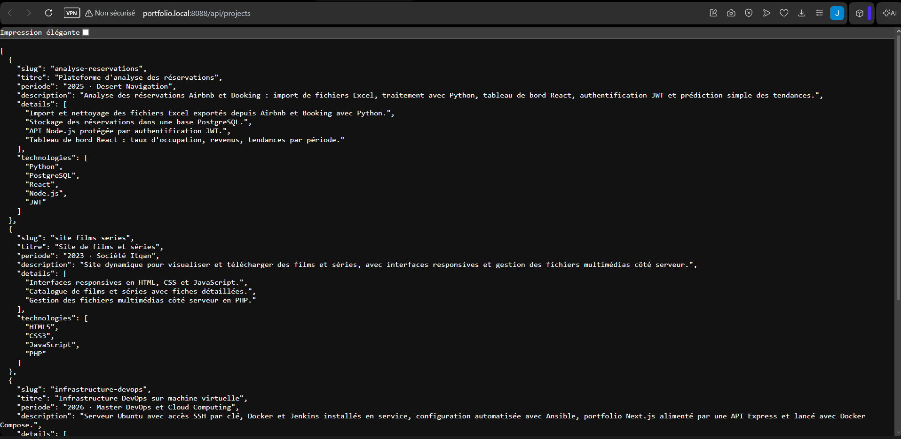

# Activité 7 – Partie 28 : Configuration de l'application (étapes 147 à 152)

Les Deployments de la [partie 26](../28-kubernetes/README.md) sont remplacés par leur **version finale** : configuration dans des ConfigMaps, valeurs sensibles dans des Secrets, sondes de santé, ressources, exécution sans privilèges, accès par un Ingress.

| Manifest | Contenu |
| :--- | :--- |
| [`k8s/configmap.yaml`](k8s/configmap.yaml) | ConfigMaps `api-config` et `frontend-config` (étape 147) |
| [`k8s/api-deployment.yaml`](k8s/api-deployment.yaml) | API : ConfigMap + Secrets (149), sondes (157-158), ressources (159), securityContext (165) |
| [`k8s/frontend-deployment.yaml`](k8s/frontend-deployment.yaml) | frontend, mêmes principes |
| [`k8s/postgres.yaml`](k8s/postgres.yaml) | PostgreSQL avec PVC (150), non root (uid 70) |
| [`k8s/ingress.yaml`](k8s/ingress.yaml) | Ingress `portfolio.local` : `/` → frontend, `/api` → API (151-152) |

## Étape 147 – ConfigMap

```yaml
apiVersion: v1
kind: ConfigMap
metadata:
  name: api-config
  namespace: devsecops-portfolio
data:
  NODE_ENV: production
  PORT: "4000"
  CORS_ORIGIN: "https://portfolio.local:8443,http://portfolio.local:8088,https://portfolio.local,http://portfolio.local"
  CHECKPOINT_DISABLE: "1"     # Prisma : pas d'appel réseau de télémétrie
  HOME: /tmp                  # système de fichiers en lecture seule : seul /tmp est inscriptible
---
apiVersion: v1
kind: ConfigMap
metadata:
  name: frontend-config
  namespace: devsecops-portfolio
data:
  API_URL: http://api:4000
  NEXT_TELEMETRY_DISABLED: "1"
```

```text
kubectl -n devsecops-portfolio get configmap
NAME               DATA   AGE
api-config         5      42s
frontend-config    2      42s
kube-root-ca.crt   1      55m
```



## Étape 148 – Secret de démonstration utilisé par l'API

```bash
kubectl -n devsecops-portfolio create secret generic api-secrets \
  --from-literal=API_DEMO_TOKEN="demo-$(openssl rand -hex 12)"
kubectl -n devsecops-portfolio get secrets
kubectl -n devsecops-portfolio describe secret api-secrets     # taille seulement, jamais la valeur
```

```text
NAME                   TYPE     DATA
api-secrets            Opaque   1
postgres-credentials   Opaque   4
Data
====
API_DEMO_TOKEN:  29 bytes
```



Les valeurs sont générées au moment de la commande : aucune valeur sensible n'est écrite dans un fichier ni dans Git. Un Secret Kubernetes est seulement encodé en base64 (pas chiffré) : la [partie 34](../36-secrets/README.md) compare les solutions plus sûres (Vault, Sealed Secrets).

## Étape 149 – Deployments utilisant le ConfigMap et le Secret

```yaml
          envFrom:
            - configMapRef: { name: api-config }          # configuration non sensible
          env:
            - name: DATABASE_URL                          # valeurs sensibles : Secrets
              valueFrom:
                secretKeyRef: { name: postgres-credentials, key: DATABASE_URL }
            - name: API_DEMO_TOKEN
              valueFrom:
                secretKeyRef: { name: api-secrets, key: API_DEMO_TOKEN }
```

```text
kubectl -n devsecops-portfolio exec deploy/api -- printenv NODE_ENV PORT CORS_ORIGIN
production
4000
https://portfolio.local:8443,http://portfolio.local:8088,https://portfolio.local,http://portfolio.local
API_DEMO_TOKEN reçu par l API (valeur masquée)
```




## Étape 150 – PostgreSQL avec un PersistentVolumeClaim

Le PVC `postgres-data` (1 Gi, classe `local-path` de K3s) est monté sur `/var/lib/postgresql/data`. Test : une ligne est écrite, le Pod est supprimé, Kubernetes en recrée un, la ligne est toujours là.

```bash
kubectl -n devsecops-portfolio get pvc
kubectl -n devsecops-portfolio exec deploy/postgres -- psql -U amal -d portfolio_db -c "CREATE TABLE IF NOT EXISTS test_persistance(id serial PRIMARY KEY, note text, cree_le timestamptz DEFAULT now()); INSERT INTO test_persistance(note) VALUES ('écrit avant la suppression du Pod');"
kubectl -n devsecops-portfolio delete pod -l app=postgres
kubectl -n devsecops-portfolio exec deploy/postgres -- psql -U amal -d portfolio_db -c "SELECT * FROM test_persistance;"
```

```text
NAME            STATUS   VOLUME          CAPACITY   ACCESS MODES   STORAGECLASS
postgres-data   Bound    pvc-3fc26914…   1Gi        RWO            local-path
postgres-6c45754ff9-wrv6t   1/1   Running        <- ancien Pod, supprimé
postgres-6c45754ff9-gnn9j   1/1   Running        <- nouveau Pod
 id |                note                |           cree_le
  1 | écrit avant la suppression du Pod  | 2026-11-11 19:59:03+00
```



Le Deployment PostgreSQL utilise la stratégie `Recreate` : l'ancien Pod est arrêté avant le démarrage du nouveau (un volume `ReadWriteOnce` ne peut pas être monté par deux Pods à la fois).

## Étapes 151 et 152 – Ingress `portfolio.local` et routage `/api`

```yaml
spec:
  ingressClassName: traefik              # Ingress controller fourni par K3s
  rules:
    - host: portfolio.local
      http:
        paths:
          - path: /api
            pathType: Prefix
            backend:
              service: { name: api, port: { number: 4000 } }
          - path: /
            pathType: Prefix
            backend:
              service: { name: frontend, port: { number: 3000 } }
```

Accès depuis la machine physique (Windows) : redirections de ports VirtualBox (NAT) et nom local dans le fichier `hosts` (PowerShell administrateur) :

```powershell
$VBM = "C:\Program Files\Oracle\VirtualBox\VBoxManage.exe"
& $VBM controlvm "ubuntu-server-26" natpf1 "http-ingress,tcp,,8088,,80"
& $VBM controlvm "ubuntu-server-26" natpf1 "https-ingress,tcp,,8443,,443"
Add-Content -Path C:\Windows\System32\drivers\etc\hosts -Value "`n127.0.0.1 portfolio.local"
```

```text
kubectl -n devsecops-portfolio get ingress
NAME        CLASS     HOSTS             ADDRESS     PORTS
portfolio   traefik   portfolio.local   10.0.2.15   80
curl -s -H "Host: portfolio.local" http://127.0.0.1/api/health   ->  "status": "ok"
```



**Portfolio accessible depuis Windows** (`http://portfolio.local:8088`), données fournies par l'API :



**Routage `/api`** (`http://portfolio.local:8088/api/projects`) :


