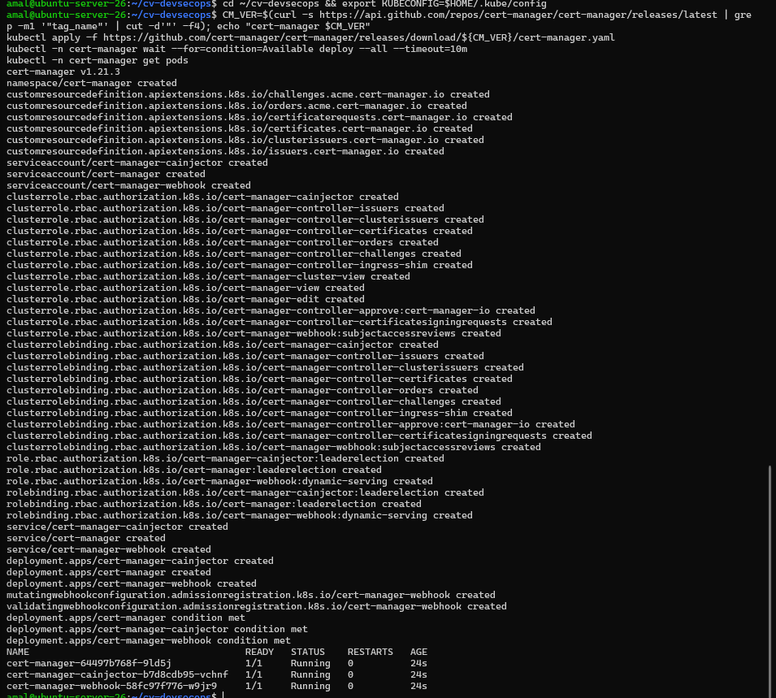
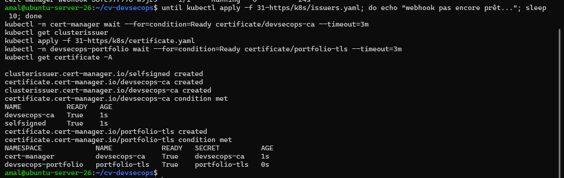
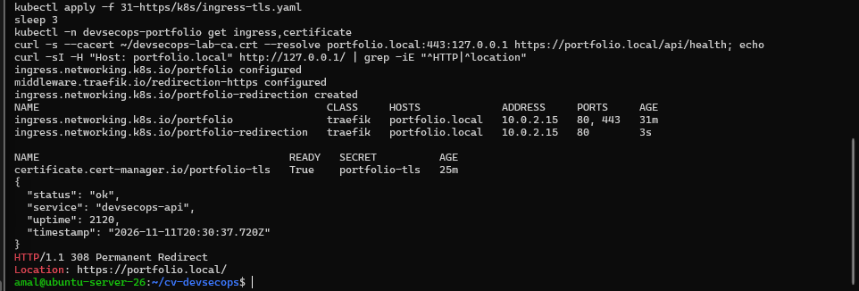
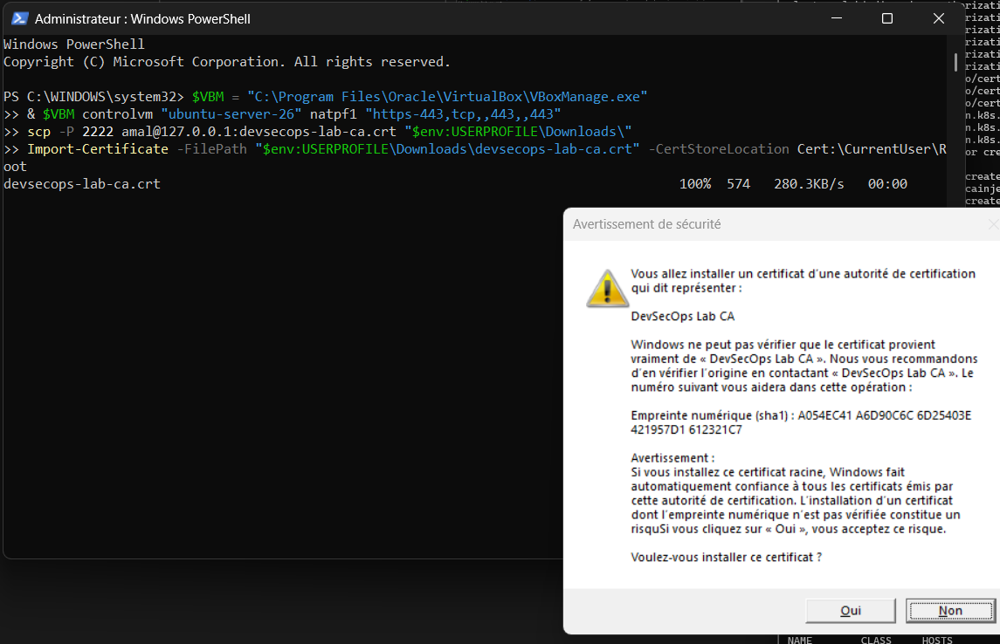
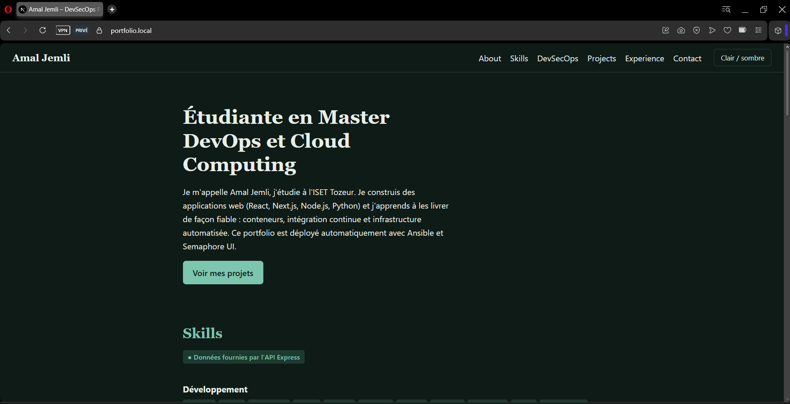
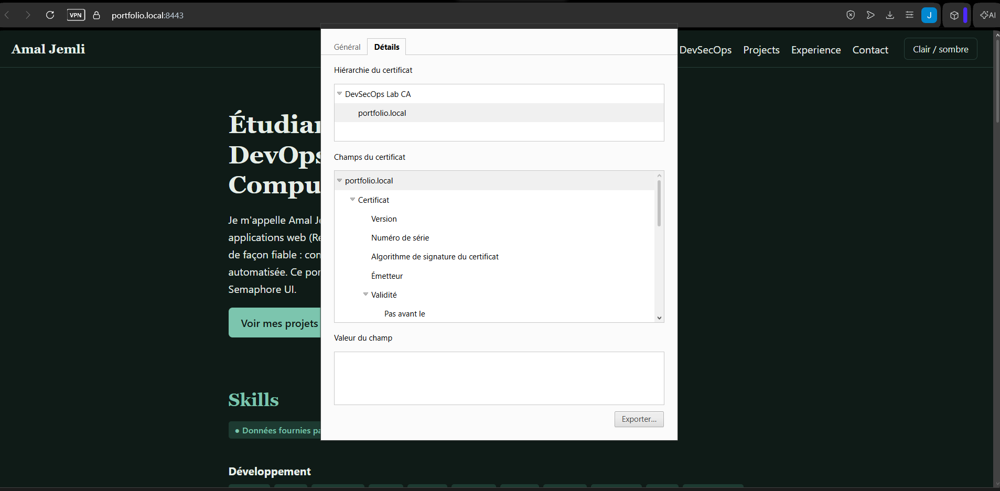

# Activité 7 – Partie 29 : HTTPS et certificats (étapes 153 à 155)

```text
ClusterIssuer « selfsigned »
   └─ signe ─► Certificate « devsecops-ca » (CA locale « DevSecOps Lab CA », 1 an, ECDSA P-256)
                  └─ ClusterIssuer « devsecops-ca »
                        └─ signe ─► Certificate « portfolio-tls » (portfolio.local, 90 jours,
                                       renouvelé automatiquement 15 jours avant expiration)
                                       └─ Secret portfolio-tls ─► Ingress HTTPS (Traefik, port 443)
```

## Étape 153 – Installation de cert-manager

```bash
CM_VER=$(curl -s https://api.github.com/repos/cert-manager/cert-manager/releases/latest | grep -m1 '"tag_name"' | cut -d'"' -f4)
kubectl apply -f https://github.com/cert-manager/cert-manager/releases/download/${CM_VER}/cert-manager.yaml
kubectl -n cert-manager wait --for=condition=Available deploy --all --timeout=10m
kubectl -n cert-manager get pods
```

```text
cert-manager v1.21.3
cert-manager-64497b768f-9ld5j              1/1   Running
cert-manager-cainjector-b7d8cdb95-vchnf    1/1   Running
cert-manager-webhook-58fc97f776-w9jr9      1/1   Running
```



## Étape 154 – Issuer (CA locale) et certificat TLS

Une **CA locale** plutôt qu'un simple certificat autosigné : on ne fait confiance qu'une seule fois à la CA, puis tous les certificats qu'elle signe (et leurs renouvellements) sont reconnus.

| Manifest | Contenu |
| :--- | :--- |
| [`k8s/issuers.yaml`](k8s/issuers.yaml) | ClusterIssuer autosigné → certificat de CA → ClusterIssuer `devsecops-ca` |
| [`k8s/certificate.yaml`](k8s/certificate.yaml) | certificat `portfolio-tls` pour `portfolio.local` |

```yaml
apiVersion: cert-manager.io/v1
kind: Certificate
metadata:
  name: portfolio-tls
  namespace: devsecops-portfolio
spec:
  secretName: portfolio-tls
  dnsNames: [portfolio.local]
  duration: 2160h          # 90 jours
  renewBefore: 360h        # renouvelé 15 jours avant expiration
  privateKey: { algorithm: ECDSA, size: 256 }
  issuerRef: { name: devsecops-ca, kind: ClusterIssuer }
```

```text
kubectl get clusterissuer
NAME           READY
devsecops-ca   True
selfsigned     True
kubectl get certificate -A
NAMESPACE             NAME            READY   SECRET
cert-manager          devsecops-ca    True    devsecops-ca
devsecops-portfolio   portfolio-tls   True    portfolio-tls
```



## Étape 155 – Ingress en HTTPS : `https://portfolio.local`

[`k8s/ingress-tls.yaml`](k8s/ingress-tls.yaml) contient **deux Ingress** :

- `portfolio` : HTTPS uniquement (entrée `websecure` de Traefik), certificat `portfolio-tls` ;
- `portfolio-redirection` : HTTP (entrée `web`), redirigé vers HTTPS par le Middleware Traefik `redirection-https`.

**Problème rencontré :** avec un seul Ingress portant à la fois `tls` et la redirection, le trafic déjà en HTTPS était aussi redirigé : `curl https://portfolio.local/api/health` répondait `Moved Permanently` au lieu des données. Séparer les deux Ingress supprime la boucle.

```bash
kubectl apply -f k8s/ingress-tls.yaml
echo | openssl s_client -connect 127.0.0.1:443 -servername portfolio.local 2>/dev/null | openssl x509 -noout -ext subjectAltName -issuer -enddate
curl -s --cacert ~/devsecops-lab-ca.crt --resolve portfolio.local:443:127.0.0.1 https://portfolio.local/api/health
curl -sI -H "Host: portfolio.local" http://127.0.0.1/ | grep -iE "^HTTP|^location"
```

```text
ingress.networking.k8s.io/portfolio               traefik   portfolio.local   80, 443
ingress.networking.k8s.io/portfolio-redirection   traefik   portfolio.local   80
certificate.cert-manager.io/portfolio-tls   True   portfolio-tls
{ "status": "ok", "service": "devsecops-api", ... }
HTTP/1.1 308 Permanent Redirect
Location: https://portfolio.local/
```



**Confiance dans la CA sous Windows** (uniquement le certificat public de la CA, jamais sa clé privée) et redirection du port 443 (PowerShell administrateur) :

```bash
# Sur la VM
kubectl -n cert-manager get secret devsecops-ca -o jsonpath='{.data.ca\.crt}' | base64 -d > ~/devsecops-lab-ca.crt
```

```powershell
& $VBM controlvm "ubuntu-server-26" natpf1 "https-443,tcp,,443,,443"
scp -P 2222 amal@127.0.0.1:devsecops-lab-ca.crt "$env:USERPROFILE\Downloads\"
Import-Certificate -FilePath "$env:USERPROFILE\Downloads\devsecops-lab-ca.crt" -CertStoreLocation Cert:\CurrentUser\Root
```



**Accès HTTPS depuis la machine physique** — `https://portfolio.local`, cadenas, certificat émis par « DevSecOps Lab CA » :




> Le navigateur avait mémorisé l'ancienne redirection permanente vers `:8443` (code 308) : un nouvel onglet en navigation privée a suffi. Les redirections permanentes sont mises en cache par les navigateurs.
