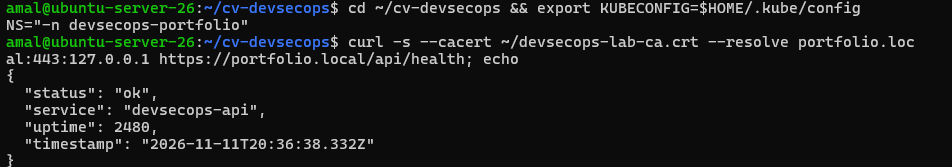
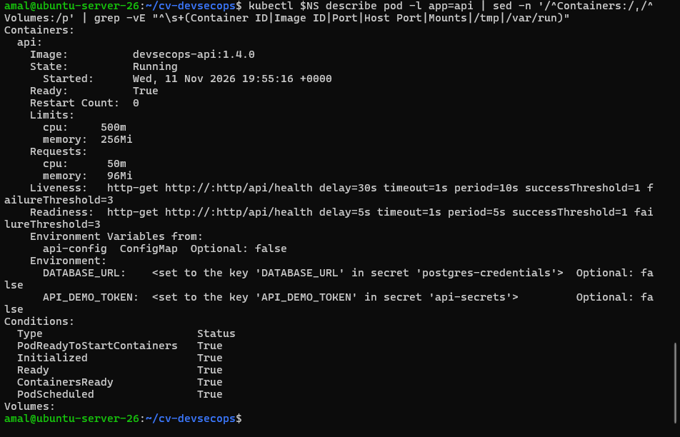
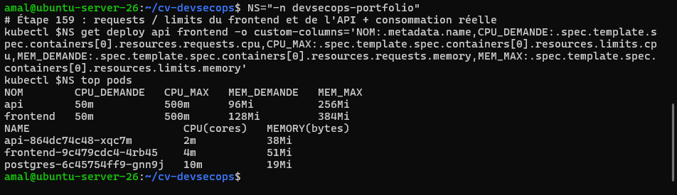
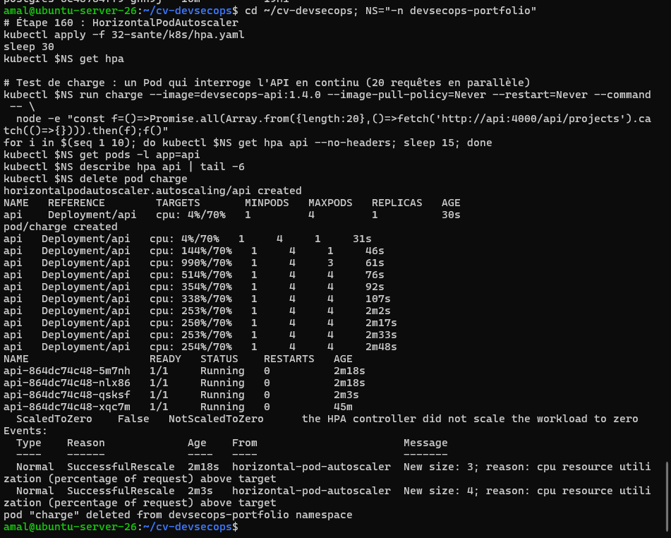

# Activité 7 – Partie 30 : Santé et disponibilité (étapes 156 à 160)

Les sondes et les ressources font partie de la version finale des Deployments ([`../30-k8s-config/k8s/`](../30-k8s-config/k8s/)).

## Étape 156 – `/api/health`, base des vérifications

```text
curl -s --cacert ~/devsecops-lab-ca.crt --resolve portfolio.local:443:127.0.0.1 https://portfolio.local/api/health
{ "status": "ok", "service": "devsecops-api", "uptime": 2480, "timestamp": "2026-11-11T20:36:38.332Z" }
```



## Étapes 157 et 158 – readinessProbe et livenessProbe

```yaml
          readinessProbe:                     # le Pod ne reçoit du trafic que s'il répond
            httpGet: { path: /api/health, port: http }
            initialDelaySeconds: 5
            periodSeconds: 5
            failureThreshold: 3
          livenessProbe:                      # Kubernetes redémarre le conteneur s'il ne répond plus
            httpGet: { path: /api/health, port: http }
            initialDelaySeconds: 30
            periodSeconds: 10
            failureThreshold: 3
```

| Sonde | Question posée | En cas d'échec |
| :--- | :--- | :--- |
| **readiness** | « peut-il recevoir du trafic ? » | retiré du Service, pas redémarré |
| **liveness** | « est-il encore vivant ? » | conteneur redémarré |

```text
kubectl -n devsecops-portfolio describe pod -l app=api
    Ready:          True
    Restart Count:  0
    Limits:    cpu: 500m   memory: 256Mi
    Requests:  cpu: 50m    memory: 96Mi
    Liveness:   http-get http://:http/api/health delay=30s timeout=1s period=10s #success=1 #failure=3
    Readiness:  http-get http://:http/api/health delay=5s timeout=1s period=5s #success=1 #failure=3
    Environment Variables from:  api-config  ConfigMap
```



La readinessProbe corrige le défaut constaté à l'étape 143 : le Pod n'est plus déclaré prêt pendant les migrations Prisma.

**Incident réel et correction (frontend) :** pendant une saturation du disque, l'API a été arrêtée. Chaque page du frontend attendait alors 2 x 3 s avant d'afficher ses données locales de secours, mais la sonde n'attend qu'**1 s** par défaut : Kubernetes a redémarré 7 fois un frontend qui fonctionnait (code 143 = arrêté par Kubernetes). C'est une **panne en cascade** : la sonde de vie d'un service ne doit pas dépendre d'un autre service. Correction : `timeoutSeconds: 8` sur les sondes du frontend.

## Étape 159 – requests et limits

```text
NOM        CPU_DEMANDE   CPU_MAX   MEM_DEMANDE   MEM_MAX
api        50m           500m      96Mi          256Mi
frontend   50m           500m      128Mi         384Mi
kubectl top pods
api-864dc74c48-xqc7m        2m    38Mi
frontend-9c479cdc4-4rb45    4m    51Mi
postgres-6c45754ff9-gnn9j   10m   19Mi
```



- **requests** : réservé par le scheduler pour placer le Pod, base de calcul de l'HPA ;
- **limits** : plafond ; au-delà du CPU le conteneur est ralenti, au-delà de la mémoire il est arrêté (`OOMKilled`).

## Étape 160 – HorizontalPodAutoscaler

[`k8s/hpa.yaml`](k8s/hpa.yaml) : de 1 à 4 Pods pour l'API, cible 70 % du CPU demandé (metrics-server fourni par K3s).

Test de charge : un Pod envoie 20 requêtes en parallèle en continu à l'API.

```bash
kubectl apply -f k8s/hpa.yaml
kubectl -n devsecops-portfolio run charge --image=devsecops-api:1.4.0 --image-pull-policy=Never --restart=Never --command -- \
  node -e "const f=()=>Promise.all(Array.from({length:20},()=>fetch('http://api:4000/api/projects').catch(()=>{}))).then(f);f()"
```

```text
NAME   REFERENCE        TARGETS       MINPODS   MAXPODS   REPLICAS
api    Deployment/api   cpu: 4%/70%   1         4         1
api    Deployment/api   cpu: 990%/70%  1        4         3
api    Deployment/api   cpu: 254%/70%  1        4         4
Normal  SuccessfulRescale  New size: 3; reason: cpu resource utilization (percentage of request) above target
Normal  SuccessfulRescale  New size: 4; reason: cpu resource utilization (percentage of request) above target
```



Après l'arrêt de la charge, l'HPA redescend à 1 Pod après sa fenêtre de stabilisation (5 minutes par défaut), pour éviter des oscillations.
