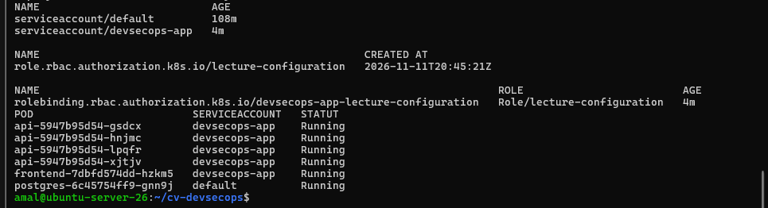
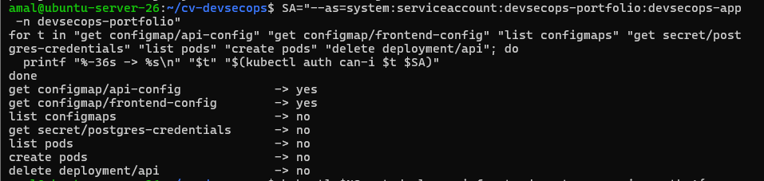
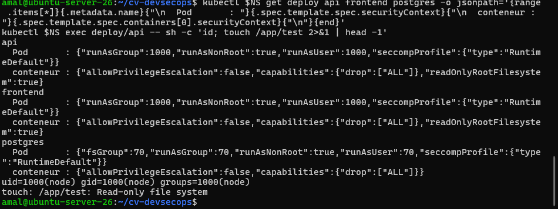
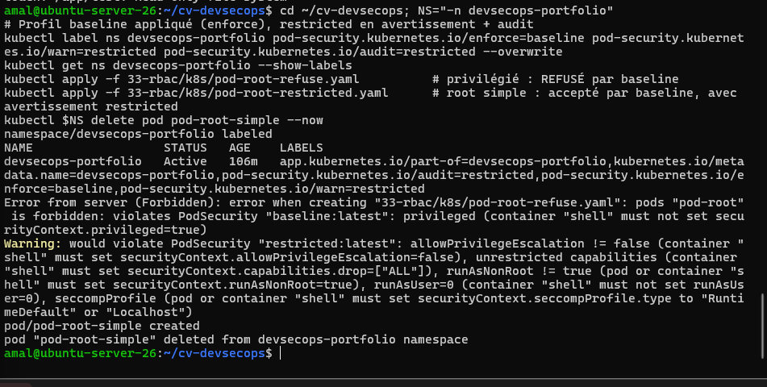
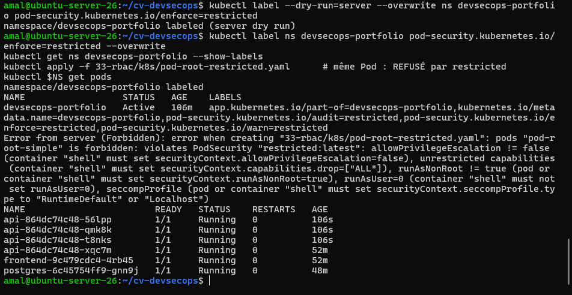

# Activité 7 – Partie 31 : Kubernetes Security et RBAC (étapes 161 à 166)

## Étapes 161 à 163 – ServiceAccount, Role, RoleBinding

| Manifest | Contenu |
| :--- | :--- |
| [`k8s/serviceaccount.yaml`](k8s/serviceaccount.yaml) | identité `devsecops-app` (et non le compte `default`), jeton non monté automatiquement |
| [`k8s/role.yaml`](k8s/role.yaml) | droits minimaux : **lire** (`get`) les deux ConfigMaps de l'application, rien d'autre |
| [`k8s/rolebinding.yaml`](k8s/rolebinding.yaml) | accorde ce Role au ServiceAccount, dans ce namespace uniquement |

```yaml
apiVersion: rbac.authorization.k8s.io/v1
kind: Role
metadata:
  name: lecture-configuration
  namespace: devsecops-portfolio
rules:
  - apiGroups: [""]
    resources: ["configmaps"]
    resourceNames: ["api-config", "frontend-config"]
    verbs: ["get"]
```

Les Deployments de l'API et du frontend utilisent ce ServiceAccount (`serviceAccountName: devsecops-app`, avec `automountServiceAccountToken: false` : l'application n'appelle pas l'API Kubernetes, aucun jeton n'est présent dans les conteneurs).

```text
POD                         SERVICEACCOUNT   STATUT
api-5947b95d54-gsdcx        devsecops-app    Running
frontend-7dbfd574dd-hzkm5   devsecops-app    Running
postgres-6c45754ff9-gnn9j   default          Running
```



## Étape 164 – Tests avec `kubectl auth can-i`

```bash
SA="--as=system:serviceaccount:devsecops-portfolio:devsecops-app -n devsecops-portfolio"
for t in "get configmap/api-config" "get configmap/frontend-config" "list configmaps" \
         "get secret/postgres-credentials" "list pods" "create pods" "delete deployment/api"; do
  printf "%-36s -> %s\n" "$t" "$(kubectl auth can-i $t $SA)"
done
```

```text
get configmap/api-config             -> yes
get configmap/frontend-config        -> yes
list configmaps                      -> no
get secret/postgres-credentials      -> no
list pods                            -> no
create pods                          -> no
delete deployment/api                -> no
```



Principe du **moindre privilège** : même `list configmaps` est refusé (seuls les deux ConfigMaps nommés sont lisibles), et aucun Secret n'est accessible.

## Étape 165 – Conteneurs sans privilèges élevés

| Paramètre | Niveau | Effet |
| :--- | :--- | :--- |
| `runAsNonRoot: true` + `runAsUser: 1000` | Pod | refus de démarrer en root ; utilisateur `node` de l'image (uid 70 pour PostgreSQL) |
| `seccompProfile: RuntimeDefault` | Pod | filtre des appels système dangereux |
| `allowPrivilegeEscalation: false` | conteneur | pas d'élévation de privilèges (setuid, sudo…) |
| `capabilities.drop: ["ALL"]` | conteneur | aucune capacité Linux |
| `readOnlyRootFilesystem: true` | conteneur | code non modifiable ; seuls `/tmp` (et `.next/cache`) sont inscriptibles (`emptyDir`) |
| `automountServiceAccountToken: false` | Pod | aucun jeton Kubernetes dans le conteneur |

```text
api
  Pod       : {"runAsGroup":1000,"runAsNonRoot":true,"runAsUser":1000,"seccompProfile":{"type":"RuntimeDefault"}}
  conteneur : {"allowPrivilegeEscalation":false,"capabilities":{"drop":["ALL"]},"readOnlyRootFilesystem":true}
postgres
  Pod       : {"fsGroup":70,"runAsGroup":70,"runAsNonRoot":true,"runAsUser":70,"seccompProfile":{"type":"RuntimeDefault"}}
uid=1000(node) gid=1000(node) groups=1000(node)
touch: /app/test: Read-only file system
```



## Étape 166 – Pod Security Standards : baseline puis restricted

**Labels utilisés :**

```bash
# 1. baseline appliqué, restricted en avertissement et en audit
kubectl label ns devsecops-portfolio \
  pod-security.kubernetes.io/enforce=baseline \
  pod-security.kubernetes.io/warn=restricted \
  pod-security.kubernetes.io/audit=restricted --overwrite
# 2. simulation : les Pods existants respectent-ils restricted ?
kubectl label --dry-run=server --overwrite ns devsecops-portfolio pod-security.kubernetes.io/enforce=restricted
# 3. restricted appliqué
kubectl label ns devsecops-portfolio pod-security.kubernetes.io/enforce=restricted --overwrite
```

Deux Pods de test :

- [`k8s/pod-root-refuse.yaml`](k8s/pod-root-refuse.yaml) : root + `privileged: true` → refusé **dès baseline** ;
- [`k8s/pod-root-restricted.yaml`](k8s/pod-root-restricted.yaml) : root sans mode privilégié → accepté par baseline (avec avertissement), **refusé par restricted**.

```text
Error from server (Forbidden): pods "pod-root" is forbidden: violates PodSecurity "baseline:latest":
  privileged (container "shell" must not set securityContext.privileged=true)
Warning: would violate PodSecurity "restricted:latest": allowPrivilegeEscalation != false, unrestricted capabilities,
  runAsNonRoot != true, runAsUser=0, seccompProfile ...
pod/pod-root-simple created
```



```text
namespace/devsecops-portfolio labeled (server dry run)          <- aucun avertissement : l'application est conforme
Error from server (Forbidden): pods "pod-root-simple" is forbidden: violates PodSecurity "restricted:latest":
  allowPrivilegeEscalation != false (container "shell" must set securityContext.allowPrivilegeEscalation=false),
  unrestricted capabilities (container "shell" must set securityContext.capabilities.drop=["ALL"]),
  runAsNonRoot != true (pod or container "shell" must set securityContext.runAsNonRoot=true),
  runAsUser=0 (container "shell" must not set runAsUser=0),
  seccompProfile (pod or container "shell" must set securityContext.seccompProfile.type to "RuntimeDefault" or "Localhost")
```



| Profil | Interdit notamment | Pour qui |
| :--- | :--- | :--- |
| `privileged` | rien | composants système (CNI, Falco…) |
| `baseline` | `privileged`, `hostNetwork`, `hostPath`, capacités dangereuses | point de départ sans casser les applications |
| `restricted` | baseline + root, élévation de privilèges, capacités, seccomp absent | applications durcies, comme le portfolio |

Passer par `warn`/`audit` puis par la simulation `--dry-run=server` permet de durcir un namespace **sans casser** les Pods existants.
