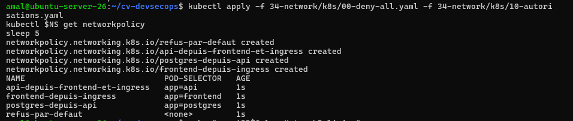
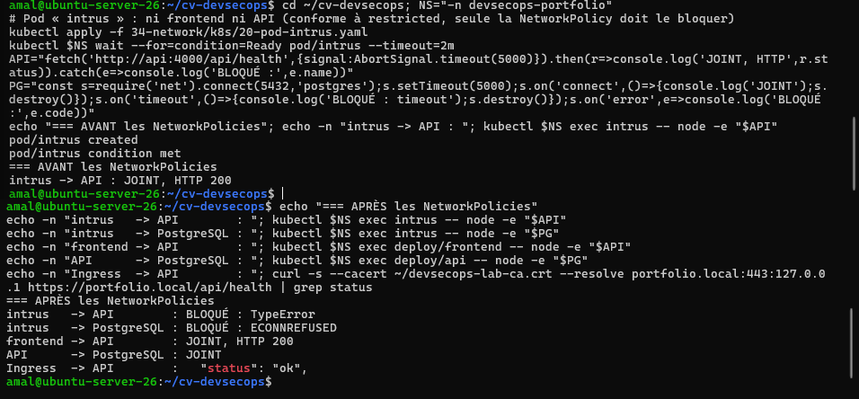
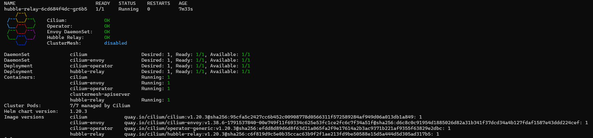
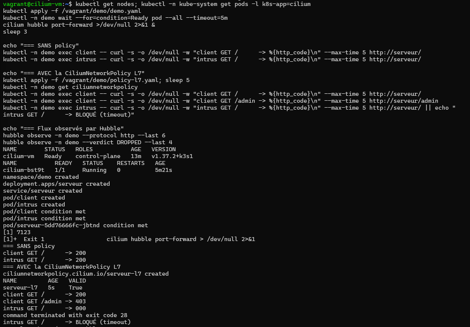
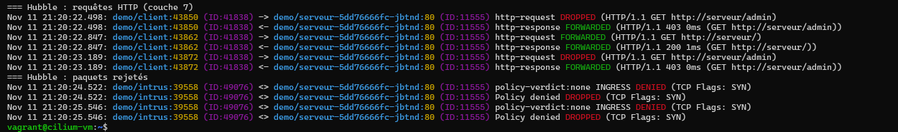

# Activité 7 – Partie 32 : Network Security (étapes 167 à 170)

K3s applique les NetworkPolicies avec son contrôleur intégré (kube-router). Sans NetworkPolicy, **tous les Pods peuvent se parler**.

```text
                       namespace devsecops-portfolio (refus par défaut)
 Traefik (kube-system) ──► frontend :3000 ──► api :4000 ──► postgres :5432
           └──────────────────────────────────► api :4000
 intrus ──X──► api            intrus ──X──► postgres          frontend ──X──► postgres
```

| Manifest | Contenu |
| :--- | :--- |
| [`k8s/00-deny-all.yaml`](k8s/00-deny-all.yaml) | `refus-par-defaut` : aucun Pod du namespace ne reçoit de trafic (étape 167) |
| [`k8s/10-autorisations.yaml`](k8s/10-autorisations.yaml) | frontend → API, API → PostgreSQL, Ingress (Traefik) → frontend et API (étape 168) |
| [`k8s/20-pod-intrus.yaml`](k8s/20-pod-intrus.yaml) | Pod non autorisé, conforme au profil restricted : seule la NetworkPolicy doit le bloquer (étape 169) |

## Étape 167 – Refus par défaut

```yaml
apiVersion: networking.k8s.io/v1
kind: NetworkPolicy
metadata:
  name: refus-par-defaut
  namespace: devsecops-portfolio
spec:
  podSelector: {}            # tous les Pods du namespace
  policyTypes: [Ingress]
```

## Étape 168 – Autorisations explicites

```yaml
apiVersion: networking.k8s.io/v1
kind: NetworkPolicy
metadata:
  name: postgres-depuis-api
  namespace: devsecops-portfolio
spec:
  podSelector:
    matchLabels: { app: postgres }
  policyTypes: [Ingress]
  ingress:
    - from:
        - podSelector:
            matchLabels: { app: api }
      ports:
        - port: 5432
```

L'Ingress controller (Traefik, namespace `kube-system`) est aussi autorisé vers le frontend et l'API : sans cela, le site ne serait plus accessible depuis le navigateur.

```text
NAME                           POD-SELECTOR
api-depuis-frontend-et-ingress app=api
frontend-depuis-ingress        app=frontend
postgres-depuis-api            app=postgres
refus-par-defaut               <none>
```



## Étape 169 – Un Pod non autorisé ne peut pas contacter l'API

```text
=== AVANT les NetworkPolicies
intrus   -> API        : JOINT, HTTP 200
=== APRÈS les NetworkPolicies
intrus   -> API        : BLOQUÉ : TypeError
intrus   -> PostgreSQL : BLOQUÉ : ECONNREFUSED
frontend -> API        : JOINT, HTTP 200
API      -> PostgreSQL : JOINT
Ingress  -> API        :   "status": "ok",
```



Les tests utilisent Node.js (`fetch`, module `net`) déjà présent dans l'image de l'API : pas besoin d'une image d'outils supplémentaire.

## Étape 170 – Cilium et Hubble dans un cluster de test

Cluster **séparé** (VM `cilium-vm`, 3 Go), créé par Vagrant + Ansible comme à la [partie 27](../29-kubernetes-ansible/README.md) : il réutilise le rôle `k3s` (sans flannel ni contrôleur NetworkPolicy de K3s), puis le rôle [`cilium`](cilium/ansible/roles/cilium/tasks/main.yml) installe les CLI `cilium` et `hubble`, Cilium (CNI eBPF) et Hubble (observabilité réseau).

| Fichier | Rôle |
| :--- | :--- |
| [`cilium/Vagrantfile`](cilium/Vagrantfile) | VM de test, partage du rôle k3s de la partie 27 |
| [`cilium/ansible/playbook.yml`](cilium/ansible/playbook.yml) | K3s sans flannel (`flannel-backend: none`, `disable-network-policy`) puis Cilium |
| [`cilium/demo/demo.yaml`](cilium/demo/demo.yaml) | serveur nginx, client autorisé (`role=client`), intrus |
| [`cilium/demo/policy-l7.yaml`](cilium/demo/policy-l7.yaml) | **CiliumNetworkPolicy de niveau 7 (HTTP)** |

```text
    Cilium:             OK
    Operator:           OK
    Envoy DaemonSet:    OK
    Hubble Relay:       OK
Cluster Pods:   7/7 managed by Cilium
Image versions  cilium  quay.io/cilium/cilium:v1.20.3
```



**NetworkPolicy avancée :** une NetworkPolicy standard filtre par adresse et port (couches 3-4). Cilium filtre aussi le contenu HTTP (couche 7) : le client a le droit de faire `GET /`, mais pas `GET /admin`.

```yaml
apiVersion: cilium.io/v2
kind: CiliumNetworkPolicy
metadata:
  name: serveur-l7
  namespace: demo
spec:
  endpointSelector:
    matchLabels: { app: serveur }
  ingress:
    - fromEndpoints:
        - matchLabels: { role: client }
      toPorts:
        - ports: [{ port: "80", protocol: TCP }]
          rules:
            http:
              - method: GET
                path: "/"
```

```text
=== SANS policy
client GET /      -> 200
intrus GET /      -> 200
=== AVEC la CiliumNetworkPolicy L7
client GET /      -> 200
client GET /admin -> 403
intrus GET /      -> BLOQUÉ (timeout)
```



**Flux réseau observés avec Hubble :**

```text
demo/client -> demo/serveur:80  http-request  DROPPED   (HTTP/1.1 GET http://serveur/admin)
demo/client <- demo/serveur:80  http-response FORWARDED (HTTP/1.1 403 0ms (GET http://serveur/admin))
demo/client -> demo/serveur:80  http-request  FORWARDED (HTTP/1.1 GET http://serveur/)
demo/client <- demo/serveur:80  http-response FORWARDED (HTTP/1.1 200 1ms (GET http://serveur/))
demo/intrus <> demo/serveur:80  policy-verdict:none INGRESS DENIED (TCP Flags: SYN)
demo/intrus <> demo/serveur:80  Policy denied DROPPED (TCP Flags: SYN)
```



| | NetworkPolicy (K3s / kube-router) | Cilium |
| :--- | :--- | :--- |
| Technique | iptables | eBPF dans le noyau |
| Filtrage | adresses, ports (L3-L4) | + identités de Pods, HTTP / gRPC / DNS (L7) |
| Observabilité | aucune | Hubble : chaque flux, verdict, raison du rejet |

Le cluster de test est arrêté après la démonstration (`vagrant halt`) pour libérer la mémoire.
