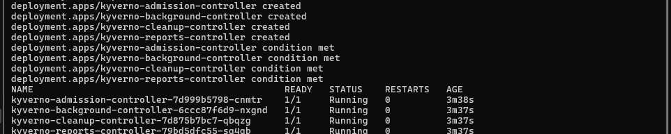
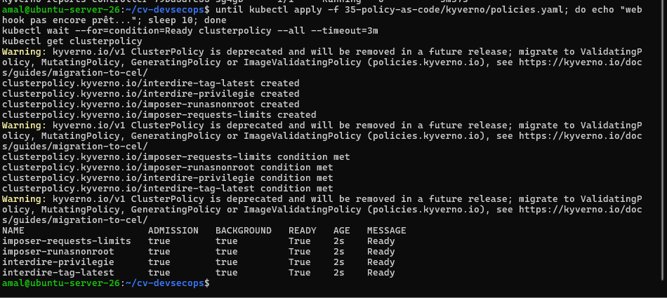
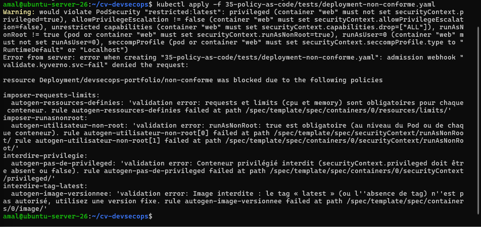
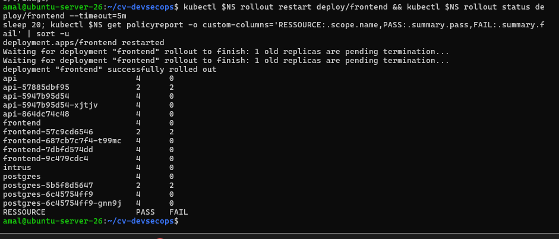
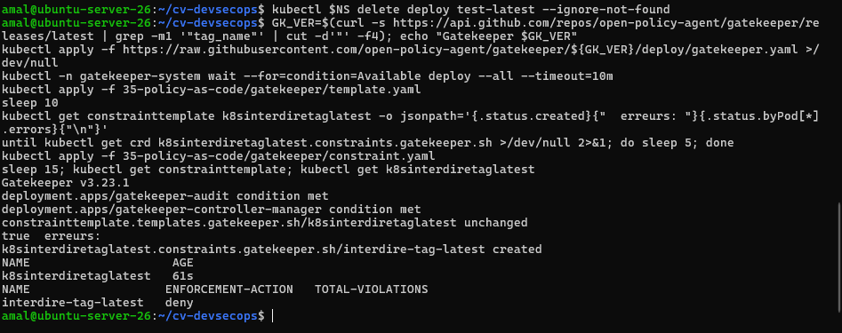
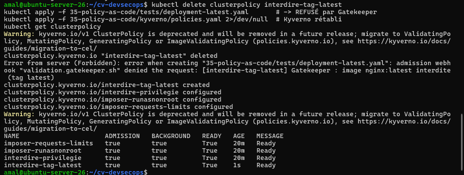

# Activité 7 – Partie 33 : Policy as Code (étapes 171 à 177)

Les règles de sécurité deviennent du **code versionné** : le cluster refuse automatiquement toute ressource non conforme, au moment de sa création (contrôleur d'admission).

## Étape 171 – Installation de Kyverno

```bash
KY_VER=$(curl -s https://api.github.com/repos/kyverno/kyverno/releases/latest | grep -m1 '"tag_name"' | cut -d'"' -f4)
kubectl create -f https://github.com/kyverno/kyverno/releases/download/${KY_VER}/install.yaml
kubectl -n kyverno wait --for=condition=Available deploy --all --timeout=10m
```

```text
Kyverno v1.19.2
kyverno-admission-controller    1/1   Running
kyverno-background-controller   1/1   Running
kyverno-cleanup-controller      1/1   Running
kyverno-reports-controller      1/1   Running
```



## Étapes 172 à 175 – Les 4 policies

[`kyverno/policies.yaml`](kyverno/policies.yaml) : 4 `ClusterPolicy` en mode `Enforce`, appliquées aux namespaces portant le label `app.kubernetes.io/part-of=devsecops-portfolio`. Écrites pour les Pods, Kyverno génère automatiquement les mêmes règles pour les Deployments, StatefulSets, Jobs… (règles `autogen-…`).

| Étape | Policy | Règle |
| :--- | :--- | :--- |
| 172 | `interdire-tag-latest` | image `*:*` et pas `*:latest` (image sans tag = latest) |
| 173 | `interdire-privilegie` | `securityContext.privileged` absent ou `false` |
| 174 | `imposer-runasnonroot` | `runAsNonRoot: true` au niveau du Pod ou de chaque conteneur |
| 175 | `imposer-requests-limits` | `requests` et `limits` cpu + memory pour chaque conteneur |

```yaml
apiVersion: kyverno.io/v1
kind: ClusterPolicy
metadata:
  name: interdire-tag-latest
spec:
  background: true
  rules:
    - name: image-versionnee
      match:
        any:
          - resources:
              kinds: [Pod]
              namespaceSelector:
                matchLabels: { app.kubernetes.io/part-of: devsecops-portfolio }
      validate:
        failureAction: Enforce
        message: "Image interdite : le tag « latest » (ou l'absence de tag) n'est pas autorisé, utilisez une version fixe."
        pattern:
          spec:
            containers:
              - image: "*:* & !*:latest"
```

Les policies ont d'abord été testées hors cluster avec la CLI Kyverno (`kyverno apply policies.yaml --resource …`) : le Deployment non conforme échoue sur les 4 règles, le vrai Deployment de l'API les passe toutes.

```text
NAME                      ADMISSION   BACKGROUND   READY
imposer-requests-limits   true        true         True
imposer-runasnonroot      true        true         True
interdire-privilegie      true        true         True
interdire-tag-latest      true        true         True
```



> Kyverno 1.19 signale que `ClusterPolicy` est dépréciée au profit des nouvelles `ValidatingPolicy` (règles écrites en CEL, le langage des `ValidatingAdmissionPolicy` natives de Kubernetes). Les `ClusterPolicy` restent pleinement fonctionnelles ; la migration est une évolution possible.

## Étape 176 – Deployment volontairement non conforme : refusé

[`tests/deployment-non-conforme.yaml`](tests/deployment-non-conforme.yaml) : `nginx:latest`, conteneur privilégié, root, sans ressources.

```text
Error from server: error when creating "deployment-non-conforme.yaml": admission webhook "validate.kyverno.svc-fail" denied the request:

resource Deployment/devsecops-portfolio/non-conforme was blocked due to the following policies

imposer-requests-limits:
  autogen-ressources-definies: 'validation error: requests et limits (cpu et memory) sont obligatoires pour chaque conteneur. rule autogen-ressources-definies failed at path /spec/template/spec/containers/0/resources/limits/'
imposer-runasnonroot:
  autogen-utilisateur-non-root: 'validation error: runAsNonRoot: true est obligatoire (au niveau du Pod ou de chaque conteneur). ...'
interdire-privilegie:
  autogen-pas-de-privileged: 'validation error: Conteneur privilégié interdit (securityContext.privileged doit être absent ou false). ...'
interdire-tag-latest:
  autogen-image-versionnee: 'validation error: Image interdite : le tag « latest » (ou l''absence de tag) n''est pas autorisé, utilisez une version fixe. ...'
```



Le Deployment est refusé **avant** de créer le moindre Pod, avec un message par règle. L'avertissement Pod Security « restricted » ([partie 31](../33-rbac/README.md)) apparaît aussi : deux couches de défense indépendantes.

**Contre-épreuve :** l'application réelle est conforme (redémarrage du frontend accepté). Le rapport de conformité (`PolicyReport`, scan en arrière-plan) donne `FAIL 0` pour tous les objets actifs ; les seuls `FAIL 2` concernent d'anciens ReplicaSets à 0 Pod de la version simple de la partie 26.



## Étape 177 – OPA Gatekeeper : la même règle en Rego

[`gatekeeper/template.yaml`](gatekeeper/template.yaml) (ConstraintTemplate : logique en Rego) + [`gatekeeper/constraint.yaml`](gatekeeper/constraint.yaml) (Constraint : où l'appliquer).

```rego
package k8sinterdiretaglatest

conteneurs[c] { c := input.review.object.spec.containers[_] }
conteneurs[c] { c := input.review.object.spec.template.spec.containers[_] }

violation[{"msg": msg}] {
  c := conteneurs[_]
  endswith(c.image, ":latest")
  msg := sprintf("Gatekeeper : image %v interdite (tag latest)", [c.image])
}
violation[{"msg": msg}] {
  c := conteneurs[_]
  not contains(c.image, ":")
  msg := sprintf("Gatekeeper : image %v interdite (aucun tag = latest)", [c.image])
}
```

La logique a été testée avec `opa eval` avant le déploiement. **Problème rencontré :** une première version utilisait `import rego.v1` ; Gatekeeper n'autorise aucun `import` autre que `data.lib`, le modèle n'était pas compilé (aucune erreur visible à l'`apply`, mais le type de Constraint n'était jamais créé). La syntaxe classique de la bibliothèque Gatekeeper fonctionne.

```text
Gatekeeper v3.23.1
constrainttemplate.templates.gatekeeper.sh/k8sinterdiretaglatest   true  erreurs:
NAME                   ENFORCEMENT-ACTION   TOTAL-VIOLATIONS
interdire-tag-latest   deny
```



Test avec la policy Kyverno équivalente retirée un instant, pour voir Gatekeeper seul ([`tests/deployment-latest.yaml`](tests/deployment-latest.yaml), conforme à tout sauf le tag) :

```text
Error from server (Forbidden): error when creating "deployment-latest.yaml": admission webhook "validation.gatekeeper.sh"
denied the request: [interdire-tag-latest] Gatekeeper : image nginx:latest interdite (tag latest)
```



Gatekeeper a ensuite été désinstallé (un seul moteur de policies suffit, et le laboratoire a peu de mémoire).

### Comparaison Kyverno / OPA Gatekeeper

| | Kyverno | OPA Gatekeeper |
| :--- | :--- | :--- |
| Langage | YAML (motifs `pattern`, CEL dans les nouvelles policies) | Rego (langage de programmation dédié) |
| Prise en main | rapide : une policy ressemble à la ressource qu'elle contrôle | plus long : apprendre Rego, deux objets (Template + Constraint) |
| Deployments, Jobs… | règles générées automatiquement à partir des règles sur les Pods | à écrire soi-même (`spec.template.spec`) |
| Au-delà de la validation | mutation, génération de ressources, nettoyage, vérification de signatures d'images | validation, mutation (plus limitée) |
| Rapports | `PolicyReport` intégrés | audit (`TOTAL-VIOLATIONS`) |
| Point fort | simplicité, très orienté Kubernetes | Rego réutilisable hors Kubernetes (Terraform, API, CI…) avec OPA |

**Choix pour le portfolio : Kyverno**, plus lisible et suffisant pour ces règles ; Gatekeeper/OPA se justifie quand une organisation veut un seul langage de policies pour tous ses outils.
