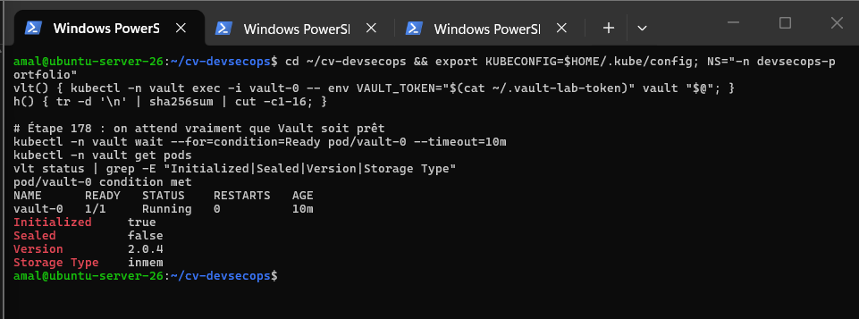
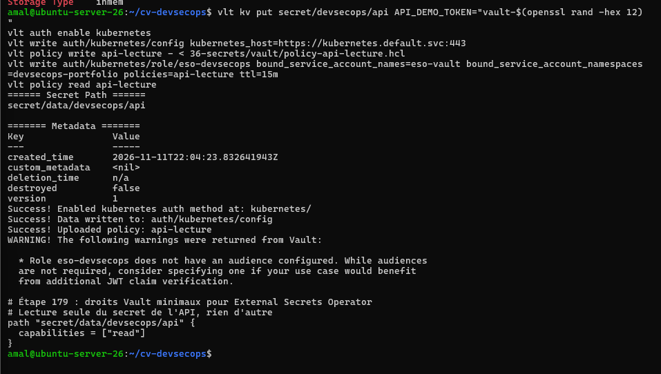
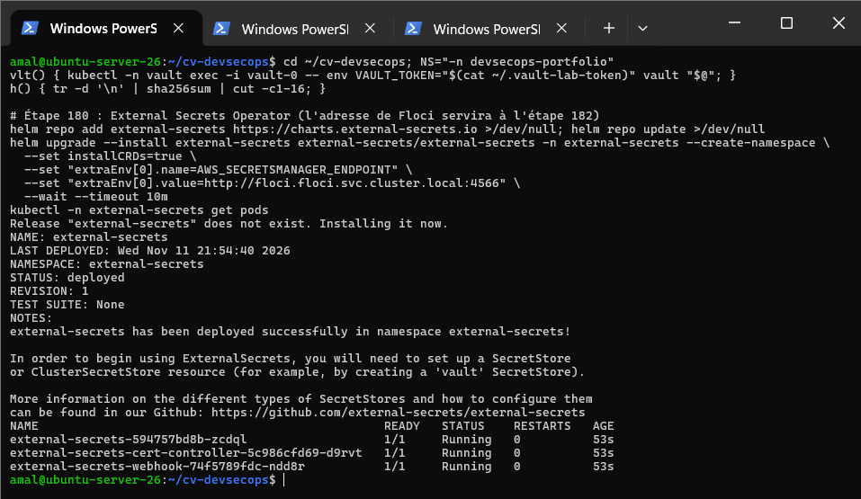
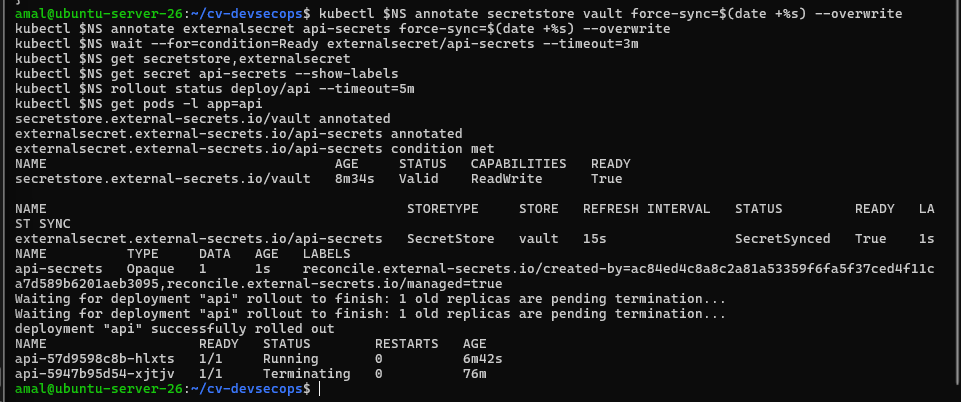
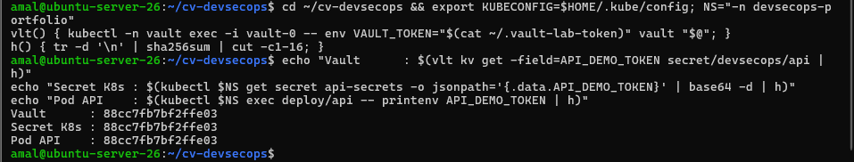
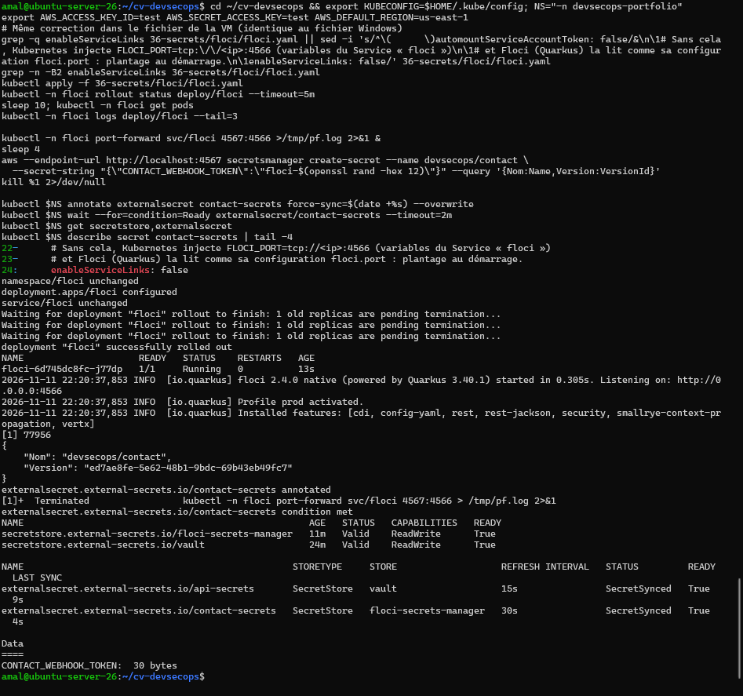
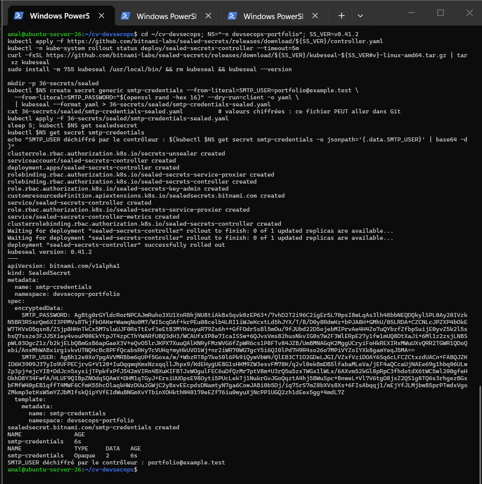
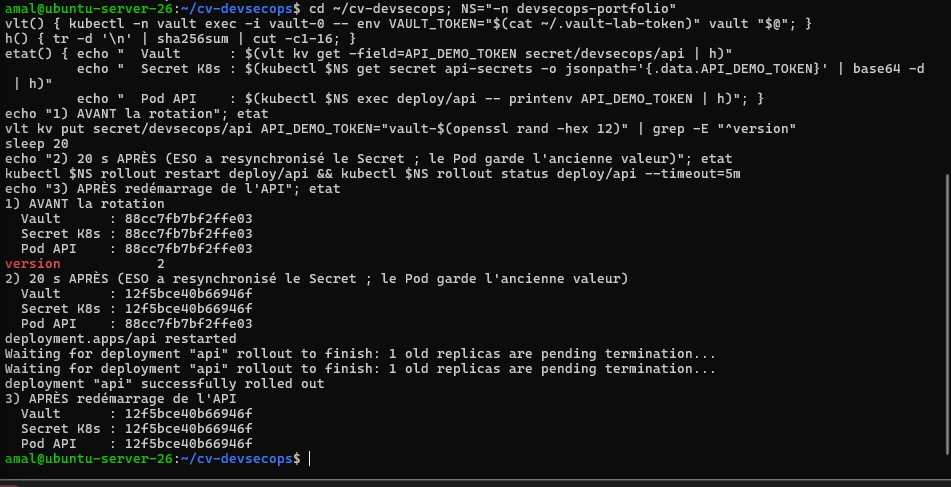

# Activité 7 – Partie 34 : Gestion avancée des secrets (étapes 178 à 184)

```text
 Vault (namespace vault)            Floci Secrets Manager (namespace floci)
 secret/devsecops/api                devsecops/contact
        │  auth Kubernetes                  │  identifiants fictifs « test »
        ▼                                   ▼
 SecretStore vault          SecretStore floci-secrets-manager       ◄── External Secrets Operator
        │                                   │
 ExternalSecret api-secrets   ExternalSecret contact-secrets   (relecture toutes les 15 s / 30 s)
        ▼                                   ▼
 Secret api-secrets ─► API (API_DEMO_TOKEN)      Secret contact-secrets

 Git : sealed/smtp-credentials-sealed.yaml (chiffré) ─► contrôleur Sealed Secrets ─► Secret smtp-credentials
```

## Étape 178 – HashiCorp Vault dans le cluster de laboratoire

Vault en **mode dev** (Helm) : déverrouillé automatiquement, stockage **en mémoire**. Pratique pour un labo, **interdit en production** (aucune persistance, un seul jeton root). Le jeton root est aléatoire, stocké dans un fichier privé hors du dépôt (`~/.vault-lab-token`, droits 600), jamais affiché.

```bash
( umask 077; [ -s ~/.vault-lab-token ] || openssl rand -hex 16 > ~/.vault-lab-token )
helm repo add hashicorp https://helm.releases.hashicorp.com
helm upgrade --install vault hashicorp/vault -n vault --create-namespace \
  --set server.dev.enabled=true --set server.dev.devRootToken="$(cat ~/.vault-lab-token)" \
  --set injector.enabled=false --wait --timeout 10m
kubectl -n vault wait --for=condition=Ready pod/vault-0 --timeout=10m
vlt() { kubectl -n vault exec -i vault-0 -- env VAULT_TOKEN="$(cat ~/.vault-lab-token)" vault "$@"; }
```

```text
vault-0   1/1   Running
Initialized     true
Sealed          false
Version         2.0.4
Storage Type    inmem
```



## Étape 179 – Secret de l'API dans Vault

```bash
vlt kv put secret/devsecops/api API_DEMO_TOKEN="vault-$(openssl rand -hex 12)"
vlt auth enable kubernetes
vlt write auth/kubernetes/config kubernetes_host=https://kubernetes.default.svc:443
vlt policy write api-lecture - < vault/policy-api-lecture.hcl
vlt write auth/kubernetes/role/eso-devsecops bound_service_account_names=eso-vault \
  bound_service_account_namespaces=devsecops-portfolio policies=api-lecture ttl=15m
```

[`vault/policy-api-lecture.hcl`](vault/policy-api-lecture.hcl) : **lecture seule** de `secret/data/devsecops/api`, rien d'autre. Le rôle n'est accordé qu'au ServiceAccount `eso-vault` du namespace du portfolio : **aucun jeton Vault n'est stocké dans le cluster**, ESO prouve son identité avec un jeton Kubernetes de courte durée.



> Vault conseille de configurer une `audience` sur le rôle (vérification supplémentaire du jeton JWT) : amélioration possible.

## Étape 180 – External Secrets Operator

```bash
helm repo add external-secrets https://charts.external-secrets.io
helm upgrade --install external-secrets external-secrets/external-secrets -n external-secrets --create-namespace \
  --set installCRDs=true \
  --set "extraEnv[0].name=AWS_SECRETSMANAGER_ENDPOINT" \
  --set "extraEnv[0].value=http://floci.floci.svc.cluster.local:4566" \
  --wait --timeout 10m
```

La variable `AWS_SECRETSMANAGER_ENDPOINT` (lue dans le code source d'ESO v2.15, `providers/v1/aws/secretsmanager/resolver.go`) envoie les appels Secrets Manager vers Floci au lieu d'AWS.



## Étape 181 – Vault → Secret Kubernetes utilisé par l'API

| Manifest | Contenu |
| :--- | :--- |
| [`eso/serviceaccount.yaml`](eso/serviceaccount.yaml) | identité `eso-vault` utilisée pour s'authentifier auprès de Vault |
| [`eso/secretstore-vault.yaml`](eso/secretstore-vault.yaml) | connexion à Vault (KV v2, authentification Kubernetes) |
| [`eso/externalsecret-vault.yaml`](eso/externalsecret-vault.yaml) | crée et gère le Secret `api-secrets` |

L'ExternalSecret produit **le même Secret** `api-secrets` que celui créé à la main à l'étape 148 : le Deployment de l'API n'est pas modifié.

```yaml
apiVersion: external-secrets.io/v1
kind: ExternalSecret
metadata:
  name: api-secrets
  namespace: devsecops-portfolio
spec:
  refreshInterval: 15s
  secretStoreRef: { name: vault, kind: SecretStore }
  target:
    name: api-secrets
    creationPolicy: Owner
  data:
    - secretKey: API_DEMO_TOKEN
      remoteRef: { key: devsecops/api, property: API_DEMO_TOKEN }
```

```text
secretstore.external-secrets.io/vault         Valid   ReadWrite   True
externalsecret.external-secrets.io/api-secrets  SecretStore  vault  15s  SecretSynced  True
api-secrets   Opaque   1   reconcile.external-secrets.io/managed=true
```



Preuve que l'API reçoit la valeur de Vault, **sans jamais l'afficher** (empreinte SHA-256 tronquée) :

```text
Vault      : 88cc7fb7bf2ffe03
Secret K8s : 88cc7fb7bf2ffe03
Pod API    : 88cc7fb7bf2ffe03
```



## Étape 182 – Synchronisation depuis Secrets Manager de Floci

[`floci/floci.yaml`](floci/floci.yaml) déploie Floci (émulateur AWS de l'[activité 6](../24-floci/README.md)) dans le cluster ; [`eso/secretstore-floci.yaml`](eso/secretstore-floci.yaml) et [`eso/externalsecret-floci.yaml`](eso/externalsecret-floci.yaml) synchronisent `devsecops/contact` vers le Secret `contact-secrets`.

```bash
kubectl -n floci port-forward svc/floci 4567:4566 &
aws --endpoint-url http://localhost:4567 secretsmanager create-secret --name devsecops/contact \
  --secret-string "{\"CONTACT_WEBHOOK_TOKEN\":\"floci-$(openssl rand -hex 12)\"}"
kubectl -n devsecops-portfolio create secret generic floci-credentials \
  --from-literal=access-key=test --from-literal=secret-key=test     # identifiants fictifs acceptés par Floci
kubectl apply -f eso/secretstore-floci.yaml -f eso/externalsecret-floci.yaml
```

```text
secretstore.external-secrets.io/floci-secrets-manager   Valid   ReadWrite   True
secretstore.external-secrets.io/vault                   Valid   ReadWrite   True
externalsecret.external-secrets.io/api-secrets       SecretStore   vault                   15s   SecretSynced   True
externalsecret.external-secrets.io/contact-secrets   SecretStore   floci-secrets-manager   30s   SecretSynced   True
CONTACT_WEBHOOK_TOKEN:  30 bytes
```



**Problème rencontré :** Floci redémarrait en boucle (`CrashLoopBackOff`). Kubernetes injecte dans chaque Pod des variables pour les Services du namespace, dont `FLOCI_PORT=tcp://10.43.243.71:4566` pour le Service `floci` ; Floci (Quarkus) lit justement `FLOCI_PORT` comme son numéro de port. Correction : `enableServiceLinks: false`.

## Étape 183 – Sealed Secrets : un secret chiffré versionné dans Git

```bash
kubectl apply -f https://github.com/bitnami-labs/sealed-secrets/releases/download/v0.41.2/controller.yaml
kubectl -n devsecops-portfolio create secret generic smtp-credentials \
  --from-literal=SMTP_USER=portfolio@example.test --from-literal=SMTP_PASSWORD="$(openssl rand -hex 16)" \
  --dry-run=client -o yaml | kubeseal --format yaml > sealed/smtp-credentials-sealed.yaml
kubectl apply -f sealed/smtp-credentials-sealed.yaml
```

Le Secret en clair n'existe qu'en mémoire (`--dry-run=client` puis tube vers `kubeseal`). [`sealed/smtp-credentials-sealed.yaml`](sealed/smtp-credentials-sealed.yaml) est chiffré avec la clé publique du contrôleur : **seul ce cluster** peut le déchiffrer, le fichier peut donc être commité.

```text
encryptedData:
  SMTP_PASSWORD: AgBtg0rGYldcRorNPCAJmRuho3XU1XnR8hjNU8tiAkBx5qvk0zEP63+/7vhD2T2i96C2igEr5L70psI8wLqAs3lh48bb...
  SMTP_USER: AgBh12e0Xo7pgAVVMRBbw6qUPf5Goxa/w/+WbzRT8p7keS0l6Pk9iQywVbW4/QlEB3CT1O2GDeLJGI/VZxfVziDOAY6Sq6cL...
sealedsecret.bitnami.com/smtp-credentials created
smtp-credentials   Opaque   2
SMTP_USER déchiffré par le contrôleur : portfolio@example.test
```



## Étape 184 – Rotation d'un secret

```bash
vlt kv put secret/devsecops/api API_DEMO_TOKEN="vault-$(openssl rand -hex 12)"    # version 2
sleep 20
kubectl -n devsecops-portfolio rollout restart deploy/api
```

```text
1) AVANT la rotation
  Vault      : 88cc7fb7bf2ffe03
  Secret K8s : 88cc7fb7bf2ffe03
  Pod API    : 88cc7fb7bf2ffe03
version            2
2) 20 s APRÈS (ESO a resynchronisé le Secret ; le Pod garde l'ancienne valeur)
  Vault      : 12f5bce40b66946f
  Secret K8s : 12f5bce40b66946f
  Pod API    : 88cc7fb7bf2ffe03
3) APRÈS redémarrage de l'API
  Vault      : 12f5bce40b66946f
  Secret K8s : 12f5bce40b66946f
  Pod API    : 12f5bce40b66946f
```



ESO met à jour le Secret Kubernetes en moins de 15 s, mais **une variable d'environnement n'est lue qu'au démarrage du conteneur** : il faut redémarrer l'API. Pour automatiser : un contrôleur comme Reloader (redémarrage dès que le Secret change), ou un Secret monté en **fichier** (mis à jour dans le Pod, si l'application relit le fichier).

> Pendant le TP, une saturation du disque a fait expulser des Pods, dont `vault-0` : Vault en mode dev a redémarré **vide** et a dû être reconfiguré (étape 179). Le Secret `api-secrets` est resté disponible dans Kubernetes pendant la panne : ESO conserve la dernière valeur connue. C'est une bonne illustration de la différence entre le mode dev et un Vault de production (stockage persistant Raft, haute disponibilité, déverrouillage automatique).

## Comparaison : Secret Kubernetes, Vault + External Secrets, Sealed Secrets

| | Secret Kubernetes | Vault + External Secrets | Sealed Secrets |
| :--- | :--- | :--- | :--- |
| Où est la valeur de référence ? | dans le cluster (etcd) | dans Vault (ou AWS Secrets Manager…), hors du cluster | dans Git, **chiffrée** |
| Dans Git ? | **jamais** (base64 = pas de chiffrement) | non, seulement la référence (ExternalSecret) | oui, fichier chiffré |
| Rotation | manuelle (`kubectl create secret …`) | centralisée : on change Vault, ESO propage | rechiffrer et recommiter |
| Contrôle d'accès, audit | RBAC Kubernetes | policies Vault, journal d'audit, secrets dynamiques possibles | RBAC Kubernetes |
| Plusieurs clusters / outils | un cluster | une source pour tous les clusters et applications | un fichier par cluster (clé du cluster) |
| Complexité | aucune | élevée (Vault à exploiter, haute disponibilité) | faible (un contrôleur) |
| Risque principal | fuite d'un fichier YAML ou de etcd | Vault indisponible (dernière valeur conservée par ESO) | perte de la clé privée du contrôleur = secrets illisibles |
| Usage conseillé | développement, valeurs générées par la CI | production, équipes multiples, rotation fréquente | GitOps simple (Argo CD, Flux), petites équipes |
