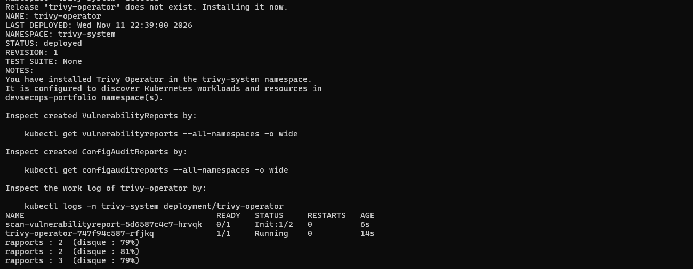
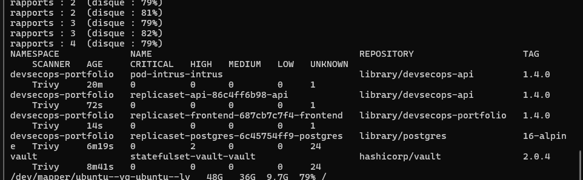
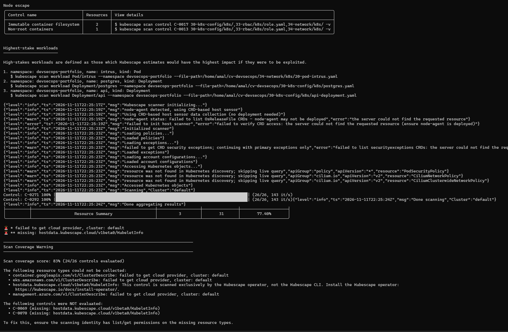
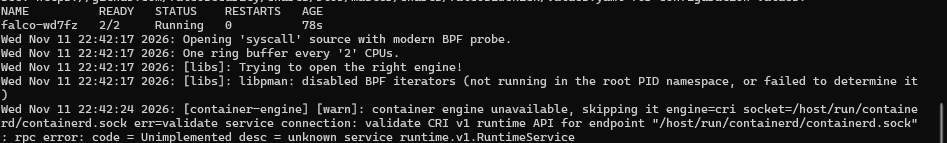
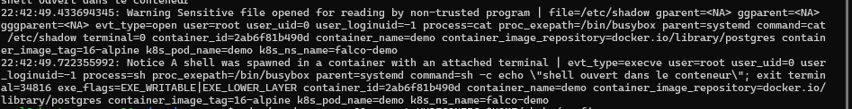

# Activité 7 – Partie 35 : Sécurité Kubernetes continue (étapes 185 à 189)

| Outil | Quand | Ce qu'il vérifie |
| :--- | :--- | :--- |
| Trivy Operator | en continu, dans le cluster | vulnérabilités des images qui tournent, configuration des ressources |
| Kubescape | à la demande (CI, poste) | manifests YAML et cluster face aux référentiels (NSA, MITRE…) |
| Falco | en temps réel, dans le noyau | comportements suspects pendant l'exécution |

## Étape 185 – Trivy Operator

```bash
helm repo add aqua https://aquasecurity.github.io/helm-charts/
helm upgrade --install trivy-operator aqua/trivy-operator -n trivy-system --create-namespace \
  --set targetNamespaces=devsecops-portfolio \
  --set trivy.command=filesystem \
  --set trivyOperator.scanJobPodTemplateContainerSecurityContext.runAsUser=0 \
  --set operator.scanJobsConcurrentLimit=1 \
  --wait --timeout 10m
```

- `trivy.command=filesystem` : les images `devsecops-api:1.4.0` et `devsecops-portfolio:1.4.0` ne sont dans **aucun registre** (importées dans K3s). Le mode par défaut `image` les téléchargerait ; le mode `filesystem` analyse l'image présente sur le nœud. Il exige `runAsUser: 0` pour le Job d'analyse, qui tourne dans le namespace `trivy-system`, pas dans celui de l'application.
- `scanJobsConcurrentLimit=1` : une analyse à la fois, pour ménager le laboratoire.



## Étape 186 – Vulnérabilités présentes dans le cluster

```text
kubectl get vulnerabilityreports -A -o wide
NAMESPACE             NAME                                       REPOSITORY                   TAG         CRITICAL  HIGH  MEDIUM  LOW  UNKNOWN
devsecops-portfolio   pod-intrus-intrus                          library/devsecops-api        1.4.0       0         0     0       0    1
devsecops-portfolio   replicaset-api-86c4ff6b98-api              library/devsecops-api        1.4.0       0         0     0       0    1
devsecops-portfolio   replicaset-frontend-687cb7c7f4-frontend    library/devsecops-portfolio  1.4.0       0         0     0       0    1
devsecops-portfolio   replicaset-postgres-6c45754ff9-postgres    library/postgres             16-alpine   0         2     0       0    24
vault                 statefulset-vault-vault                    hashicorp/vault              2.0.4       0         0     0       0    24
```



**Analyse :**

- les images de l'application (API et frontend) n'ont **aucune vulnérabilité CRITICAL, HIGH, MEDIUM ou LOW** : résultat du travail des activités précédentes (images Alpine minimales, multi-stage, dépendances à jour, Dependabot) ;
- `postgres:16-alpine` (image officielle) a **2 vulnérabilités HIGH** : à corriger en passant à la dernière version corrective de l'image ;
- la colonne `UNKNOWN` compte les vulnérabilités dont la sévérité n'est pas encore évaluée par les bases de données.

Les `configauditreports` vérifient aussi la configuration des ressources : 0 problème sur les Ingress, NetworkPolicies, Services et le PVC ; une alerte HIGH sur PostgreSQL (système de fichiers inscriptible) et sur le Pod de test.

**Incident :** la première installation analysait plusieurs namespaces. Le téléchargement de la base de vulnérabilités et des images a rempli le disque de la VM (91 %) : Kubernetes a signalé `DiskPressure`, a **expulsé des Pods** (Kyverno, cert-manager, ESO, API) et supprimé des images inutilisées. Pendant ce temps, le webhook de Kyverno était indisponible et, avec `failurePolicy: Fail`, **toute création de ressource était refusée** dans le cluster : choix sûr par défaut, mais qui rend Kyverno critique pour tout le cluster. Corrections : nettoyage du disque (images Harbor inutilisées, caches), analyse limitée au namespace de l'application, désinstallation de Trivy Operator après l'analyse.

## Étape 187 – Kubescape

```bash
curl -s https://raw.githubusercontent.com/kubescape/kubescape/master/install.sh | /bin/bash
export PATH=$PATH:$HOME/.kubescape/bin
kubescape scan 30-k8s-config/k8s/ 33-rbac/k8s/role.yaml 34-network/k8s/        # manifests du dépôt
kubescape scan framework nsa --include-namespaces devsecops-portfolio           # cluster en marche
```



Résultat sur le namespace du portfolio (référentiel NSA/CISA) : **score de conformité 77,40 %**.

| Contrôle | Ressources | Explication |
| :--- | :--- | :--- |
| Immutable container filesystem (C-0017) | 2 | PostgreSQL et le Pod de test écrivent sur leur système de fichiers (PostgreSQL en a besoin) |
| Non-root containers (C-0013) | 1 | Pod de test |
| Workloads les plus exposés | intrus, postgres, api | priorités de durcissement indiquées par Kubescape |

Deux contrôles n'ont pas pu être évalués : ils demandent des informations du kubelet que seul l'opérateur Kubescape (installé dans le cluster) collecte.

## Étape 188 – Falco

```bash
helm repo add falcosecurity https://falcosecurity.github.io/charts
helm upgrade --install falco falcosecurity/falco -n falco --create-namespace \
  --set driver.kind=modern_ebpf --set tty=true --wait --timeout 10m
kubectl -n falco rollout status ds/falco --timeout=10m
```

Falco observe les appels système de tous les conteneurs grâce à une sonde **eBPF** (`modern_ebpf` : aucun module noyau à compiler) et les compare à ses règles.

```text
falco-wd7fz   2/2   Running   0   78s
Opening 'syscall' source with modern BPF probe.
One ring buffer every '2' CPUs.
```



## Étape 189 – Événements de démonstration et alertes Falco

Dans un namespace de démonstration séparé (`falco-demo`, sans restriction Pod Security, pour pouvoir lancer un conteneur root) :

```bash
kubectl create ns falco-demo
kubectl -n falco-demo run demo --image=postgres:16-alpine --image-pull-policy=IfNotPresent --command -- sleep 3600
kubectl -n falco-demo exec demo -- cat /etc/shadow > /dev/null                               # lecture d'un fichier sensible
kubectl -n falco-demo exec -it demo -- sh -c 'echo "shell ouvert dans le conteneur"; exit'   # shell interactif
kubectl -n falco logs -l app.kubernetes.io/name=falco -c falco --since=2m | grep -E "shadow|shell"
```

```text
22:42:49.433694345: Warning Sensitive file opened for reading by non-trusted program | file=/etc/shadow
  evt_type=open user=root process=cat command=cat /etc/shadow terminal=0 container_name=demo
  container_image_repository=docker.io/library/postgres container_image_tag=16-alpine k8s_pod_name=demo k8s_ns_name=falco-demo
22:42:49.722355992: Notice A shell was spawned in a container with an attached terminal | evt_type=execve user=root
  process=sh command=sh -c echo "shell ouvert dans le conteneur"; exit container_name=demo k8s_pod_name=demo k8s_ns_name=falco-demo
```



Les deux comportements sont détectés en moins d'une seconde, avec le processus, l'utilisateur, l'image, le Pod et le namespace. En production, ces alertes seraient envoyées vers une messagerie ou un SIEM (Falcosidekick).

**Défense en profondeur :** dans le namespace du portfolio, ces actions seraient déjà bloquées ou limitées (utilisateur non root, système de fichiers en lecture seule, profil restricted, Kyverno) ; Falco détecte ce qui passerait malgré ces protections.
