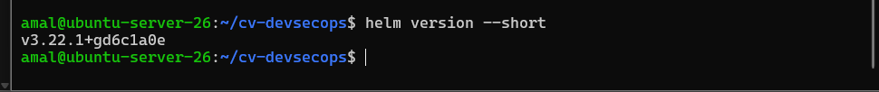
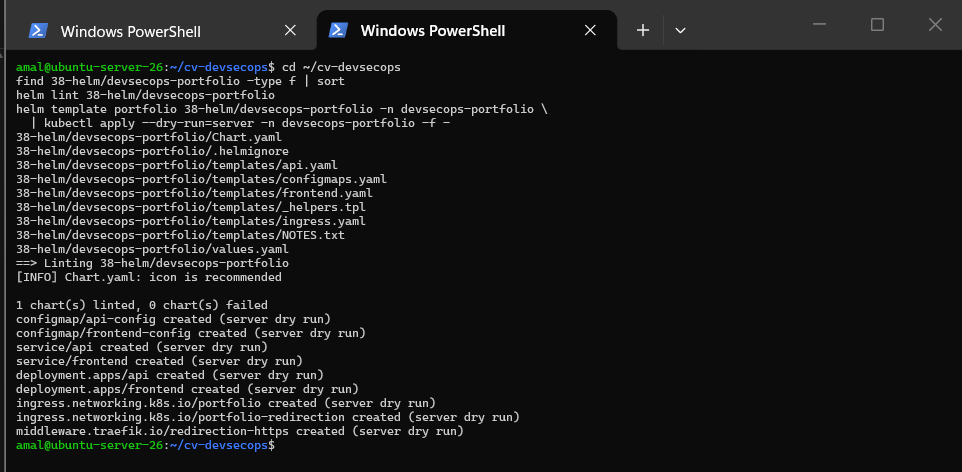
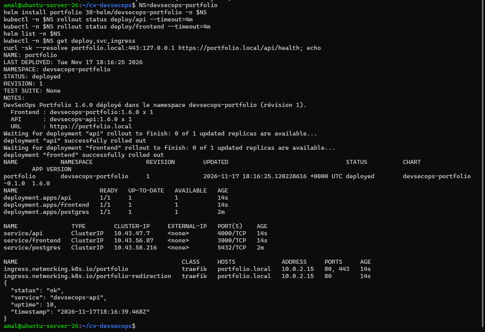
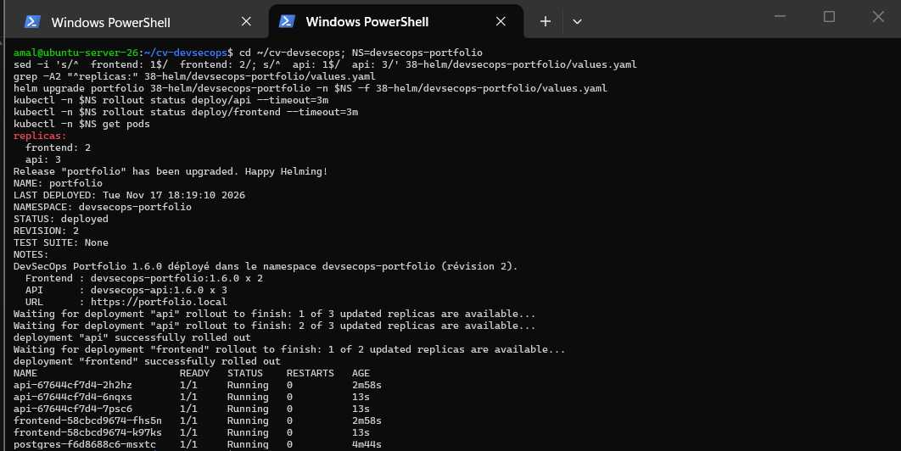
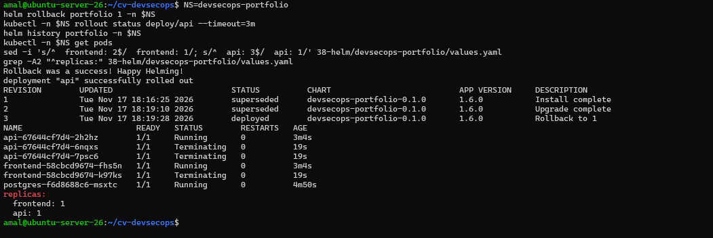

# Activité 8 – Partie 36 : Helm (étapes 190 à 195)

Les manifests Kubernetes du frontend et de l'API (activité 7, dossiers `28` à `33`) sont regroupés dans un **Helm Chart** : une seule commande installe, met à jour ou restaure toute l'application, et chaque déploiement est numéroté (révision) dans l'historique de Helm.

```text
helm install / upgrade / rollback
        │
        ▼
 values.yaml ──► templates/*.yaml ──► manifests rendus ──► API Kubernetes (namespace devsecops-portfolio)
 (images, tags,     (Deployments, Services,                 frontend ×N   api ×N
  replicas,          ConfigMaps, Ingress)                   + Secrets et PostgreSQL existants
  ingress, resources)
```

## Étape 190 – Installation de Helm

Helm était déjà installé sur `ubuntu-server-26` (script officiel `get-helm-3`, activité 7). Vérification :

```bash
helm version --short
```

```text
v3.22.1+gd6c1a0e
```



## Étape 191 – Le Helm Chart `devsecops-portfolio`

```text
38-helm/devsecops-portfolio/
├── Chart.yaml                 # nom, version du chart (0.1.0) et de l'application (1.6.0)
├── values.yaml                # valeurs modifiables (étape 192)
├── .helmignore
└── templates/
    ├── _helpers.tpl           # labels communs, securityContext du Pod et du conteneur
    ├── configmaps.yaml        # api-config, frontend-config (API_URL)
    ├── api.yaml               # Deployment + Service de l'API (+ HPA optionnel)
    ├── frontend.yaml          # Deployment + Service du frontend
    ├── ingress.yaml           # Ingress HTTPS + redirection HTTP → HTTPS (Middleware Traefik)
    └── NOTES.txt              # résumé affiché après install / upgrade
```

| Template | Contenu repris de l'activité 7 |
| :--- | :--- |
| [`api.yaml`](devsecops-portfolio/templates/api.yaml) | probes `/api/health`, requests/limits, `runAsNonRoot`, `readOnlyRootFilesystem`, ServiceAccount `devsecops-app`, Secrets `postgres-credentials` et `api-secrets` |
| [`frontend.yaml`](devsecops-portfolio/templates/frontend.yaml) | probes avec `timeoutSeconds: 8`, volumes `/tmp` et `.next/cache` |
| [`ingress.yaml`](devsecops-portfolio/templates/ingress.yaml) | 2 Ingress séparés (pas de boucle de redirection) |
| [`_helpers.tpl`](devsecops-portfolio/templates/_helpers.tpl) | labels `app.kubernetes.io/*` et contextes de sécurité partagés par les 2 Deployments |

Choix de conception :

- les noms (`api`, `frontend`) et les sélecteurs `app: api` / `app: frontend` sont **identiques** à l'activité 7 : `API_URL=http://api:4000`, les NetworkPolicies et les règles Kyverno restent valables ;
- une annotation `checksum/config` (hash des ConfigMaps) relance les Pods quand la configuration change ;
- **aucun secret dans le chart** : il référence les Secrets créés avec `openssl rand` (comme à l'étape 138).

```bash
find 38-helm/devsecops-portfolio -type f | sort
helm lint 38-helm/devsecops-portfolio
# rendu du chart, validé par le cluster (schémas, PSS restricted, Kyverno) sans rien créer
helm template portfolio 38-helm/devsecops-portfolio -n devsecops-portfolio \
  | kubectl apply --dry-run=server -n devsecops-portfolio -f -
```

```text
==> Linting 38-helm/devsecops-portfolio
[INFO] Chart.yaml: icon is recommended

1 chart(s) linted, 0 chart(s) failed
configmap/api-config created (server dry run)
configmap/frontend-config created (server dry run)
service/api created (server dry run)
service/frontend created (server dry run)
deployment.apps/api created (server dry run)
deployment.apps/frontend created (server dry run)
ingress.networking.k8s.io/portfolio created (server dry run)
ingress.networking.k8s.io/portfolio-redirection created (server dry run)
middleware.traefik.io/redirection-https created (server dry run)
```



## Étape 192 – `values.yaml`

[`values.yaml`](devsecops-portfolio/values.yaml) contient les valeurs demandées :

| Valeur demandée | Clé dans `values.yaml` | Valeur par défaut |
| :--- | :--- | :--- |
| frontend image | `frontend.image` | `devsecops-portfolio` |
| frontend tag | `frontend.tag` | `1.6.0` |
| api image | `api.image` | `devsecops-api` |
| api tag | `api.tag` | `1.6.0` |
| replicas | `replicas.frontend`, `replicas.api` | `1`, `1` |
| ingress | `ingress.enabled`, `ingress.host`, `ingress.tlsSecret`, `ingress.redirectHttpToHttps` | `true`, `portfolio.local`, `portfolio-tls`, `true` |
| resources | `frontend.resources`, `api.resources` | requests / limits de l'activité 7 |

Valeurs supplémentaires : `api.corsOrigin`, `frontend.apiUrl`, noms des Secrets, `serviceAccountName`, `imagePullSecrets` (utilisé à l'étape 202) et `autoscaling` (HPA de l'étape 160, **désactivé** : sinon le HPA écraserait le nombre de replicas fixé par `values.yaml`).

```yaml
replicas:
  frontend: 1
  api: 1

frontend:
  image: devsecops-portfolio
  tag: "1.6.0"
  ...
api:
  image: devsecops-api
  tag: "1.6.0"
  ...
ingress:
  enabled: true
  className: traefik
  host: portfolio.local
```

## Étape 193 – `helm install`

Préparation (hors chart) : namespace `devsecops-portfolio` avec PSS `restricted`, ServiceAccount `devsecops-app`, Secrets générés avec `openssl rand` et PostgreSQL ([`30-k8s-config/k8s/postgres.yaml`](../30-k8s-config/k8s/postgres.yaml)). Les images `1.6.0` sont construites puis importées dans K3s (`docker save … | sudo k3s ctr images import -`) ; elles viendront de Harbor à la partie suivante.

```bash
helm install portfolio 38-helm/devsecops-portfolio -n devsecops-portfolio
helm list -n devsecops-portfolio
curl -sk --resolve portfolio.local:443:127.0.0.1 https://portfolio.local/api/health
```

```text
NAME: portfolio
NAMESPACE: devsecops-portfolio
STATUS: deployed
REVISION: 1
NOTES:
DevSecOps Portfolio 1.6.0 déployé dans le namespace devsecops-portfolio (révision 1).
  Frontend : devsecops-portfolio:1.6.0 x 1
  API      : devsecops-api:1.6.0 x 1
  URL      : https://portfolio.local

NAME       NAMESPACE            REVISION  STATUS    CHART                     APP VERSION
portfolio  devsecops-portfolio  1         deployed  devsecops-portfolio-0.1.0 1.6.0

{ "status": "ok", "service": "devsecops-api", "uptime": 10, ... }
```



**Problème rencontré :** au début de l'activité, le namespace `devsecops-portfolio` n'existait plus (K3s avait été réinstallé, `kubectl get ns` ne montrait que les namespaces système) : `helm template | kubectl apply --dry-run=server` répondait `namespaces "devsecops-portfolio" not found`. Le namespace, le ServiceAccount, les Secrets et PostgreSQL ont été recréés avant le `helm install`. cert-manager n'étant plus installé, le Secret `portfolio-tls` est absent : Traefik présente alors son certificat par défaut (avertissement du navigateur, d'où `curl -k`).

## Étape 194 – `helm upgrade` : plus de replicas

```bash
sed -i 's/^  frontend: 1$/  frontend: 2/; s/^  api: 1$/  api: 3/' 38-helm/devsecops-portfolio/values.yaml
helm upgrade portfolio 38-helm/devsecops-portfolio -n devsecops-portfolio -f 38-helm/devsecops-portfolio/values.yaml
kubectl -n devsecops-portfolio get pods
```

```text
REVISION: 2
NAME                        READY   STATUS    RESTARTS   AGE
api-67644cf7d4-2h2hz        1/1     Running   0          2m58s
api-67644cf7d4-6nqxs        1/1     Running   0          13s
api-67644cf7d4-7psc6        1/1     Running   0          13s
frontend-58cbcd9674-fhs5n   1/1     Running   0          2m58s
frontend-58cbcd9674-k97ks   1/1     Running   0          13s
postgres-f6d8688c6-msxtc    1/1     Running   0          4m44s
```

Seul le nombre de Pods change : les Pods existants ne sont pas recréés (même modèle de Pod, même hash `67644cf7d4`).



## Étape 195 – `helm rollback` et `helm history`

```bash
helm rollback portfolio 1 -n devsecops-portfolio
helm history portfolio -n devsecops-portfolio
```

```text
REVISION  UPDATED                   STATUS      CHART                      APP VERSION  DESCRIPTION
1         Tue Nov 17 18:16:25 2026  superseded  devsecops-portfolio-0.1.0  1.6.0        Install complete
2         Tue Nov 17 18:19:10 2026  superseded  devsecops-portfolio-0.1.0  1.6.0        Upgrade complete
3         Tue Nov 17 18:19:28 2026  deployed    devsecops-portfolio-0.1.0  1.6.0        Rollback to 1
```

Un rollback ne supprime pas l'historique : il crée une **nouvelle révision (3)** dont le contenu est celui de la révision 1. Les Pods en trop passent en `Terminating` et l'application revient à 1 frontend + 1 API. `values.yaml` a ensuite été remis à 1 replica, comme dans Git.


