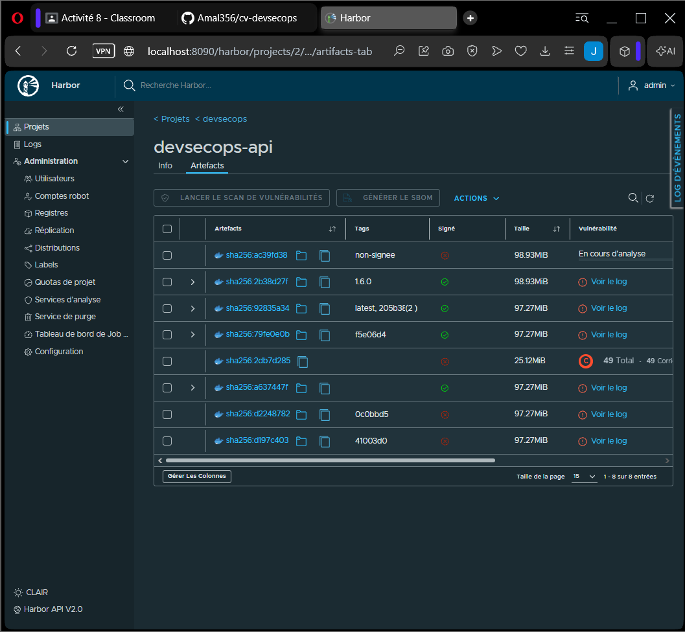
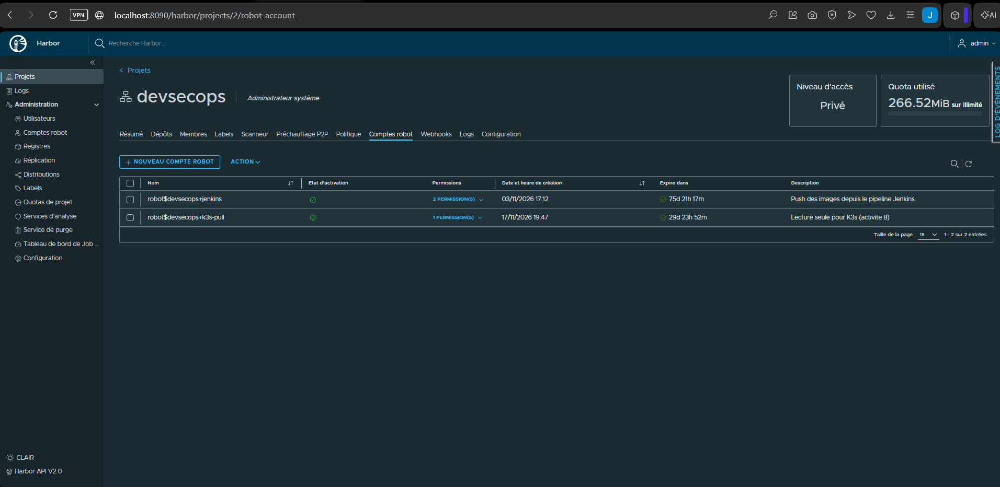
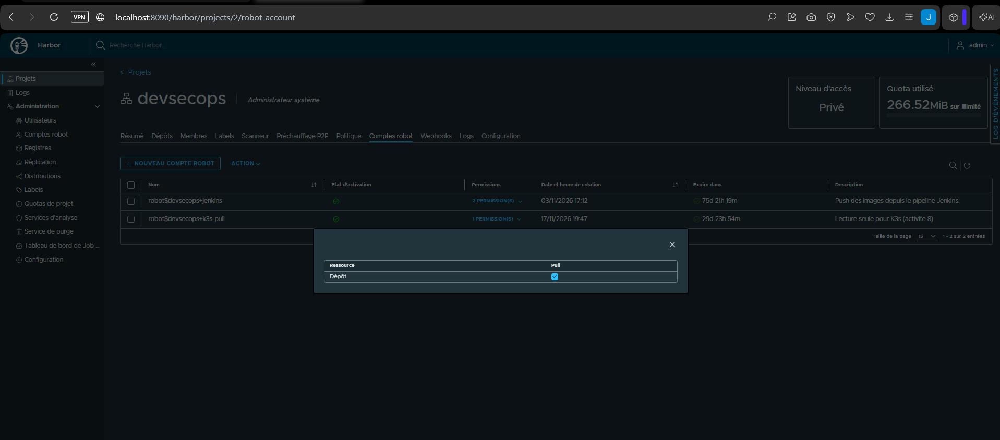
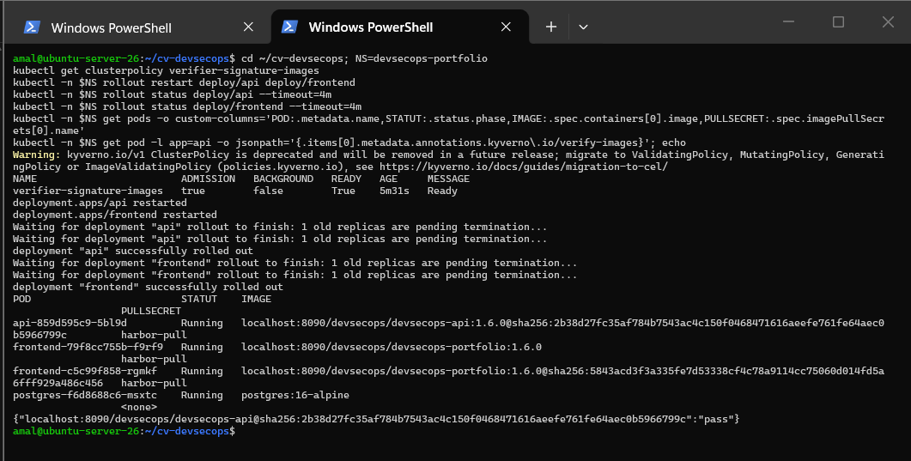
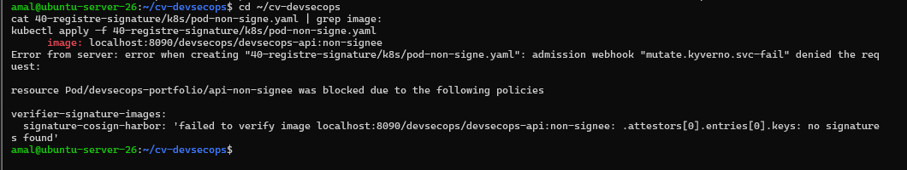

# Activité 8 – Partie 38 : Images du registre et contrôle avant déploiement (étapes 201 à 204)

Jusqu'ici, les images étaient construites sur la VM puis importées directement dans K3s. Désormais, Kubernetes **télécharge les images depuis Harbor** avec un compte robot en lecture seule, et **Kyverno refuse toute image Harbor qui n'est pas signée** par la clé Cosign du projet.

```text
 docker build ─► docker push ─► Harbor (localhost:8090/devsecops)  ◄── cosign sign (clé privée, hors Git)
                                     │                 ▲
                         imagePullSecret harbor-pull   │ vérification de la signature
                         (robot k3s-pull : Pull)       │ (clé publique 40-registre-signature/cosign.pub)
                                     ▼                 │
 kubectl / helm ─► API Kubernetes ─► webhook Kyverno ──┘ ─► signé : tag remplacé par le digest, Pod créé
                                                          └► non signé : Pod REFUSÉ
```

| Fichier | Contenu |
| :--- | :--- |
| [`registries.yaml`](registries.yaml) | `/etc/rancher/k3s/registries.yaml` : Harbor (`localhost:8090`) en HTTP pour containerd |
| [`values-harbor.yaml`](values-harbor.yaml) | valeurs Helm : images `localhost:8090/devsecops/…:1.6.0`, `imagePullSecrets: harbor-pull` |
| [`k8s/kyverno-verify-images.yaml`](k8s/kyverno-verify-images.yaml) | ClusterPolicy `verifier-signature-images` (`verifyImages`, `Enforce`) |
| [`k8s/pod-non-signe.yaml`](k8s/pod-non-signe.yaml) | Pod de test utilisant une image Harbor **non signée** |
| [`cosign.pub`](cosign.pub) | clé publique Cosign de l'activité 8 |

## Étape 201 – Images de Harbor au lieu d'images locales

Harbor (activité 5, partie 22) est relancé (`docker compose -f /opt/harbor/docker-compose.yml up -d`), puis les images `1.6.0` sont poussées dans le projet privé `devsecops`, ainsi qu'une image de test **non signée** (même API + un label, donc un digest différent) :

```bash
echo "$HPW" | docker login localhost:8090 -u admin --password-stdin
for i in devsecops-api devsecops-portfolio; do
  docker tag $i:1.6.0 localhost:8090/devsecops/$i:1.6.0
  docker push -q localhost:8090/devsecops/$i:1.6.0
done
printf 'FROM devsecops-api:1.6.0\nLABEL test="image non signée (étape 204)"\n' \
  | docker build -q -t localhost:8090/devsecops/devsecops-api:non-signee -
docker push -q localhost:8090/devsecops/devsecops-api:non-signee
```

Les 2 images `1.6.0` sont signées **par digest** avec Cosign (clé privée dans `~/cosign-keys-v2`, hors du dépôt, mot de passe lu avec `read -s`) :

```bash
cosign sign --yes --allow-http-registry --key /cosign.key --tlog-upload=false \
  --new-bundle-format=false --use-signing-config=false \
  localhost:8090/devsecops/devsecops-api@sha256:2b38d27fc35a…
cosign verify --allow-http-registry --key /cosign.pub --insecure-ignore-tlog=true <image@digest>
```

```text
Pushing signature to: localhost:8090/devsecops/devsecops-api
SIGNATURE VALIDE : devsecops-api
Pushing signature to: localhost:8090/devsecops/devsecops-portfolio
SIGNATURE VALIDE : devsecops-portfolio
```

- `--tlog-upload=false` : pas de publication dans le journal public Rekor (registre de labo) ;
- `--new-bundle-format=false` : signature au format classique (tag `sha256-….sig`), lu par la règle `verifyImages` de Kyverno.

Dans Harbor, `1.6.0` est **signée** (✓) et `non-signee` ne l'est pas (✗) :



Côté Kubernetes :

- K3s (containerd) doit savoir que Harbor est en HTTP : [`registries.yaml`](registries.yaml) est copié dans `/etc/rancher/k3s/`, puis `sudo systemctl restart k3s` ;
- le chart Helm de la partie 36 est réutilisé **sans modification** : seules les valeurs changent ([`values-harbor.yaml`](values-harbor.yaml)) ;

```bash
helm upgrade portfolio 38-helm/devsecops-portfolio -n devsecops-portfolio \
  -f 38-helm/devsecops-portfolio/values.yaml -f 40-registre-signature/values-harbor.yaml
```

```text
DevSecOps Portfolio 1.6.0 déployé dans le namespace devsecops-portfolio (révision 4).
  Frontend : localhost:8090/devsecops/devsecops-portfolio:1.6.0 x 1
  API      : localhost:8090/devsecops/devsecops-api:1.6.0 x 1
```

**Problème rencontré :** le mot de passe de l'ancienne clé Cosign (activité 5) n'a pas été retrouvé (`decrypt: encrypted: decryption failed`). Une **nouvelle paire de clés** a été générée (`cosign generate-key-pair`, dossier `~/cosign-keys-v2` en `chmod 700`), et sa clé publique est utilisée par Kyverno. L'ancienne clé publique reste dans `23-supply-chain/` pour l'historique de l'activité 5.

## Étape 202 – imagePullSecret avec un robot Harbor en lecture seule

Le robot `robot$devsecops+k3s-pull` est créé par l'API Harbor : projet `devsecops` uniquement, permission **Dépôt : Pull** uniquement, expiration **30 jours**. Son secret n'est jamais affiché : il passe d'une variable directement dans des Secrets Kubernetes de type `docker-registry`, puis la variable est supprimée.

```bash
ROBOT_JSON=$(curl -s -u "admin:$HPW" -H 'Content-Type: application/json' -X POST \
  http://localhost:8090/api/v2.0/robots -d '{"name":"k3s-pull","duration":30,"level":"project",
  "permissions":[{"kind":"project","namespace":"devsecops","access":[{"resource":"repository","action":"pull"}]}]}')
for ns in devsecops-portfolio portfolio-dev kyverno; do
  kubectl -n $ns create secret docker-registry harbor-pull --docker-server=localhost:8090 \
    --docker-username="$R_NAME" --docker-password="$R_SECRET"
done
unset R_SECRET ROBOT_JSON HPW
```

```text
Robot : robot$devsecops+k3s-pull — empreinte du secret : 4c8d3a09c0bd833c
NAMESPACE             NAME          TYPE
devsecops-portfolio   harbor-pull   kubernetes.io/dockerconfigjson
kyverno               harbor-pull   kubernetes.io/dockerconfigjson
portfolio-dev         harbor-pull   kubernetes.io/dockerconfigjson
```

Le Secret du namespace `kyverno` permet à Kyverno de lire les signatures dans le projet privé.

| Robot | Utilisé par | Droits | Expiration |
| :--- | :--- | :--- | :--- |
| `robot$devsecops+jenkins` | pipeline Jenkins | Push + Pull | 90 jours |
| `robot$devsecops+k3s-pull` | K3s et Kyverno | **Pull seulement** | 30 jours |

Si le Secret `harbor-pull` fuite, il ne permet ni de pousser ni de remplacer une image.





## Étape 203 – Politique Kyverno `verifyImages`

```yaml
verifyImages:
  - imageReferences: ["localhost:8090/devsecops/*"]
    failureAction: Enforce
    mutateDigest: true          # le tag est remplacé par le digest vérifié
    verifyDigest: true
    required: true
    imageRegistryCredentials:
      allowInsecureRegistry: true
      secrets: [harbor-pull]
    attestors:
      - entries:
          - keys:
              publicKeys: |-
                -----BEGIN PUBLIC KEY-----
                …
              rekor: { ignoreTlog: true }
              ctlog: { ignoreSCT: true }
```

Après un redémarrage des Deployments, chaque Pod a été vérifié par Kyverno ; l'image est **figée par son digest** et Kyverno ajoute l'annotation `kyverno.io/verify-images` :

```text
NAME                        ADMISSION   BACKGROUND   READY   MESSAGE
verifier-signature-images   true        false        True    Ready

POD                        STATUT    IMAGE                                                                     PULLSECRET
api-859d595c9-5bl9d        Running   localhost:8090/devsecops/devsecops-api:1.6.0@sha256:2b38d27fc35a…         harbor-pull
frontend-c5c99f858-rgmkf   Running   localhost:8090/devsecops/devsecops-portfolio:1.6.0@sha256:5843acd3f3a3…   harbor-pull

{"localhost:8090/devsecops/devsecops-api@sha256:2b38d27fc35a…":"pass"}
```

Le digest ajouté par `mutateDigest` empêche qu'une autre image soit poussée sous le même tag entre la vérification et le démarrage du conteneur.



**Problème rencontré :** Kyverno vérifie les signatures **depuis son propre Pod**. Dans un Pod, `localhost:8090` désigne le Pod lui-même et non Harbor. Le contrôleur d'admission a donc été placé sur le réseau de la VM (`admissionController.hostNetwork=true`). Il a alors planté en boucle (`CrashLoopBackOff`) :

```text
failed to start manager error="failed to start metrics server: failed to create listener:
listen tcp :8080: bind: address already in use"
```

Le port **8080** de la VM est celui de **Jenkins**. Correction : désactiver le serveur de métriques secondaire de Kyverno (option `--controllerRuntimeMetricsAddress=0`, trouvée dans le code de Kyverno v1.19.2) ; les métriques principales restent sur le port 8000.

```bash
helm upgrade kyverno kyverno/kyverno -n kyverno --version 3.9.2 --reuse-values --no-hooks \
  --set admissionController.hostNetwork=true \
  --set admissionController.dnsPolicy=ClusterFirstWithHostNet \
  --set-string admissionController.container.extraArgs.controllerRuntimeMetricsAddress=0
```

Pendant la panne, un Pod non signé avait pu être créé (le Pod `api-non-signee`) : l'ancien contrôleur ne connaissait pas encore la règle. Il a été supprimé avant le test de l'étape 204.

## Étape 204 – Déploiement d'une image non signée : refusé

```bash
kubectl apply -f 40-registre-signature/k8s/pod-non-signe.yaml
```

```text
Error from server: error when creating "40-registre-signature/k8s/pod-non-signe.yaml":
admission webhook "mutate.kyverno.svc-fail" denied the request:

resource Pod/devsecops-portfolio/api-non-signee was blocked due to the following policies

verifier-signature-images:
  signature-cosign-harbor: 'failed to verify image localhost:8090/devsecops/devsecops-api:non-signee:
  .attestors[0].entries[0].keys: no signatures found'
```

L'image vient bien du registre de confiance et le robot a le droit de la lire, mais **aucune signature** de notre clé n'existe pour ce digest : le Pod n'est jamais créé.


