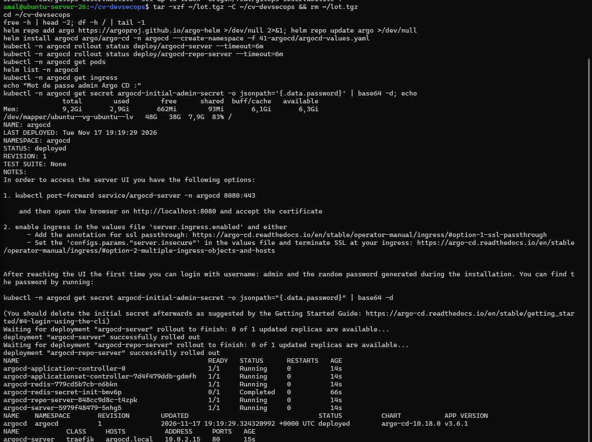
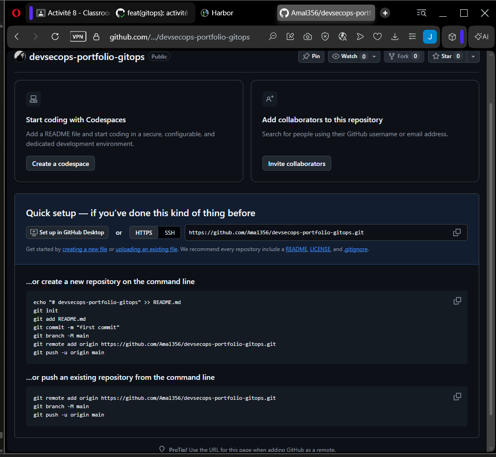
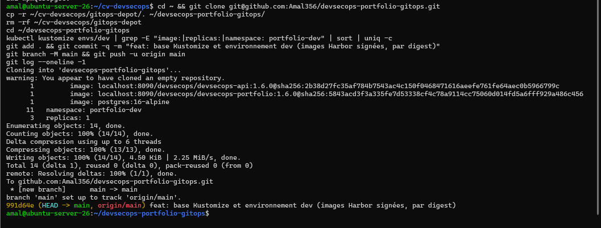
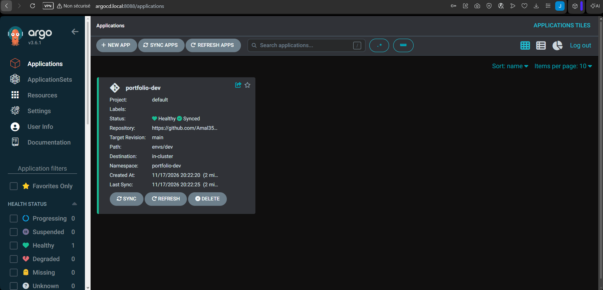
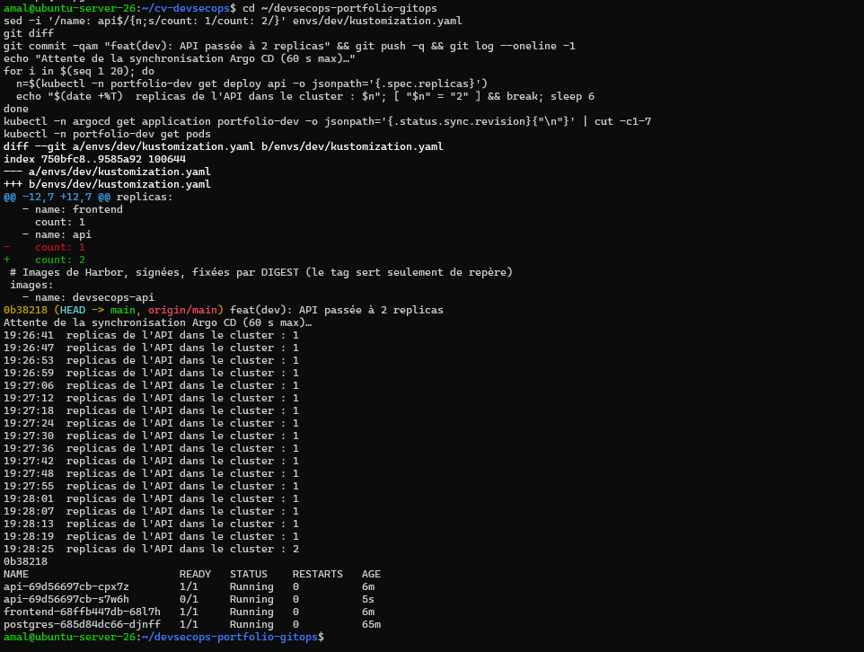
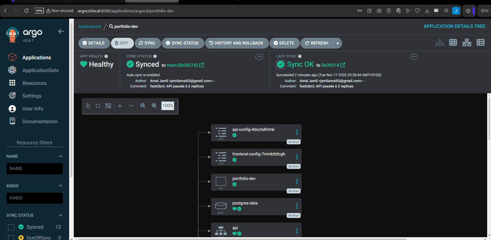
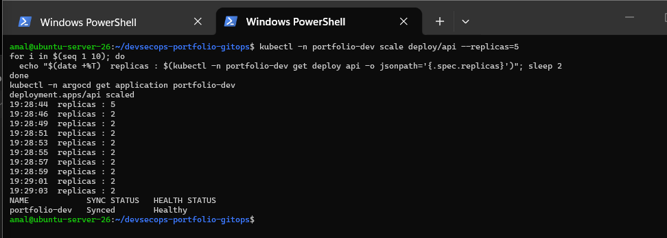
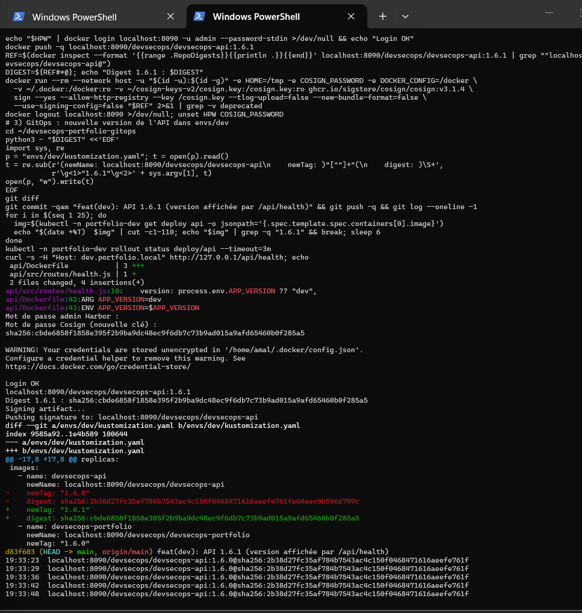
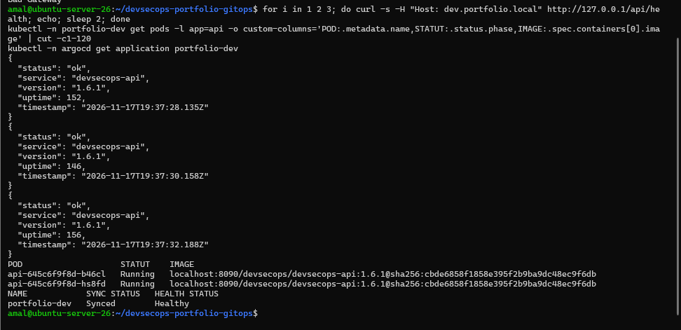

# Activité 8 – Partie 39 : GitOps avec Argo CD (étapes 205 à 210)

Avec **GitOps**, on ne déploie plus avec `kubectl apply` ou `helm upgrade` : l'état voulu du cluster est décrit dans un **dépôt Git**, et **Argo CD** (installé dans le cluster) le compare en permanence à ce qui tourne réellement. Chaque commit est appliqué automatiquement, et toute modification manuelle est annulée.

```text
 git push ──► GitHub : Amal356/devsecops-portfolio-gitops ◄── Argo CD relit le dépôt (toutes les 60 s)
                       base/ + envs/dev/ (Kustomize)              │ compare Git ↔ cluster
                                                                  ▼
                                               namespace portfolio-dev : api, frontend, postgres
                                               (images Harbor signées, fixées par digest, vérifiées par Kyverno)
```

| Fichier | Contenu |
| :--- | :--- |
| [`argocd-values.yaml`](argocd-values.yaml) | valeurs Helm d'Argo CD : Ingress `argocd.local`, `server.insecure`, relecture du dépôt toutes les 60 s, sans Dex ni notifications |
| [`argocd/application-dev.yaml`](argocd/application-dev.yaml) | Application `portfolio-dev` : `envs/dev` du dépôt GitOps, synchronisation automatique avec `prune` et `selfHeal` |
| Dépôt [`devsecops-portfolio-gitops`](https://github.com/Amal356/devsecops-portfolio-gitops) | `base/` (manifests Kustomize de la partie 37 + `imagePullSecrets`) et `envs/dev/` (namespace, replicas, `API_URL`, images **par digest**) |

## Étape 205 – Installation d'Argo CD

```bash
helm repo add argo https://argoproj.github.io/argo-helm
helm install argocd argo/argo-cd -n argocd --create-namespace -f 41-argocd/argocd-values.yaml
kubectl -n argocd get pods
```

```text
NAME                                                READY   STATUS
argocd-application-controller-0                     1/1     Running
argocd-applicationset-controller-7d4f479ddb-gdmfh   1/1     Running
argocd-redis-779cd5b7cb-n6bkn                       1/1     Running
argocd-repo-server-848cc9d8c-t4zpk                  1/1     Running
argocd-server-5979f48479-5nhg5                      1/1     Running

NAME     NAMESPACE  REVISION  STATUS    CHART             APP VERSION
argocd   argocd     1         deployed  argo-cd-10.18.0   v3.6.1
```

L'interface est publiée par Traefik sur `http://argocd.local:8088` (ligne `127.0.0.1 argocd.local` dans le fichier `hosts` de Windows). Le mot de passe initial du compte `admin` (Secret `argocd-initial-admin-secret`) a été changé dès la première connexion (*User Info → Update Password*) ; il n'apparaît dans aucune capture.



## Étape 206 – Dépôt GitOps `devsecops-portfolio-gitops`

Un **deuxième dépôt GitHub** contient uniquement les manifests Kubernetes. Il est séparé du dépôt du code (`cv-devsecops`) : les déploiements ont leur propre historique, et le pipeline CI pourra y écrire sans toucher au code.



```text
devsecops-portfolio-gitops/
├── README.md
├── base/                     # Deployments, Services, PostgreSQL, Ingress, ConfigMaps générées
└── envs/dev/                 # namespace portfolio-dev, 1 replica, API_URL, hôte dev.portfolio.local
```

Les images sont celles de Harbor, **fixées par digest** : le tag n'est qu'un repère lisible.

```yaml
images:
  - name: devsecops-api
    newName: localhost:8090/devsecops/devsecops-api
    newTag: "1.6.0"
    digest: sha256:2b38d27fc35af784b7543ac4c150f0468471616aeefe761fe64aec0b5966799c
```

```bash
git clone git@github.com:Amal356/devsecops-portfolio-gitops.git
kubectl kustomize envs/dev | grep -E "image:|replicas:" | sort | uniq -c
git add . && git commit -m "feat: base Kustomize et environnement dev (images Harbor signées, par digest)"
git push -u origin main
```



## Étape 207 – Déploiement automatique par Argo CD

```yaml
spec:
  source:
    repoURL: https://github.com/Amal356/devsecops-portfolio-gitops.git
    targetRevision: main
    path: envs/dev
  destination:
    namespace: portfolio-dev
  syncPolicy:
    automated:
      prune: true        # ressource supprimée de Git => supprimée du cluster
      selfHeal: true     # modification manuelle => annulée
```

```bash
kubectl apply -f 41-argocd/argocd/application-dev.yaml
kubectl -n argocd get applications
```

```text
NAME            SYNC STATUS   HEALTH STATUS
portfolio-dev   Synced        Healthy
```

Argo CD a repris les ressources créées à la partie 37 (`kubectl apply -k`) et a remplacé les images locales par les images **Harbor signées** (`localhost:8090/devsecops/devsecops-api:1.6.0@sha256:2b38…`). Le dépôt étant public et sans secret, Argo CD le lit sans identifiants.



## Étape 208 – Modification des replicas dans Git

```bash
sed -i '/name: api$/{n;s/count: 1/count: 2/}' envs/dev/kustomization.yaml
git commit -qam "feat(dev): API passée à 2 replicas" && git push
```

```text
-    count: 1
+    count: 2
0b38218 (HEAD -> main, origin/main) feat(dev): API passée à 2 replicas
19:26:41  replicas de l'API dans le cluster : 1
…
19:28:19  replicas de l'API dans le cluster : 1
19:28:25  replicas de l'API dans le cluster : 2
```

Aucune commande `kubectl` n'a été lancée : Argo CD a détecté le commit `0b38218` puis l'a appliqué (moins de 2 min, avec une relecture toutes les 60 s).

Avant / après :





## Étape 209 – Modification manuelle et self-healing

```bash
kubectl -n portfolio-dev scale deploy/api --replicas=5
```

```text
deployment.apps/api scaled
19:28:44  replicas : 5
19:28:46  replicas : 2
19:28:49  replicas : 2
NAME            SYNC STATUS   HEALTH STATUS
portfolio-dev   Synced        Healthy
```

En **2 secondes**, Argo CD détecte l'écart avec Git (`OutOfSync`) et remet 2 replicas : la seule façon durable de changer le cluster est un commit, qui laisse une trace (auteur, date, message) et peut être annulé avec `git revert`.



## Étape 210 – Nouvelle version de l'API via le dépôt GitOps

Pour rendre la version visible, `/api/health` renvoie désormais la version de l'image (variable `APP_VERSION` définie au build, modification du dépôt `cv-devsecops`) :

```js
// api/src/routes/health.js
version: process.env.APP_VERSION ?? "dev",
```

```dockerfile
# api/Dockerfile (étape d'exécution)
ARG APP_VERSION=dev
ENV APP_VERSION=$APP_VERSION
```

L'image `1.6.1` est construite, poussée dans Harbor et **signée** (sinon Kyverno la refuserait), puis **seul le dépôt GitOps** est modifié :

```bash
docker build --build-arg APP_VERSION=1.6.1 -t localhost:8090/devsecops/devsecops-api:1.6.1 api
docker push localhost:8090/devsecops/devsecops-api:1.6.1
cosign sign … localhost:8090/devsecops/devsecops-api@sha256:cbde6858…
```

```text
-    newTag: "1.6.0"
-    digest: sha256:2b38d27fc35af784b7543ac4c150f0468471616aeefe761fe64aec0b5966799c
+    newTag: "1.6.1"
+    digest: sha256:cbde6858f1858e395f2b9ba9dc48ec9f6db7c73b9ad015a9afd65460b0f285a5
d83f603 (HEAD -> main, origin/main) feat(dev): API 1.6.1 (version affichée par /api/health)
19:34:44  localhost:8090/devsecops/devsecops-api:1.6.0@sha256:2b38d27f…
19:34:50  localhost:8090/devsecops/devsecops-api:1.6.1@sha256:cbde6858…
deployment "api" successfully rolled out
```



```text
{ "status": "ok", "service": "devsecops-api", "version": "1.6.1", "uptime": 152, … }
api-645c6f9f8d-b46cl   Running   localhost:8090/devsecops/devsecops-api:1.6.1@sha256:cbde6858…
api-645c6f9f8d-hs8fd   Running   localhost:8090/devsecops/devsecops-api:1.6.1@sha256:cbde6858…
```

La mise à jour est progressive (*rolling update*) : un Pod 1.6.1 démarre et devient prêt avant l'arrêt d'un Pod 1.6.0.



**Problème rencontré :** juste après le déploiement, `curl` a répondu `Bad Gateway`. Traefik envoyait encore la requête vers un ancien Pod en cours d'arrêt ; quelques secondes plus tard, les 3 appels répondaient `"version": "1.6.1"`.
