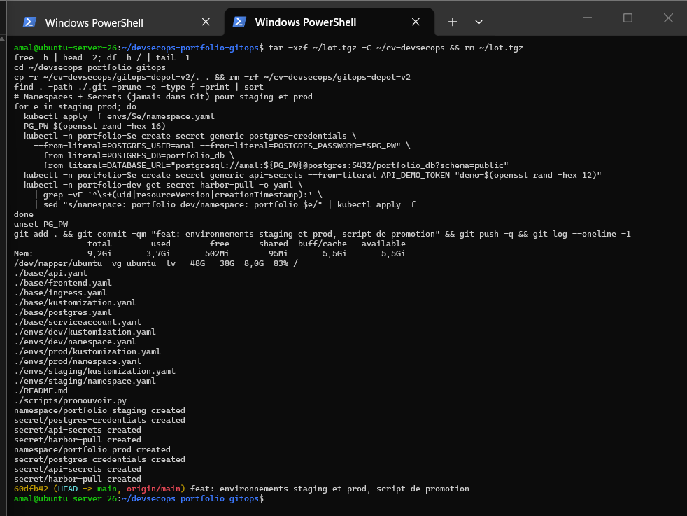
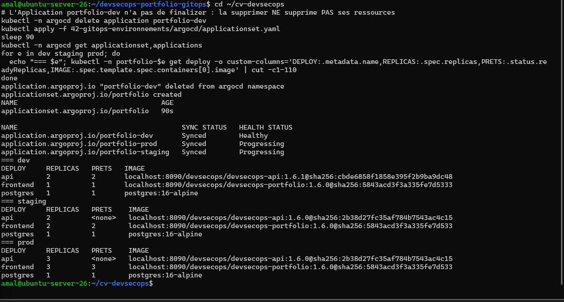
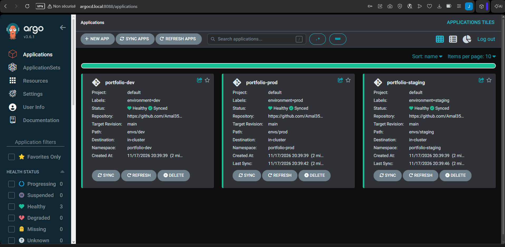
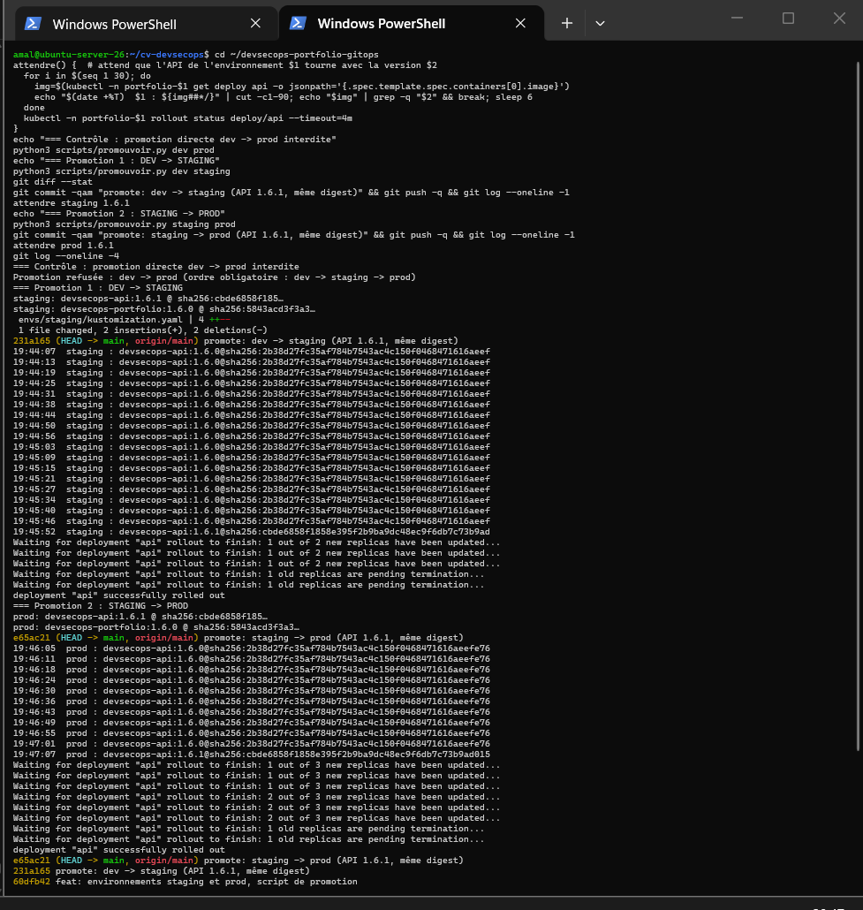
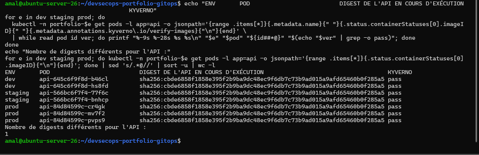

# Activité 8 – Partie 40 : Environnements GitOps (étapes 211 à 215)

Le dépôt GitOps décrit maintenant **trois environnements**. Une seule image, construite et signée une fois, est **promue** de DEV à STAGING puis à PROD en modifiant uniquement Git ; un **ApplicationSet** Argo CD crée automatiquement une Application par environnement.

```text
devsecops-portfolio-gitops                          Argo CD (ApplicationSet « portfolio », générateur Git)
├── base/                                            envs/dev     ─► Application portfolio-dev     ─► ns portfolio-dev
├── envs/dev/      1 replica                         envs/staging ─► Application portfolio-staging ─► ns portfolio-staging
├── envs/staging/  2 replicas                        envs/prod    ─► Application portfolio-prod    ─► ns portfolio-prod
├── envs/prod/     3 replicas, limite mémoire API plus haute
└── scripts/promouvoir.py      dev ─► staging ─► prod  (copie des digests, aucune reconstruction)
```

| Fichier | Contenu |
| :--- | :--- |
| [`argocd/applicationset.yaml`](argocd/applicationset.yaml) | ApplicationSet `portfolio` : une Application par dossier `envs/*` |
| [`envs/staging/kustomization.yaml`](https://github.com/Amal356/devsecops-portfolio-gitops/blob/main/envs/staging/kustomization.yaml) | STAGING (dépôt GitOps) |
| [`envs/prod/kustomization.yaml`](https://github.com/Amal356/devsecops-portfolio-gitops/blob/main/envs/prod/kustomization.yaml) | PROD (dépôt GitOps) |
| [`scripts/promouvoir.py`](https://github.com/Amal356/devsecops-portfolio-gitops/blob/main/scripts/promouvoir.py) | promotion dans l'ordre imposé dev → staging → prod |

## Étape 211 – Trois environnements dans le dépôt GitOps

Les 3 dossiers partagent la même `base/`. Chaque environnement a son namespace (PSS `restricted`), sa base PostgreSQL et ses Secrets, créés hors de Git (mot de passe `openssl rand`, robot Harbor copié depuis `portfolio-dev`) :

```bash
for e in staging prod; do
  kubectl apply -f envs/$e/namespace.yaml
  PG_PW=$(openssl rand -hex 16)
  kubectl -n portfolio-$e create secret generic postgres-credentials …
  kubectl -n portfolio-$e create secret generic api-secrets …
  kubectl -n portfolio-dev get secret harbor-pull -o yaml | … | kubectl apply -f -
done
git commit -m "feat: environnements staging et prod, script de promotion" && git push
```



## Étape 212 – Configurations différentes

| | DEV | STAGING | PROD |
| :--- | :---: | :---: | :---: |
| Namespace | `portfolio-dev` | `portfolio-staging` | `portfolio-prod` |
| Replicas frontend / API | 1 / 2 (étape 208) | 2 / 2 | 3 / 3 |
| `API_URL` | `http://api.portfolio-dev.svc…` | `http://api.portfolio-staging.svc…` | `http://api.portfolio-prod.svc…` |
| Hôte de l'Ingress | `dev.portfolio.local` | `staging.portfolio.local` | `prod.portfolio.local` |
| Limite mémoire de l'API | 256Mi | 256Mi | **384Mi** (patch) |
| Version de l'API au départ | **1.6.1** | 1.6.0 | 1.6.0 |

```text
=== dev
api        2   2   localhost:8090/devsecops/devsecops-api:1.6.1@sha256:cbde6858f185…
frontend   1   1   localhost:8090/devsecops/devsecops-portfolio:1.6.0@sha256:5843acd3f3a3…
=== staging
api        2       localhost:8090/devsecops/devsecops-api:1.6.0@sha256:2b38d27fc35a…
frontend   2   2   localhost:8090/devsecops/devsecops-portfolio:1.6.0@sha256:5843acd3f3a3…
=== prod
api        3       localhost:8090/devsecops/devsecops-api:1.6.0@sha256:2b38d27fc35a…
frontend   3   3   localhost:8090/devsecops/devsecops-portfolio:1.6.0@sha256:5843acd3f3a3…
```



## Étape 215 – ApplicationSet

```yaml
generators:
  - git:
      repoURL: https://github.com/Amal356/devsecops-portfolio-gitops.git
      revision: main
      directories:
        - path: envs/*
template:
  metadata:
    name: 'portfolio-{{ .path.basename }}'
  spec:
    source:
      path: '{{ .path.path }}'
    destination:
      namespace: 'portfolio-{{ .path.basename }}'
    syncPolicy:
      automated: { prune: true, selfHeal: true }
```

Ajouter un environnement = ajouter un dossier `envs/<nom>` : l'Application est créée toute seule. L'Application `portfolio-dev` créée à la main (partie 39) est supprimée avant : sans *finalizer*, sa suppression **ne supprime pas** ses ressources, et l'ApplicationSet les reprend sans interruption.

```bash
kubectl -n argocd delete application portfolio-dev
kubectl apply -f 42-gitops-environnements/argocd/applicationset.yaml
kubectl -n argocd get applicationset,applications
```

```text
applicationset.argoproj.io/portfolio   90s
application.argoproj.io/portfolio-dev       Synced   Healthy
application.argoproj.io/portfolio-prod      Synced   Healthy
application.argoproj.io/portfolio-staging   Synced   Healthy
```



## Étape 213 – Promotion GitOps sans reconstruire l'image

[`scripts/promouvoir.py`](https://github.com/Amal356/devsecops-portfolio-gitops/blob/main/scripts/promouvoir.py) copie le bloc `images:` (noms, tags, **digests**) d'un environnement vers le suivant et **refuse** de sauter une étape :

```text
=== Contrôle : promotion directe dev -> prod interdite
Promotion refusée : dev -> prod (ordre obligatoire : dev -> staging -> prod)
=== Promotion 1 : DEV -> STAGING
staging: devsecops-api:1.6.1 @ sha256:cbde6858f185…
 envs/staging/kustomization.yaml | 4 ++--
231a165 promote: dev -> staging (API 1.6.1, même digest)
19:45:46  staging : devsecops-api:1.6.0@sha256:2b38d27f…
19:45:52  staging : devsecops-api:1.6.1@sha256:cbde6858…
deployment "api" successfully rolled out
=== Promotion 2 : STAGING -> PROD
prod: devsecops-api:1.6.1 @ sha256:cbde6858f185…
e65ac21 promote: staging -> prod (API 1.6.1, même digest)
19:47:07  prod : devsecops-api:1.6.1@sha256:cbde6858…
deployment "api" successfully rolled out
```

Aucun `docker build` : chaque promotion est un **commit** (traçable, réversible avec `git revert`), et Argo CD fait le reste.



## Étape 214 – La même image signée dans les trois environnements

Le digest est lu sur les Pods **en cours d'exécution** (`status.containerStatuses[].imageID`) ; la colonne Kyverno montre l'annotation `kyverno.io/verify-images` posée après la vérification de la signature :

```text
ENV       POD                    DIGEST DE L'API EN COURS D'EXÉCUTION                                     KYVERNO
dev       api-645c6f9f8d-b46cl   sha256:cbde6858f1858e395f2b9ba9dc48ec9f6db7c73b9ad015a9afd65460b0f285a5   pass
dev       api-645c6f9f8d-hs8fd   sha256:cbde6858f1858e395f2b9ba9dc48ec9f6db7c73b9ad015a9afd65460b0f285a5   pass
staging   api-566bc6f7f4-77f6c   sha256:cbde6858f1858e395f2b9ba9dc48ec9f6db7c73b9ad015a9afd65460b0f285a5   pass
staging   api-566bc6f7f4-bnhcp   sha256:cbde6858f1858e395f2b9ba9dc48ec9f6db7c73b9ad015a9afd65460b0f285a5   pass
prod      api-84d84599c-cr4gk    sha256:cbde6858f1858e395f2b9ba9dc48ec9f6db7c73b9ad015a9afd65460b0f285a5   pass
prod      api-84d84599c-mv7f2    sha256:cbde6858f1858e395f2b9ba9dc48ec9f6db7c73b9ad015a9afd65460b0f285a5   pass
prod      api-84d84599c-pvps9    sha256:cbde6858f1858e395f2b9ba9dc48ec9f6db7c73b9ad015a9afd65460b0f285a5   pass
Nombre de digests différents pour l'API :
1
```

Les 7 Pods exécutent **exactement le même artefact**, testé en DEV et en STAGING avant PROD, et sa signature a été vérifiée à chaque création de Pod.


