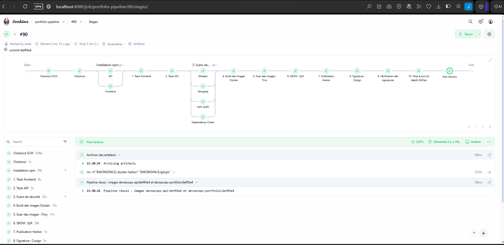
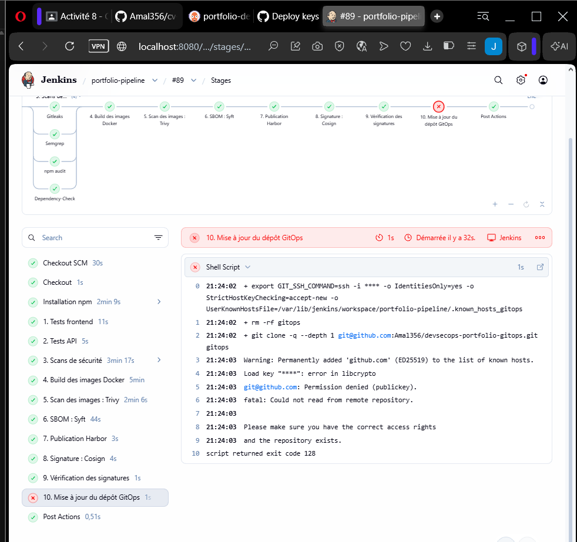
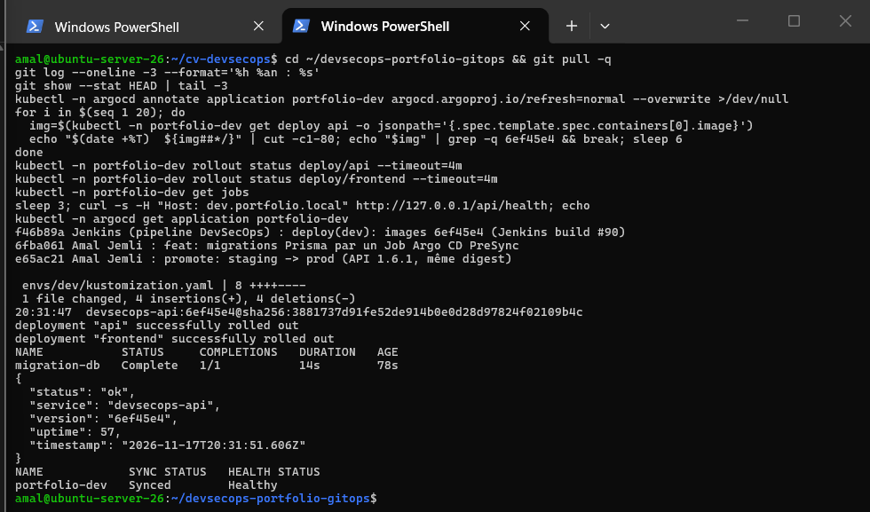
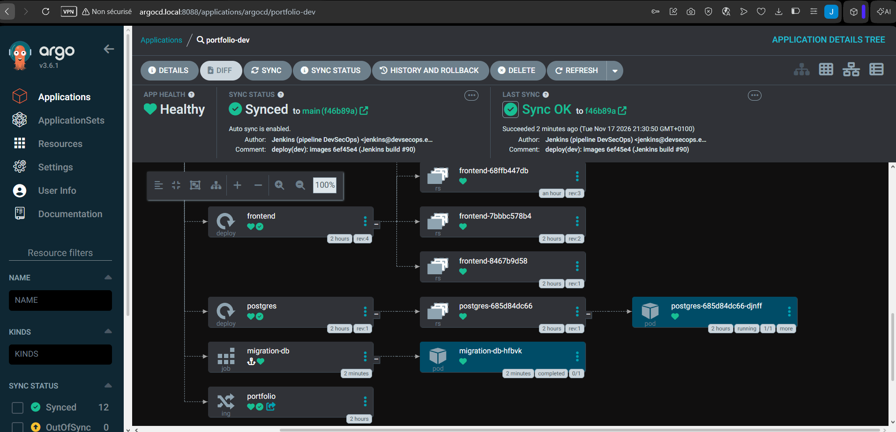
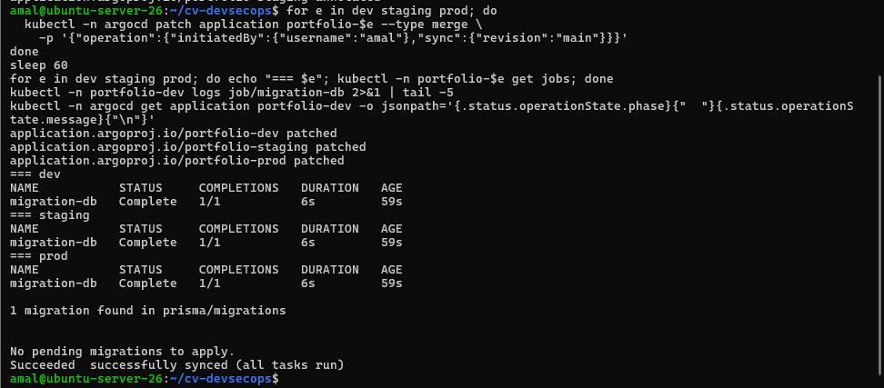
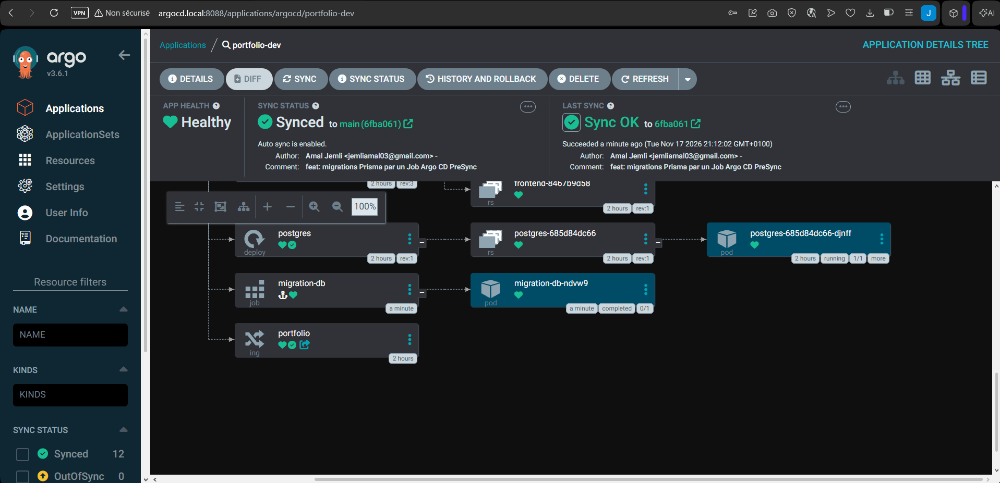

# Activité 8 – Partie 41 : Pipeline CI/CD GitOps (étapes 216 à 218)

Le pipeline Jenkins ne déploie plus rien directement : il **teste, analyse, construit, signe et publie** les images, puis écrit leur **digest** dans le dépôt GitOps. Argo CD fait le reste (étape 217), et un **hook PreSync** applique les migrations de base de données avant chaque livraison (étape 218).

```text
 git push (cv-devsecops) ──► Jenkins (scrutation toutes les 5 min)
   1. Tests frontend  2. Tests API  3. Scans (Gitleaks │ Semgrep │ npm audit │ Dependency-Check)
   4. Build des images  5. Trivy  6. SBOM (Syft)  7. Publication Harbor  8. Signature Cosign
   9. Vérification des signatures  10. Mise à jour du dépôt GitOps (envs/dev : tag + digest)
                                              │ commit « deploy(dev): images <sha> (Jenkins build #n) »
                                              ▼
 devsecops-portfolio-gitops ──► Argo CD : hook PreSync (migration Prisma) ──► Deployments api/frontend
                                              Kyverno revérifie la signature de chaque Pod
```

| Fichier | Contenu |
| :--- | :--- |
| [`../Jenkinsfile`](../Jenkinsfile) | pipeline réorganisé dans l'ordre de l'énoncé, 10 étapes numérotées |
| [`maj-image-gitops.py`](maj-image-gitops.py) | écrit le tag (hash du commit) et le digest de chaque image publiée dans `envs/<env>/kustomization.yaml` |
| [`gitops/migration-job.yaml`](gitops/migration-job.yaml) | Job `migration-db` (`prisma migrate deploy`) avec l'annotation `argocd.argoproj.io/hook: PreSync`, copié dans `base/` du dépôt GitOps |

## Étape 216 – Le pipeline

| N° | Stage | Outil | Le pipeline échoue si… |
| :---: | :--- | :--- | :--- |
| 1 | Tests frontend | Jest | un test échoue |
| 2 | Tests API | Jest + Supertest | un test échoue |
| 3 | Scans de sécurité (en parallèle) | Gitleaks, Semgrep, npm audit, OWASP Dependency-Check | secret trouvé, règle `ERROR`, dépendance critique, CVSS ≥ 9 |
| 4 | Build des images | Docker (`--build-arg APP_VERSION=<sha>`) | le build échoue |
| 5 | Scan des images | Trivy | vulnérabilité CRITICAL corrigeable |
| 6 | SBOM | Syft (SPDX JSON, archivé) | – |
| 7 | Publication | Harbor, robot `robot$devsecops+jenkins` | – |
| 8 | Signature | Cosign (nouvelle clé, credentials `cosign-key` / `cosign-password`) + SBOM en attestation signée | – |
| 9 | Vérification | `cosign verify` avec `40-registre-signature/cosign.pub` | une image n'a pas de signature valide |
| 10 | Mise à jour GitOps | `git clone` / `commit` / `push` avec une **deploy key** SSH | – |

Ordre « signe puis publie » de l'énoncé : avec Cosign, la signature est stockée **dans le registre**, à côté de l'image (tag `sha256-….sig`). L'image doit donc être poussée dans Harbor (stage 7) avant d'être signée (stage 8) ; elle n'est **publiée vers un environnement** qu'au stage 10, une fois sa signature vérifiée.

Stage 10 (extrait) :

```groovy
withCredentials([sshUserPrivateKey(credentialsId: 'gitops-deploy-key', keyFileVariable: 'GITOPS_KEY')]) {
    sh '''
        export GIT_SSH_COMMAND="ssh -i $GITOPS_KEY -o IdentitiesOnly=yes -o StrictHostKeyChecking=accept-new …"
        git clone -q --depth 1 "$GITOPS_REPO" gitops
        python3 43-pipeline-gitops/maj-image-gitops.py "gitops/envs/$GITOPS_ENV/kustomization.yaml" \
            "$REPORTS/images-harbor.txt" "$GIT_SHA"
        cd gitops && git commit -qam "deploy($GITOPS_ENV): images $GIT_SHA (Jenkins build #$BUILD_NUMBER)"
        git push -q origin HEAD:main
    '''
}
```

Accès donnés à Jenkins pour cette partie :

| Credential Jenkins | Type | Droits |
| :--- | :--- | :--- |
| `gitops-deploy-key` | SSH Username with private key (`git`) | **deploy key** du seul dépôt GitOps, en écriture (pas d'accès au compte GitHub) |
| `cosign-key` / `cosign-password` | Secret file / Secret text | remplacés par la nouvelle paire de clés de la partie 38 |
| `harbor-robot` | Username with password | inchangé (robot push/pull du projet `devsecops`) |

Build **#90** : les 10 stages sont verts en **3 min 02** (Dependency-Check réutilise sa base NVD, mise à jour il y a moins de 4 h).



**Problème rencontré :** au build **#89**, les stages 1 à 9 étaient verts mais le stage 10 échouait :

```text
Load key "****": error in libcrypto
git@github.com: Permission denied (publickey).
```

La clé testée depuis la VM fonctionnait (`ssh -i ~/gitops-deploy-key -T git@github.com` → `Hi Amal356/devsecops-portfolio-gitops!`) : c'est la **copie collée dans Jenkins** qui était abîmée (dernière ligne vide manquante après `-----END OPENSSH PRIVATE KEY-----`). Le credential a été recollé en entier, avec un retour à la ligne final.



## Étape 217 – Argo CD déploie automatiquement la nouvelle version

```text
f46b89a Jenkins (pipeline DevSecOps) : deploy(dev): images 6ef45e4 (Jenkins build #90)
6fba061 Amal Jemli : feat: migrations Prisma par un Job Argo CD PreSync
 envs/dev/kustomization.yaml | 8 ++++----
20:31:47  devsecops-api:6ef45e4@sha256:3881737d91fe52de914b0e0d28d97824f02109b4c…
deployment "api" successfully rolled out
NAME           STATUS     COMPLETIONS   DURATION
migration-db   Complete   1/1           14s
{ "status": "ok", "service": "devsecops-api", "version": "6ef45e4", … }
portfolio-dev   Synced   Healthy
```

Personne n'a tapé de commande de déploiement : l'API de DEV répond avec le **hash du commit** construit par Jenkins.





## Étape 218 – Migrations automatiques : hook Argo CD PreSync

```yaml
apiVersion: batch/v1
kind: Job
metadata:
  name: migration-db
  annotations:
    argocd.argoproj.io/hook: PreSync
    argocd.argoproj.io/hook-delete-policy: BeforeHookCreation
spec:
  backoffLimit: 2
  template:
    spec:
      containers:
        - name: migration
          image: devsecops-api        # même image et même digest que l'API de l'environnement
          command: ["node", "node_modules/prisma/build/index.js", "migrate", "deploy"]
```

À chaque synchronisation, Argo CD lance d'abord ce Job avec la **nouvelle** image ; si la migration échoue, la nouvelle version de l'API n'est pas appliquée. Le Job respecte PSS `restricted` et passe la vérification de signature Kyverno.

```text
=== dev / staging / prod
migration-db   Complete   1/1   6s
1 migration found in prisma/migrations
No pending migrations to apply.
Succeeded  successfully synced (all tasks run)
```





**Problème rencontré :** après le push du Job, aucune migration ne s'est lancée alors qu'Argo CD affichait le bon commit. Un hook **ne fait pas partie de la comparaison** Git ↔ cluster : l'ajouter ne rend pas l'application `OutOfSync`, donc la synchronisation automatique ne démarre pas. Les hooks s'exécutent **uniquement pendant une synchronisation** : une synchronisation manuelle (`kubectl patch application … operation.sync`) a servi de test, puis la livraison de Jenkins (étape 217) a relancé `migration-db` automatiquement.
