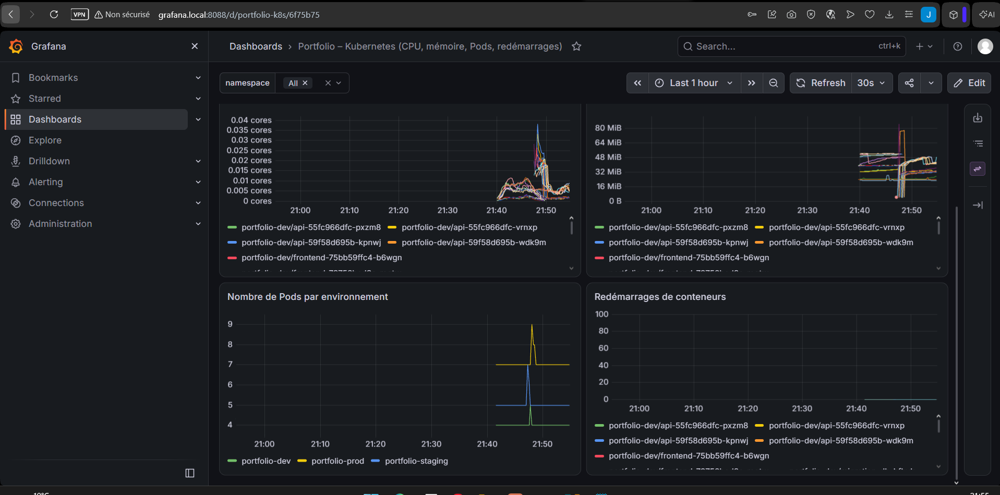
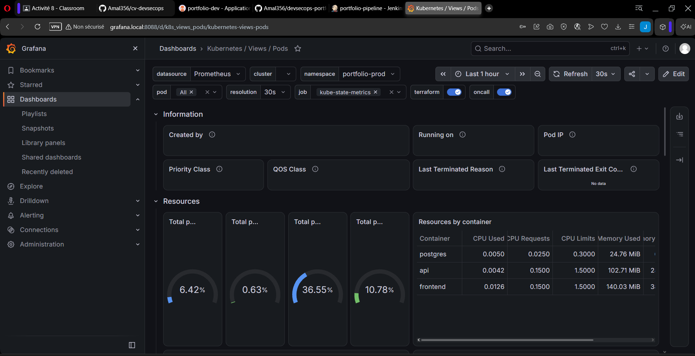

# Activité 8 – Partie 42 : Monitoring applicatif (étapes 219 à 225)

> **État :** étapes 219 à 221 terminées. Étapes 222 à 225 en cours : le code (route `/metrics`) est livré par le pipeline, et le ServiceMonitor et le tableau de bord de l'API sont prêts.

```text
 kubelet/cAdvisor ─┐
 kube-state-metrics┼──► Prometheus (namespace monitoring) ──► Grafana (http://grafana.local:8088)
 API /metrics ─────┘        ServiceMonitor devsecops-api        tableaux de bord « Portfolio – … »
```

| Fichier | Contenu |
| :--- | :--- |
| [`values-kube-prometheus-stack.yaml`](values-kube-prometheus-stack.yaml) | Prometheus + Grafana adaptés à K3s (sans Alertmanager ni node-exporter, composants intégrés à K3s désactivés), Ingress `grafana.local` / `prometheus.local`, sources Loki et Tempo reliées entre elles |
| [`k8s/servicemonitor-api.yaml`](k8s/servicemonitor-api.yaml) | Prometheus lit `/metrics` de l'API dans `portfolio-dev`, `portfolio-staging` et `portfolio-prod` (étape 223) |
| [`k8s/dashboard-kubernetes.yaml`](k8s/dashboard-kubernetes.yaml) | tableau de bord « Portfolio – Kubernetes » : CPU, mémoire, nombre de Pods, redémarrages (étape 221) |
| [`k8s/dashboard-api.yaml`](k8s/dashboard-api.yaml) | tableau de bord « Portfolio – API » : requêtes, taux d'erreurs, latence p50/p95/p99, logs (étape 224) |

## Étapes 219 et 220 – Prometheus et Grafana

Le mot de passe admin de Grafana est généré (`openssl rand`) dans le Secret `grafana-admin` ; il n'est ni dans Git ni dans les captures.

```bash
kubectl create namespace monitoring
kubectl -n monitoring create secret generic grafana-admin \
  --from-literal=admin-user=admin --from-literal=admin-password="$(openssl rand -hex 12)"
helm install kps prometheus-community/kube-prometheus-stack -n monitoring \
  -f 44-monitoring/values-kube-prometheus-stack.yaml
kubectl apply -f 44-monitoring/k8s/
```

```text
NAME                                                  READY   STATUS
kps-grafana-6f46f95896-sn4mj                          3/3     Running
kps-kube-prometheus-stack-operator-567b944766-prhrg   1/1     Running
kps-kube-state-metrics-75cd45544b-kql92               1/1     Running
prometheus-kps-kube-prometheus-stack-prometheus-0     2/2     Running
kps   monitoring   1   deployed   kube-prometheus-stack-93.3.1   v0.95.2
```


**Problème rencontré :** pendant l'installation, le disque de la VM est monté à **95 %**. Kubernetes a expulsé le premier Pod Grafana (`Evicted … low on resource: ephemeral-storage`) et a marqué le nœud `DiskPressure`, ce qui a bloqué le second en `Pending`. Le nettoyage (cache de build Docker, images locales déjà publiées dans Harbor, images K3s inutilisées, caches npm, volumes Docker anonymes) a libéré près de 7 Go ; le nœud est revenu à `DiskPressure False` et Grafana a démarré.

## Étape 221 – Tableaux de bord

Le tableau de bord « Portfolio – Kubernetes » est importé automatiquement depuis une ConfigMap (label `grafana_dashboard=1`, lu par le *sidecar* de Grafana) : nombre de Pods en cours d'exécution, redémarrages, CPU et mémoire (total et par Pod), nombre de Pods par environnement.




Un tableau de bord officiel a aussi été importé depuis grafana.com (*Dashboards → New → Import*, ID **15760** « Kubernetes / Views / Pods »), ici sur `portfolio-prod` :


