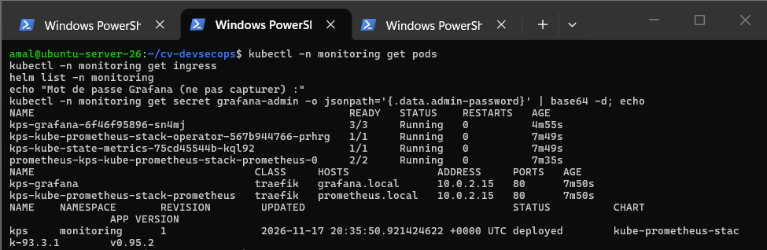
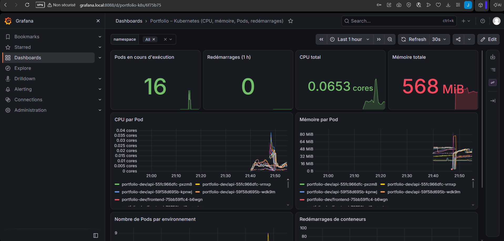
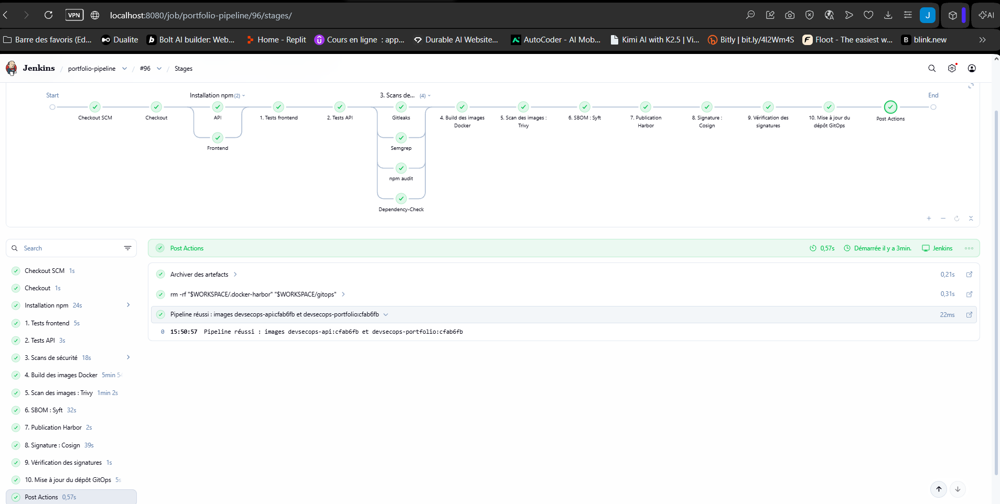
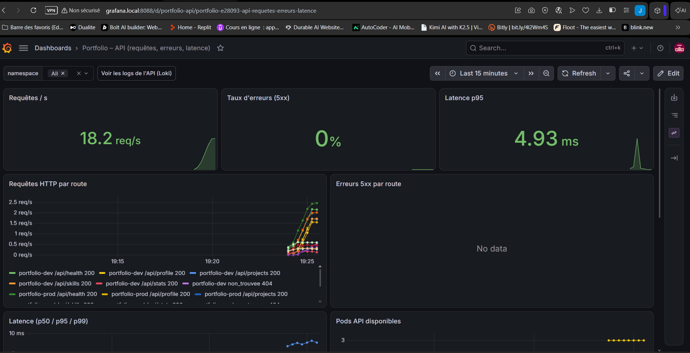
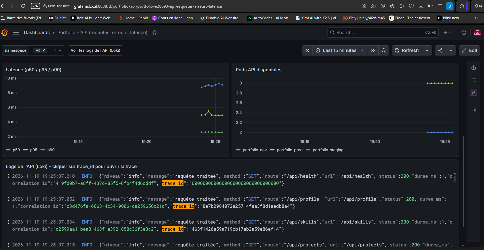
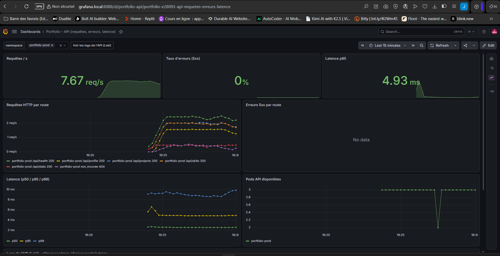

# Activité 8 – Partie 42 : Monitoring applicatif (étapes 219 à 225)

> **État :** étapes 219 à 225 terminées.

```text
 kubelet/cAdvisor ─┐
 kube-state-metrics┼──► Prometheus (namespace monitoring) ──► Grafana (http://grafana.local:8088)
 API /metrics ─────┘        ServiceMonitor devsecops-api        tableaux de bord « Portfolio – … »
```

| Fichier | Contenu |
| :--- | :--- |
| [`values-kube-prometheus-stack.yaml`](values-kube-prometheus-stack.yaml) | Prometheus + Grafana adaptés à K3s (sans Alertmanager ni node-exporter, composants intégrés à K3s désactivés), Ingress `grafana.local` / `prometheus.local`, sources Loki et Tempo reliées entre elles |
| [`k8s/servicemonitor-api.yaml`](k8s/servicemonitor-api.yaml) | Prometheus lit `/metrics` de l'API dans `portfolio-dev`, `portfolio-staging` et `portfolio-prod` (étape 223) |
| [`k8s/dashboard-kubernetes.yaml`](k8s/dashboard-kubernetes.yaml) | tableau de bord « Portfolio – Kubernetes » : CPU, mémoire, nombre de Pods, redémarrages (étape 221) |
| [`k8s/dashboard-api.yaml`](k8s/dashboard-api.yaml) | tableau de bord « Portfolio – API » : requêtes, taux d'erreurs, latence p50/p95/p99, logs (étape 224) |

## Étapes 219 et 220 – Prometheus et Grafana

Le mot de passe admin de Grafana est généré (`openssl rand`) dans le Secret `grafana-admin` ; il n'est ni dans Git ni dans les captures.

```bash
kubectl create namespace monitoring
kubectl -n monitoring create secret generic grafana-admin \
  --from-literal=admin-user=admin --from-literal=admin-password="$(openssl rand -hex 12)"
helm install kps prometheus-community/kube-prometheus-stack -n monitoring \
  -f 44-monitoring/values-kube-prometheus-stack.yaml
kubectl apply -f 44-monitoring/k8s/
```

```text
NAME                                                  READY   STATUS
kps-grafana-6f46f95896-sn4mj                          3/3     Running
kps-kube-prometheus-stack-operator-567b944766-prhrg   1/1     Running
kps-kube-state-metrics-75cd45544b-kql92               1/1     Running
prometheus-kps-kube-prometheus-stack-prometheus-0     2/2     Running
kps   monitoring   1   deployed   kube-prometheus-stack-93.3.1   v0.95.2
```



**Problème rencontré :** pendant l'installation, le disque de la VM est monté à **95 %**. Kubernetes a expulsé le premier Pod Grafana (`Evicted … low on resource: ephemeral-storage`) et a marqué le nœud `DiskPressure`, ce qui a bloqué le second en `Pending`. Le nettoyage (cache de build Docker, images locales déjà publiées dans Harbor, images K3s inutilisées, caches npm, volumes Docker anonymes) a libéré près de 7 Go ; le nœud est revenu à `DiskPressure False` et Grafana a démarré.

## Étape 221 – Tableaux de bord

Le tableau de bord « Portfolio – Kubernetes » est importé automatiquement depuis une ConfigMap (label `grafana_dashboard=1`, lu par le *sidecar* de Grafana) : nombre de Pods en cours d'exécution, redémarrages, CPU et mémoire (total et par Pod), nombre de Pods par environnement.




Un tableau de bord officiel a aussi été importé depuis grafana.com (*Dashboards → New → Import*, ID **15760** « Kubernetes / Views / Pods »), ici sur `portfolio-prod` :


## Étape 222 – Route `/metrics` de l'API

L'API Express expose ses métriques au format Prometheus (`prom-client`) sur `/metrics` : nombre de requêtes par route et code HTTP, erreurs 5xx, et histogramme de latence. Les URL inconnues sont regroupées sous `route="non_trouvee"` pour éviter une série par URL inventée.

Exemple (DEV, après 2 contrôles de santé et 25 requêtes vers des routes inexistantes) :

```text
# HELP http_requests_total Nombre de requêtes HTTP reçues par l'API
# TYPE http_requests_total counter
http_requests_total{method="GET",route="/api/health",status_code="200"} 2
http_requests_total{method="GET",route="non_trouvee",status_code="404"} 25
# HELP http_request_errors_total Nombre de réponses en erreur (codes 5xx)
# TYPE http_request_errors_total counter
# HELP http_request_duration_seconds Durée de traitement des requêtes HTTP (secondes)
# TYPE http_request_duration_seconds histogram
http_request_duration_seconds_bucket{le="0.025",method="GET",route="/api/health",status_code="200"} 2
http_request_duration_seconds_sum{method="GET",route="/api/health",status_code="200"} 0.015299837
http_request_duration_seconds_count{method="GET",route="/api/health",status_code="200"} 2
```

## Étape 223 – Prometheus récupère les métriques de l'API

Le ServiceMonitor [`devsecops-api`](k8s/servicemonitor-api.yaml) fait lire `/metrics` toutes les 15 s dans `portfolio-dev`, `portfolio-staging` et `portfolio-prod`. Après la livraison de la version corrigée (build Jenkins #97, puis promotion GitOps DEV → STAGING → PROD avec le même digest signé `sha256:e09d624f…`), les 7 Pods API sont `up` :

```text
portfolio-dev     api-64b8555cfb-c969z  up
portfolio-dev     api-64b8555cfb-m9wj9  up
portfolio-prod    api-6cffcbf995-z2tvh  up
portfolio-prod    api-6cffcbf995-499nk  up
portfolio-prod    api-6cffcbf995-ddxsd  up
portfolio-staging api-955d75847-xqdwl   up
portfolio-staging api-955d75847-wsd6f   up
```

Pipeline Jenkins complet ayant livré la correction (tests, scans, build, Trivy, SBOM, Harbor, Cosign, GitOps) :



## Étape 224 – Requêtes, taux d'erreurs et latence dans Grafana

Tableau de bord « Portfolio – API » ([`k8s/dashboard-api.yaml`](k8s/dashboard-api.yaml)), filtrable par environnement, avec du trafic de test (routes normales et quelques 404) :





| Panneau | Valeur observée |
| :--- | :--- |
| Requêtes/s | 18,2 req/s (DEV + PROD) |
| Taux d'erreurs 5xx | 0 % (`or vector(0)` affiche 0 au lieu de « No data » quand aucune erreur n'existe) |
| Latence p95 | 4,9 ms (p50 ≈ 2 ms, p99 < 10 ms) |
| Pods API disponibles | prod 3, staging 2, dev 2 |

Les 404 sont visibles dans « Requêtes HTTP par route » (`non_trouvee 404`) : ce sont des erreurs client, non comptées dans le taux d'erreurs serveur (5xx).

## Étape 225 – Suppression manuelle d'un Pod API

```text
== 18:27:23 suppression de api-6cffcbf995-499nk
18:27:23  disponibles=2/3
...
18:27:39  disponibles=2/3
18:27:42  disponibles=3/3
NAME                   READY   STATUS    RESTARTS   AGE
api-6cffcbf995-ddxsd   1/1     Running   0          65m
api-6cffcbf995-fw6lg   1/1     Running   0          32s
api-6cffcbf995-z2tvh   1/1     Running   0          64m
```

Le ReplicaSet recrée immédiatement un Pod (`fw6lg`) ; il n'est compté disponible qu'après sa readiness probe (`/api/health`), soit environ 19 s. Dans Grafana, « Pods API disponibles » descend de 3 à 2 puis remonte, tandis que les requêtes/s et le taux d'erreurs (0 %) ne bougent pas : grâce aux 3 réplicas, la panne d'un Pod est invisible pour les utilisateurs.



## Problèmes rencontrés (étapes 222 à 225)

| Problème | Cause | Correction |
| :--- | :--- | :--- |
| API DEV en `CrashLoopBackOff` (`parentTracer.getSpanLimits is not a function`) à la première requête SQL ; cibles Prometheus `down` | `@prisma/instrumentation` 5.22 embarquait sa propre copie d'OpenTelemetry 1.x, incompatible avec OpenTelemetry v2 | Prisma 6.19.3 (PR #36) |
| Build Jenkins #95 bloqué par Dependency-Check | `deepmerge-ts` 7.1.5 (GHSA-ggr8-5vv4-36mx, CVSS 10), apporté par Prisma 6 | `overrides` npm `deepmerge-ts ^8.0.0` (PR #37), sans passer à Prisma 7 |
| Nouvelle API encore en échec au démarrage (`Cannot destructure property 'PrismaInstrumentation'`) | Prisma 6 n'exporte plus la classe sous `default` ; les tests tournaient sans OpenTelemetry | import compatible + test de démarrage avec `OTEL_EXPORTER_OTLP_ENDPOINT` (PR #38, 25 tests) |
| STAGING/PROD : `/metrics` en 404 | ancienne version | promotion GitOps DEV → STAGING → PROD (même digest, sans rebuild) |
| Pods expulsés en série, nœud `DiskPressure`, Argo CD `Pending` | disque à plus de 85 % pendant les builds (seuil d'éviction du kubelet : 15 % libre) | disque virtuel passé de 50 à 80 Go (`VBoxManage modifymedium --resize`, puis `growpart`, `pvresize`, `lvextend -r`) : 49 % utilisé |
| Grafana « No data » alors que Prometheus avait les données | horloge de la VM en retard de 45 min après le redémarrage : les mesures tombaient hors de la fenêtre « 15 dernières minutes » | `chronyc makestep` |
