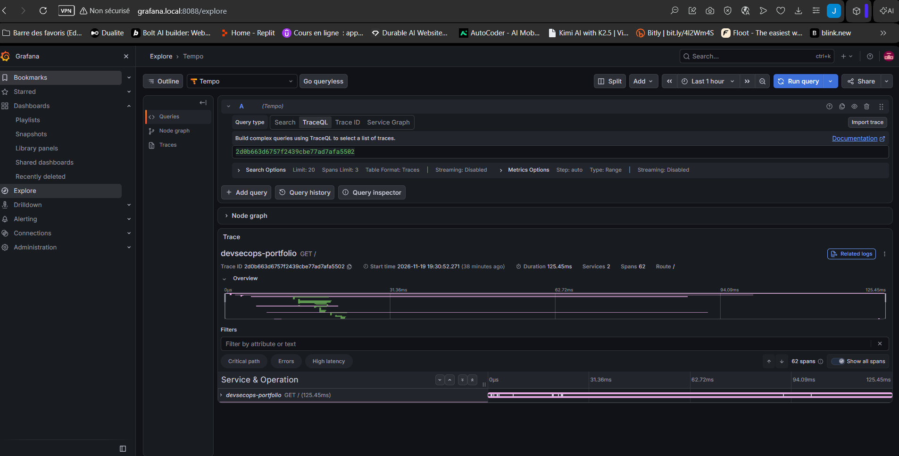
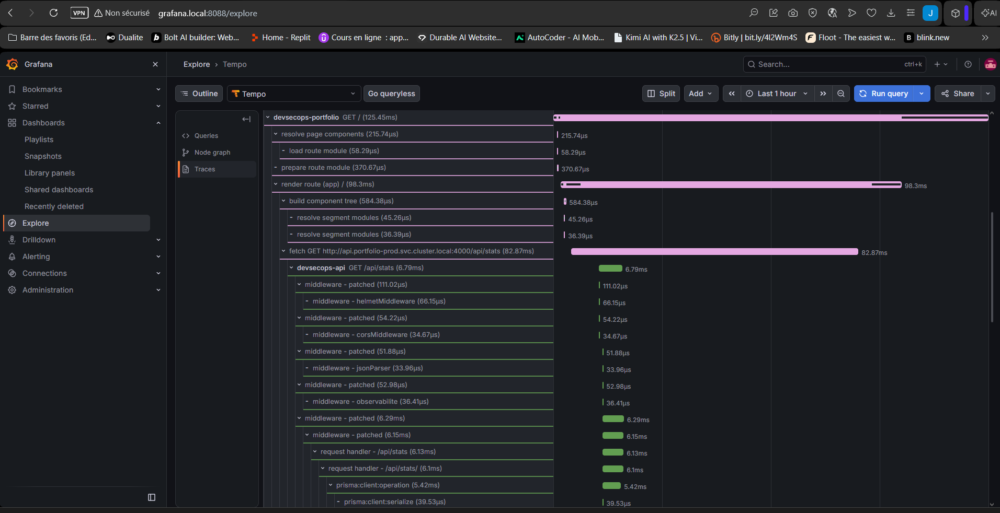
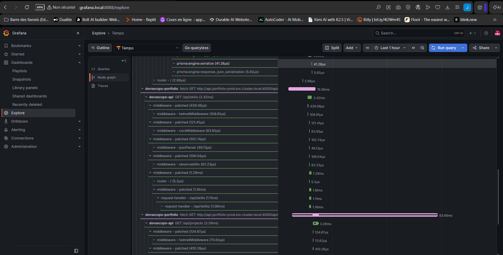
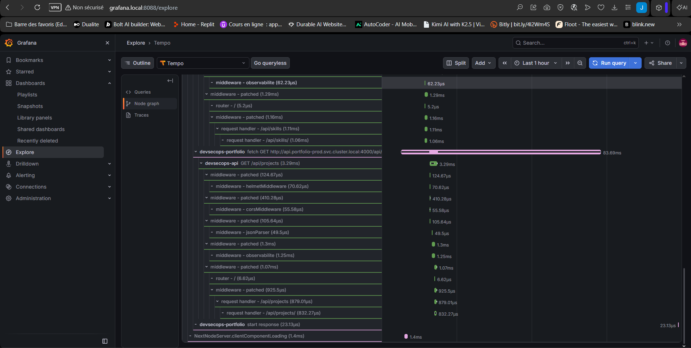

# Activité 8 – Partie 43 : OpenTelemetry et traces distribuées (étapes 226 à 230)

> **État :** étapes 226 à 230 terminées.

Une **trace** suit une seule requête à travers tous les services. Chaque étape (page Next.js, appel `fetch`, route Express, requête SQL) est un **span** avec sa durée : on voit où le temps est passé.

```text
 Navigateur ──► Next.js (devsecops-portfolio) ──fetch + traceparent──► Express (devsecops-api) ──Prisma──► PostgreSQL
                     │                                                       │
                     └──────────────── OTLP HTTP :4318 ──────────────────────┴──► Grafana Tempo ──► Grafana (Explore)
```

| Fichier | Contenu |
| :--- | :--- |
| [`values-tempo.yaml`](values-tempo.yaml) | Grafana Tempo en mode monolithique, récepteurs OTLP HTTP (4318) et gRPC (4317), rétention 24 h (étape 229) |
| [`api/src/otel.js`](../api/src/otel.js) | SDK Node OpenTelemetry chargé avant l'API (`node --import`) : HTTP, Express, Prisma/PostgreSQL, AWS SDK/Floci ; `/metrics` et `/api/health` ignorés (étape 226) |
| [`portfolio-next/instrumentation.js`](../portfolio-next/instrumentation.js) | `@vercel/otel` : requêtes de page, rendu et `fetch` ; l'en-tête W3C `traceparent` est propagé vers l'API (étape 227) |
| [`portfolio-next/lib/api.js`](../portfolio-next/lib/api.js) | correlation ID par affichage de page, envoyé dans `x-correlation-id` et écrit dans les logs (étape 228) |
| [`api/src/middlewares/observabilite.js`](../api/src/middlewares/observabilite.js) | lit `x-correlation-id`, l'ajoute à la trace (`correlation.id`) et à chaque log JSON avec le `trace_id` (étape 228) |

L'activation dépend de `OTEL_EXPORTER_OTLP_ENDPOINT` (ConfigMap de chaque environnement) : sans collecteur, rien n'est chargé.

## Étapes 226, 227 et 229 – Instrumentation et Tempo

Les deux services envoient leurs traces à Tempo :

```text
$ curl http://localhost:3200/api/search/tag/service.name/values
{"tagValues":["devsecops-api","devsecops-portfolio"]}
```

## Étape 228 – Correlation ID transmis de Next.js à l'API

Un affichage de la page d'accueil (PROD) : la ligne de log du frontend et les trois lignes de l'API portent **le même `correlation_id` et le même `trace_id`**.

```text
# frontend (Next.js)
{"niveau":"info","message":"appel API","chemin":"/api/stats","status":200,"duree_ms":9,"correlation_id":"9df1cf72-5c0f-477d-a527-c4e656ae6ad5","trace_id":"701c07f784f107e6ae7e5eb57c1cd4ad"}
# API (Express)
{"niveau":"info","message":"requête traitée","route":"/api/stats","status":200,"duree_ms":3,"correlation_id":"9df1cf72-5c0f-477d-a527-c4e656ae6ad5","trace_id":"701c07f784f107e6ae7e5eb57c1cd4ad"}
{"niveau":"info","message":"requête traitée","route":"/api/projects","status":200,"duree_ms":1,"correlation_id":"9df1cf72-5c0f-477d-a527-c4e656ae6ad5","trace_id":"701c07f784f107e6ae7e5eb57c1cd4ad"}
{"niveau":"info","message":"requête traitée","route":"/api/skills","status":200,"duree_ms":1,"correlation_id":"9df1cf72-5c0f-477d-a527-c4e656ae6ad5","trace_id":"701c07f784f107e6ae7e5eb57c1cd4ad"}
```

Le `correlation_id` identifie l'action de l'utilisateur (un affichage de page) ; le `trace_id` permet d'ouvrir la trace correspondante dans Tempo depuis les logs (partie 44).

## Étape 230 – Requête complète Next.js → Express → PostgreSQL

Trace `2d0b663d6757f2439cbe77ad7afa5502` (Grafana → Explore → Tempo) : 125 ms, 2 services, 62 spans.









| Niveau | Spans |
| :--- | :--- |
| Next.js | `GET /`, `render route (app) /`, `fetch GET http://api…:4000/api/stats` (et `/api/skills`, `/api/projects`, en parallèle) |
| Express | `GET /api/stats`, middlewares `helmet`, `cors`, `jsonParser`, `observabilite`, `request handler` |
| PostgreSQL | `prisma:client:operation` → `prisma:engine:query` → `prisma:engine:db_query` |

Lecture : l'API répond en 2 à 7 ms ; la majorité des 125 ms de la page est passée côté Next.js (rendu et attente des trois appels).

## Problème rencontré

Avec OpenTelemetry v2, `@prisma/instrumentation` 5.22 faisait planter l'API à la première requête SQL tracée (`parentTracer.getSpanLimits is not a function`). Passage à Prisma 6.19.3, puis correction de l'import de `PrismaInstrumentation` (exporté directement en version 6) et ajout d'un test de démarrage avec OpenTelemetry activé. Détails dans [`44-monitoring/README.md`](../44-monitoring/README.md#problèmes-rencontrés-étapes-222-à-225).
