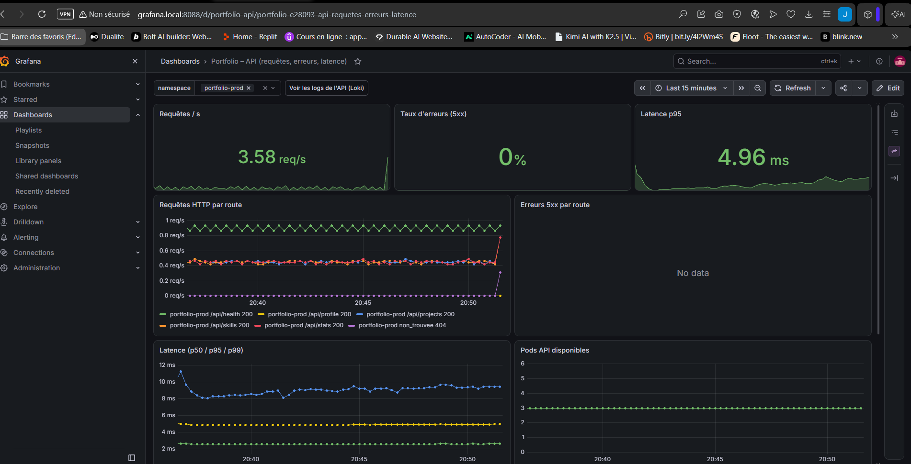
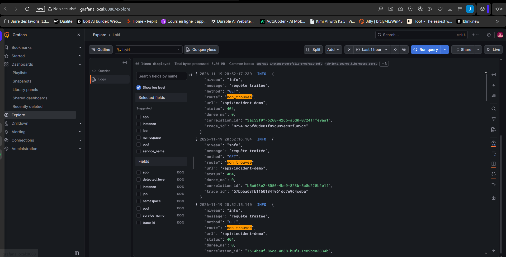
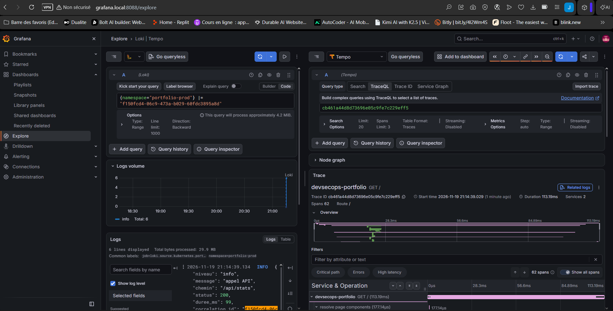

# Activité 8 – Partie 44 : Centralisation des logs (étapes 231 à 233)

> **État :** étapes 231 à 233 terminées. Stack d'observabilité complète : **Prometheus + Grafana + Loki + Tempo + OpenTelemetry**.

```text
 Pods frontend / api (dev, staging, prod)
        │  logs JSON (correlation_id, trace_id)
        ▼
 Grafana Alloy ──► Loki ──┐
                          ├──► Grafana : métrique (Prometheus) → logs (Loki) → trace (Tempo)
 OpenTelemetry ──► Tempo ─┘
```

| Fichier | Contenu |
| :--- | :--- |
| [`values-loki.yaml`](values-loki.yaml) | Loki en un seul binaire, stockage sur disque (2 Gi), rétention 48 h (étape 231) |
| [`values-alloy.yaml`](values-alloy.yaml) | Alloy lit les logs des Pods `app=api` et `app=frontend` des 3 namespaces via l'API Kubernetes et les envoie à Loki avec les labels `namespace`, `app`, `pod` (étape 232) |
| [`../44-monitoring/values-kube-prometheus-stack.yaml`](../44-monitoring/values-kube-prometheus-stack.yaml) | sources Grafana Loki et Tempo reliées : le champ `trace_id` des logs ouvre la trace dans Tempo (étape 233) |

## Étape 231 – Loki

```bash
helm install loki grafana/loki -n monitoring -f 46-logs/values-loki.yaml
```

## Étape 232 – Logs du frontend et de l'API dans Loki

```text
$ curl http://localhost:3100/loki/api/v1/label/app/values
['api', 'frontend']

# {namespace="portfolio-prod", app="frontend"} |= "correlation_id"
{"niveau":"info","message":"appel API","chemin":"/api/stats","status":200,"duree_ms":10,"correlation_id":"bba0e540-…","trace_id":"4ffe439e…"}
# {namespace="portfolio-prod", app="api"} |= "correlation_id"
{"niveau":"info","message":"requête traitée","method":"GET","route":"/api/health","status":200,"duree_ms":1,"correlation_id":"56e5d447-…","trace_id":"0000…"}
```

Les contrôles de santé (`/api/health`) ont un `trace_id` nul : ils sont exclus des traces pour ne pas remplir Tempo.

## Étape 233 – Métrique → log → trace pour analyser un incident

Incident simulé en PROD : 60 requêtes vers une route inexistante (`/api/incident-demo`) pendant des visites de la page d'accueil.

**1. Métrique** – tableau de bord « Portfolio – API », namespace `portfolio-prod` : la courbe `non_trouvee 404` monte, le taux d'erreurs serveur reste à 0 %.



**2. Logs** – Explore → Loki, `{namespace="portfolio-prod", app="api"} |= "non_trouvee"` : 60 lignes, chacune avec son `correlation_id` et son `trace_id`.



**3. Trace** – vue partagée : à gauche, les logs d'un affichage de page filtrés par son correlation ID (`{namespace="portfolio-prod"} |= "f150fcd4-06c9-473a-b029-60fdc3895a8d"`, lignes du frontend et de l'API) ; à droite, la trace `cb461a44d8d73696e05c9fe7c229eff5` dans Tempo (113 ms, 2 services, 62 spans). Le bouton « Related logs » de la trace fait le chemin inverse.



Démarche : la **métrique** signale quand et quoi (pic de 404 sur une route) ; les **logs** de ce moment donnent le détail de chaque requête et ses identifiants ; la **trace** montre le chemin complet (Next.js → Express → PostgreSQL) et la durée de chaque étape.

## Problème rencontré

| Problème | Cause | Correction |
| :--- | :--- | :--- |
| Traces introuvables dans Tempo (`trace … not found`) quelques minutes après leur création | `tempo-0` redémarrait en boucle (7 fois, `Exit Code: 137`) : mémoire au-delà de la limite de 512 Mi ; sans persistance, chaque redémarrage effaçait les traces | limite portée à 1 Gi dans [`values-tempo.yaml`](../45-opentelemetry/values-tempo.yaml) (`helm upgrade tempo grafana/tempo --version 1.24.4`, révision 2) ; `helm repo update` préalable, le cache Helm ayant été supprimé lors du nettoyage du disque |
