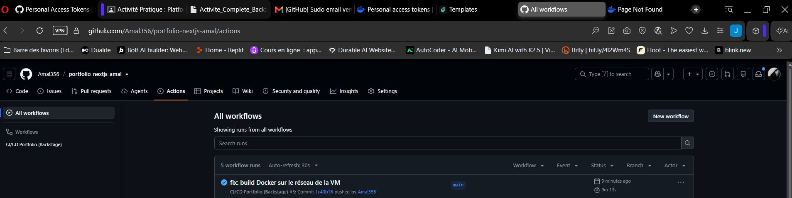
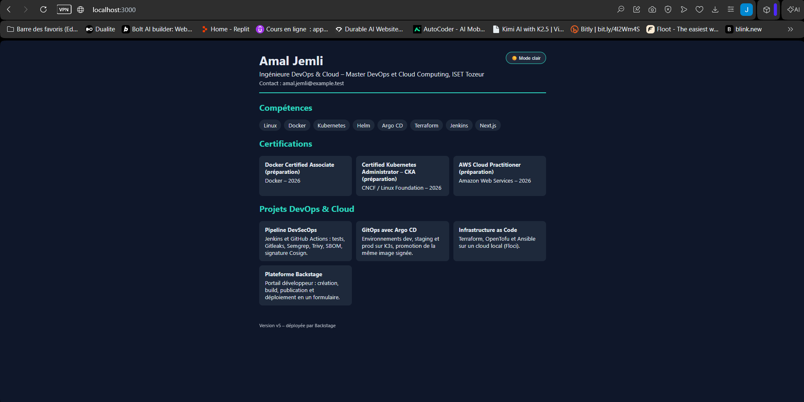
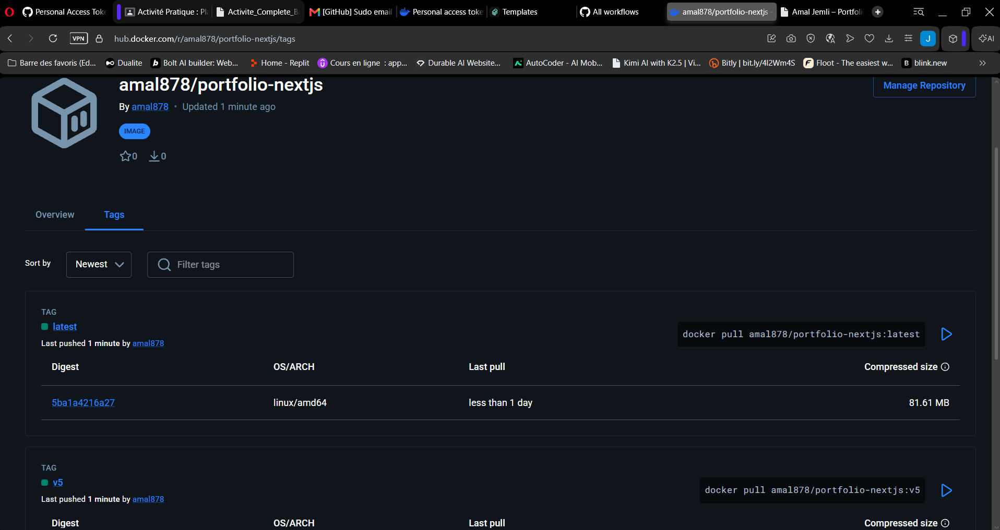

# Activité 9 – Platform Engineering avec Backstage : cycle de vie d'un Portfolio Next.js

**Backstage** (projet open source créé par Spotify, CNCF) est un **portail développeur** : un site interne où le développeur remplit un formulaire et obtient un projet prêt à l'emploi. L'équipe plateforme y publie des **Software Templates** (« chemins tout tracés ») qui automatisent la création, le build, la publication et le déploiement.

Ici, **toutes les étapes sont déclenchées depuis Backstage** : le développeur ne tape aucune commande `git`, `docker` ou `docker compose`.

```text
           Backstage (http://localhost:3001)
   ┌──────────────────────────────────────────────────────────┐
   │ Template portfolio-nextjs-template (formulaire)            │
   │  1. fetch:template   -> projet Next.js + artefacts Docker │
   │  2. publish:github   -> dépôt GitHub + secret Docker Hub  │
   │  3. catalog:register -> composant dans le Catalogue       │
   └──────────────┬───────────────────────────────────────────┘
                  │ push initial (ou github:actions:dispatch)
                  ▼
   GitHub Actions – runner auto-hébergé sur la VM (.github/workflows/cicd.yml)
   récupération du code -> build Next.js + image Docker <user>/portfolio-nextjs:vN
   -> docker login + push Docker Hub -> docker compose up -d -> /api/health
                  │
                  ▼
           http://localhost:3000  (Portfolio)
```

## Contenu du dossier

| Chemin | Livrable |
| :--- | :--- |
| [`templates/portfolio-nextjs/template.yaml`](templates/portfolio-nextjs/template.yaml) | **Template Backstage** `portfolio-nextjs-template` (étapes 1 à 6) |
| [`templates/portfolio-nextjs/skeleton/`](templates/portfolio-nextjs/skeleton) | squelette du projet généré : **application Next.js**, **Dockerfile**, `.dockerignore`, **docker-compose.yml**, `deploy.env`, README, `catalog-info.yaml`, pipeline `cicd.yml` |
| [`templates/portfolio-evolution/`](templates/portfolio-evolution) | template `portfolio-nextjs-evolution` : version 2 proposée en pull request (étape 7) |
| [`templates/portfolio-relivraison/template.yaml`](templates/portfolio-relivraison/template.yaml) | template `portfolio-nextjs-relivraison` : relance du cycle complet (étape 7) |
| [`backstage/app-config.local.yaml`](backstage/app-config.local.yaml) | configuration de Backstage : ports, intégration GitHub (jeton lu dans `GITHUB_TOKEN`), emplacement des templates |

## Mise en place de la plateforme

```bash
npx @backstage/create-app@latest --path ~/backstage      # application Backstage (Yarn 4)
cd ~/backstage
yarn config set httpTimeout 600000 && yarn config set networkConcurrency 8
yarn install
cp ~/cv-devsecops/47-backstage/backstage/app-config.local.yaml .
read -rsp "Jeton GitHub : " GITHUB_TOKEN; export GITHUB_TOKEN   # jamais écrit dans un fichier
yarn start                                                       # interface http://localhost:3001, API :7007
```

| Accès | Usage | Où il est stocké |
| :--- | :--- | :--- |
| Jeton GitHub *classic* (`repo`, `workflow`) | Backstage crée les dépôts, écrit les secrets, déclenche les workflows | variable `GITHUB_TOKEN` du processus Backstage |
| Jeton Docker Hub (*Read & Write*) | le pipeline publie l'image | saisi dans le champ **Secret** du formulaire → secret GitHub Actions `DOCKERHUB_TOKEN` |
| Runner GitHub Actions | exécute build, push et déploiement **sur la VM** | service du runner sur la VM |

Ports de la VM redirigés vers Windows : 3001 (interface Backstage), 7007 (API Backstage), 3000 (Portfolio).

## Explication des 7 étapes

| Étape | Ce qui est automatisé | Mécanisme Backstage / pipeline |
| :--- | :--- | :--- |
| 1. Création du projet | projet Next.js (App Router, sortie `standalone`), configuration initiale, enregistrement dans le Catalogue | `fetch:template` (squelette + valeurs du formulaire), `catalog:register` |
| 2. Dépôt Git | dépôt GitHub public créé, initialisé avec le code et le README ; métadonnées dans `catalog-info.yaml` (liens, annotation `github.com/project-slug`) | `publish:github` |
| 3. Artefacts Docker | `Dockerfile` multi-étapes (utilisateur non root, HEALTHCHECK), `.dockerignore`, `docker-compose.yml` versionnés dès la création | fichiers du squelette |
| 4. Build de l'image | pipeline déclenché par la création du dépôt ; image `<user>/portfolio-nextjs:v<numéro d'exécution>` (v1, v2…) ; statut visible via les liens de la tâche et du composant | `.github/workflows/cicd.yml` |
| 5. Docker Hub | secret Docker Hub saisi dans Backstage (`ui:field: Secret`) puis enregistré dans le dépôt ; `docker login --password-stdin` puis `docker push` (version + `latest`) | `publish:github` → `secrets` |
| 6. Déploiement local | `docker compose up -d` sur la VM, puis vérification de `http://localhost:3000/api/health` | runner auto-hébergé |
| 7. Évolution | v2 : Certifications, Projets DevOps & Cloud, mode sombre, informations mises à jour, proposée par Backstage en pull request ; fusion → relivraison complète (image v2, Docker Hub, redéploiement, santé) ; relance possible à tout moment | `publish:github:pull-request`, `github:actions:dispatch` |

Chaîne de l'étape 7 :

```text
Modification du code (template « Évolution », pull request fusionnée)
  -> build de l'application -> image Docker vN -> Docker Hub -> docker compose up -> /api/health OK
```

## Problèmes rencontrés

- **`yarn install` interrompu (`Timeout`)** pendant `create-app` : relancé dans `~/backstage` avec `yarn config set httpTimeout 600000` et `networkConcurrency 8` (installation terminée en 11 min, 1,8 Go de `node_modules`).
- **Page blanche puis `ERR_CONNECTION_RESET`** sur `http://localhost:3001` : Backstage tournait (`Rspack compiled successfully`), mais le **pare-feu UFW** de la VM (activité 1) bloquait les nouveaux ports. Correction : `sudo ufw allow 3001/tcp`, `7007/tcp` et `3000/tcp`.
- **Fusion de la pull request v2 bloquée (« Review required »)** : l'action `publish:github` protège la branche `main` par défaut (une relecture obligatoire, même pour l'administratrice). Dans un dépôt de TP à une seule personne, la règle a été supprimée (*Settings → Branches*) et le template utilise désormais `protectDefaultBranch: false`.
- **Livraison v1 en échec à l'étape `npm ci` (« Exit handler never called »)** : téléchargements npm interrompus par la lenteur du réseau (même cause que pour Yarn). Le Dockerfile configure maintenant `fetch-retries`, `fetch-timeout` et `maxsockets` ; correction faite dans l'éditeur web de GitHub (aucune commande Git), le commit relance automatiquement tout le cycle.
- **Livraison v3 bloquée dans « Set up job »** : le runner n'arrivait pas à télécharger l'action `docker/login-action` (3 essais de 100 s). Remplacée par `docker login --password-stdin` (le jeton reste un secret GitHub, jamais affiché).
- **Livraison v4 : `npm ci` toujours bloqué dans le conteneur de build** (527 s) : le réseau *bridge* de Docker ajouté au NAT de VirtualBox coupait les longs téléchargements. Test : `docker run --rm --network host node:22-alpine npm view next version` répond. Correction : `docker build --network host`. **Livraison v5 réussie** (build, Docker Hub `v5` + `latest`, déploiement, santé).
- **Disque de la VM à 96 %** après l'installation : caches Yarn, npm et images Docker inutilisées supprimés ; K3s, Harbor et Jenkins arrêtés pendant l'activité (sans rien supprimer).
- **Runner auto-hébergé sur un dépôt public** : GitHub le déconseille (une pull request externe pourrait exécuter du code sur la VM). Acceptable pour un TP local ; en entreprise : dépôt privé, runners éphémères ou approbation obligatoire des workflows venant de forks.

## Résultat final (livraison v5)

| Preuve | Capture |
| :--- | :--- |
| Pipeline GitHub Actions #5 réussi (déclenché par le commit, exécuté sur le runner de la VM) |  |
| Portfolio v2 déployé sur `http://localhost:3000` (Certifications, Projets DevOps & Cloud, mode sombre, « Version v5 – déployée par Backstage ») |  |
| Image publiée sur Docker Hub : `amal878/portfolio-nextjs:v5` et `:latest` |  |
