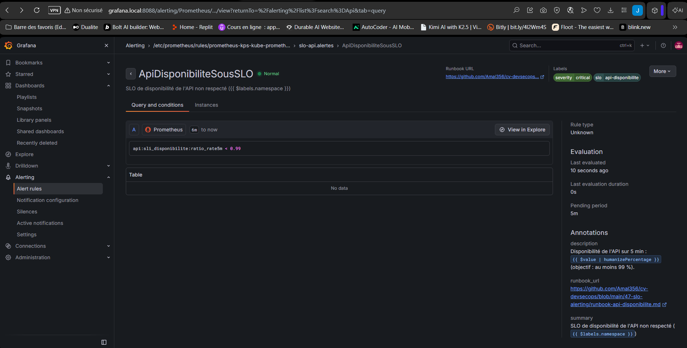

# Activité 8 – Partie 45 : SLI, SLO et alerting (étapes 234 à 237)

> **État :** étapes 234 à 237 terminées.

| Fichier | Contenu |
| :--- | :--- |
| [`prometheusrule-slo-api.yaml`](prometheusrule-slo-api.yaml) | SLI enregistré par Prometheus (5 min et 1 h) et alertes `ApiDisponibiliteSousSLO` et `ApiIndisponible` |
| [`test-slo-api.yaml`](test-slo-api.yaml) | test unitaire des règles avec `promtool test rules` |
| [`runbook-api-disponibilite.md`](runbook-api-disponibilite.md) | runbook associé aux deux alertes |

## Étape 234 – SLI de disponibilité de l'API

**SLI** = part des requêtes HTTP de l'API qui ne se terminent pas par une erreur serveur (5xx), par environnement :

```promql
sum by (namespace) (rate(http_requests_total{status_code!~"5.."}[5m]))
/
sum by (namespace) (rate(http_requests_total[5m]))
```

Enregistré sous `api:sli_disponibilite:ratio_rate5m` (et `…_rate1h`). Les 4xx (route inexistante, requête invalide) sont des erreurs du client : elles ne comptent pas contre la disponibilité du service.

```text
portfolio-dev     100.0 %
portfolio-staging 100.0 %
portfolio-prod    100.0 %
```

## Étape 235 – SLO, et différence entre SLI, SLO et SLA

**SLO : disponibilité de l'API ≥ 99 %**, soit un **budget d'erreur de 1 %** (environ 7 h 18 d'indisponibilité tolérée sur 30 jours).

| | Définition | Pour qui | Ici |
| :--- | :--- | :--- | :--- |
| **SLI** (*Service Level Indicator*) | **la mesure** réelle d'un aspect du service | l'équipe technique | % de requêtes sans 5xx |
| **SLO** (*Service Level Objective*) | **l'objectif interne** fixé sur ce SLI | l'équipe et sa direction | SLI ≥ 99 % |
| **SLA** (*Service Level Agreement*) | **l'engagement contractuel** envers le client, avec des pénalités s'il n'est pas tenu | le client | par exemple 98 %, sinon avoir sur la facture |

Le SLA est toujours **moins strict** que le SLO : l'alerte se déclenche sur le SLO, ce qui laisse le temps de corriger avant de rompre le contrat.

## Étape 236 – Alerte Prometheus quand le SLO n'est plus respecté

| Alerte | Condition | Sévérité |
| :--- | :--- | :--- |
| `ApiDisponibiliteSousSLO` | `api:sli_disponibilite:ratio_rate5m < 0.99` pendant 5 min | critical |
| `ApiIndisponible` | aucun Pod API lisible par Prometheus (`up{service="api"}`) pendant 2 min | critical |

Le délai `for: 5m` évite les fausses alertes sur une erreur isolée. Règles chargées (`ruleSelector: {}` : toutes les PrometheusRule sont lues) et à l'état `inactive`/Normal tant que le SLO est respecté.

**Test unitaire** (`promtool test rules`) : avec 10 % d'erreurs 5xx en PROD, le SLI vaut 90 % ; l'alerte ne se déclenche pas à 3 min, mais se déclenche à 12 min, pour PROD uniquement, avec le bon résumé et le lien du runbook.

```bash
python3 -c "import yaml;d=yaml.safe_load(open('prometheusrule-slo-api.yaml'));yaml.safe_dump(d['spec'],open('regles-slo-api.yaml','w'),allow_unicode=True,sort_keys=False)"
docker run --rm -u $(id -u):$(id -g) -v "$PWD":/w -w /w --entrypoint promtool quay.io/prometheus/prometheus:latest test rules test-slo-api.yaml
#   SUCCESS
```

## Étape 237 – Runbook lié à l'alerte

L'annotation `runbook_url` de chaque alerte pointe vers [`runbook-api-disponibilite.md`](runbook-api-disponibilite.md) : confirmer et mesurer, trouver la cause (tableau symptôme → cause → action), rétablir par GitOps, vérifier, puis rédiger un compte rendu.

```yaml
annotations:
  runbook_url: "https://github.com/Amal356/cv-devsecops/blob/main/47-slo-alerting/runbook-api-disponibilite.md"
```



## Problèmes rencontrés

| Problème | Correction |
| :--- | :--- |
| `promtool: permission denied` | le conteneur tourne en utilisateur non-root : `docker run -u $(id -u):$(id -g)` |
| Test du SLI en échec (`0.8999999999999999` au lieu de `0.9`) | arrondi des nombres à virgule : `round(…, 0.001)` dans le test |
