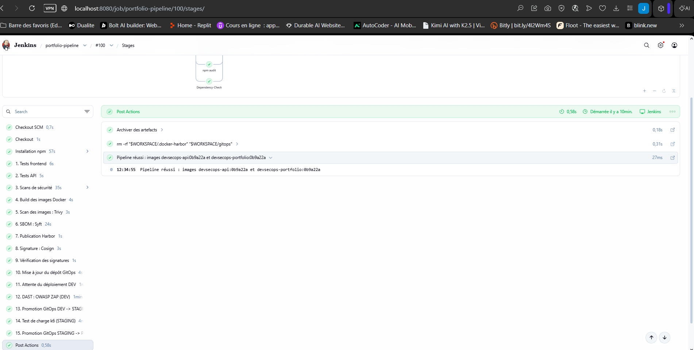

# Activité 8 – Partie 46 : DAST et tests de performance (étapes 238 à 242)

> **État :** étapes 238 à 242 terminées. Build Jenkins #100 réussi : 15 étapes, de la compilation à la promotion en PROD.

| Fichier | Contenu |
| :--- | :--- |
| [`k6-api.js`](k6-api.js) | test de charge de l'API (10 utilisateurs virtuels, 1 min 10) et seuils de performance |
| [`etapes-46.groovy`](etapes-46.groovy) | étapes 11 à 15 du [`Jenkinsfile`](../Jenkinsfile), insérées par [`ajout-etapes-jenkinsfile.py`](ajout-etapes-jenkinsfile.py) |
| [`rapports/`](rapports) | rapports OWASP ZAP avant/après correction et résultats k6 |
| [`../portfolio-next/next.config.mjs`](../portfolio-next/next.config.mjs) | en-têtes de sécurité du frontend (correction de l'étape 239) |

## Pipeline complet

```text
 1-10  tests, scans (Gitleaks, Semgrep, npm audit, Dependency-Check), images, Trivy, SBOM,
       Harbor, Cosign, vérification, mise à jour GitOps DEV
 11    attente du déploiement DEV par Argo CD (/api/health renvoie le commit construit)
 12    DAST OWASP ZAP sur DEV                                  -> étape 238
 13    promotion GitOps DEV -> STAGING (même digest signé)
 14    test de charge k6 sur STAGING ; échec si un seuil n'est pas tenu -> étapes 240 à 242
 15    promotion GitOps STAGING -> PROD, seulement si k6 a réussi   -> étape 241
```

Le pipeline ne touche jamais au cluster : il écrit dans le dépôt GitOps et attend, via l'Ingress, qu'Argo CD ait déployé la bonne version.



## Étape 238 – OWASP ZAP dans le pipeline

Scan **DAST** (*Dynamic Application Security Testing*) : ZAP visite l'application **en marche** en DEV (frontend et API derrière l'Ingress) et analyse les réponses, là où Semgrep (SAST) lit le code sans l'exécuter.

```bash
docker run --rm --add-host "dev.portfolio.local:$INGRESS_IP" -v "$WORKSPACE/reports:/zap/wrk:rw" \
  ghcr.io/zaproxy/zaproxy:stable zap-baseline.py -t http://dev.portfolio.local -r zap-dev.html -J zap-dev.json -I
```

Scan passif (*baseline*) : il n'envoie pas d'attaque destructrice. L'option `-I` rapporte les avertissements sans faire échouer le pipeline ; le rapport HTML est archivé dans Jenkins.

## Étape 239 – Correction d'alertes ZAP (avant / après)

| | Avant ([`zap-avant.html`](rapports/zap-avant.html)) | Après, build #100 ([`zap-apres.html`](rapports/zap-apres.html)) |
| :--- | :---: | :---: |
| FAIL | 0 | 0 |
| WARN | **8** | **4** |
| PASS | 60 | **64** |

Alertes corrigées dans [`next.config.mjs`](../portfolio-next/next.config.mjs) :

| Alerte ZAP | Risque | Correction |
| :--- | :--- | :--- |
| 10020 Missing Anti-clickjacking Header | page intégrée dans un cadre invisible pour détourner les clics | `X-Frame-Options: DENY` |
| 10021 X-Content-Type-Options Header Missing | le navigateur « devine » le type d'un fichier | `X-Content-Type-Options: nosniff` |
| 10037 Server Leaks Information via X-Powered-By | l'attaquant connaît la technologie (Next.js) | `poweredByHeader: false` |
| 10063 Permissions Policy Header Not Set | accès possible à la caméra, au micro… | `Permissions-Policy: camera=(), microphone=(), geolocation=(), payment=()` |

Avertissements restants, acceptés pour ce projet :

| Alerte | Raison |
| :--- | :--- |
| 10038 Content Security Policy (CSP) Header Not Set | une CSP stricte doit autoriser précisément les scripts de Next.js (nonce) ; mal réglée, elle casse le site. Prochaine amélioration |
| 90004 Cross-Origin-Embedder-Policy | isolation inter-origines utile pour des fonctions avancées (SharedArrayBuffer), sans objet ici |
| 10049 Non-Storable Content | information sur la mise en cache, pas une faille |
| 10024 Sensitive Information in URL | paramètre technique d'une URL interne de Next.js, sans donnée personnelle |

## Étape 240 – Test de charge k6

[`k6-api.js`](k6-api.js) : montée à 10 utilisateurs virtuels en 20 s, palier de 40 s, descente en 10 s ; chaque utilisateur appelle `/api/health`, `/api/profile`, `/api/projects` et `/api/skills` puis attend 1 s.

## Étape 241 – k6 sur STAGING avant toute promotion vers PROD

L'étape 14 attend que STAGING serve la version construite, lance k6, et ne laisse passer à l'étape 15 (promotion PROD) que si tous les seuils sont respectés. Build #100 :

```text
Promu vers STAGING : 186b206 promote(staging): images 0b9a22a depuis dev (Jenkins build #100)
...
Promu vers PROD : f80d45a promote(prod): images 0b9a22a depuis staging après k6 (Jenkins build #100)
```

## Étape 242 – Seuil de performance provoquant l'échec du pipeline

```js
thresholds: {
  http_req_failed: ["rate<0.01"],                  // moins de 1 % de requêtes en échec
  http_req_duration: ["p(95)<500", "p(99)<1000"],  // 95 % sous 500 ms, 99 % sous 1 s
  checks: ["rate>0.99"],                           // plus de 99 % de réponses 200
},
```

Si un seuil est dépassé, k6 sort avec le code **99** : l'étape Jenkins échoue et la promotion vers PROD n'a pas lieu.

**Résultats du build #100** ([`k6-staging-build100.txt`](rapports/k6-staging-build100.txt)) :

```text
  █ THRESHOLDS
    checks             ✓ 'rate>0.99'   rate=100.00%
    http_req_duration  ✓ 'p(95)<500'   p(95)=4.59ms
                       ✓ 'p(99)<1000'  p(99)=8.54ms
    http_req_failed    ✓ 'rate<0.01'   rate=0.00%
  2 208 requêtes en 1 min 10 (31 req/s), 0 échec, latence moyenne 2,76 ms
```

**Démonstration de l'échec** ([`k6-demo-seuil-depasse.txt`](rapports/k6-demo-seuil-depasse.txt)) : même test avec un seuil volontairement impossible (`p(95)<1`).

```text
  █ THRESHOLDS
    ✓ 'rate>0.99' rate=100.00%
    ✗ 'p(95)<1' p(95)=4.04ms
    ✓ 'p(99)<1000' p(99)=7.77ms
    ✓ 'rate<0.01' rate=0.00%
level=error msg="thresholds on metrics 'http_req_duration' have been crossed"
Code de sortie de k6 : 99
```

## Problèmes rencontrés

| Problème | Cause | Correction |
| :--- | :--- | :--- |
| k6 : `stat /scripts/k6-api.js: permission denied` | le conteneur tourne avec son propre utilisateur, sans droit de lecture sur le dossier | `docker run -u "$DOCKER_USER"` (utilisateur Jenkins) |
| Build #99 en échec à « 7. Publication Harbor » (`connect: connection refused` sur `localhost:8090`) | Harbor non redémarré après l'arrêt de la VM | `docker compose -f /opt/harbor/docker-compose.yml start` ; démarrage des 3 services (K3s, Jenkins, Harbor) à chaque reprise |
| `Failed to allocate directory watch: Too many open files` | limite inotify par défaut, réglage perdu au redémarrage | `/etc/sysctl.d/99-inotify.conf` (`max_user_instances=1024`, `max_user_watches=524288`) |
| Noms `*.portfolio.local` inconnus des conteneurs ZAP et k6 | absents de `/etc/hosts` | `--add-host <nom>:10.0.2.15` (IP de l'Ingress Traefik) |
