# Activité 9 – Partie 47 : Progressive Delivery (étapes 243 à 248)

> **État :** étapes 243 à 248 terminées. Argo Rollouts (Blue/Green, Canary, rollback automatique par Prometheus) et feature flag OpenFeature + flagd, livré par le pipeline (build Jenkins #104) puis activé sans redéploiement.

| Fichier | Contenu |
| :--- | :--- |
| [`preparer-namespace.sh`](preparer-namespace.sh) | crée le namespace de démonstration `portfolio-rollouts` et y **copie** les secrets depuis `portfolio-dev` (aucun secret dans Git) |
| [`k8s/00-namespace.yaml`](k8s/00-namespace.yaml) | namespace (Pod Security `restricted`), accès à PostgreSQL DEV, ServiceMonitor Prometheus |
| [`k8s/01-bluegreen.yaml`](k8s/01-bluegreen.yaml) | Rollout `api-bg` en **Blue/Green** : services active et preview, IngressRoutes |
| [`k8s/02-canary.yaml`](k8s/02-canary.yaml) | Rollout `api-canary` en **Canary** 10/25/50/100 %, TraefikService pondéré, AnalysisTemplate Prometheus |
| [`k8s/03-flagd.yaml`](k8s/03-flagd.yaml) | flagd (moteur de feature flags) et ConfigMap du flag `api-nouveautes` |
| [`../api/src/lib/flags.js`](../api/src/lib/flags.js), [`../api/src/routes/nouveautes.js`](../api/src/routes/nouveautes.js) | client OpenFeature et route protégée par le flag |
| [`preuves/247-rollback-automatique.txt`](preuves/247-rollback-automatique.txt) | sortie complète du rollback automatique (étape 247) |

## Pourquoi la livraison progressive ?

Un `Deployment` Kubernetes remplace les pods petit à petit, mais il ne sait **ni s'arrêter, ni vérifier** que la nouvelle version fonctionne, ni revenir en arrière seul. Une mauvaise version touche donc vite **tous** les utilisateurs.

**Argo Rollouts** remplace le `Deployment` par un objet `Rollout` qui pilote la livraison :

| Stratégie | Principe | Retour arrière |
| :--- | :--- | :--- |
| **Blue/Green** | deux versions complètes en parallèle ; la nouvelle est testée en *preview*, puis le trafic **bascule d'un coup** | immédiat (l'ancienne version reste allumée 120 s) |
| **Canary** | une **petite part** des utilisateurs reçoit la nouvelle version, puis la part augmente par paliers | automatique si l'**analyse Prometheus** échoue |
| **Feature flag** | le code est livré **éteint** ; un réglage décide qui voit la fonctionnalité | instantané (*kill switch*), sans redéploiement |

```text
                         ┌────────────── Traefik (Ingress) ──────────────┐
 bluegreen.portfolio.local ─► api-bg-active  ─► pods Blue  (v1)
 preview.bluegreen...      ─► api-bg-preview ─► pods Green (v2)          Blue/Green
 canary.portfolio.local    ─► TraefikService api-canary-poids
                                 ├─ x %   ─► api-canary-canary ─► nouvelle version   Canary
                                 └─ 100-x ─► api-canary-stable ─► version stable
 Prometheus ◄── /metrics des pods ;  AnalysisRun : taux de 5xx du canary ≤ 5 % ?
 API ── OpenFeature (OFREP, HTTP) ──► flagd ◄── ConfigMap « flags »        Feature flag
```

Toutes les démonstrations tournent dans un namespace séparé, `portfolio-rollouts` : les environnements DEV, STAGING et PROD gérés par Argo CD ne sont pas touchés.

## Étape 243 – Installation d'Argo Rollouts

```bash
kubectl create namespace argo-rollouts
kubectl apply --server-side --force-conflicts -n argo-rollouts \
  -f https://github.com/argoproj/argo-rollouts/releases/download/v1.10.2/install.yaml
# plugin kubectl : kubectl argo rollouts …
sudo install -m 755 kubectl-argo-rollouts-linux-amd64 /usr/local/bin/kubectl-argo-rollouts
```

`--server-side` est obligatoire : la CRD `Rollout` est trop grande pour l'annotation `last-applied-configuration` d'un `kubectl apply` classique (limite de 262 144 octets). Résultat : le contrôleur est `Running` et les 5 CRD sont présentes (Rollout, AnalysisTemplate, ClusterAnalysisTemplate, AnalysisRun, Experiment).

## Étape 244 – Blue/Green

```bash
bash preparer-namespace.sh
kubectl apply -f k8s/01-bluegreen.yaml                      # Blue = v1 (5c3545c)
kubectl argo rollouts set image api-bg api=…devsecops-api:0148d22@sha256:99f78bf… -n portfolio-rollouts
# Green (v2) démarre, branchée seulement sur la preview ; autoPromotionEnabled: false => pause
kubectl argo rollouts promote api-bg -n portfolio-rollouts  # bascule du service actif vers Green
```

| Moment | `bluegreen.portfolio.local` (utilisateurs) | `preview.bluegreen.portfolio.local` |
| :--- | :---: | :---: |
| après le déploiement de v2 | `5c3545c` (Blue) | `0148d22` (Green, à tester) |
| après `promote` | **`0148d22`** | `0148d22` |

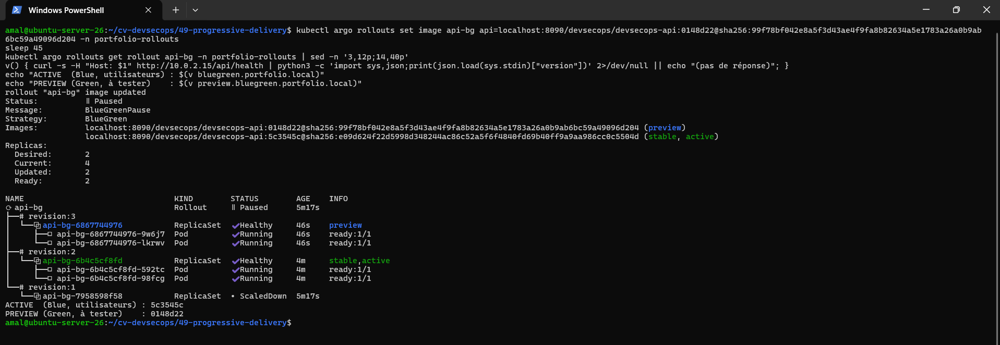

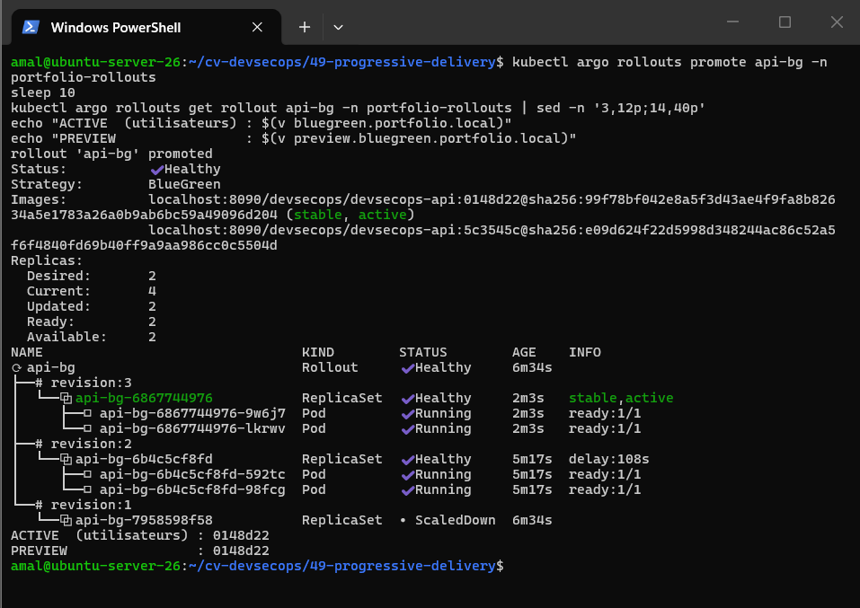

## Étapes 245 et 246 – Canary 10 → 25 → 50 → 100 % avec analyse Prometheus

Le Rollout `api-canary` monte par paliers (`setWeight` 10, 25, 50, 100, avec une pause de 60 s entre chaque). **Traefik** répartit le trafic selon les poids que lui donne Argo (`trafficRouting.traefik`).

Pendant toute la montée, l'**AnalysisTemplate** `taux-erreurs-api` interroge Prometheus toutes les 20 s :

```promql
(sum(rate(http_requests_total{namespace="portfolio-rollouts",service="api-canary-canary",status_code=~"5.."}[1m])) or vector(0))
/
(sum(rate(http_requests_total{namespace="portfolio-rollouts",service="api-canary-canary"}[1m])) > 0 or vector(1))
```

- `successCondition: result[0] <= 0.05` : au plus 5 % d'erreurs 5xx sur la version canary ;
- `failureLimit: 1` : au 2ᵉ échec, Argo annule le déploiement ;
- `or vector(0)` et `or vector(1)` : pas de division par zéro quand il n'y a pas encore de trafic.

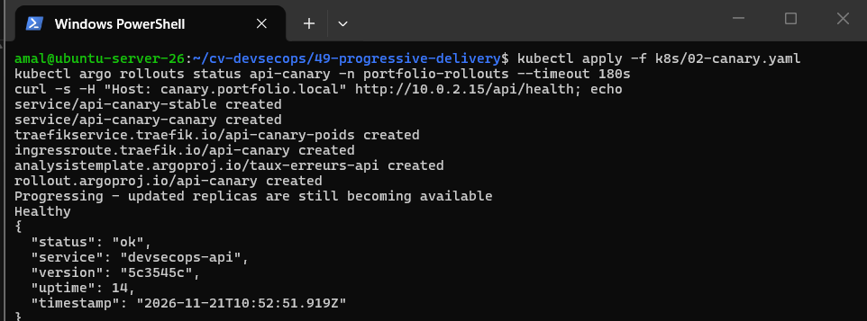

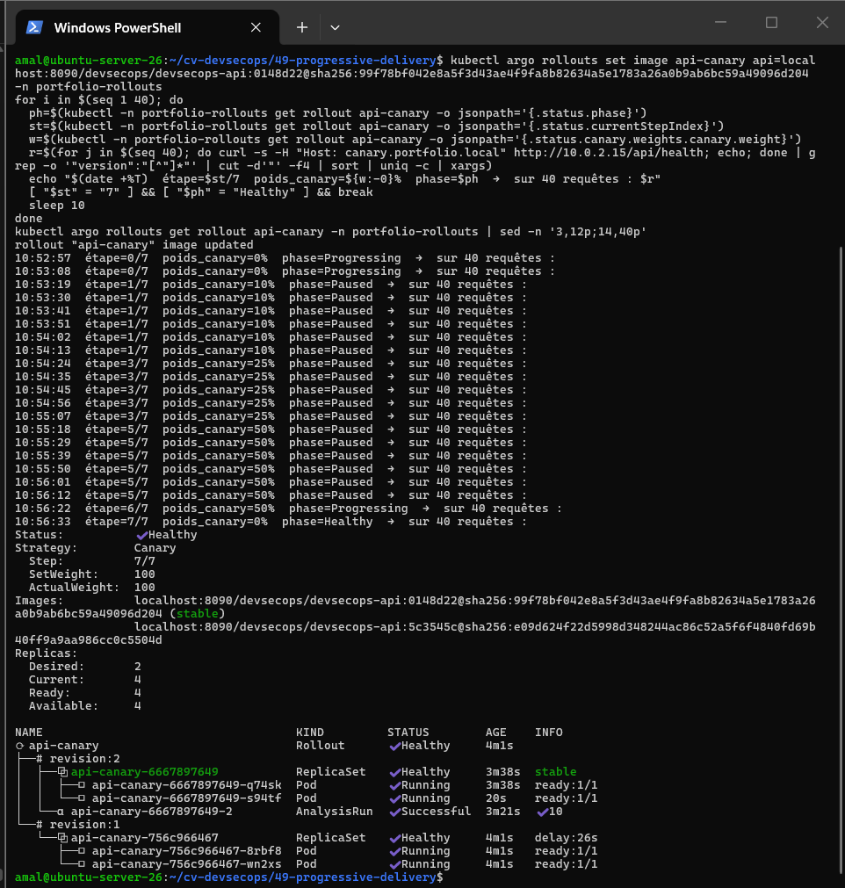

## Étape 247 – Rollback automatique piloté par Prometheus

**Scénario :** une « v3 » démarre normalement, mais `POST /api/contact` renvoie **500**. Sa `DATABASE_URL` pointe vers une base inexistante, et la migration Prisma du démarrage est sautée (`command: node …`), sinon le pod ne démarrerait même pas. La limite anti-spam de la route est relevée sur la v3 (`CONTACT_RATE_LIMIT`), pour obtenir des 500 et non des 429.

```text
11:10:41  étape=1/7  poids_canary=10%  phase=Paused   →  codes POST /api/contact : 36 429 4 500
...
11:11:36  étape=1/7  poids_canary=0%   phase=Paused   →  codes POST /api/contact : 30 429 10 500
11:11:42  étape=0/7  poids_canary=0%   phase=Degraded →  codes POST /api/contact : 40 429
Message: RolloutAborted: Rollout aborted update to revision 4: Background analysis phase error/failed:
         Metric "taux-erreurs-5xx" assessed Failed due to failed (2) > failureLimit (1)
│  └──α api-canary-67768ddbbc-4         AnalysisRun  ✖ Failed      67s  ✔ 2,✖ 2
├──# revision:2 … ReplicaSet ✔ Healthy  stable
```

1. À 10 %, environ 4 requêtes sur 40 tombent sur la v3 et renvoient 500 (les 429 viennent de la limite anti-spam des pods stables : c'est normal).
2. Prometheus mesure deux fois plus de 5 % d'erreurs sur le service canary.
3. Argo **remet le poids à 0 %**, sans intervention humaine, environ 1 minute après le début, et le Rollout passe en `Degraded`.
4. 100 % du trafic retourne sur la version stable : plus aucune erreur 500.

Sortie complète : [`preuves/247-rollback-automatique.txt`](preuves/247-rollback-automatique.txt).

**Première protection observée, avant même Prometheus :** une v3 qui **plante au démarrage** (base introuvable pendant la migration) n'est jamais `Ready`. Argo ne lui envoie donc **aucun trafic** (`ActualWeight: 0`, 40 réponses 200 sur 40 pendant 3 minutes).

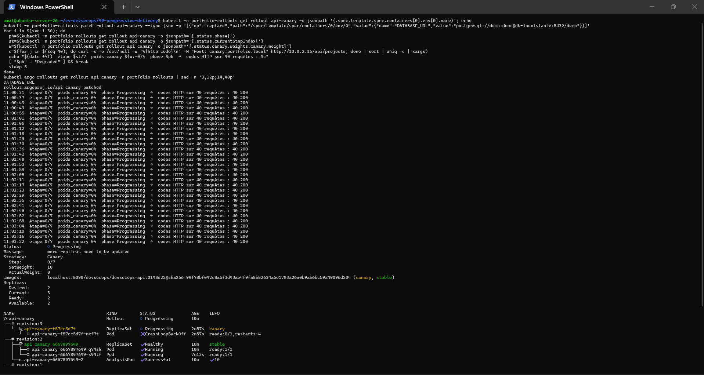

Après la démonstration, le Rollout est remis dans son état sain : vraie `DATABASE_URL` (référence au secret), commande d'origine. Les 10 messages de test `canary@example.test` sont supprimés de la base DEV.

## Étape 248 – Feature flag OpenFeature : déploiement technique ≠ activation fonctionnelle

| | **Déploiement technique** | **Activation fonctionnelle** |
| :--- | :--- | :--- |
| Question | le **code** est-il en production ? | les **utilisateurs** voient-ils la fonctionnalité ? |
| Qui décide | pipeline Jenkins + Argo CD | un flag dans flagd |
| Comment | nouvelle image, nouveaux pods | changer `off` en `on` dans une ConfigMap |
| Durée | 16 min (build #104 : scans, signature, DEV, ZAP, staging, k6, prod) | ≈ 50 s, **sans redémarrer de pod** |
| Retour arrière | rollback (nouveaux pods) | *kill switch* : remettre `off` |

**Dans le code** ([`flags.js`](../api/src/lib/flags.js), [`nouveautes.js`](../api/src/routes/nouveautes.js)) :

- **OpenFeature** est l'API **standard** des feature flags. Le code appelle `flags.getBooleanValue("api-nouveautes", false, contexte)` sans savoir quel outil répond ;
- le **fournisseur** est **flagd**, interrogé en HTTP avec le protocole **OFREP**. On peut le remplacer (LaunchDarkly, Unleash, etc.) sans toucher à la route ;
- **sûr par défaut :** sans la variable `OFREP_ENDPOINT` (tests, DEV, STAGING, PROD), aucun fournisseur n'est défini, donc la valeur par défaut `false` s'applique et la route répond **404 « Fonctionnalité non activée »** ;
- le **contexte** contient le groupe de l'utilisateur. En production, il viendrait d'un **jeton vérifié** (Keycloak, partie 50), pas d'un en-tête libre comme `x-groupe` dans cette démonstration.

**Le flag** ([`03-flagd.yaml`](k8s/03-flagd.yaml)) : `defaultVariant: "off"`, avec une règle de ciblage qui l'active pour `groupe == "beta"`.

```bash
curl -X POST http://127.0.0.1:8016/ofrep/v1/evaluate/flags/api-nouveautes -d '{"context":{"groupe":"public"}}'
# {"value":false,"variant":"off","reason":"DEFAULT"}
curl -X POST http://127.0.0.1:8016/ofrep/v1/evaluate/flags/api-nouveautes -d '{"context":{"groupe":"beta"}}'
# {"value":true,"variant":"on","reason":"TARGETING_MATCH"}
```

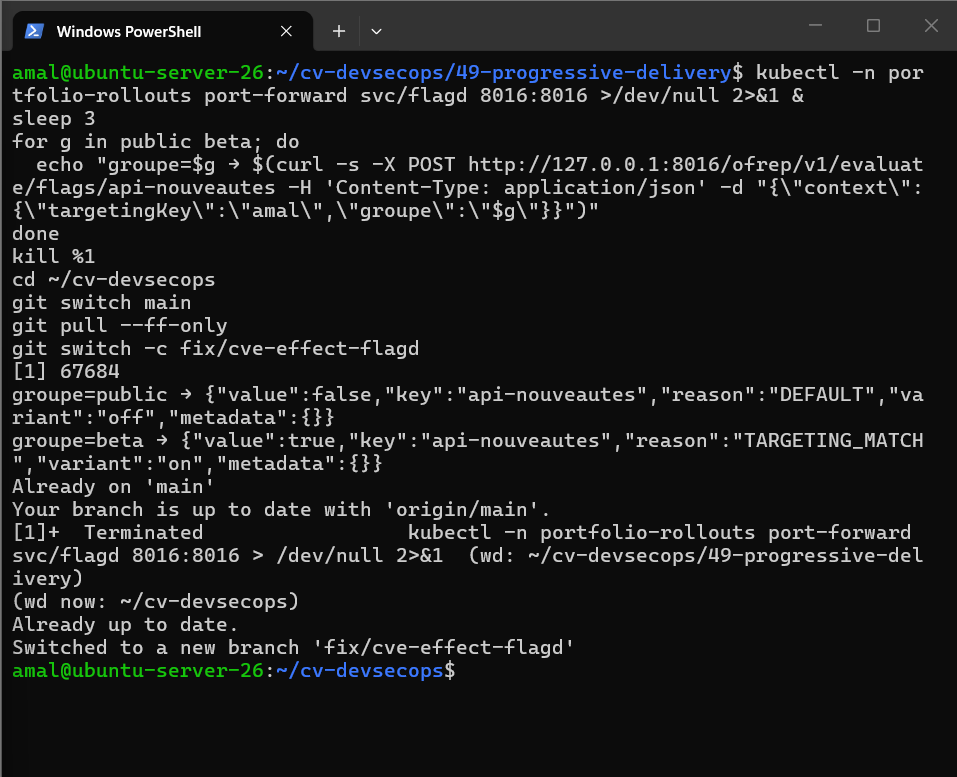

### 1. Déploiement technique : le code est en production, mais éteint

La PR [#42](https://github.com/Amal356/cv-devsecops/pull/42) ajoute la route et le client OpenFeature. Le premier build (#103) est **bloqué par Dependency-Check** : la bibliothèque `effect` (dépendance interne de Prisma) a une faille **CVSS 10** ([GHSA-7589-6fvf-x4pw](https://github.com/advisories/GHSA-7589-6fvf-x4pw)) publiée entre-temps. La PR [#45](https://github.com/Amal356/cv-devsecops/pull/45) force la version corrigée (`overrides: { "effect": "3.22.5" }`), et le build **#104** passe toutes les étapes jusqu'en prod.

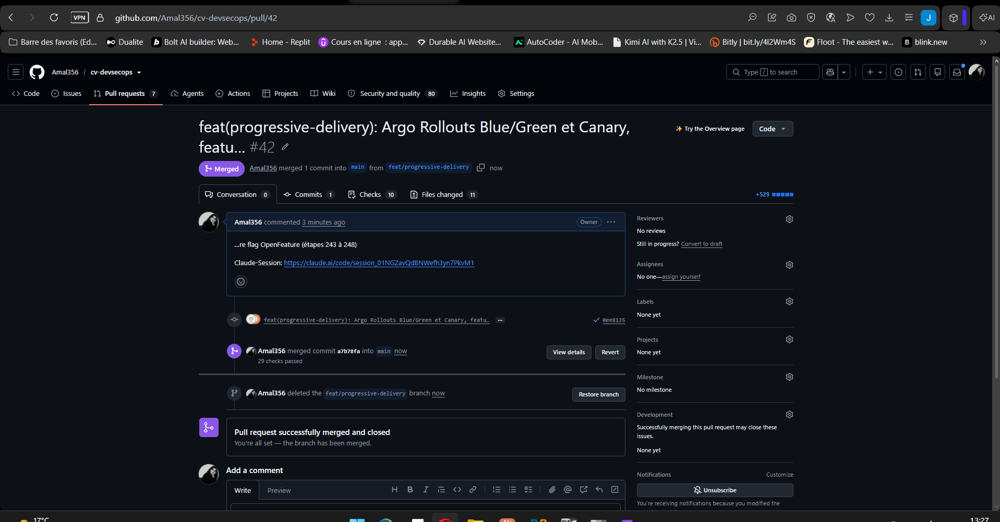

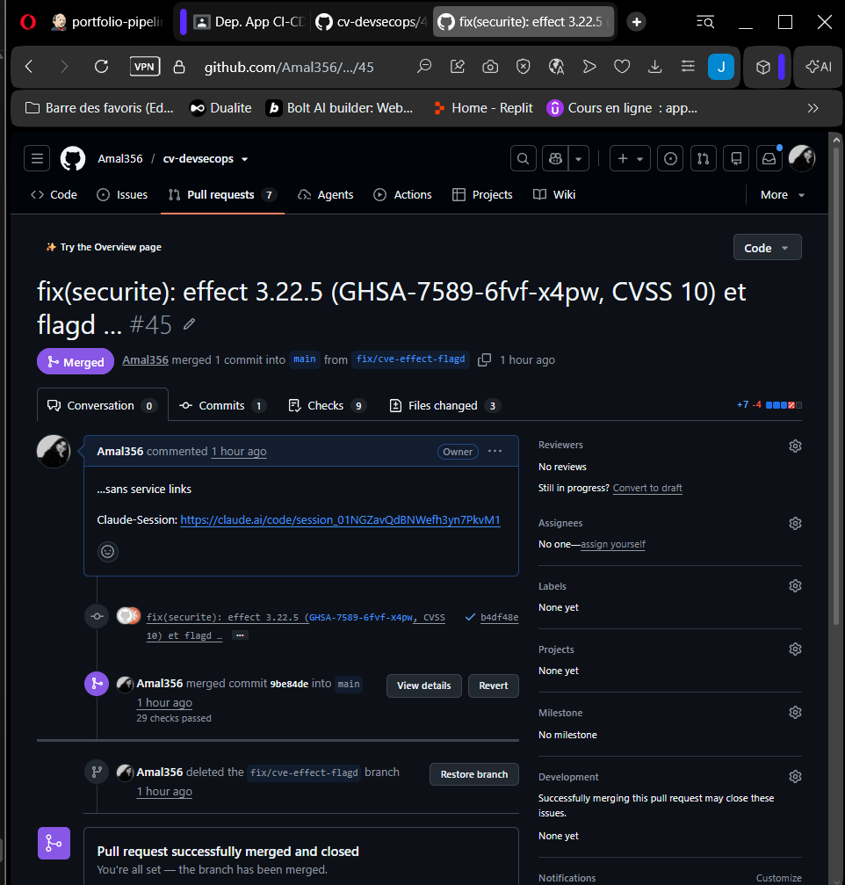

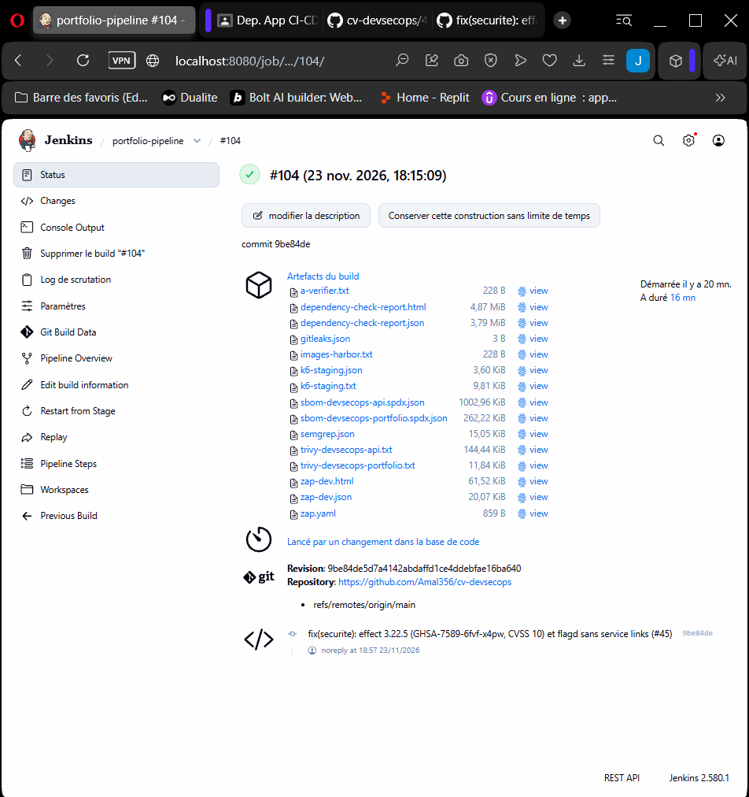

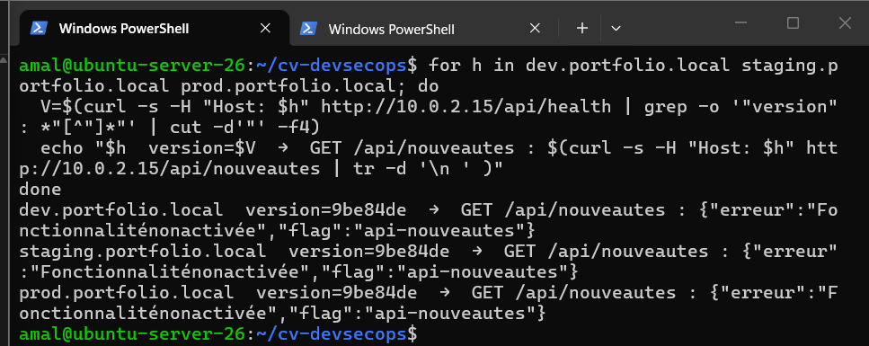

### 2. Activation pour le groupe beta seulement

L'API de `portfolio-rollouts` reçoit l'image de prod (`9be84de@sha256:ea4274ec…`) et `OFREP_ENDPOINT=http://flagd.portfolio-rollouts.svc:8016`. Ce changement passe lui aussi par le canary, avec l'analyse Prometheus (AnalysisRun `Successful`).

```text
--- groupe public (10 requêtes)  10 "erreur": "Fonctionnalité non activée"
--- groupe beta   (10 requêtes)  10 réponses avec la liste des nouveautés
```

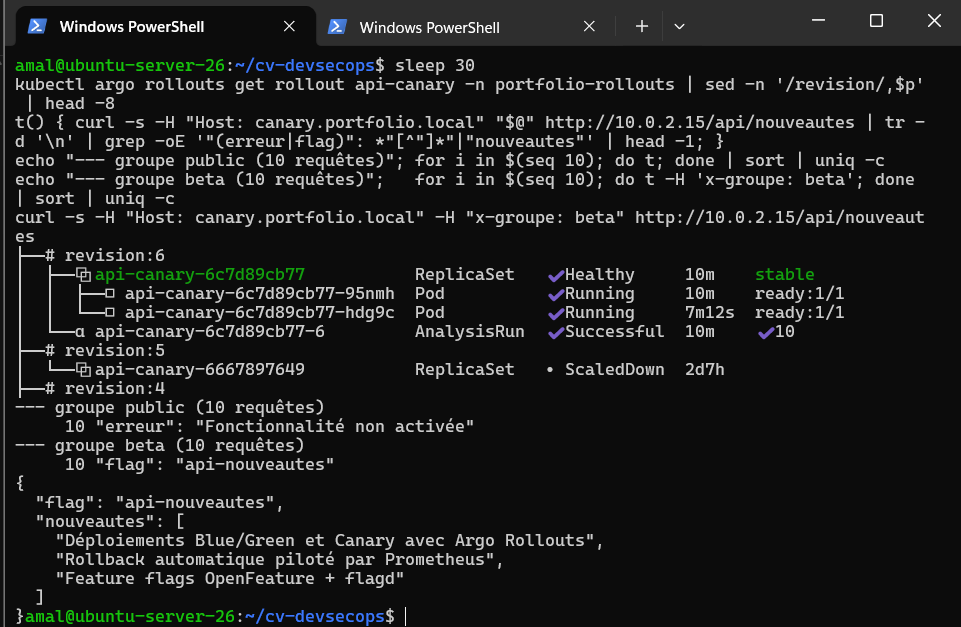

### 3. Activation pour tout le monde, sans redéploiement

```bash
kubectl -n portfolio-rollouts get cm flags -o yaml \
  | sed 's/"defaultVariant": "off"/"defaultVariant": "on"/' | kubectl apply -f -
```

- 18:54:42 : la ConfigMap est modifiée ;
- 18:55:27 : flagd détecte le nouveau fichier (`filepath event: /etc/flagd/flags.json`) ;
- **18:55:32** : le public reçoit **200**.

Les pods de l'API sont les **mêmes** avant et après : mêmes noms, même heure de démarrage, 0 redémarrage. Le délai d'environ 50 s est celui de la synchronisation des ConfigMaps par le kubelet.

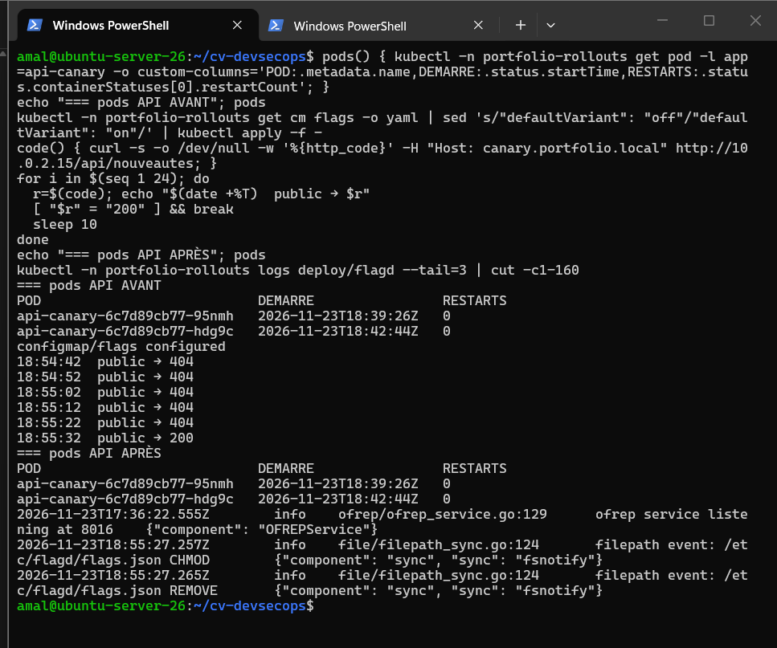

### 4. Kill switch

On remet `"defaultVariant": "off"` : le public reçoit de nouveau **404** environ 80 s plus tard. Toujours **aucun pod redémarré**, ni l'API, ni flagd.

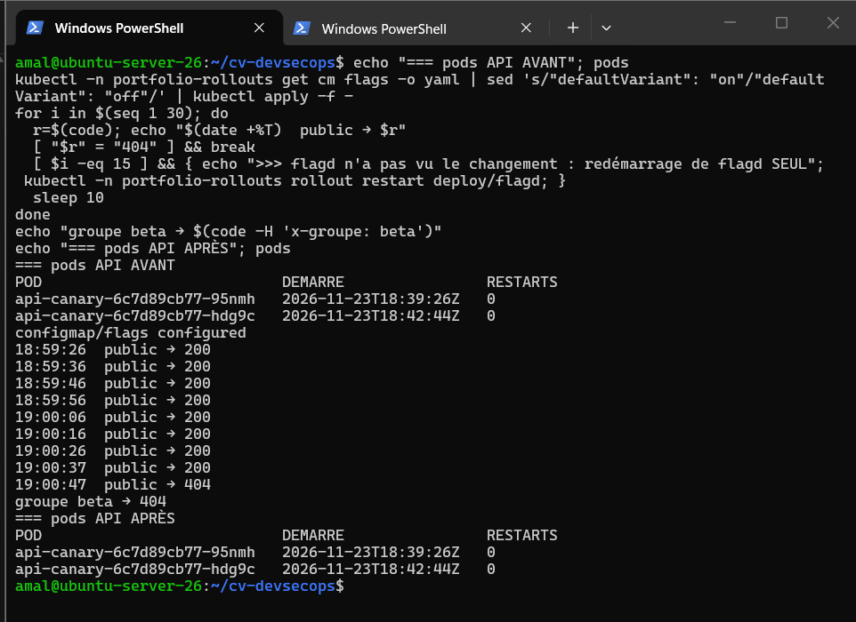

> Dans la capture, la ligne `groupe beta → 404` vient de la fonction `code()` du test : elle n'envoie pas l'en-tête `x-groupe`. C'est donc une requête « public ». La règle beta reste active.

## Problèmes rencontrés

| Problème | Cause | Solution |
| :--- | :--- | :--- |
| CRD Argo Rollouts : `Too long: may not be more than 262144 bytes` | `kubectl apply` client-side stocke tout le manifeste dans une annotation | `kubectl apply --server-side --force-conflicts` |
| Pods `CreateContainerConfigError` : `image has non-numeric user (node)` | `runAsNonRoot: true` ne peut pas vérifier un utilisateur donné par son **nom** | `runAsUser: 1000` et `runAsGroup: 1000` (UID de `node`) |
| Colonne « sur 40 requêtes » vide pendant le canary | `/api/health` renvoie `"version": "…"` **avec un espace** ; le `grep` ne le prévoyait pas | `grep -o '"version": *"…"'` ; les poids d'Argo restaient la preuve |
| 1ʳᵉ v3 cassée : `CrashLoopBackOff` au lieu d'erreurs 500 | le conteneur lance `prisma migrate deploy` avant l'API ; et `/api/projects` ne lit pas la base (données statiques) | v3 lancée avec `node` directement, test sur `POST /api/contact` (seule route qui écrit en base) |
| Build #103 bloqué par Dependency-Check | `effect 3.21.0` (via `@prisma/config`) : GHSA-7589-6fvf-x4pw, **CVSS 10** | `overrides` npm vers `effect 3.22.5` (PR #45). Le pipeline a joué son rôle de garde-fou |
| flagd `CrashLoopBackOff` : `invalid port value for 'port': "tcp://10.43.…:8016"` | Kubernetes injecte `FLAGD_PORT` (*service links*, service nommé `flagd`), que flagd lit comme **son** port | `enableServiceLinks: false` dans le pod |
| Après un arrêt brutal de la VM : PostgreSQL bloqué en `recovery mode`, toutes les API en `CrashLoopBackOff`, site en 503 | à la fin de sa récupération, PostgreSQL n'a pas pu signaler le checkpointer (`could not signal for checkpoint: Permission denied`) et est resté bloqué | redémarrage du pod PostgreSQL (données sur volume persistant, aucune perte), puis des pods API. **Leçon :** `sudo systemctl stop k3s` avant d'éteindre la VM. CloudNativePG (partie 48) apporte répliques et sauvegardes |
| 1ʳᵉ requête après le canary : `Route introuvable` | les anciens pods restent quelques secondes après la fin du canary (`scaleDownDelay`) | attendre 30 s et afficher le **message**, pas seulement le code HTTP |

## Comparaison Blue/Green, Canary et feature flag

| Critère | Blue/Green | Canary | Feature flag |
| :--- | :--- | :--- | :--- |
| Ressources | ×2 pendant la bascule | +1 pod canary | aucune en plus (flagd est léger) |
| Exposition au risque | 0 % puis 100 % | 10 % → 100 %, mesurée | ciblée (groupe beta), puis tout le monde |
| Décision | humaine (`promote`) | automatique (Prometheus) | humaine, ou automatisable |
| Retour arrière | immédiat | automatique, ≈ 1 min | quelques secondes, sans redéploiement |
| Idéal pour | grosse migration, tests avant bascule | changement de code ou d'infrastructure | nouvelle fonctionnalité métier |

Ces trois techniques se **combinent** : à l'étape 248, le branchement de l'API sur flagd est lui-même passé par un **canary surveillé par Prometheus**, puis la fonctionnalité a été activée par le **flag**.
