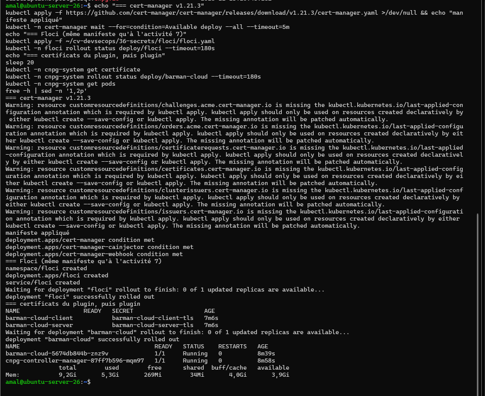
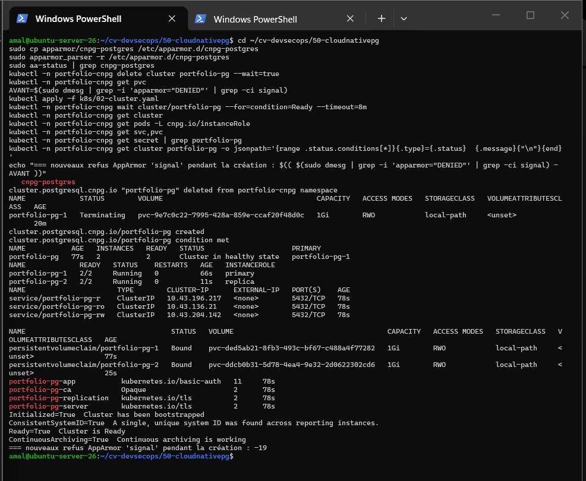
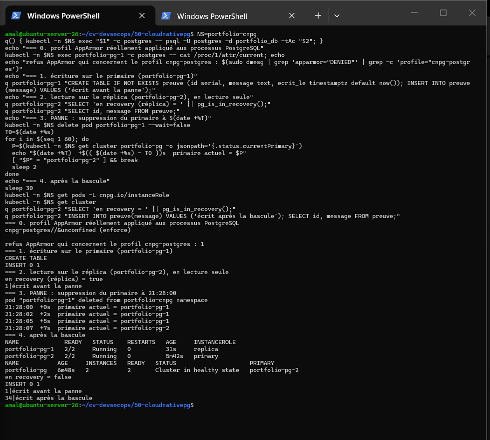
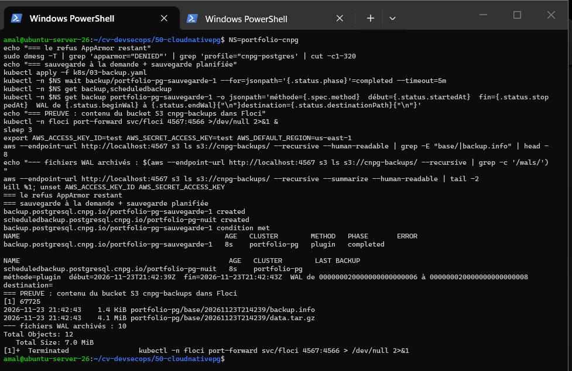
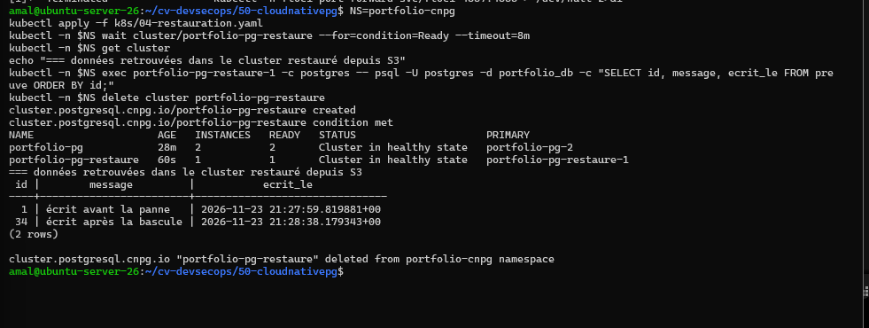

# Activité 9 – Partie 48 : PostgreSQL avec l'opérateur CloudNativePG (étapes 249 à 252)

> **État :** étapes 249 à 252 terminées. Cluster PostgreSQL à 2 instances géré par CloudNativePG 1.30.2, bascule automatique en 7 secondes, sauvegarde complète et archivage continu des WAL dans un bucket S3 (Floci), restauration vérifiée.

| Fichier | Contenu |
| :--- | :--- |
| [`k8s/00-namespace.yaml`](k8s/00-namespace.yaml) | namespace `portfolio-cnpg` (Pod Security `baseline` appliqué, `restricted` en avertissement) |
| [`k8s/01-objectstore.yaml`](k8s/01-objectstore.yaml) | `ObjectStore` : où envoyer les sauvegardes (bucket `cnpg-backups` de Floci) |
| [`k8s/02-cluster.yaml`](k8s/02-cluster.yaml) | `Cluster` : 2 instances, base `portfolio_db`, archivage continu, profil AppArmor |
| [`k8s/03-backup.yaml`](k8s/03-backup.yaml) | sauvegarde à la demande et sauvegarde planifiée chaque nuit |
| [`k8s/04-restauration.yaml`](k8s/04-restauration.yaml) | nouveau cluster restauré **uniquement** depuis S3 |
| [`apparmor/cnpg-postgres`](apparmor/cnpg-postgres) | profil AppArmor qui autorise les signaux internes de PostgreSQL (voir « Problèmes rencontrés ») |

## Pourquoi un opérateur ?

Jusqu'ici, PostgreSQL tourne dans un simple `Deployment` avec **1 pod**. Le 23 novembre, après un arrêt brutal de la VM, ce pod est resté bloqué en `recovery mode` : toutes les API ont planté et le site a renvoyé **503 pendant plus de 20 minutes**, jusqu'à une réparation à la main.

Un **opérateur** est un programme qui tourne dans Kubernetes et qui applique le savoir-faire d'un administrateur de bases de données. On décrit **ce qu'on veut** dans un objet `Cluster` (20 lignes) ; l'opérateur crée et surveille tout le reste.

```text
                     opérateur CloudNativePG (cnpg-system) ─── plugin Barman Cloud ───┐
                         │ crée, surveille, bascule                                   │
        ┌────────────────┴───────────────────┐                                        │
  portfolio-pg-1 (primaire)  ── réplication ──►  portfolio-pg-2 (réplica)              │
        │  Service portfolio-pg-rw (écritures)      Service portfolio-pg-ro (lectures) │
        └──── WAL archivés en continu + sauvegardes complètes ─────────────────────────┴──► S3 Floci : cnpg-backups
```

## Comparaison avec le Deployment classique

| Critère | `Deployment` PostgreSQL (DEV/STAGING/PROD) | `Cluster` CloudNativePG |
| :--- | :--- | :--- |
| Instances | 1 pod | 1 **primaire** + 1 **réplica** synchronisé en continu |
| Panne du pod | site indisponible, réparation **manuelle** (> 20 min le 23/11) | le réplica devient primaire **tout seul en 7 s** (étape 251) |
| Retour de l'ancienne instance | — | recréée et réintégrée **comme réplica** |
| Sauvegarde | aucune | complète (`Backup`, `ScheduledBackup`) + **WAL archivés en continu** dans S3 |
| Restauration | impossible | nouveau cluster depuis S3, à n'importe quel instant (PITR) |
| Services | 1 Service | `-rw` (primaire), `-ro` (réplicas), `-r` (toutes les instances) : mis à jour à chaque bascule |
| Mots de passe | Secret créé à la main | Secrets `portfolio-pg-app`, `-ca`, `-server`, `-replication` **générés** par l'opérateur ; TLS activé |
| Manifeste | Deployment + Service + PVC + Secret | **un** objet `Cluster` |
| Prix à payer | simple, peu de mémoire | opérateur + plugin + cert-manager à maintenir ; 2 fois plus de mémoire pour la base |

## Étape 249 – Installation de l'opérateur et du plugin

```bash
kubectl apply --server-side -f https://raw.githubusercontent.com/cloudnative-pg/cloudnative-pg/release-1.30/releases/cnpg-1.30.2.yaml
kubectl apply -f https://github.com/cert-manager/cert-manager/releases/download/v1.21.3/cert-manager.yaml
kubectl apply -f https://github.com/cloudnative-pg/plugin-barman-cloud/releases/download/v0.16.0/manifest.yaml
kubectl apply -f ../36-secrets/floci/floci.yaml        # Floci : l'« Amazon S3 » du labo (activité 7)
```

- **CloudNativePG 1.30.2** : l'opérateur et ses CRD (`Cluster`, `Backup`, `ScheduledBackup`, `Pooler`…) ;
- **plugin Barman Cloud 0.16.0** : la méthode de sauvegarde recommandée. L'intégration native (`spec.backup.barmanObjectStore`) est **dépréciée depuis CloudNativePG 1.26** et doit être retirée dans une prochaine version ;
- **cert-manager** : l'opérateur et le plugin dialoguent en gRPC avec **TLS mutuel**. Le plugin demande ses certificats à cert-manager.



## Étape 250 – Déploiement d'un cluster PostgreSQL

```bash
aws --endpoint-url http://localhost:4567 s3 mb s3://cnpg-backups          # bucket dans Floci (port-forward)
kubectl -n portfolio-cnpg create secret generic floci-s3 \
  --from-literal=ACCESS_KEY_ID=… --from-literal=ACCESS_SECRET_KEY=…        # créé à la main, jamais dans Git
kubectl apply -f k8s/00-namespace.yaml -f k8s/01-objectstore.yaml -f k8s/02-cluster.yaml
kubectl -n portfolio-cnpg wait cluster/portfolio-pg --for=condition=Ready --timeout=8m
```

Résultat en 77 secondes, sans avoir écrit un seul pod, volume ou Service :

- `Cluster in healthy state`, 2 instances prêtes ;
- `portfolio-pg-1` en **primary** et `portfolio-pg-2` en **replica**, chacun avec 2 conteneurs : PostgreSQL 18 et le sidecar du plugin Barman ;
- Services `portfolio-pg-rw`, `-ro` et `-r` ; 2 volumes de 1 Gio ; 4 Secrets générés ;
- condition **`ContinuousArchiving=True`** : le journal WAL part déjà vers S3.



## Étape 251 – Bascule automatique (comparaison avec le Deployment)

1. Une ligne est écrite sur le primaire. Elle est **déjà présente** sur le réplica, qui est en lecture seule (`pg_is_in_recovery() = true`).
2. **Panne simulée :** suppression du pod primaire à 21:28:00.
3. À **21:28:07** (+7 s), l'opérateur a promu `portfolio-pg-2` en primaire et redirigé le Service `-rw`.
4. 30 s plus tard, `portfolio-pg-1` est recréé et réintégré **comme réplica** ; le cluster est de nouveau `healthy`.
5. Aucune donnée perdue, et les écritures fonctionnent sur le nouveau primaire.

L'identifiant `34` de la 2ᵉ ligne n'est pas une erreur : PostgreSQL journalise les séquences par lots de 32. Après une bascule, le nouveau primaire repart après le lot réservé, pour ne jamais réutiliser un numéro.



## Étape 252 – Sauvegarde dans le bucket S3 de Floci, et restauration

```bash
kubectl apply -f k8s/03-backup.yaml     # Backup à la demande + ScheduledBackup chaque nuit à 2 h
aws --endpoint-url http://localhost:4567 s3 ls s3://cnpg-backups/ --recursive --summarize --human-readable
```

| Preuve | Valeur |
| :--- | :--- |
| `Backup portfolio-pg-sauvegarde-1` | méthode `plugin`, phase **`completed`**, en 4 s (21:42:39 → 21:42:43) |
| `ScheduledBackup portfolio-pg-nuit` | `0 0 2 * * *` (format cron à 6 champs, secondes en premier) |
| Sauvegarde complète | `portfolio-pg/base/20261123T214239/data.tar.gz` (4,1 Mio) + `backup.info` |
| Journal WAL archivé | 10 fichiers (compressés en gzip) |
| Total dans le bucket | 12 objets, 7,0 Mio |



Deux mécanismes se complètent :

- la **sauvegarde complète** est une copie de tous les fichiers de la base, à un instant donné ;
- les **WAL archivés en continu** contiennent chaque modification faite depuis.

Ensemble, ils permettent de restaurer la base à **n'importe quelle seconde passée** (*Point-In-Time Recovery*).

**Une sauvegarde n'a de valeur que si on sait la restaurer.** [`04-restauration.yaml`](k8s/04-restauration.yaml) crée un nouveau cluster `portfolio-pg-restaure` à partir du bucket **seulement** (`bootstrap.recovery`). Il ne contacte jamais le cluster d'origine : c'est le scénario « la base a été détruite ».

- Résultat : prêt en 60 s, avec **les 2 lignes**.
- La ligne `écrit après la bascule` a été écrite **après** la sauvegarde complète, et sur le **nouveau** primaire. Elle vient donc des WAL archivés en continu. Ça prouve que l'archivage a **suivi la bascule** de l'étape 251.
- Le cluster de test est ensuite supprimé.



## Problèmes rencontrés

| Problème | Cause | Solution |
| :--- | :--- | :--- |
| Plugin `barman-cloud` bloqué en `ContainerCreating` | cert-manager n'était plus installé : les `Certificate` du plugin n'étaient jamais signés, et son Secret TLS n'existait pas | réinstallation de cert-manager v1.21.3 ; le pod a démarré tout seul dès la création des certificats |
| Floci absent | retiré après l'activité 7 | réapplication de [`36-secrets/floci/floci.yaml`](../36-secrets/floci/floci.yaml) |
| Job `initdb` en `Error` à chaque essai : `pg_ctl: could not send stop signal (PID: 33): Permission denied` | **AppArmor.** Sur cette VM (Ubuntu 26.04, noyau 7.0, AppArmor 5.0.2, containerd 2.2.7), les processus des conteneurs portent le label empilé `cri-containerd.apparmor.d//&unconfined`. Le profil par défaut de containerd n'autorise les signaux qu'envers `cri-containerd.apparmor.d` exactement : les signaux **internes** de PostgreSQL (SIGURG, arrêt par `pg_ctl`, signal au checkpointer) sont refusés. `dmesg` en montrait 339 : `apparmor="DENIED" operation="signal" … comm="postgres" signal=urg peer="cri-containerd.apparmor.d//&unconfined"` | profil [`cnpg-postgres`](apparmor/cnpg-postgres), chargé avec `apparmor_parser`. Il reprend les règles du profil par défaut des conteneurs et n'**autorise que les signaux**. Il est appliqué par `podSecurityContext.appArmorProfile: Localhost`. C'est plus sûr que `Unconfined`, que le niveau `baseline` refuserait d'ailleurs |
| `podSecurityContext` remplace les défauts de l'opérateur | le champ **remplace** au lieu de s'ajouter | réglages de l'opérateur recopiés : UID/GID 26, `runAsNonRoot`, `fsGroup`, `seccompProfile: RuntimeDefault` |
| Compteur de refus AppArmor négatif (`-19`) | `dmesg` est une mémoire circulaire : les anciennes lignes s'effacent | preuve directe à la place : `/proc/1/attr/current` affiche `cnpg-postgres//&unconfined (enforce)`, et le cluster démarre |
| `destination=` vide dans le `Backup` | avec le plugin, la destination est décrite dans l'`ObjectStore` | preuve par le contenu du bucket |

**La même cause AppArmor explique la panne du 23/11** sur les `Deployment` PostgreSQL de DEV, STAGING et PROD (`could not signal for checkpoint: Permission denied`). **Corrigé le 24/11** (partie 49) : le profil `cnpg-postgres` est ajouté à [`base/postgres.yaml`](https://github.com/Amal356/devsecops-portfolio-gitops/pull/1) du dépôt GitOps, et Argo CD l'a appliqué aux 3 environnements.

## Limites de cette démonstration

- **Floci** est un émulateur de laboratoire, sans volume persistant dans ce manifeste : un redémarrage de son pod efface le bucket. En production, on utiliserait un vrai stockage objet (S3, ou MinIO avec volume), avec chiffrement et versionnement du bucket.
- Les identifiants S3 sont créés à la main dans un Secret. En production, on utiliserait un rôle IAM, une *Workload Identity* (partie 52) ou External Secrets (activité 7).
- Le profil AppArmor doit être chargé sur **chaque nœud** : avec plusieurs nœuds, on le déploie avec un DaemonSet ou avec Ansible.
- Les deux instances sont sur le **même nœud**, la seule machine de la VM. La bascule protège contre la panne d'un pod, pas contre celle de la machine.
