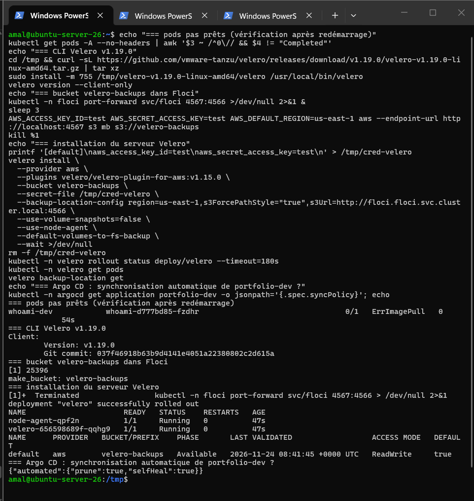
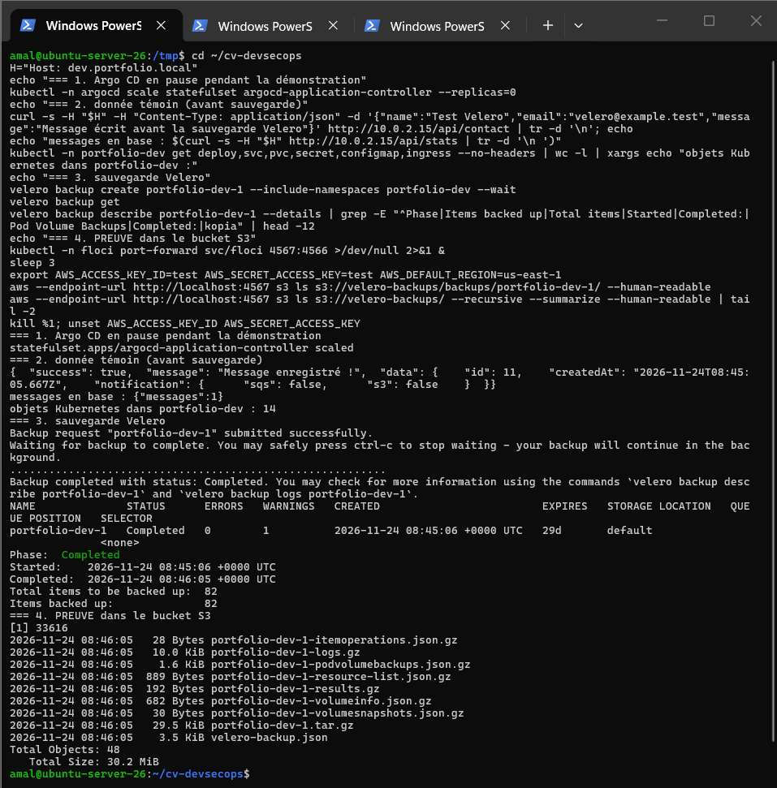
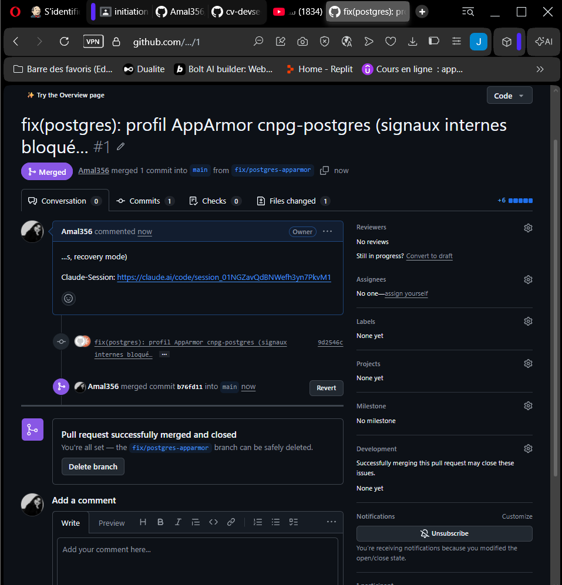

# Activité 9 – Partie 49 : sauvegarde et restauration d'un namespace avec Velero (étapes 253 à 255)

> **État :** étapes 253 à 255 terminées. Velero 1.19 sauvegarde le namespace `portfolio-dev` (objets Kubernetes **et** données du volume PostgreSQL) dans le bucket S3 de Floci. Le namespace est supprimé, puis restauré, et la donnée témoin est retrouvée. En chemin, la panne AppArmor de PostgreSQL a été corrigée dans le dépôt GitOps pour les 3 environnements.

| Fichier | Contenu |
| :--- | :--- |
| [`installer-velero.sh`](installer-velero.sh) | installation de la CLI et du serveur Velero ; identifiants S3 lus dans des variables, jamais écrits dans Git |
| [`preuves/255-preuves-finales.txt`](preuves/255-preuves-finales.txt) | sortie complète de la vérification finale (AppArmor, HTTP, données, Velero, Argo CD) |

## Velero et CloudNativePG : deux niveaux de sauvegarde

| | CloudNativePG (partie 48) | Velero (partie 49) |
| :--- | :--- | :--- |
| Ce qui est sauvegardé | **une base PostgreSQL** | **tout un namespace** : Deployments, Services, Secrets, ConfigMaps, Ingress, PVC… **et** les données des volumes |
| Méthode | sauvegarde PostgreSQL native + journal WAL | export des objets Kubernetes (`.tar.gz`) + copie des fichiers des volumes (Kopia) |
| Restauration | à la seconde près (PITR) | état du namespace au moment de la sauvegarde |
| Sinistre couvert | perte ou corruption de la base | suppression du namespace, erreur de manipulation, migration vers un autre cluster |

```text
 namespace portfolio-dev ──► pod velero ──► objets Kubernetes ──┐
       └─ volume postgres-data ──► node-agent (Kopia) ──────────┴──► S3 Floci : bucket velero-backups
```

## Étape 253 – Installation de Velero

```bash
aws --endpoint-url http://localhost:4567 s3 mb s3://velero-backups      # bucket dans Floci (port-forward)
S3_ACCESS_KEY=… S3_SECRET_KEY=… ./installer-velero.sh
```

Les options importantes de `velero install` :

| Option | Rôle |
| :--- | :--- |
| `--provider aws` + `s3Url=http://floci.floci.svc.cluster.local:4566` + `s3ForcePathStyle=true` | Velero parle à Floci comme à Amazon S3 |
| `--use-volume-snapshots=false` | les volumes `local-path` de K3s ne savent pas faire de snapshots de disque |
| `--use-node-agent` + `--default-volumes-to-fs-backup` | un agent sur le nœud **copie les fichiers** des volumes, avec Kopia (déduplication, chiffrement) |

Résultat : les pods `velero` et `node-agent` sont `Running`, et l'emplacement de sauvegarde `default → velero-backups` est **Available**.



## Étape 254 – Sauvegarde du namespace `portfolio-dev`

`portfolio-dev` est géré par **Argo CD** avec `automated: prune + selfHeal`. Si on supprime le namespace, Argo CD le recrée en quelques secondes **à partir de Git**, avec une base **vide**, et la démonstration ne prouverait rien sur Velero. Pendant le test, le contrôleur d'Argo CD est donc mis en pause (`kubectl -n argocd scale statefulset argocd-application-controller --replicas=0`), puis relancé à la fin.

```bash
curl -H "Host: dev.portfolio.local" -d '{"name":"Test Velero","email":"velero@example.test","message":"Message écrit avant la sauvegarde Velero"}' …/api/contact
velero backup create portfolio-dev-1 --include-namespaces portfolio-dev --wait
```

| Preuve | Valeur |
| :--- | :--- |
| Donnée témoin | message n° 11, `{"messages":1}` en base |
| Sauvegarde `portfolio-dev-1` | **Completed**, **82 éléments sur 82**, 0 erreur, en 1 minute |
| Bucket `velero-backups` | `portfolio-dev-1.tar.gz` (objets Kubernetes), `podvolumebackups.json.gz` (volume PostgreSQL), dossier Kopia : **48 objets, 30,2 Mio** |



## Étape 255 – Suppression du namespace, puis restauration

```bash
kubectl delete namespace portfolio-dev --wait=true       # le sinistre
velero restore create portfolio-dev-restauration-1 --from-backup portfolio-dev-1 --wait
```

| Moment | Résultat |
| :--- | :--- |
| 08:49:02 – suppression | `namespace "portfolio-dev" deleted`, puis `NotFound` ; site DEV **HTTP 404** |
| 08:49:53 → 08:50:35 | restauration **Completed** en 42 s, 0 erreur |
| après la restauration | volume `postgres-data` recréé et rempli par Velero (conteneur `restore-wait`), puis pods recréés |
| preuve des données | `11 \| velero@example.test \| Message écrit avant la sauvegarde Velero` ; `{"messages":1}` |
| fin | site DEV **HTTP 200** ; Argo CD relancé : `portfolio-dev` **Synced / Healthy**. Le namespace restauré est conforme à Git |

Sortie complète : [`preuves/255-preuves-finales.txt`](preuves/255-preuves-finales.txt).

### Incident pendant la restauration : PostgreSQL bloqué, et sa correction GitOps

Le volume est copié **pendant que la base tourne** : c'est une copie cohérente « comme après une coupure de courant ». Au démarrage, PostgreSQL fait donc une récupération, puis il reste bloqué en `the database system is in recovery mode`.

C'est la panne AppArmor identifiée dans la [partie 48](../50-cloudnativepg/README.md#problèmes-rencontrés) : le profil par défaut de containerd refuse les signaux internes de PostgreSQL.

- **Correction immédiate :** le checkpoint de fin de récupération était déjà écrit, donc supprimer le pod suffit. Il redémarre proprement.
- **Correction durable, dans Git et non à la main :** la PR [#1 du dépôt GitOps](https://github.com/Amal356/devsecops-portfolio-gitops/pull/1) ajoute à `base/postgres.yaml` :

  ```yaml
  appArmorProfile:
    type: Localhost
    localhostProfile: cnpg-postgres
  ```

  Argo CD l'applique aux 3 environnements. Le niveau Pod Security `restricted` autorise les profils `Localhost`.

```text
portfolio-dev : cnpg-postgres//&unconfined (enforce)
portfolio-staging : cnpg-postgres//&unconfined (enforce)
portfolio-prod : cnpg-postgres//&unconfined (enforce)
dev.portfolio.local → HTTP 200
staging.portfolio.local → HTTP 200
prod.portfolio.local → HTTP 200
messages en base (DEV) : {"messages":1}
portfolio-dev-1                Completed   0 errors
portfolio-dev-restauration-1   Completed   0 errors
portfolio-dev / portfolio-staging / portfolio-prod   Synced   Healthy
```



## Problèmes rencontrés

| Problème | Cause | Solution |
| :--- | :--- | :--- |
| Argo CD aurait recréé le namespace supprimé (base vide) | `syncPolicy.automated` avec `selfHeal` | contrôleur Argo CD mis en pause pendant la démonstration, puis relancé. Après la restauration, Argo CD voit l'application **Synced** : la restauration est conforme à Git |
| `velero backup describe` : `lookup floci.floci.svc.cluster.local … server misbehaving` | pour lire les détails, la CLI télécharge un fichier depuis S3 avec une URL signée qui pointe vers un nom DNS **interne au cluster**, que la VM ne résout pas | sans conséquence : sauvegarde et restauration sont faites par le pod Velero, dans le cluster. Sinon : `kubectl -n velero logs deploy/velero` |
| PostgreSQL bloqué en `recovery mode` après la restauration | volume copié à chaud + signaux internes refusés par AppArmor | redémarrage du pod, puis correction GitOps durable (voir ci-dessus) |
| Site DEV en 502 juste après un `rollout restart` | Traefik interroge encore l'ancien pod en arrêt | attendre la fin de l'arrêt (`200` × 5 ensuite) |

## Limites et bonnes pratiques

- **Sauvegarde cohérente de la base :** Velero copie les fichiers à chaud. Pour une base, il vaut mieux ajouter un **hook** (`pre.hook.backup.velero.io/command`, par exemple `CHECKPOINT` ou un `pg_dump`), ou laisser la base à CloudNativePG (partie 48) et Velero au reste du namespace.
- **Secrets :** la sauvegarde contient les Secrets du namespace (mot de passe PostgreSQL…). En production, il faut un bucket **chiffré**, privé, avec accès restreint et versionnement.
- **Floci** n'a pas de volume persistant : un redémarrage de son pod efface les sauvegardes. En production : vrai S3, ou MinIO avec volume, **hors du cluster sauvegardé**.
- **Planification :** `velero schedule create portfolio-dev-nuit --schedule "0 2 * * *" --include-namespaces portfolio-dev --ttl 168h` pour une sauvegarde chaque nuit, gardée 7 jours.
- **Tester les restaurations** régulièrement, comme ici : une sauvegarde jamais restaurée n'est pas une garantie.
