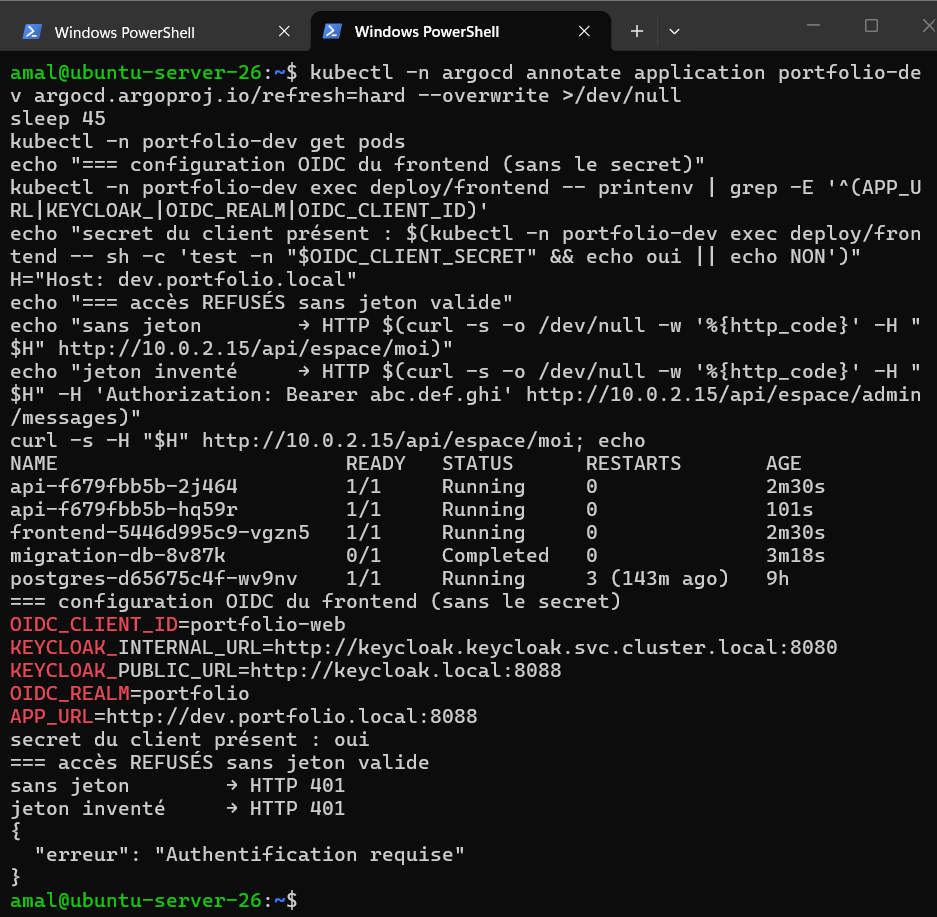
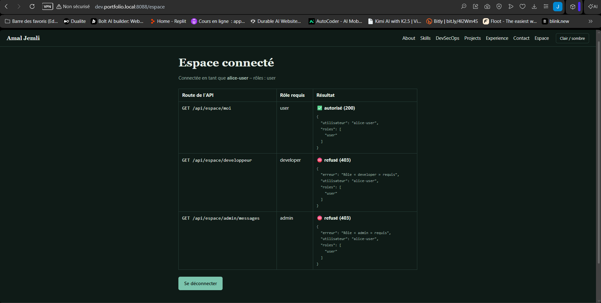
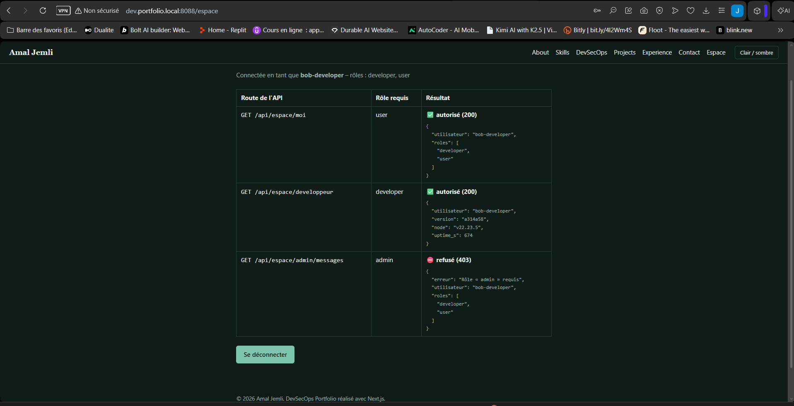
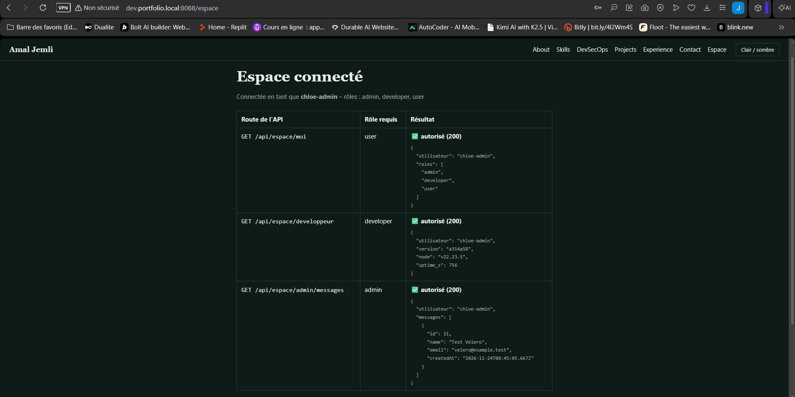

# Activité 9 – Partie 50 : identité et autorisations avec Keycloak (étapes 256 à 259)

> **État :** étapes 256 à 259 terminées. Keycloak 26.8.2 fournit l'identité (realm `portfolio`, client OIDC `portfolio-web`, rôles `user` / `developer` / `admin`). Le portfolio Next.js connecte l'utilisatrice avec le flux *authorization code* + PKCE, et l'API vérifie elle-même chaque jeton avant d'autoriser (200), de refuser l'accès (403) ou de rejeter la requête (401).

| Fichier | Contenu |
| :--- | :--- |
| [`k8s/00-namespace.yaml`](k8s/00-namespace.yaml), [`k8s/01-keycloak.yaml`](k8s/01-keycloak.yaml) | namespace `keycloak` (Pod Security `restricted`), Deployment, Service, Ingress `keycloak.local` |
| [`realm/portfolio-realm.template.json`](realm/portfolio-realm.template.json) | realm, rôles, client OIDC et utilisateurs de test, avec des **emplacements** à la place des secrets |
| [`deployer-keycloak.sh`](deployer-keycloak.sh) | génère tous les secrets (admin, client, utilisateurs), crée les Secrets Kubernetes et déploie Keycloak |
| [`../api/src/lib/auth.js`](../api/src/lib/auth.js), [`../api/src/routes/espace.js`](../api/src/routes/espace.js) | vérification des jetons et routes protégées par rôle |
| [`../api/tests/auth.test.js`](../api/tests/auth.test.js) | 7 tests : sans jeton, fausse signature, mauvais émetteur ou audience, jeton expiré, les 3 rôles |
| [`../portfolio-next/lib/oidc.js`](../portfolio-next/lib/oidc.js), [`../portfolio-next/app/auth/`](../portfolio-next/app/auth), [`../portfolio-next/app/espace/page.js`](../portfolio-next/app/espace/page.js) | connexion, retour de Keycloak, déconnexion, page « Espace » |
| dépôt GitOps : [`envs/dev/kustomization.yaml`](https://github.com/Amal356/devsecops-portfolio-gitops/pull/2) | configuration OIDC **en DEV uniquement** |

## Les notions

| Terme | Dans le projet |
| :--- | :--- |
| **Fournisseur d'identité (IdP)** | Keycloak : vérifie le mot de passe, délivre les jetons |
| **Realm** | `portfolio` : un espace isolé, avec ses utilisateurs, rôles et clients (le realm `master` sert seulement à administrer Keycloak) |
| **Client OIDC** | `portfolio-web` : l'application qui demande la connexion (le portfolio Next.js) |
| **Jeton d'accès (JWT)** | signé par Keycloak (RS256), valable 5 minutes, il contient `iss`, `aud`, `exp`, `preferred_username` et `realm_access.roles` |
| **401 / 403** | **401** : je ne sais pas **qui** tu es (pas de jeton ou jeton invalide). **403** : je sais qui tu es, mais tu n'as **pas le droit** |

```text
 Navigateur ──1. /auth/login──► Next.js ──2. redirection (state + PKCE)──► Keycloak (page de connexion)
     ▲                                                                          │ 3. code d'autorisation
     │                         Next.js ◄── /auth/callback?code=… ───────────────┘
     │                            │ 4. code + secret du client + code_verifier ──► Keycloak (canal interne)
     │                            │ 5. jetons ──► cookies httpOnly (illisibles par JavaScript)
     └──── page /espace ◄─────────┤ 6. GET /api/espace/... avec « Authorization: Bearer <jeton> »
                                  ▼
                       API Express : signature (clés publiques JWKS), iss, aud, exp, puis rôle → 200 / 403 / 401
```

## Étape 256 – Realm et client OIDC

[`deployer-keycloak.sh`](deployer-keycloak.sh) déploie Keycloak et importe le realm. **Aucun secret dans Git** : le modèle JSON contient des emplacements (`__CLIENT_SECRET__`, `__PWD_ALICE__`…), que le script remplace par des valeurs **générées** (`openssl rand`). Le résultat est rangé dans le Secret `keycloak-realm`. Le secret du client est aussi copié dans `portfolio-dev/oidc-client`, pour Next.js.

| Réglage du client `portfolio-web` | Valeur | Pourquoi |
| :--- | :--- | :--- |
| Type | **confidentiel** (`publicClient: false`) | le serveur Next.js prouve son identité avec un secret |
| Flux | *authorization code* seulement | *implicit* et *direct access grants* (mot de passe envoyé à l'application) désactivés |
| PKCE | `S256` obligatoire | un code d'autorisation intercepté est inutilisable sans le `code_verifier` |
| Redirect URI | `http://dev.portfolio.local:8088/auth/callback` exactement | Keycloak n'envoie jamais un code vers une autre adresse |
| Audience | mapper `portfolio-api` | l'API refuse les jetons destinés à une autre application |
| Durée du jeton | 5 minutes | un jeton volé expire vite |

Les adresses de Keycloak :

- **`KC_HOSTNAME=http://keycloak.local:8088`** : l'adresse du **navigateur**. Elle devient l'émetteur `iss` de tous les jetons.
- **`KC_HOSTNAME_BACKCHANNEL_DYNAMIC=true`** : les serveurs du cluster (Next.js, API) joignent Keycloak par son Service interne (`keycloak.keycloak.svc:8080`), mais les jetons gardent le même émetteur.

## Étape 257 – Rôles user / developer / admin

| Utilisateur (`@example.test`) | Rôles du realm |
| :--- | :--- |
| `alice-user` | `user` |
| `bob-developer` | `user`, `developer` |
| `chloe-admin` | `user`, `developer`, `admin` |

Les rôles sont des **rôles de realm**. Keycloak les met dans le jeton d'accès (`realm_access.roles`), et l'API les lit après avoir vérifié la signature.

## Étape 258 – Authentification OIDC dans le portfolio

Toute la connexion se fait **côté serveur** Next.js (`app/auth/login`, `app/auth/callback`, `app/auth/logout`) :

- `/auth/login` génère `state` (anti-CSRF) et `code_verifier` (PKCE), les garde dans un cookie `httpOnly` limité à `/auth` (10 minutes), puis redirige vers Keycloak ;
- `/auth/callback` vérifie `state` et échange le code contre les jetons sur le **canal interne**, avec le secret du client et le `code_verifier`. Les jetons sont ensuite rangés dans des cookies **`httpOnly`** et `SameSite=Lax` : aucun script de la page ne peut les lire ;
- `/auth/logout` supprime les cookies **et** ferme la session Keycloak (*single logout*) ;
- **sûr par défaut :** sans configuration OIDC (STAGING, PROD, tests), la page Espace l'indique et l'API répond **503** sur les routes protégées. Seul DEV est configuré, par le dépôt GitOps.





## Étape 259 – Route API protégée : accès autorisés et refusés

[`auth.js`](../api/src/lib/auth.js) vérifie chaque jeton avec la bibliothèque `jose` : signature RS256 avec les **clés publiques** du realm (JWKS, téléchargées et mises en cache), émetteur exact, audience `portfolio-api`, et expiration. Le middleware `exigerRole(role)` répond ensuite 401, 403 ou laisse passer.

| Route | Rôle requis | sans jeton | alice-user | bob-developer | chloe-admin |
| :--- | :--- | :---: | :---: | :---: | :---: |
| `GET /api/espace/moi` | user | 401 | ✅ 200 | ✅ 200 | ✅ 200 |
| `GET /api/espace/developpeur` | developer | 401 | ⛔ 403 | ✅ 200 | ✅ 200 |
| `GET /api/espace/admin/messages` | admin | 401 | ⛔ 403 | ⛔ 403 | ✅ 200 |





Ces cas sont aussi couverts par les tests automatiques ([`auth.test.js`](../api/tests/auth.test.js)), lancés par Jenkins et GitHub Actions à chaque commit : faux « Keycloak » local, jetons signés par une autre clé, avec un mauvais `iss` ou `aud`, ou expirés.

## Problèmes rencontrés

| Problème | Cause | Solution |
| :--- | :--- | :--- |
| `Add-Content … hosts : accès refusé` | le fichier `hosts` de Windows n'est modifiable qu'en administrateur | PowerShell **administrateur** |
| Pods Keycloak bloqués en `ContainerCreating` plus de 10 min, `exceeded its progress deadline` | image de 265 Mo téléchargée lentement depuis `quay.io` | `sudo k3s crictl pull …` pour voir la progression ; Kubernetes continue d'attendre après le délai |
| `Invalid username or password` | `admin` n'existe que dans le realm `master` ; dans le realm `portfolio`, il faut les utilisateurs de test | console d'administration avec `admin`, portfolio avec `alice-user` / `bob-developer` / `chloe-admin` |
| Builds Jenkins #105 à #107 en échec après 2 h | **Syft** (SBOM, étape 6) bloqué sur l'image du frontend, VM saturée (Keycloak qui démarre, swap à 50 %), puis délai de 2 h dépassé | pause temporaire de l'observabilité, de Prometheus et de Keycloak pendant le build (`~/reprendre-services.sh` pour relancer) : build #108 vert |
| Le patch GitOps a disparu | `/tmp` est vidé à chaque redémarrage de la VM | recopie avec `scp`, puis application du patch |
| Mots de passe affichés pendant les tests | sortie du script copiée telle quelle | tous les secrets **régénérés** à la fin (`deployer-keycloak.sh`), aucun dans Git ni dans les captures |

## Limites et passage en production

- **HTTP** : en labo, les cookies ne sont pas `Secure` et le realm a `sslRequired: none`. En production : **HTTPS** partout (cert-manager, activité 7), cookies `Secure`, `sslRequired: external`.
- **Keycloak en mode `start-dev`** avec une base H2 interne : un redémarrage réimporte le realm depuis le Secret. En production : `start` (mode production), base **PostgreSQL** (CloudNativePG, partie 48), au moins 2 réplicas.
- **Compte `admin` temporaire** (bandeau jaune de la console) : en production, on crée un administrateur nominatif avec MFA, puis on supprime le compte temporaire.
- Les jetons de 5 minutes ne sont pas renouvelés automatiquement (pas de *refresh token* dans cette démonstration) : il faut se reconnecter après expiration.
- Le cookie de jeton (≈ 1,5 Ko) suffit ici. Pour de gros jetons, on garderait une **session côté serveur**, avec seulement un identifiant de session dans le cookie.
