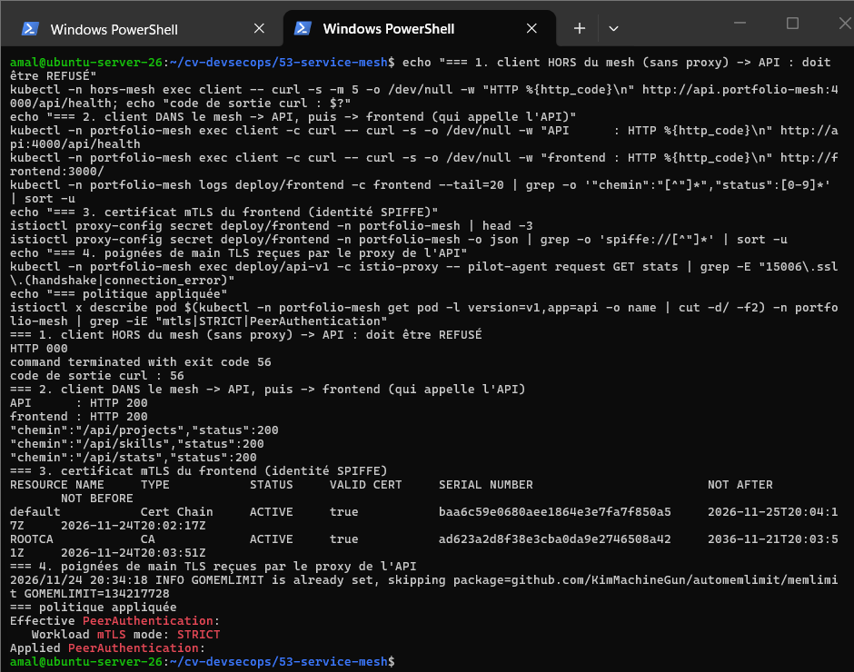
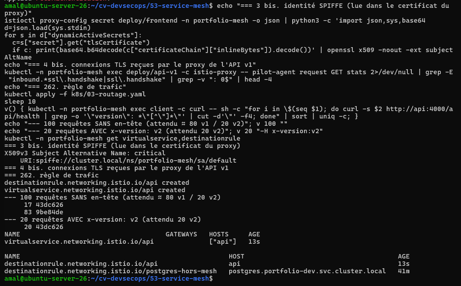

# Activité 9 – Partie 51 : service mesh avec Istio, comparé à Linkerd (étapes 260 à 263)

> **État :** étapes 260 à 263 terminées. Istio 1.31.4 (profil `minimal`) chiffre et authentifie le trafic entre le frontend et l'API (mTLS **STRICT**, sans modifier le code) et répartit le trafic entre 2 versions de l'API (80 % / 20 %, ou en-tête `x-version: v2`).

| Fichier | Contenu |
| :--- | :--- |
| [`installer-istio.sh`](installer-istio.sh) | installation d'`istioctl` et d'istiod avec des ressources réduites |
| [`preparer-namespace.sh`](preparer-namespace.sh) | namespaces, copie des secrets depuis `portfolio-dev` (jamais dans Git), injection des images v1 / v2 |
| [`k8s/00-namespaces.yaml`](k8s/00-namespaces.yaml) | `portfolio-mesh` (injection automatique du sidecar) et `hors-mesh` (témoin sans sidecar) |
| [`k8s/01-application.yaml`](k8s/01-application.yaml) | frontend, API v1 (`9be84de`) et v2 (`43dc626`) derrière **un seul** Service `api`, clients de test |
| [`k8s/02-mtls.yaml`](k8s/02-mtls.yaml) | `PeerAuthentication` STRICT (PERMISSIVE pour le seul frontend, qui reçoit Traefik) |
| [`k8s/03-routage.yaml`](k8s/03-routage.yaml) | `DestinationRule` (sous-ensembles v1 / v2) et `VirtualService` (en-tête, puis 80 / 20) |
| [`preuves/260-installation.txt`](preuves/260-installation.txt) | sortie de l'installation |

## Pourquoi un service mesh ?

Sans mesh, le frontend appelle l'API en **HTTP clair** dans le cluster : un pod compromis peut écouter le trafic ou se faire passer pour un autre service. Un mesh place un **proxy Envoy** (*sidecar*) à côté de chaque pod, et tout le trafic passe par ces proxys :

```text
 client hors mesh ──HTTP clair──► [Envoy]  ✖ refusé (STRICT)
                                    │
 frontend ─► [Envoy] ═══ mTLS (certificats SPIFFE, 24 h, renouvelés par istiod) ═══► [Envoy] ─► API v1 (80 %)
                                                                                └─► [Envoy] ─► API v2 (20 %, ou x-version: v2)
```

- **Identité :** istiod (l'autorité de certification du mesh) délivre à chaque pod un certificat contenant son identité SPIFFE (`spiffe://cluster.local/ns/<namespace>/sa/<compte de service>`), valable 24 h et renouvelé automatiquement.
- **Chiffrement + authentification mutuelle (mTLS) :** les deux proxys se présentent leurs certificats. Le code de l'application ne change pas.
- **Routage L7 :** les proxys comprennent HTTP et peuvent répartir les requêtes selon un poids, un en-tête, un chemin…

## Étape 260 – Installation d'Istio

```bash
./installer-istio.sh        # istioctl install --set profile=minimal (istiod seul, ressources réduites)
./preparer-namespace.sh     # namespace « istio-injection=enabled » : chaque pod reçoit un proxy Envoy
```

Les 4 pods de `portfolio-mesh` sont en **`2/2`** : l'application + le proxy Envoy injecté automatiquement ([preuve](preuves/260-installation.txt)).

## Étape 261 – mTLS entre frontend et backend, et vérification du chiffrement

[`02-mtls.yaml`](k8s/02-mtls.yaml) impose **STRICT** à tout le namespace : un pod n'accepte **que** du trafic chiffré, présenté avec un certificat du mesh. Seul le frontend reste en **PERMISSIVE**, parce qu'il reçoit aussi le trafic de Traefik, qui est hors mesh. PostgreSQL de DEV est hors mesh : une `DestinationRule` (`tls: DISABLE`) garde la connexion vers lui telle qu'avant.

| Preuve | Résultat |
| :--- | :--- |
| client **hors** mesh → API | **refusé** : `HTTP 000`, curl code **56** (connexion coupée par le proxy de l'API) |
| client **dans** le mesh → API | **200** |
| frontend → API (dans ses logs) | `/api/projects`, `/api/skills`, `/api/stats` → **200**, à travers le mesh |
| certificat du proxy du frontend | `Cert Chain ACTIVE`, valable 24 h, CA d'Istio valable 10 ans |
| identité dans le certificat | `URI:spiffe://cluster.local/ns/portfolio-mesh/sa/default` |
| politique effective | `Workload mTLS mode: STRICT` |



## Étape 262 – Règle de trafic entre 2 versions de l'API

[`03-routage.yaml`](k8s/03-routage.yaml) :

- la **`DestinationRule`** définit 2 sous-ensembles du même Service `api`, selon le label `version` (v1, v2) ;
- la **`VirtualService`** envoie l'en-tête `x-version: v2` **toujours** vers la v2 (testeurs). Le reste du trafic va **80 % vers v1 et 20 % vers v2**.

| Test | Résultat |
| :--- | :--- |
| 100 requêtes sans en-tête | **83 × v1** (`9be84de`), **17 × v2** (`43dc626`) : répartition aléatoire proche de 80 / 20 |
| 20 requêtes avec `x-version: v2` | **20 × v2** |



## Étape 263 – Comparaisons

### Istio et Linkerd

| Critère | Istio (utilisé ici) | Linkerd |
| :--- | :--- | :--- |
| Proxy | **Envoy** (C++), très configurable | **linkerd2-proxy** (Rust), écrit pour le mesh, très léger |
| Consommation | plus élevée (istiod ≈ 250 Mo ici, sidecar 40–128 Mo) | plus faible (sidecar ≈ 10–20 Mo) |
| mTLS | à activer par `PeerAuthentication` (PERMISSIVE par défaut, STRICT au choix) | **activé automatiquement** entre pods maillés, sans configuration |
| Routage | très riche : poids, en-têtes, réécriture, *fault injection*, *mirroring*, passerelles d'entrée et de sortie | plus simple : séparation de trafic par poids (Gateway API, `HTTPRoute`), retries, timeouts |
| Autorisations L7 | `AuthorizationPolicy` (identité, méthode, chemin, JWT) | `AuthorizationPolicy` / `Server` (identité, routes) |
| Mode sans sidecar | **ambient mode** (ztunnel + waypoints) | non (sidecar uniquement) |
| Courbe d'apprentissage | plus longue (nombreuses CRD) | plus courte (« ça marche dès l'installation ») |
| Choix typique | besoins avancés de trafic et de sécurité, multi-cluster | mTLS et observabilité simples avec peu de ressources |

### Routage Istio et canary Argo Rollouts (partie 47)

| Critère | VirtualService Istio | Canary Argo Rollouts |
| :--- | :--- | :--- |
| Rôle | **règle de trafic** permanente, posée à la main | **processus de livraison** : paliers 10 → 25 → 50 → 100 % automatiques |
| Décision | humaine (on modifie les poids) | automatique : l'**analyse Prometheus** promeut ou annule |
| Retour arrière | modifier les poids | **rollback automatique** en cas d'erreurs (démontré à l'étape 247) |
| Critères de routage | poids, en-têtes, cookies, chemin… | poids (avec Traefik ici). Avec Istio comme routeur, Argo Rollouts peut aussi router par en-tête |
| Couche | infrastructure réseau (mesh) | déploiement (contrôleur Kubernetes) |

**Ils sont complémentaires.** Argo Rollouts sait piloter une `VirtualService` Istio (`trafficRouting.istio`) : à chaque palier, il **modifie lui-même les poids**, et le mesh applique le routage, avec en plus le mTLS.

## Problèmes rencontrés

| Problème | Cause | Solution |
| :--- | :--- | :--- |
| `scp: stat local ":USERPROFILE\…": No such file` | la commande `scp` (côté Windows) a été lancée **dans la VM** | lancer `scp` dans un PowerShell Windows, sans `ssh` |
| identité SPIFFE introuvable avec `grep` | dans la sortie JSON, le certificat est encodé en base64 | décodage, puis `openssl x509 -noout -ext subjectAltName` |
| Mémoire de la VM | istiod et les sidecars ajoutent environ 600 Mo | pause temporaire de Keycloak et de l'observabilité (`~/reprendre-services.sh`) |

## Limites

- **Pod Security** : l'init container `istio-init` a besoin de `NET_ADMIN` pour ses règles iptables. Le namespace `portfolio-mesh` ne peut donc pas appliquer `baseline`/`restricted`. En production, on installe **Istio CNI** (ou l'**ambient mode**) pour garder `restricted`.
- Le frontend reste en **PERMISSIVE** pour recevoir Traefik. En production, l'entrée passerait par une **passerelle Istio** (Gateway), dans le mesh, et tout pourrait être en STRICT.
- PostgreSQL est hors mesh (connexion en clair, comme avant). Il faudrait le mailler aussi, ou utiliser le TLS natif de PostgreSQL (CloudNativePG l'active par défaut, partie 48).
- L'étape suivante serait une **`AuthorizationPolicy`** : par exemple, seul le compte de service du frontend peut appeler l'API (avec un ServiceAccount dédié par application).
