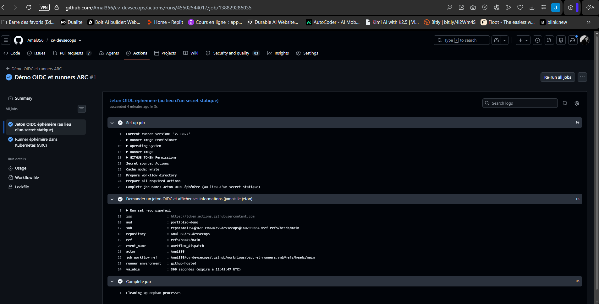
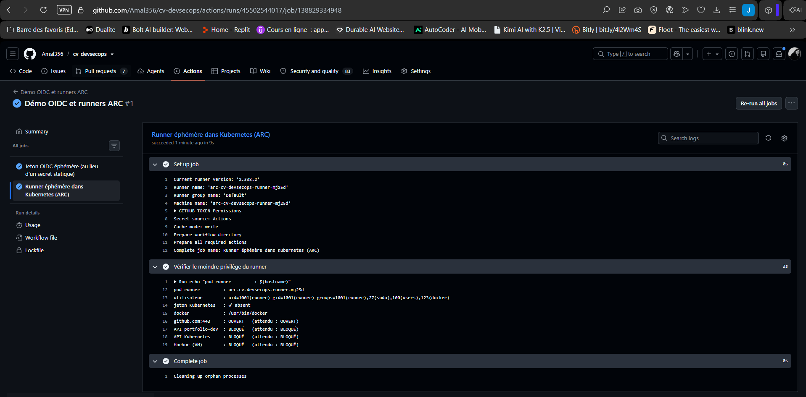

# Activité 9 – Partie 52 : CI/CD sécurisée – OIDC et runners éphémères dans Kubernetes (étapes 264 à 268)

> **État :** étapes 264 à 268 terminées. Le workflow [`oidc-et-runners.yml`](../.github/workflows/oidc-et-runners.yml) obtient un **jeton OIDC de 5 minutes** au lieu d'un secret statique, puis exécute un job sur un **runner éphémère** créé dans K3s par **ARC** (Actions Runner Controller 0.15.1) : un pod par job, détruit à la fin, sans jeton Kubernetes et sans accès réseau au cluster.

| Fichier | Contenu |
| :--- | :--- |
| [`../.github/workflows/oidc-et-runners.yml`](../.github/workflows/oidc-et-runners.yml) | job `oidc` (GitHub) puis job `runner-kubernetes` (`runs-on: arc-cv-devsecops`) |
| [`installer-arc.sh`](installer-arc.sh) | contrôleur ARC + scale set ; le jeton GitHub est lu au clavier, rangé dans un Secret, puis `unset` |
| [`arc/values-runners.yaml`](arc/values-runners.yaml) | runners éphémères, `minRunners: 0`, non root, sans jeton de ServiceAccount, sans Docker-in-Docker |
| [`k8s/00-namespace-runners.yaml`](k8s/00-namespace-runners.yaml) | namespace `arc-runners` en Pod Security **restricted** |
| [`k8s/01-networkpolicy.yaml`](k8s/01-networkpolicy.yaml) | sortie limitée au DNS et à Internet en 443 ; pods, Services et réseau de la VM interdits |
| [`preuves/268-pod-ephemere.txt`](preuves/268-pod-ephemere.txt) | cycle de vie du pod runner pendant le run #1 |

```text
 GitHub (Actions)                                   K3s (VM)
 ┌──────────────────────────┐   long polling   ┌───────────────────────────────────────┐
 │ job oidc  (ubuntu-latest) │ ◄──────────────  │ arc-systems : listener + contrôleur   │
 │  └ jeton OIDC 300 s       │                  │                                       │
 │ job runner-kubernetes ────┼── job assigné ──►│ arc-runners : pod runner éphémère     │
 └──────────────────────────┘                  │   non root, pas de jeton SA, 443 seul │
                                               │   détruit à la fin du job             │
                                               └───────────────────────────────────────┘
```

## Étape 264 – OIDC : un jeton éphémère au lieu d'un secret statique

**Problème du secret statique :** une clé d'accès cloud (ou un mot de passe de registre) rangée dans les secrets GitHub est **valable des mois**. Si elle fuit (log, dépendance compromise, fork), l'attaquant l'utilise depuis n'importe où, jusqu'à ce que quelqu'un pense à la révoquer.

**Avec OIDC :** le job demande à GitHub un **jeton JWT signé**, valable quelques minutes, qui décrit *qui* le demande. Le fournisseur cloud (AWS, Azure, GCP, Vault…) vérifie la signature et des conditions précises, puis délivre des droits temporaires. **Aucun secret n'est stocké.**

Seule la permission `id-token: write` est accordée au job (`permissions: {}` partout ailleurs). Le jeton est **masqué** (`::add-mask::`) et seules ses informations (claims) sont affichées :

| Claim | Valeur obtenue | Ce qu'un fournisseur cloud vérifie |
| :--- | :--- | :--- |
| `iss` | `https://token.actions.githubusercontent.com` | le jeton vient bien de GitHub |
| `aud` | `portfolio-demo` | il est destiné à **ce** service |
| `sub` | `repo:Amal356/cv-devsecops:ref:refs/heads/main` (avec identifiants numériques) | seul **ce dépôt, sur `main`**, est accepté |
| `job_workflow_ref` | `…/oidc-et-runners.yml@refs/heads/main` | seul **ce workflow** est accepté |
| `event_name`, `actor` | `workflow_dispatch`, `Amal356` | lancement manuel, par qui |
| validité | **300 secondes** | inutilisable après 5 minutes |



| | Secret statique | OIDC |
| :--- | :--- | :--- |
| Stockage | dans GitHub, à protéger | rien à stocker |
| Durée de vie | mois / années | minutes |
| Rotation | manuelle, souvent oubliée | automatique (un jeton par job) |
| Portée | tout ce que la clé permet, d'où qu'on l'utilise | conditions sur dépôt, branche, workflow, environnement |
| En cas de fuite | à révoquer en urgence | expiré presque aussitôt |

## Étape 265 – Le jeton d'ARC à droits minimaux

ARC doit s'enregistrer auprès de GitHub. On utilise un **jeton fine-grained dédié** (`arc-runners-cv-devsecops`) : **un seul dépôt** (`cv-devsecops`), **une seule permission** (*Administration : read and write*, nécessaire pour enregistrer des runners), **expiration 7 jours**. Il est saisi au clavier par `installer-arc.sh`, stocké dans le Secret `arc-github-pat`, jamais dans Git ni dans une capture.

Problèmes rencontrés :

- **401 Unauthorized** : le jeton avait été collé deux fois (184 caractères au lieu de 93) ;
- **403 Forbidden** : un jeton d'un autre TP (portée et permissions différentes) avait été utilisé. Règle retenue : **un jeton par usage**, jamais réutilisé.

En production, on préfère une **GitHub App** : jetons d'installation renouvelés automatiquement (1 h), permissions fines, non liée au compte d'une personne.

## Étape 266 – Installation d'ARC

```bash
./installer-arc.sh
kubectl -n arc-systems get pods     # arc-gha-rs-controller-…  Running ; arc-cv-devsecops-…-listener  Running
```

- Le **contrôleur** surveille les ressources ARC ; le **listener** garde une connexion longue avec GitHub et demande des runners quand un job attend.
- `minRunners: 0` : **aucun pod** n'attend en permanence (le listener calcule `"assigned job"=0 … currentRunnerCount=0`).
- **Pas de Docker-in-Docker** : DinD exige un conteneur **privilégié**, interdit en PSS restricted. Les images sont construites par Jenkins ou par les runners GitHub.

## Étape 267 – Moindre privilège du runner



| Vérification | Résultat | Pourquoi |
| :--- | :--- | :--- |
| utilisateur | `uid=1001(runner)` | `runAsNonRoot`, `allowPrivilegeEscalation: false`, capacités `drop: ALL`, seccomp |
| jeton Kubernetes | ✔ **absent** | `automountServiceAccountToken: false` : le job ne peut pas parler à l'API du cluster |
| `github.com:443` | **OUVERT** | nécessaire pour récupérer le code et les actions |
| API `portfolio-dev:4000` | **BLOQUÉ** | NetworkPolicy : les pods (10.42.0.0/16) sont interdits |
| API Kubernetes | **BLOQUÉ** | les Services (10.43.0.0/16) sont interdits |
| Harbor sur la VM (10.0.2.15:8090) | **BLOQUÉ** | le réseau de la VM (10.0.2.0/24) est interdit |

> Remarque honnête : l'image officielle `actions-runner` contient le **binaire** `docker` et place l'utilisateur dans les groupes `sudo` et `docker`. Sans démon ni socket Docker, le binaire ne peut rien faire, et `allowPrivilegeEscalation: false` (bit *no_new_privs*) rend `sudo` inopérant. Pour aller plus loin : une image de runner personnalisée sans `sudo` ni client Docker.

## Étape 268 – Runner éphémère

Pendant le run #1, un pod a été **créé pour le job** puis **détruit** dès la fin ([preuve](preuves/268-pod-ephemere.txt)) :

```text
arc-cv-devsecops-runner-mj25d   0/1   Pending             0s
arc-cv-devsecops-runner-mj25d   0/1   ContainerCreating   0s
arc-cv-devsecops-runner-mj25d   1/1   Running             2m1s
arc-cv-devsecops-runner-mj25d   0/1   Completed           2m18s
arc-cv-devsecops-runner-mj25d   0/1   Terminating         2m18s
```

Un runner **persistant** garde fichiers, caches et processus d'un job à l'autre : un job malveillant peut y laisser une porte dérobée pour le suivant. Un runner **éphémère** repart d'une image propre à chaque job.

## Risques d'un runner auto-hébergé sur un dépôt public

Sur un dépôt **public**, n'importe qui peut ouvrir une PR depuis un fork. Si un workflow déclenché par `pull_request` tourne sur un runner auto-hébergé, le **code de l'inconnu s'exécute dans notre réseau**. Mesures appliquées ici :

- le workflow est **`workflow_dispatch` uniquement** : seul un mainteneur le lance ;
- runners **éphémères**, **non root**, **sans jeton Kubernetes**, **isolés par NetworkPolicy** ;
- `permissions: {}` par défaut, `contents: read` seulement pour le job du runner.

À ajouter en production : *Require approval for all outside collaborators* (Settings → Actions), un **groupe de runners** limité à certains dépôts et workflows, et un cluster ou nœud **dédié** aux runners.
